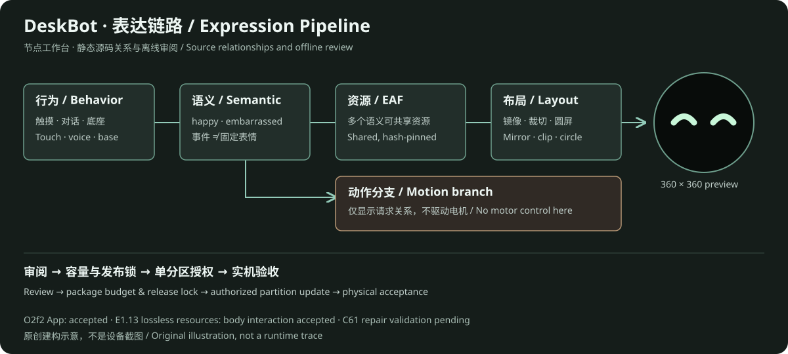
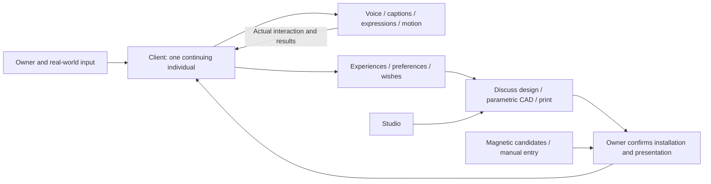

# DeskBot Hardware

[简体中文](README.md) · [English](README.en.md)

**One continuing individual, with shared experiences taking physical form.**

Firmware and Studio built on ESP-VoCat. The client owns life, memory and growth; the device senses and expresses. Studio authors and installs presentation resources. Identity and relationships persist across shell changes; magnetic readings suggest candidates and the owner confirms installation.

## Progress · November 27, 2026

**The current milestone is a complete path from replacement artwork to device installation.** Layered r8 and the alarm fix are installed; the expression workbench has passed host validation. XiaoZhi voice, shared memories, Wi-Fi touch and owner-confirmed shell changes have physical acceptance. The separate client develops autonomous life and growth. See the [mainline](docs/project-mainline.md), [architecture](docs/architecture.md) and [publication record](docs/publication-20261127.md).

| Area | Available now | Next |
| --- | --- | --- |
| Device | E3f-9d.7 daily interactions, cold boot and charging accepted; alarm fix installed and verified | Voice alarm acceptance, sustained use and battery feedback |
| Layered expressions | r8: 29 semantics, 480-to-360 scaling, complete performances, independent eyes, listening overlay and base insertion fixes | Physical r8 playback, overlay and base reconnection |
| Studio | GIF/EAF/PNG upload, mirroring, 360 preview, production-format compilation, capacity checks, paired installation and recovery | Physical browser installation and previous-version recovery |
| Body and client | USB/Wi-Fi expressions, touch records and installation synchronization; credential renewal and restore tested | Hotspot reconnection, actual login startup and sustained use |
| Voice and daily use | XiaoZhi life queries, voice sharing and corrected shared-memory recall accepted; unified background deployed | Joint experience of actual life and wishes |
| Shell and growth | Owner-confirmed A/B installation accepted; simulated magnetic baseline saved; client develops autonomous life | Real shell fabrication, fitting and repeated calibration |

Current device: **E3f-9d.7 baseline + layered r8 + alarm fix**, 32 MiB Flash / 16 MiB PSRAM. Assets use 3,993,973 B, leaving 4,394,635 B in the 8 MiB partition; the current App is 4,603,008 B. The implicit daily 08:00 alarm is disabled and was checked after reboot. New alarm voice controls, physical r8 playback and browser installation/recovery await owner acceptance. Accepted versions and device recovery records remain local. [Expression integration](docs/layered-face-integration.md) · [Alarm management](docs/alarm-management.md)

## Studio and previews



| Entry | Purpose |
| --- | --- |
| [Layered expression preview](artifacts/layered-face-20261124-r8/index.html) | Current 29 expressions, independent eyes, interruption and exit |
| [Expression creation and replacement](docs/expression-pipeline.md) | Upload, trace the real pipeline, compile, install and restore |
| [Current Studio guide](docs/layered-face-integration.md) | Connection, resource preview, device playback and acceptance |
| [Historical DeskBot Studio preview](artifacts/deskbot-studio-e3d2-20261105/index.html) | Nodes, assets, characters, publishing, device state, snapshots and live catalogs |
| [Node previews](artifacts/expression-node-preview-e1-19-20261024/index.html) | Inspect animations, compare replacements and trace changed connections |
| [Character expression editor](artifacts/role-expression-workbench-e1-31-20261029/index.html) | Map expression semantics to resources per character |
| [Catalog and draft comparison](docs/deskbot-studio-e3d1-20261105.md) | 28 expression semantics, 18 EAF files, motion bindings and previews |
| [Live device catalog](docs/deskbot-studio-e3d2-20261105.md) | Paged reads in one USB session, complete digests and connection state |
| [USB guide](docs/deskbot-studio-e3c6-20261105.md) | Local startup, state queries and expression receipts |
| [Visualization index](docs/visualizations.md) | Previews, reviews and machine-readable reports |

Current local entries: [8782 Studio](http://127.0.0.1:8782/#connection), [expression creation](http://127.0.0.1:8782/expressions/), [layered expressions](http://127.0.0.1:8782/layered-face/) and [4311 companion and shared memories](http://127.0.0.1:4311/companion). Studio uses one USB owner. The daily background service combines XiaoZhi tools, the original store, touch and Wi-Fi expressions. The client has its [own repository](https://github.com/404-NOT-FOUND-ERROR/DeskBot).

Public HTML previews open directly. These commands start the older E3d2 public preview at 8772:

```powershell
python -m pip install -r tests/requirements-body-facts-validation.txt
& .\scripts\start-deskbot-studio-e3d2.ps1
```

The start script checks Offline Python and the IDF Python with pyserial. On another computer, use `serve-deskbot-studio-e3d2.py --public --serial-python <Python path with pyserial>`. The page retains official previews, the historical E1.18 snapshot and a separate live catalog. Asset provenance and licenses are listed in [THIRD_PARTY.md](THIRD_PARTY.md).

## Product flow



This is the full product target. Body networking and XiaoZhi life integration have passed acceptance. Continuous life and real fabrication follow the sequence below.

## Development sequence

1. **Complete current acceptance**: r8 performances, listening overlay, base reconnection, voice alarm queries/cancellation, browser installation and recovery.
2. **Improve daily operation**: actual login startup, hotspot reconnection, sustained use and battery/charging feedback.
3. **Improve natural interaction**: retain XiaoZhi and the continuing individual store; jointly validate actual life and wishes with the client.
4. **Integrate life and wishes**: client development validates autonomous life; both projects verify actual experiences and grounded wishes.
5. **Fabricate and adopt a real shell**: design, parametric CAD, print/fit checks, matching assets and installation continuity.

Each increment follows scope → offline tests → isolated builds and comparisons → backup/deployment → physical acceptance. See the [development plan](docs/development-plan-20261104.md), [architecture](docs/architecture.md) and [action guide](docs/development-pipeline-20261102.md).

Development uses one serial owner. Versions, resources and recovery entries are listed in [baseline status](docs/baseline-status.md). GitHub updates follow larger stable milestones.

## Development checks

```powershell
python scripts/check-publication.py
python scripts/run-offline-checks.py
```

Portable checks use Python 3.11+; native C/C++ tests require a compiler. Firmware uses ESP-IDF 5.5.5; see [firmware/body](firmware/body/README.md). On the development Windows machine, run `scripts/preflight-deskbot-toolchain.ps1` first. Tests, builds, installation records and physical acceptance are recorded separately.

| Directory | Contents |
| --- | --- |
| `firmware/body` / `firmware/releases` | S3 firmware, locked dependencies and N32R16 target |
| `firmware/base` | Historical C61 additions and upstream references |
| `protocol` | Body facts, shells, characters, expressions and USB contracts |
| `scripts` / `tools` / `tests` | Builds, Studio, diagnostics and regression tests |
| `artifacts` / `docs` | Public previews, results, architecture and plans |
| `gateway` | Early client connection prototype |

O2f2 and E1.13 remain historical acceptance anchors. Device backups, NVS, raw serial logs, credentials and build caches stay local. See the [publication record](docs/publication-20261127.md).

## Licensing

New project documentation, protocols and tools use [MIT](LICENSE). ESP-VoCat, XiaoZhi, ESP-IDF components, fonts and third-party animations retain their licenses; see [THIRD_PARTY.md](THIRD_PARTY.md).
