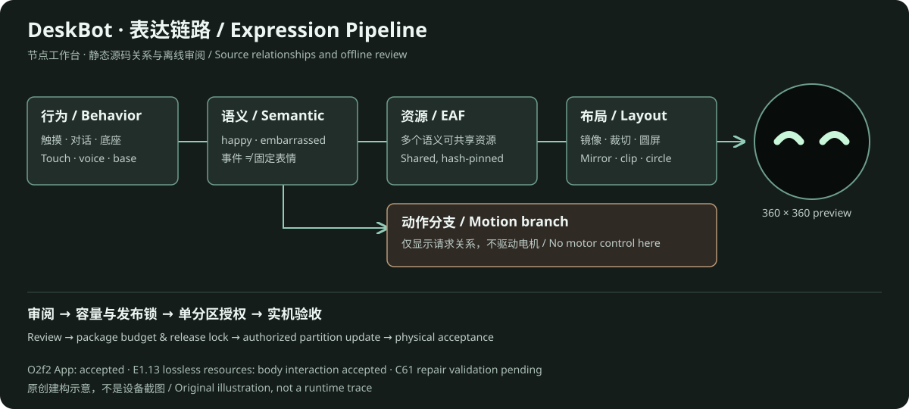
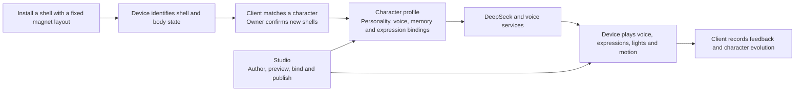

# DeskBot Hardware

[简体中文](README.md) · [English](README.en.md)

**A new shell, a new character for your desktop companion.**

Firmware and expression tooling built on ESP-VoCat. The device recognizes shells, reports body state and performs expressions. A desktop client manages characters, voice and memory. Studio provides expression and motion authoring, previews, bindings and packaging.

## Progress · November 5, 2026

| Area | Available now | Next |
| --- | --- | --- |
| Device | XiaoZhi voice, head touch, circular expressions and official motion; E3c-8 installed, readback, restart and live state verified | Neutral request and interaction acceptance |
| Studio | Node/circular previews, drafts, packaging, state and receipts; E3d-1 adds verified resources beside character drafts | Live device catalog; neutral acceptance when online |
| USB interface | One serial owner; sessions, state queries and neutral requests; offline catalog paging verified | E3d-2 device snapshot and paged reads |
| Storage | N32R16: 32 MiB Flash, 16 MiB PSRAM; active expressions migrated to an 8 MiB partition | New shy animation and character packages |
| Shell recognition | Fixed A/B layouts, removal/reinstallation, stable windows and confidence validated | Reinstallation tests and persistent registration after base repair |
| Character client | Offline body-fact, character-binding and expression contracts | Character confirmation, then DeepSeek and voice services |

The device runs **E3c-8 App + E1.40 bootloader + E1.18 assets + upper-assets-8m partition table**. App readback, boot, restart and live USB state queries passed. The neutral request and physical interactions await an online idle session. Exact E3c-7 recovery and the accepted E1.42 App are retained. See [E3c-8 results](docs/deskbot-studio-e3c8-20261105.md). See [baseline status](docs/baseline-status.md) and the [changelog](CHANGELOG.en.md).

## Studio and previews



| Entry | Purpose |
| --- | --- |
| [DeskBot Studio](artifacts/deskbot-studio-e3d1-20261105/index.html) | Nodes, assets, characters, publishing, device state and catalog comparisons |
| [Node previews](artifacts/expression-node-preview-e1-19-20261024/index.html) | Inspect animations, compare replacements and trace changed connections |
| [Character expression editor](artifacts/role-expression-workbench-e1-31-20261029/index.html) | Map expression semantics to resources per character |
| [Catalog and draft comparison](docs/deskbot-studio-e3d1-20261105.md) | 28 expression semantics, 18 EAF files, motion bindings and previews |
| [USB guide](docs/deskbot-studio-e3c6-20261105.md) | Local startup, state queries and expression receipts |
| [Visualization index](docs/visualizations.md) | Previews, reviews and machine-readable reports |

Download the repository to open public HTML previews, or run Studio locally:

```powershell
python -m pip install -r tests/requirements-body-facts-validation.txt
& .\scripts\start-deskbot-studio-e3d.ps1
```

The start script checks Offline Python and the IDF Python with pyserial. On another computer, use `serve-deskbot-studio-e3d.py --public --serial-python <Python path with pyserial>`. Open `http://127.0.0.1:8766/`. Public previews include official assets; the catalog currently comes from the verified E1.18 snapshot. Packaging and USB observation use the inputs described in the guide. Licensing for the shy candidate images is being reviewed; public artifacts retain provenance, bindings and capacity data.

## Product flow



This is the product target. Current work connects Studio to the head unit. Shell registration resumes after base repair; client integration and service replacement follow.

## Development sequence

1. **Complete expression and interaction acceptance**: [E3c-8](docs/deskbot-studio-e3c8-20261105.md) provides verified live state queries. Once online and idle, verify neutral receipts, screen playback, conversation, menus, head touch and sleep/wake.
2. **Expose the installed catalog**: [E3d-1](docs/deskbot-studio-e3d1-20261105.md) completes offline catalog and draft comparisons. Build E3d-2 device snapshots and paging offline, integrate after online acceptance, then add pure expressions and existing motions.
3. **Complete shell registration**: fixed-layout reliability, persistent profiles, confirmation and naming.
4. **Connect character profiles**: map shell IDs to characters, load expression/motion bindings and show the active character.
5. **Integrate DeepSeek and voice**: connect speech recognition, Agent and speech synthesis incrementally, then character evolution.

Each increment follows scope → offline tests → isolated builds and comparisons → backup/deployment → physical acceptance. See the [development plan](docs/development-plan-20261104.md), [architecture](docs/architecture.md) and [action guide](docs/development-pipeline-20261102.md).

## Development checks

```powershell
python scripts/check-publication.py
python scripts/run-offline-checks.py
```

Portable checks use Python 3.11+; native C/C++ tests require a compiler. Firmware uses ESP-IDF 5.5.5; see [firmware/body](firmware/body/README.md). On the development Windows machine, run `scripts/preflight-deskbot-toolchain.ps1` first. Tests, builds, installation records and physical acceptance are recorded separately.

| Directory | Contents |
| --- | --- |
| `firmware/body` / `firmware/releases` | S3 firmware, locked dependencies and N32R16 target |
| `firmware/base` | Historical C61 additions and upstream references |
| `protocol` | Body facts, shells, characters, expressions and USB contracts |
| `scripts` / `tools` / `tests` | Builds, Studio, diagnostics and regression tests |
| `artifacts` / `docs` | Public previews, results, architecture and plans |
| `gateway` | Early client connection prototype |

O2f2 and E1.13 remain historical acceptance anchors. Device backups, NVS, raw serial logs, credentials and build caches stay local. See the [publication record](docs/publication-20261105.md).

## Licensing

New project documentation, protocols and tools use [MIT](LICENSE). ESP-VoCat, XiaoZhi, ESP-IDF components, fonts and third-party animations retain their licenses; see [THIRD_PARTY.md](THIRD_PARTY.md).
