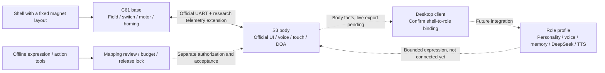

# DeskBot Hardware

[简体中文](README.md) | [English](README.en.md)

**Making interchangeable magnetic shells recognizable and expressive parts of a desktop companion.**

A hardware and firmware research project built on ESP-VoCat. The accepted XiaoZhi baseline keeps voice interaction, dual-microphone direction following, head touch, circular-screen expressions and base motion intact. Incremental work adds magnetic shell observations, body-fact contracts and desktop expression/action tooling. A separate client will eventually own character profiles, voice, personality and memory; firmware supplies physical facts and bounded expression capabilities.

> **Status, 2026-10-24:** the O2f2 App and the body interaction regression after the E1.13 assets deployment passed user acceptance ([acceptance record](docs/e1-13-acceptance-20261024.md)). E1.13 losslessly re-encoded only `insert.eaf` and `eat.eaf`; C61/base repair validation and the client chain remain separate stages. This is not an official firmware release or an all-in-one flashing image.

## Visual Workbenches


| Entry | What it shows | Boundary |
| --- | --- | --- |
| [E1.4d node workbench](artifacts/expression-node-workbench-e1-4d-20261021/index.html) | Behavior → semantic → EAF → circular layout, action branches and candidate overlays | Static source relationships and offline preview, not a runtime trace |
| [E1.9 binding matrix](artifacts/expression-binding-matrix-e1-9-20261022/index.html) | Reused animations, trigger paths and resources needing review | An undiscovered trigger is not proof that an asset can be deleted |
| [E1.10 compression review](artifacts/expression-e1-10-review-20261022/index.html) | Candidate review, lossless optimization and capacity | Browser preview is not LCD acceptance |
| [E1.14 binding decisions](artifacts/expression-binding-decision-e1-14-20261024/index.html) | 56 node routes, protection categories, shared impact and the E1.13 capacity baseline | Offline review only; no removal, replacement or motion authorization |

GitHub does not execute HTML file pages. Clone the repository and open these self-contained pages locally, or run `python -m http.server 8080 --bind 127.0.0.1` and visit their paths. See the [visualization guide](docs/visualizations.md).

Official previews remain available. The external shy research candidate retains mapping, provenance, hashes and budget metadata only; its media is withheld pending redistribution-license confirmation. The illustration above is original, not a device screenshot.

## Architecture



Solid lines describe current hardware or offline tooling relationships. Dashed lines are integration goals. A magnetic change is not a confirmed character change: unknown, ambiguous, stale and unstable observations remain explicit and require a user-confirmed binding.

## Results and Limits

| Area | Available result | Still pending |
| --- | --- | --- |
| Official body baseline | User-accepted O2f2 preserves product UI, voice, touch, sleep/wake, dual-mic DOA and motion | C61/base repair validation is separate |
| Base facts | Semantic mapping, fixed snapshots, a 24-record ring and read-only `self.echo_base.events` | Whole-device retest after repair; no new control tool |
| Magnetic recognition | XYZ telemetry, stable windows, confidence, known/unknown observations, RAM profiles and read-only `self.shell.identify` / `self.shell.list` | No NVS profile storage; independent fixed-layout C validation is missing |
| Client contracts | Body facts, role binding, registration review, record receiver schemas and offline prototypes | No live production client, DeepSeek or replacement TTS integration |
| Expression tooling | EAF codec/compression checks, source-binding export, layered nodes, circular preview, package budget and release locks | No arbitrary hot swapping or automatic physical actions |
| E1.13 | Still 29 package members; package reduced from 5,889,001 B to 5,538,349 B; body interaction accepted | Original visuals only, not new shipped expressions; C61/client stages are separate |
| E1.14 | Five core, three shared and ten individually protected resources; candidate isolation; trigger/layout/motion branches | Static evidence, not per-route runtime observation; [single-semantic review next](docs/expression-binding-decision-e1-14-20261024.md) |

The current App has **no historical R9 research settings pages, shell-registration UI or persistent profile storage**. Experimental history is not the current accepted capability. See [status and hashes](docs/baseline-status.md) and the [feature inventory](docs/feature-inventory.md).

## Roadmap

1. **Review bindings before adding variety:** E1.14 documents protection decisions and node branches, with 605,651 bytes remaining. Next, review the offline single-semantic `surprised → shocked.eaf` proposal, retaining shared `Happy.eaf` and official motion mapping.
2. **Replace one resource at a time:** retain high-quality masters and derive player-compatible EAF files; check package size, decoded frame/pixel equivalence, partition boundaries and rollback before device acceptance.
3. **Validate shell observations:** fixed layouts A/B/C, removal, repeated reattachment, movement recovery and unknown states, before persistence.
4. **Integrate the client:** body facts and read-only role status first; confirmed role binding and expression scheduling next; replace the XiaoZhi service with client-side DeepSeek/TTS last.

[Stage gates](docs/roadmap.md) · [Architecture and concurrency](docs/architecture.md) · [Verification workflow](docs/reproducible-workflow.md)

## Quick Start

Offline checks require Python 3.11+ and no device:

```powershell
python -m pip install -r tests/requirements-body-facts-validation.txt
python scripts/check-publication.py
python scripts/run-offline-checks.py
```

To build the body, initialize ESP-IDF **5.5.5**, then run:

```powershell
.\scripts\build-body.ps1
```

The entry point **builds only and never flashes**. This public path has not yet received an independent full firmware build, and byte-identical reproduction of the accepted local App is not claimed. Read [firmware/body/README.md](firmware/body/README.md). `firmware/base` is a partial historical snapshot, not a complete base project.

## Repository

| Path | Content |
| --- | --- |
| `firmware/body` | O2f2 input snapshot, dependency lock, configuration and source manifest |
| `firmware/base` | Historical C61 changes, patches and upstream boundaries |
| `protocol` | Body facts, magnetics, role and transport contracts; host implementations |
| `scripts` / `tools` | Current offline research tools / earlier diagnostics; audit hardware tools separately |
| `artifacts` | Selected self-contained visualizations and de-identified replay examples |
| `tests` | Portable host checks and historical integration suites with prerequisites |
| `docs` | Architecture, results, roadmap, publication checks and screenshots |
| `gateway` | Earlier gateway scaffold, not the connected production client |

This publication excludes full Flash, NVS, device identifiers, raw serial logs, credentials, build caches and local absolute paths. See [publication scope](docs/publication-20261023.md). No full-chip erase is performed; S3 and C61 always require separate identification and authorization.

## License and Provenance

New project documentation, protocols and tools use [MIT](LICENSE). ESP-VoCat, XiaoZhi, ESP-IDF components, fonts and third-party animations retain their own licenses. The root license **does not relicense third-party assets**. See [THIRD_PARTY.md](THIRD_PARTY.md) for upstream pins and research-asset restrictions.
