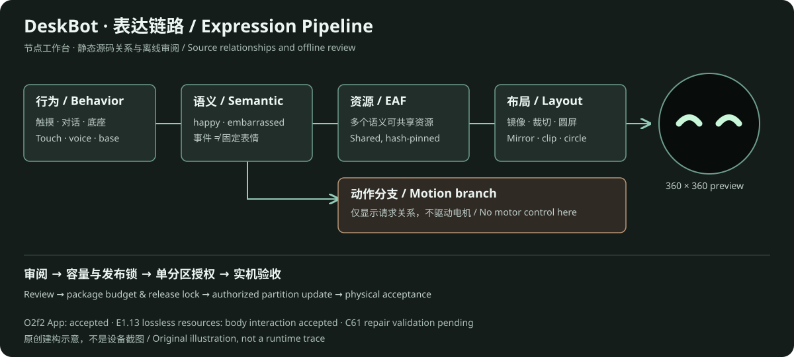
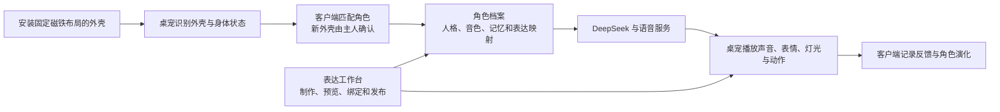

# DeskBot Hardware

[简体中文](README.md) · [English](README.en.md)

**换一个外壳，让桌宠成为新的角色。**

基于 ESP-VoCat 的桌宠固件与表达工作台。桌宠识别外壳、提供身体状态并执行表达；电脑客户端管理角色、声音和记忆；工作台用于制作、预览、绑定和发布表情与动作。

## 当前进度 · 2026-11-05

| 部分 | 已有成果 | 接下来 |
| --- | --- | --- |
| 桌宠本体 | 保留小智语音、摸头、圆屏表情和官方动作；E3c-8 已安装，回读、重启和状态查询通过 | 平静表情与交互验收 |
| 表情工作台 | 节点与圆屏预览、角色草稿、打包、状态与回执；E3d-1 新增已核对目录和草稿对照 | 接入设备实时目录；联网验收平静请求 |
| USB 接口 | 单串口所有者；会话、状态查询、平静请求；目录分页协议已离线验证 | E3d-2 设备快照与分页读取 |
| 资源容量 | N32R16：32 MiB Flash、16 MiB PSRAM；活动表情区已迁至 8 MiB | 新害羞表情与角色资源包 |
| 外壳识别 | A/B 固定磁铁布局、移除与装回、稳定窗口和置信度已有验证 | 底座修好后的拆装测试与持久登记 |
| 角色客户端 | 身体事实、角色绑定与表达协议已有离线实现 | 角色确认，再接 DeepSeek 与语音服务 |

设备当前使用 **E3c-8 App + E1.40 bootloader + E1.18 资源 + upper-assets-8m 分区表**。App 回读、启动、重启和 USB 状态查询通过；平静请求与人工交互待联网验收。E3c-7 原样恢复入口和已验收 E1.42 均已保留。见[E3c-8 结果](docs/deskbot-studio-e3c8-20261105.md)、[当前基线](docs/baseline-status.md)与[更新日志](CHANGELOG.md)。

## 工作台与可视化



| 入口 | 用途 |
| --- | --- |
| [DeskBot Studio](artifacts/deskbot-studio-e3d1-20261105/index.html) | 节点、素材、角色、发布、设备状态与资源目录对照 |
| [节点预览](artifacts/expression-node-preview-e1-19-20261024/index.html) | 查看动画、替换前后效果及旧连接与新连接 |
| [角色表达编辑器](artifacts/role-expression-workbench-e1-31-20261029/index.html) | 为不同角色编辑语义与动画映射 |
| [资源目录与草稿对照](docs/deskbot-studio-e3d1-20261105.md) | 28 个表情语义、18 个 EAF、动作关联和逐项预览 |
| [USB 使用说明](docs/deskbot-studio-e3c6-20261105.md) | 本机启动、状态查询与表情回执 |
| [完整可视化索引](docs/visualizations.md) | 各阶段的预览、审阅和机器报告 |

下载仓库后可直接打开公开 HTML，或启动本机工作台：

```powershell
python -m pip install -r tests/requirements-body-facts-validation.txt
& .\scripts\start-deskbot-studio-e3d.ps1
```

启动脚本分别核对离线环境与串口环境，页面地址为 `http://127.0.0.1:8766/`。新电脑可使用 `serve-deskbot-studio-e3d.py --public --serial-python <含 pyserial 的 Python 路径>` 启动公开版。公开版包含官方资源预览；打包与 USB 连接环境见使用说明。目录目前来自已验证的 E1.18 快照。新害羞候选的图像授权正在核对，公开页面保留来源、映射和容量数据。

## 完整产品链路



图中是整体目标。当前重点是打通工作台与本体；底座修复后继续外壳登记；客户端连接与服务替换随后进行。

## 后续开发顺序

1. **完成表情与交互验收**：[E3c-8](docs/deskbot-studio-e3c8-20261105.md)已接通真实状态查询；联网回到待机主页后，验证平静请求、回执及对话、菜单、摸头和睡眠唤醒。
2. **开放真实表达目录**：[E3d-1](docs/deskbot-studio-e3d1-20261105.md)已完成离线目录与草稿对照；先做 E3d-2 设备快照和分页构建，联网验收后接入，再逐步开放纯表情与现有动作。
3. **完成换壳登记**：固定布局可靠性、档案保存、新外壳确认和命名。
4. **连接角色客户端**：外壳编号匹配角色，加载表达配置，显示当前角色。
5. **接入 DeepSeek 与声音**：依次接入语音识别、Agent 和语音合成，完善角色演化。

每轮完成：明确范围 → 离线测试 → 独立构建与差异核对 → 备份与部署 → 实机验收。见[完整开发计划](docs/development-plan-20261104.md)、[架构](docs/architecture.md)与[行动指南](docs/development-pipeline-20261102.md)。

## 开发与验证

```powershell
python scripts/check-publication.py
python scripts/run-offline-checks.py
```

离线检查使用 Python 3.11+；原生 C/C++ 测试需要编译器。固件使用 ESP-IDF 5.5.5，见 [firmware/body](firmware/body/README.md)。Windows 本机先运行 `scripts/preflight-deskbot-toolchain.ps1` 核对环境。测试、构建、安装记录和人工验收分别保存。

| 目录 | 内容 |
| --- | --- |
| `firmware/body` / `firmware/releases` | S3 固件、锁定依赖与 N32R16 目标配置 |
| `firmware/base` | C61 历史增量与上游说明 |
| `protocol` | 身体事实、外壳、角色、表达和 USB 契约 |
| `scripts` / `tools` / `tests` | 构建、工作台、诊断与回归测试 |
| `artifacts` / `docs` | 公开预览、结果、架构与路线 |
| `gateway` | 早期客户端连接原型 |

O2f2 与 E1.13 保留为历史验收锚点。现场备份、NVS、原始串口日志、凭据与构建缓存保存在本机。见[本次发布说明](docs/publication-20261105.md)。

## 许可与来源

本项目新增文档、协议与工具使用 [MIT](LICENSE)。ESP-VoCat、小智、ESP-IDF 组件、字体和第三方动画沿用各自许可证，见 [THIRD_PARTY.md](THIRD_PARTY.md)。
