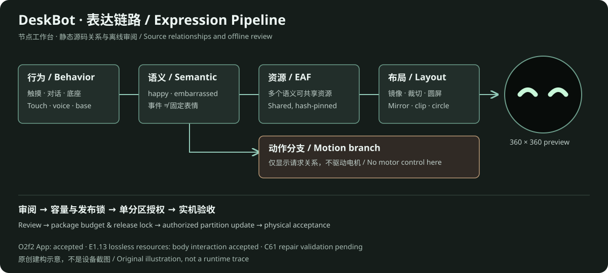
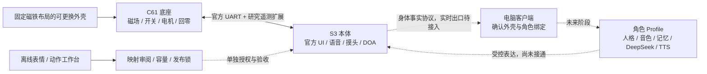

# DeskBot Hardware

[简体中文](README.md) | [English](README.en.md)

**让可更换的磁吸外壳，成为桌宠可识别、可表达的角色载体。**

基于 ESP-VoCat 喵伴的硬件与固件研究：保留官方小智语音、双麦声源跟随、摸头、圆屏表情和底座动作，在稳定基线上增量验证磁场外壳识别、身体事实协议，以及电脑端表情与动作工作台。未来由独立客户端管理角色、人格、音色和记忆，固件提供身体事实与受控表达能力。

> **状态 · 2026-10-24**：O2f2 App 与 E1.13 资源部署后的本体交互均已由用户验收通过（[验收记录](docs/e1-13-acceptance-20261024.md)）。E1.13 只对 `insert.eaf` / `eat.eaf` 做无损重编码；底座维修后的 C61 运动/磁场，以及客户端链路仍是独立阶段。本仓库不是官方发行版，也不提供可盲刷的全片镜像。

## 可视化工作台



| 入口 | 可以查看什么 | 边界 |
| --- | --- | --- |
| [节点工作台 E1.4d](artifacts/expression-node-workbench-e1-4d-20261021/index.html) | 行为 → 语义 → EAF → 圆屏布局；动作分支；候选与官方映射分层 | 静态源码关系与离线预览，不是设备运行轨迹 |
| [绑定矩阵 E1.9](artifacts/expression-binding-matrix-e1-9-20261022/index.html) | 多个语义复用同一动画、触发入口与待审查资源 | “未发现入口”不等于可直接删除 |
| [压缩对照 E1.10](artifacts/expression-e1-10-review-20261022/index.html) | 候选动画、无损资源优化与容量审阅 | 电脑预览不等于 LCD 播放验收 |

GitHub 文件页不执行 HTML。克隆后直接打开这些自包含页面，或运行 `python -m http.server 8080 --bind 127.0.0.1` 后访问对应路径。详见 [可视化导览](docs/visualizations.md)。

公开工作台保留官方动画预览；害羞研究候选因素材再分发许可待确认，只保留映射、来源、哈希和容量数据，不包含其图像。上图为原创架构示意，不是设备截图。

## 整体链路



实线表示现有硬件/离线工具关系，虚线表示尚未贯通的客户端目标。**识别到磁场变化不等于确认新角色**；未知、歧义、过期和不稳定必须显式保留，由用户确认绑定。

## 已有成果

| 模块 | 当前结果 | 未完成项 |
| --- | --- | --- |
| 官方身体基线 | O2f2 保留产品 UI、语音、摸头、睡眠/唤醒、双麦 DOA 与动作；用户已验收 | C61/底座维修后的能力另行验收 |
| 底座事实 | 语义映射、固定快照、24 条有界事件环、只读 `self.echo_base.events` | 维修后的整机复验；不是新增控制接口 |
| 磁场识别 | XYZ 遥测、稳定窗口、置信度、已知/未知识别与 RAM 档案；只读 `self.shell.identify` / `self.shell.list` | 档案不写 NVS；缺少第三种固定布局 C 的独立验证 |
| 客户端契约 | 身体事实、角色绑定、登记审核、记录接收器的 schema 与离线原型 | 尚未接入真实客户端、DeepSeek 或新 TTS |
| 表达工具链 | EAF 编解码/压缩校验、源码绑定导出、节点工作台、圆屏预览、容量与发布锁 | 不支持任意资源热替换，不自动执行动作 |
| E1.13 | 29 个包成员不变；资源包从 5,889,001 B 减至 5,538,349 B；本体交互验收通过 | 只优化原动画，不是新增表情；C61/客户端不在本次范围 |

当前 App **不包含**历史 R9 研究设置页、外壳登记 UI 或持久化档案。历史实验保存在 Git 历史，不作为当前稳定能力。详见 [状态与哈希](docs/baseline-status.md)、[功能表](docs/feature-inventory.md)。

## 开发路径

1. **梳理绑定再扩充表情**：E1.13 本体验收已通过；下一步区分语义、触发、资源、布局与动作，保留必要回退，不因复用 `Happy.eaf` 就直接改官方行为。
2. **单资源受控替换**：先在工作台审阅一项资源，再进行当前播放器兼容性、容量和回退验证。
3. **外壳识别可靠性**：底座修复后验证固定布局 A/B/C、移除、重复拆装、运动恢复和未知状态，再讨论持久化。
4. **接入客户端**：先传身体事实与只读角色显示，再接角色确认、表达调度；最后替换小智后端为客户端的 DeepSeek / TTS。

[完整路线与阶段闸门](docs/roadmap.md) · [架构与并发约束](docs/architecture.md) · [每轮验证方法](docs/reproducible-workflow.md)

## 快速开始

离线检查（Python 3.11+，无需连接设备）：

```powershell
python -m pip install -r tests/requirements-body-facts-validation.txt
python scripts/check-publication.py
python scripts/run-offline-checks.py
```

本体构建需要已初始化的 ESP-IDF **5.5.5** 环境：

```powershell
.\scripts\build-body.ps1
```

构建入口**只构建、不刷写**。公开路径尚未独立完整构建，不承诺与本机已验收镜像逐字节一致；当前构建输入和验证边界见 [firmware/body/README.md](firmware/body/README.md)。`firmware/base` 仅为历史增量资料，并非完整底座工程。

## 目录与安全

| 目录 | 内容 |
| --- | --- |
| `firmware/body` | O2f2 本体工程输入快照、依赖锁、配置与来源哈希 |
| `firmware/base` | C61 历史增量、补丁及上游边界说明 |
| `protocol` | 身体事实 / 磁场 / 角色 / 传输契约与纯主机实现 |
| `scripts` / `tools` | 当前离线研究工具 / 早期诊断工具；硬件操作须单独审查 |
| `artifacts` | 筛选后的自包含可视化与脱敏回放样例 |
| `tests` | 可移植主机测试，以及注明前置条件的历史集成测试 |
| `docs` | 当前架构、结果、路线、公开验证报告与截图 |
| `gateway` | 早期网关骨架，不是已接通的正式客户端 |

完整 Flash、NVS、设备标识、串口原始日志、凭据、构建缓存和本机路径不进入本次发布。发布范围见 [publication-20261023.md](docs/publication-20261023.md)。不执行全片擦除；S3 与 C61 始终独立识别与授权。

## 许可与来源

本项目新增文档、协议和工具使用 [MIT](LICENSE)。ESP-VoCat、小智、ESP-IDF 组件、字体及第三方动画继续遵守各自许可证，根 MIT **不重新授权第三方资产**。上游锚点、资源归属和研究示例的限制见 [THIRD_PARTY.md](THIRD_PARTY.md)。
