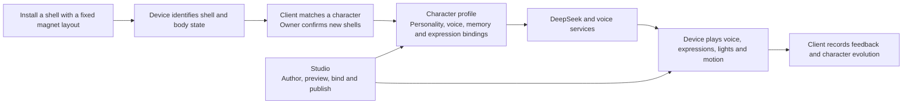

# DeskBot Hardware

[简体中文](README.md) · [English](README.en.md)

**A new shell, a new character for your desktop companion.**

Firmware and expression tooling built on ESP-VoCat. The device recognizes shells, reports body state and performs expressions. A desktop client manages characters, voice and memory. Studio provides expression and motion authoring, previews, bindings and packaging.

## Progress · November 10, 2026

See the [project status](docs/project-status-20261110.md) for the implementation, validation scope and remaining work toward the product goal.

| Area | Available now | Next |
| --- | --- | --- |
| Device | XiaoZhi dialogue, touch, sleep and official motion remain; E3f-4c / E1.18 layout switch and menu were accepted | Verify the installed E3f-4e with E1.45 assets |
| Expression Studio | Node previews, asset replacement, packaging, capacity checks, live catalog, eat/neutral requests | Connect role nodes to playback and per-asset layouts |
| Device link | USB identity, session, display status, catalog and playback receipts | Enable shy and common expressions; extend integration tests to 37 entries |
| Shell and character | Shell recognizer, confidence and first labeled post-repair magnetic samples; offline character binding contract | Repeat-install evaluation, saved registration and client role switching |
| Dialogue services | XiaoZhi remains active on-device; a DeepSeek text gateway skeleton exists | Connect client personality, ASR/TTS and character voices |

Device record: **E3f-4e App + E1.45 assets**. App readback, protected regions, boot identity, the 37-entry catalog and three dispatches passed; circular-screen and daily interaction checks are pending. The first-frame fix has 80 player tests, 34 deployment/transaction tests, paired builds and independent review. The next work completes expression playback, then shell/character integration and dialogue services.

## Studio and previews


| Entry | Purpose |
| --- | --- |
| [DeskBot Studio](artifacts/deskbot-studio-e3d2-20261105/index.html) | Nodes, assets, characters, publishing, device state, snapshots and live catalogs |
| [Node previews](artifacts/expression-node-preview-e1-19-20261024/index.html) | Inspect animations, compare replacements and trace changed connections |
| [Character expression editor](artifacts/role-expression-workbench-e1-31-20261029/index.html) | Map expression semantics to resources per character |
| [Catalog and draft comparison](docs/deskbot-studio-e3d1-20261105.md) | 28 expression semantics, 18 EAF files, motion bindings and previews |
| [Live device catalog](docs/deskbot-studio-e3d2-20261105.md) | Paged reads in one USB session, complete digests and connection state |
| [USB guide](docs/deskbot-studio-e3c6-20261105.md) | Local startup, state queries and expression receipts |
| [Visualization index](docs/visualizations.md) | Previews, reviews and machine-readable reports |

Download the repository to open public HTML previews, or run Studio locally:

```powershell
python -m pip install -r tests/requirements-body-facts-validation.txt
& .\scripts\start-deskbot-studio-e3d2.ps1
```

The start script checks Offline Python and the IDF Python with pyserial. On another computer, use `serve-deskbot-studio-e3d2.py --public --serial-python <Python path with pyserial>`. Open `http://127.0.0.1:8772/`. The page includes official previews, the verified E1.18 snapshot and a separate live-catalog section. Live reads follow E3d-2 deployment and acceptance. Packaging and USB observation use the inputs described in the guide. Licensing for the shy candidate images is being reviewed; public artifacts retain provenance, bindings and capacity data.

## Product flow



This is the product target. Current work completes expression playback and node control. The base is repaired; shell registration has its own schedule, followed by client character and voice integration.

## Development sequence

1. **Complete expression execution**: verify E3f-4e, enable shy/common expressions, and connect role nodes, per-asset layouts and the live catalog.
2. **Expand assets and motion**: publish selected new assets and add independent requests and combinations for existing motions.
3. **Complete shell-to-character switching**: repeat-install tests, saved profiles, owner confirmation and client character activation.
4. **Integrate personality and voice**: connect the client Agent, speech recognition and synthesis, then memory and character evolution.

Each increment follows scope → offline tests → isolated builds and comparisons → backup/deployment → physical acceptance. See the [development plan](docs/development-plan-20261104.md), [architecture](docs/architecture.md) and [action guide](docs/development-pipeline-20261102.md).

The local workbench runs E3f-4b with one serial owner. Versions, resources and recovery entries are listed in [baseline status](docs/baseline-status.md). GitHub updates follow larger stable milestones.

## Development checks

```powershell
python scripts/check-publication.py
python scripts/run-offline-checks.py
```

Portable checks use Python 3.11+; native C/C++ tests require a compiler. Firmware uses ESP-IDF 5.5.5; see [firmware/body](firmware/body/README.md). On the development Windows machine, run `scripts/preflight-deskbot-toolchain.ps1` first. Tests, builds, installation records and physical acceptance are recorded separately.

| Directory | Contents |
| --- | --- |
| `firmware/body` / `firmware/releases` | S3 firmware, locked dependencies and N32R16 target |
| `firmware/base` | Historical C61 additions and upstream references |
| `protocol` | Body facts, shells, characters, expressions and USB contracts |
| `scripts` / `tools` / `tests` | Builds, Studio, diagnostics and regression tests |
| `artifacts` / `docs` | Public previews, results, architecture and plans |
| `gateway` | Early client connection prototype |

O2f2 and E1.13 remain historical acceptance anchors. Device backups, NVS, raw serial logs, credentials and build caches stay local. See the [publication record](docs/publication-20261105.md).

## Licensing

New project documentation, protocols and tools use [MIT](LICENSE). ESP-VoCat, XiaoZhi, ESP-IDF components, fonts and third-party animations retain their licenses; see [THIRD_PARTY.md](THIRD_PARTY.md).
