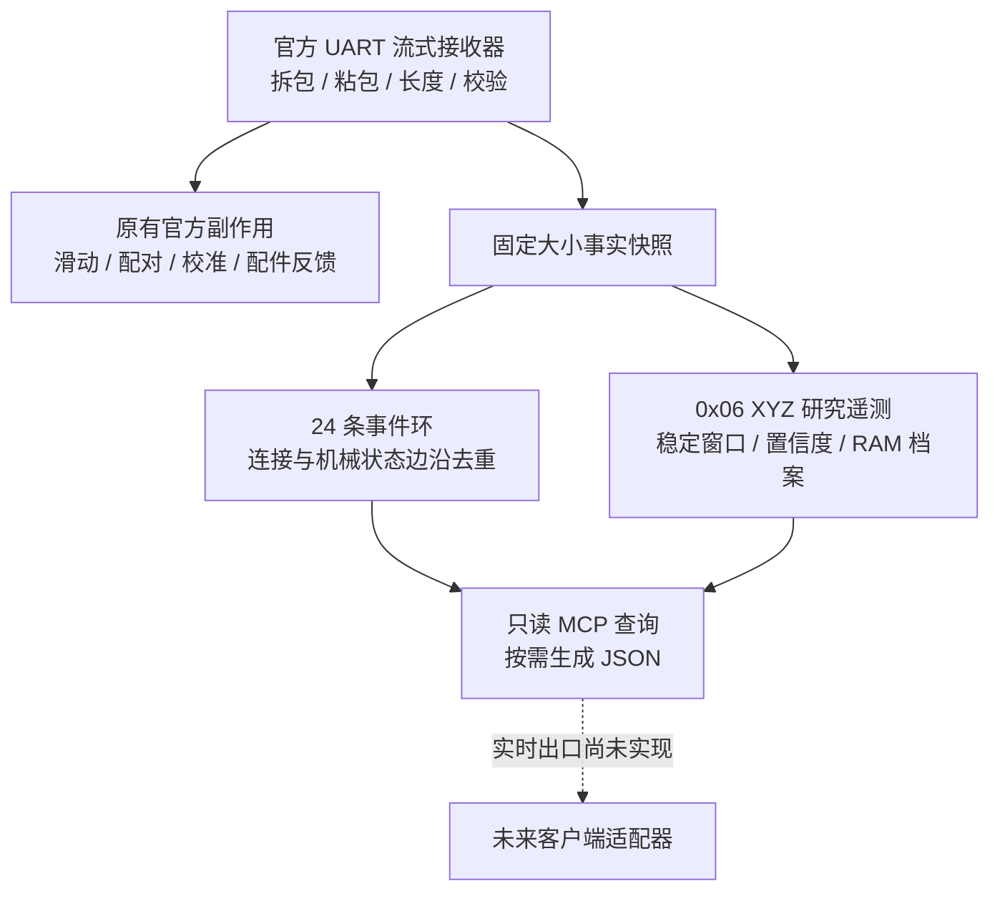
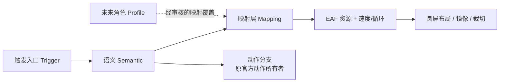

# 固件与客户端架构 / Architecture

2026-11-17 分工：自主生活由客户端开发完成，统一管理世界、决策、经历、兴趣、愿望与持续个体。本仓承担身体感知、表现执行、角色内容及硬件接入。双方通过输入事件、表现请求和执行回执连接；具体接续以[当前主线](project-mainline.md)为准。

[安装同步运行接入](client-installation-runtime.md)已完成：共享工作台在设备保存后自动向原客户端提交安装记录，共用原 SQLite 和设备登记。单一后台任务按安装编号及摘要核对凭证，网络请求在设备锁外执行；卡片分别显示设备保存、客户端接收及历史时间。当前运行端口为客户端 `4314`、共享工作台 `8782`、唯一 USB 所有者 `8780`。[形态采用模块](client-role-adoption.md)已离线联测，原服务启用接续下一轮。

2026-11-17：[4b2b 真实中文语音](xiaozhi-real-voice-4b2b.md)在 [4b2a 协议接缝](xiaozhi-voice-seam-4b2a.md)上接实际 WebSocket、Opus 和 Windows 中文听写／发声，复用原 `/api/voice/asr` 与 Node／SQLite。自动断句和按包发送保留独立回合代次，失败回合关闭连接以结束设备收音。同个体共用串行适配器，转写编号、时间与内容固定后恢复；当前电脑联测使用合成输入和固定模型回复。绑定、恢复、设备网络和常驻运行与客户端接入共同安排。

当前产品范围见[完整产品体验评估](product-journey-20261116.md)，核心规则见[成长与实体化流程](product-experience-20261116.md)。现实输入折射进平行世界，个体通过自主生活形成愿望，与主人完成形象、参数化制作和打印。主人确认安装后采用整套角色；磁场提供线索与候选，复测稳定后按设置简化自动匹配。旧壳可恢复对应形态与表达，记忆、关系和能力延续。

首版服务主人与少量体验者，设置与打印可协助；日常桌宠联网即可使用，制作和调试时再开电脑。[最小日常版设计](daily-experience-v1-20261116.md)已定义上手、交流、安静与返回，拟新增近况、偏好和回合取消接口。后台采用项目维护常驻服务的设计，每位体验者独立 Node 与运行目录，世界、认知预算、实验、配置和缓存分别隔离，网关绑定并路由主人和设备；具体主机按用量选定。USB 首环先核对共享状态与表达，网络与统一语音随后实现。

[4a 联合评估](joint-capability-assessment-4a.md)确定 Node/SQLite 集中保存生活与实际结果，Python 提交认知选择，设备负责感知和表达。首环复用 HTTP 设备登记、聊天与输出队列，接共用表现协调入口和现有 USB；4b1a 离线联测完成；4b1b 平静／开心四次真实 USB 下发、原队列确认与主人画面及日常交互验收通过。语音先验证小智兼容服务路线，状态与模型调用共同接入客户端。当前默认启动路径尚未启用正式连续 Python 认知，ASR/TTS sidecar 仍为模拟实现。

2026-11-16 接入基线：[DeskBot 客户端](https://github.com/404-NOT-FOUND-ERROR/DeskBot/tree/0d8d4c5daf261446735b049c6f385981ffd96b21)与硬件固件共同开发。静态核对已确认生活、多元输入、记忆和成长相关模块；持续自主生活的整体效果仍在开发验证。主人确认同一个体持续生活，换壳改变形态与表达，记忆和关系延续。首轮优先复用 Node/SQLite 与已验收设备能力，按输入、处理、表达和回执的联合结果确定接口与分工，见[接入设计](client-hardware-integration-20261116.md)。

外壳工作台 [S1c / S2a](shell-workbench-s1c-s2a.md)在电脑端串起采集任务 → 原日志 → S1a 评估 → S1b 档案 → 表达绑定与切换预演。`SessionStore` 持有本机项目写锁，核对修订，原日志独立留存。既有磁匹配和自动调度已离线联测；首版目标改为候选辅助与主人安装确认，手动确认可独立于磁档案完成。设备继续复用角色启用接口，固件沿用 E3f-9d.3。

[S1d 采样操作单](shell-field-guide-s1d.md)从保存的项目生成下一任务，准备项经版本核对后原子保存。未知对照名称从首份对应样本起固定；采样覆盖、识别匹配和绑定版本分别计算。电脑端预览为 8780，8779 保持原设备连接。

2026-11-13 验收记录：**E3f-9d.3 App + 双角色包**，工作台 **8779**。COM4 安装、App 回读、其余 Flash、NVS 和启动身份核对通过。主人确认主页、菜单刷新流畅，两角色表情、切换和日常操作正常；启动及运行日志无显示发送错误。USB 连接下两次开关启动正常，早期偶发黑屏本轮未复现。[实机记录](display-clock-e3f9d3.md#实机结果)。当前接续顺序见[主线](project-mainline.md)。

启动显示另有早期现象：USB 连接时偶发背光亮但黑屏，语音仍运行；成功开屏后雪花随新内容逐块消失。后续核对屏幕复位、初始化返回值和显示适配器就绪后的首次全屏传输，比较完全断电与软件重启。详见[启动排查](display-corruption-e3f9d2.md#补充开机黑屏与开屏残留)。

近期主线：两套表现、文字到表情首环与 A/B 主人确认安装已验收，电脑真实中文音频链路已离线验证，客户端安装自动同步已运行。形态配置已接入原聊天、ASR 与 TTS 的离线副本：回合开始保存快照，录音开始固定安装编号，重试与恢复沿用原配置；音色请求与服务实际回报分别记录，110 项离线测试通过。接续原服务启用、角色内容与制作项目；设备联网与常驻运行按接入需要安排。A/B 模拟磁铁 Demo 基线已保存，真实外壳完成后补拆装校准；设备继续使用 EAF 播放器。[Grok Bot 评估](grok-bot-source-review-20261111.md)记录来源与格式。

[E3d-1](deskbot-studio-e3d1-20261105.md)完成 E1.18 目录核对、角色草稿对照和离线分页协议：28 个表情语义、18 个独立 EAF、5 种动作、1 个聆听状态动画。E3d-2 已把实时目录接入工作台，与 E1.18 快照分开展示。

[E3f-5 害羞入口](studio-shy-e3f5.md)从 E3f-4e 冻结源码只开启已有配置，保留进食、逐素材布局、首帧修复、菜单 DMA 处理及原 USB 节奏。211 项离线、30 项浏览器、32 项部署测试、双配置构建和独立复核通过。E3f-5 日常交互和 E3f-6 节点画面与菜单均已获主人验收，作为双角色链路的现有表达基础。

[E3f-6 节点布局联动](role-node-layout-e3f6.md)在电脑端接通角色解析、总览、预览和节点播放。素材登记核对文件名、摘要和宽高；新服务显式接入登记和 37 项留存目录，原版本继续使用历史快照。节点与实时按钮共用连接、忙碌状态和新鲜查询，每次点击使用独立编号，变更后取消等待。

[E3f-7 常用表情](studio-common-e3f7-results.md)已安装，能力从三项扩展到八项，新增开心、难过、困倦、困惑、惊讶。385 项 Python/原生、19 项播放流程、40 项浏览器检查、32 项部署测试、双配置构建与独立复核通过。App 增加 112 B，内部静态数据保持 65,168 B；原资源、调度、附带动作、USB 接收、菜单 DMA 和播放器继续沿用。恢复从本轮原字节返回 E3f-5，并保留恢复时的 NVS。

## 当前状态

[E3f-2 总览](role-expression-overview-e3f2.md)复用角色解析器，以同一连接快照核对全部 29 项表达。分析模式在命令构造前返回；实际播放仍由单项入口重新核对。全角色未接线时，已核验目录仍显示当前资源。角色、接线、来源、目录、会话或有效状态变化后清空旧结果。42 项离线测试和 36 项浏览器检查通过。

[E3f-3 整链联测](role-expression-flow-e3f3.md)将生产 HTTP、部署事务、目录构建与 C++ 调度接到同一内存 Flash，14 项测试通过。实际 App 字节决定接口版本；安装或重启后清空连接与目录，重新读取。目录、显示和请求沿用同一设备会话；回退顺序为 App → 资源，并保留当下 NVS。原生显示入口的调度结果与圆屏播放分别验收。

COM4 当前 App 为 **E3f-9d.3**，资源为 E3f-9b 双角色包，沿用 E1.40 bootloader 与 `upper-assets-8m` 分区表。显示采用 PSRAM DMA 直接发送、20 MHz QSPI、4,092 B 分块和队列深度 2，保留 E3c-3b 发送错误返回、首帧重排和原 USB 接收任务。本轮 App 恢复使用 `tmp/e3c-live-20261113-e3f9d3-live1/` 的原字节，资源和 NVS 保留。

后续表情、通信、音频与任务增量都按[显示与菜单检查表](development-pipeline-20261102.md#显示与菜单开发检查)评估异步完成路径、连续内存与联网负载；每份实测记录绑定当前 App 和实际操作。

E1.43b-2 在 E3c-3a 上完成三分钟自动映射、释放和原 App 恢复。[E3c-3b 探针](expression-e1-43b2-current-baseline-design-20261107.md)双配置构建与独立审计通过：关闭版精确复现已验收 App，开启版只增加 4,864 B，内部静态数据相同。本轮[资源读取专项](resource-read-specialty-20261108.md)复用该探针，8 块和 19 次采样通过，映射页数 189 → 61 → 189，随后精确恢复 E3d-2b。当前目录、平静回执与日常交互复测通过，平静画面稍后确认；资源安装的离线计划与测试通过。历史结果见[自动记录](../artifacts/expression-continuous-mmap-e1-43b2-e3c3a-20261107/live-result.json)与[人工记录](../artifacts/expression-continuous-mmap-e1-43b2-e3c3a-20261107/manual-verification.json)。

当前设备提供 USB 会话、`state` 和 `display` 查询。[E3c-4b](studio-display-e3c4b-20261108.md)从 E3c-3b 组装单项显示查询，播放器创建、释放时更新 8 B 镜像，由原 USB 任务复制并回复。双配置构建、9 项候选原生测试、11 项部署测试与独立复核通过，开启版 App 为 4,490,272 B。[E3c-4a](studio-display-e3c4a-20261107.md)保留为历史离线候选。hello 的 edition 字段沿用 E3b；具体 App 版本按 App/ELF SHA-256 识别。

COM4 单帧探针的会话 / 显示 / 关闭约 2.7 / 3.2 / 3.1 秒，含探针写入与刷新。固件沿用每 10 ms 读取 1 B；[电脑时序](studio-usb-timing-20261108.md)已将请求等待设为 8 秒、完整关联回复的有效期设为 2 秒，并计入本机进程传递耗时。生产 worker 连续查询与重连通过，显示往返约 3.34–3.41 秒。

[E3c-5b](studio-neutral-e3c5b-20261108.md)在此基础上开放单个 `neutral` 请求，由原应用主循环调度，返回 `accepted` 与 `dispatched`。当前对应原有 `winking.eaf`，20 fps、单次播放；语义、资源、镜像和附带动作仍按现有映射核对。本轮只安装 App，恢复入口使用同轮保存的 E3c-4b 字节。

显示查询、进食/平静/害羞请求、逐素材布局和 E1.45 真实目录已接通。E3f-4e 首帧修复已验收，E3f-5 继承该实现；E3f-5 画面与日常交互已验收。E3f-6 工作台在 8776 使用，节点请求已接同一 USB 所有者；替换/撤销/重做与六次下发核对通过，主人确认画面与菜单正常。详见[节点实机记录](role-node-live-e3f6.md)。App 与资源分别保存回退，外壳识别独立排期。

## 逐素材布局

完整画面和镜像单眼分别定义布局。`eat.eaf` 使用居中、0/0、镜像关闭；其他素材恢复资源包原眼睛布局。App 按实际文件摘要登记，语义别名继承同一素材的布局；目录返回已启用的路由。

布局设置与原 Emote 播放共用图形锁和缓存。E3f-4c 在完整画面相关切换的首张图像准备好后重新对齐并完整刷新一次；EAF 元数据回调单独跳过。切换、资源卸载和新播放同步清理待重排状态。接口与测试见 [E3f-4c](expression-layout-e3f4c.md)。

E1.45 补查发现：同为 `eye_anim` 的素材仍可能高度不同。平静 160→害羞 200 的首帧覆盖问题由 E3f-4e 修复并沿用至 E3f-5，测试覆盖不同尺寸、快速切换和失败恢复；原对话也可能选择新害羞素材。E3f-4e 已验收，本轮 E3f-5 混合下发和主人画面与交互验收通过。

E3f-9a 已把布局清单随资源下发；当前双角色包沿用该机制，新增完整脸使用居中与独立镜像选项。E3f-6 原登记和 E1.18 对照仍保留历史布局。角色图中的片段、布局与镜像由设备播放器执行，工作台读取实际角色图摘要核对已装包。

## E3d-2 设备目录

资源所有者在成功挂载 EAF 后生成有界快照；最多 128 条、每页 2 条，快照放在 PSRAM。USB 会话复用 E3c 控制链路和单串口所有者，每次只有一条在途请求。显示查询在回复后间隔 1 秒；目录读取期间连续分页，完成或失败后补查显示。工作台收齐同设备、启动和会话的全部页并核对摘要后显示实时目录；E1.18 快照与实时结果分开展示。断线、会话过期或缺页后清空并重读。

目录、角色配置与播放能力分别记录。E3d-2b 返回 36 项：28 个表情语义、5 种动作、1 个聆听动画、2 个布局，使用 18 个独立 EAF；E3f-4c 起新增 `full_frame` 后为 37 项。E3f-5 已开放 `neutral`、`eat`、`embarrassed` 电脑请求，原有对话和触摸继续使用官方映射。

资源所有者同步构建快照，卸载前先失效，USB 在锁内复制页面。实机目录构建为 1,141 ms，快照为 68,296 B PSRAM；内部静态数据为 65,136 B，实测重启后的最低内部空闲为 10,616 B。后续增量继续核对运行内存与显示负载，详见[本轮设计与结果](studio-catalog-e3d2b-20261108.md)。

## E3f-1 害羞触发候选

显示回复新增可选 `expression_semantics`，声明可请求的 `neutral`、`embarrassed`；字段缺失沿用旧版平静能力，空数组表示没有可请求项。资源目录仍单独记录实际绑定。工作台依据同一会话的完整目录显示动画名称，点击及发送时分别核对最新能力。

害羞请求复用原队列与应用主循环。在同一锁和 ticket 下，从已接受请求复制语义到固定局部数组，锁外调用 `SetEmotion`。播放请求与目录读取串行处理，发送前再次核对读取状态。E1.18 的害羞绑定为 `Happy.eaf`；E1.45 为 `shy_candidate.eaf`；两者均沿用 `CAT_NUZZLE` 蹭蹭动作。回执表示调用播放器入口，底座动作完成另行报告。

新增配置默认关闭；候选从冻结 E3d-2b 组装四文件增量，沿用显示 DMA 修复及原 USB 任务。实现、验证和后续安装顺序见[E3f-1](studio-shy-trigger-e3f1.md)。

[安装工具](studio-shy-installer-e3f1.md)读取本轮 E1.45 资源安装记录，再重新读取全片并保存 App 计划。准备成功后保持下载模式，接续安装或启动原 App；写入意图先持久保存，随后复用原 App 事务。恢复独立读取本轮备份，保留当前 NVS 和 E1.45；每次操作分别编号归档。56 项内存模拟与事务测试通过，圆屏验收接续安排。

## 工作台资源发布

历史单角色包生成器以 E1.18 为基线，v1/v2 保留作复现。当前 [E3f-9b](unified-role-package-e3f9b.md) 从 E1.45 实际镜像组包：两角色草稿 → 角色图、逐资源布局与 EAF → 解包和容量核对。相同内容与布局可复用；不同镜像使用独立数据区。默认包 6.91 MiB，9c 已实现设备三段调度；设备启用与保存接续 E3f-9d。

资源镜像和固件分开构建。`firmware/releases/esp_vocat_n32r16/` 固定目标配置、分区 CSV 和 7 MiB 资源建议上限。隔离 App 构建核对同一分区表、模型、bootloader 与配置差异，不把资源放入通用 App 写入参数。验证记录分别标明离线生成、构建、设备写入和人工验收。

页面控件在初始化脚本之前生成，公开版和本机版均跑浏览器回归；新增布尔配置与旧构建比较时，只将明确列出的“缺省→关闭”单列，启用项仍按实际配置核对。执行步骤见 [E2b](deskbot-studio-e2b-20261104.md)。

## 表达目录与请求

E3d-1 将资源清单、接口能力和角色草稿分别保存。`deskbot.installed_expression_manifest/v1` 记录包、index、文件摘要和原动作映射；`deskbot.studio_catalog_page/v1` 沿用现有 USB 会话，每页 2 项、最多 128 项、单帧 2 KiB。电脑收齐并核对完整摘要后发布目录；断线或版本变化清空重读。原表达控制目录编号继续使用。设备侧按原资源所有者加载后生成有界快照、USB 任务复制回复的路径实现。

`deskbot.expression_catalog/v1` 保存语义、资源、布局、帧率、循环和现有动作；SHA-256 标识目录内容。E2c 目录来自 E1.18 版本记录，角色草稿修改后单独生成资源包。

`deskbot.expression_control/v1` 分别表达表情请求、动作请求、回执与底座事实。请求带目标、启动周期、会话、递增序号、目录摘要、角色、请求编号和有效期。模拟器最多保留 1 条待提交请求、24 条最近事件与 64 条去重决定；重连同步结果，同一编号重发返回原决定。

“已受理”进入队列，“已提交执行”交给表现模块。E3d-2b 已由生产工作台发送单个 `neutral` 并收到两级回执；当前对应 E1.18 的 `winking.eaf`。底座 `0x0010` 只提供动作完成事实，以独立事件展示；聆听动画由语音状态管理。

## 通信与任务归属（E3a 核对）

| 模块 | 现有入口与职责 | 增量接入方式 |
| --- | --- | --- |
| 云端语音 | 本体主动建立 WebSocket；音频与 MCP 共用现有云端通道；源码还保留 MQTT 路径 | 后续客户端适配按选定传输独立接入，保留官方认证与语音连接 |
| 应用主循环 | Application::Schedule 排队；MainEventLoop 处理状态、网络消息和已安排工作 | 新表达请求先做有界校验，再交给原所有者；主循环不等待长任务 |
| MCP | 收到 JSON-RPC 后由 DoToolCall 通过 Schedule 调用工具 | 本机工作台当前不是云端 MCP 主机；不把 USB 观察当成 MCP 调用 |
| 显示 | EmoteDisplay、ui_bridge 与 LVGL 适配器管理页面和动画 | 后续表达入口复用已有显示调度，先验证单个表情 |
| 音频 | AudioService 有输入、输出、编解码等独立任务和有界队列 | 保持音频所有权；语音产生的状态优先级单独定义 |
| 底座 | UART1 的官方组件解析帧；BaseControl 维护心跳、事实和原交互 | 动作继续交给底座；动作完成按无请求 ID 的事实处理 |
| USB 观察 | Application 状态变化日志、约十秒一次的 SystemInfo 内部 SRAM 摘要 | E3a 仅在电脑解析；逐行缓冲 2 KiB、24 条变化、30 秒数据有效期 |

来源：application.cc 的主循环、SetDeviceState 与 SendMcpMessage；protocols/websocket_protocol.cc 的 OpenAudioChannel；mcp_server.cc 的 DoToolCall；audio/audio_service.cc；display/emote_display.cc；boards/esp_vocat/base_control.cc。本轮未修改这些固件文件。

E3a 使用独立的 deskbot.body_observation/v1，只描述主机收到的日志和观察时段。它不填写缺失的设备 ID、固件版本、当前表情或底座状态；完整身体事实仍沿用 deskbot.body.v1。已保存的 E1.18 表达目录继续标为 saved_release_record、live=false。

### E3b 身份通道

当前控制台为 UART0 主输出、USB Serial/JTAG 辅输出。E3b 复用日志发送 `deskbot.device_link/v1` hello，独立任务优先级 1、栈 4 KiB、周期 10 秒，Kconfig 默认关闭。任务只读取身份、App 描述和容量；应用、UI、音频和底座各保留现有所有权。

电脑生成 `deskbot.body_observation/v2`：设备编号稳定，启动编号随重启变化；消息含版本、ELF 摘要、序号、运行时间与实际容量。按 2 KiB 行上限解析，身份 30 秒过期，重复与乱序不刷新时效，重连清理旧状态。设备目前只声明身份查询能力，目录仍使用保存的 E1.18 记录。

E3b 第二版已实测：首次启动与重启各收到 5 条身份消息，确认 32 MiB Flash / 16 MiB PSRAM；工作台断开后清理身份，重连后收到同一设备、本次启动的新序号。当前 libc 使用 nano 格式，64 位运行时间先转十进制文本；构建前的格式检查已纳入入口。

hello 是设备发现消息。后续双向接收单独绑定 USB 通道；`stdin` 仍属于主控制台，接收器选择须按实际驱动核对。云端 WebSocket 随语音会话开关；电脑持续表达连接使用独立生命周期。身体事实契约的 UTC 时间由客户端时钟补齐，hello 自带的是启动后毫秒数。

### E3c USB 会话层

[E3c-1](deskbot-studio-e3c-design-20261104.md)已加入默认关闭的 USB 诊断接收与会话层。28 项测试实际编译运行固件 C++，覆盖建立、保活、关闭、超时、重连、JSON 校验与分帧；原准备套件 83 项复测通过，合计 111 项。这是该阶段的离线结果；当前设备状态见页首。

两版隔离构建与审计通过：关闭版代码和数据与 E3b 相同；启用版 App 为 4,487,424 B，增加 4,000 B，分区剩余约 1.58 MiB。bootloader、分区表和模型产物一致，详见 E3c-1 的构建与审计报告。

USB 任务读取 basic VFS，优先级 1、栈 6 KiB。E3c-3a 保留每轮一次读取、让出 CPU 10 ms 的原节奏；实测中一次可能只返回 1 B。E3c-8 曾改为每轮最多读取 512 次、512 B，但其菜单出现卡死；这项读取策略另做增量对照。会话使用固定内存：每帧 2 KiB、残帧超时 2 秒、会话有效期 30 秒、回复最短间隔 250 ms。电脑每次逻辑重连生成新 nonce；USB 总线连接状态辅助清理残帧。会话回复的 `controls_available=false` 沿用原协议，单个表情能力由独立请求入口提供。

已核对 IDF 5.5.5：主控制台只读 UART0，USB VFS 的打开实例共用状态；接收适配保留现有驱动与全局模式。E3c-2 由应用状态和页面切换所有者向固定小型快照发布切换阶段及稳定值，USB 任务读取镜像快照。实际屏幕睡眠状态目前为未知，控制仍关闭。

E3c-2 的 132 项测试通过，实际快照存储为 56 B，新增任务为 0。启用版 App 为 4,488,144 B，比关闭版增加 720 B，分区剩余 1,655,856 B。关闭版代码和数据与冻结 E3c-1 相同；两版的 bootloader、分区表、模型与 OTA 初始数据一致。详见[本轮报告](deskbot-studio-e3c2-20261105.md)。

回退读取当轮备份、App 擦除范围、计划与状态日志，保持原计划编号；候选及构建目录缺失时仍可恢复。每次恢复单独保存结果。本机 E1.42 原字节已离线核验；串口执行使用固定 IDF Python，设备交互按 E3b 记录验收。

### E3c-3 只读状态查询

会话内 `state` 查询返回 `deskbot.studio_state/v1`：应用、页面、各自的版本与阶段、设备运行时间和会话身份。查询使用原 USB 任务和回复缓冲；复制快照后格式化 JSON，有效查询续期 30 秒，默认关闭的新配置依赖 E3c-2 快照。

电脑端 `RuntimeQueryClient` 由已有串口所有者调用，最多保存一个待回复和一份当前状态。请求与状态均按本地发送时间设置 2 秒上限；重连换 nonce，清空旧状态，校验请求、序号和身份。设备运行时间只用于顺序校验，独立于电脑计时。178 项离线测试与构建审计通过；历史 E3c-3 的实际查询未进入，后续对照见[菜单排查](ui-menu-regression-20261106.md)。

查询启用版 App 为 4,489,152 B，比关闭版增加 1,008 B，分区剩余 1,654,848 B。关闭版代码和数据与 E3c-2 相同，两版保护产物一致。离线构建审计未访问设备；后续实机尝试及恢复记录见[菜单排查报告](ui-menu-regression-20261106.md)。

#### 控制台与 USB 接收核对

UART0 是主控制台，USB Serial/JTAG 是辅助通道。历史 E3c-3 打开 `/dev/usbserjtag`，但其有效配置启用 `ESP_CONSOLE_SECONDARY_USB_SERIAL_JTAG`；IDF 5.5.5 在此模式注册 `/dev/secondary`，链接映射也包含该初始化函数。旧启动日志仅报告输入不可用，未记录 errno。见[本地证据审计](../artifacts/ui-menu-regression-20261106/e3c3-usb-path-audit.json)。

`stdin` 从主 UART 读取；直接打开 `/dev/secondary` 可读取 USB。修正按有效配置选择路径，保留控制台配置、驱动归属和原接收节奏。先验证持续接收任务下的菜单操作，再加入会话与状态请求；保存原有内部空闲内存和最低余量日志。E3c-1/2 菜单通过时接收任务已经退出，持续接收单独验证。后续读取预算、显示查询和表情请求逐项对照。

构建前按冻结源码、有效配置和 IDF 注册代码核对路径；启动检查包括 `USB input ready`，再核对会话回复。设备身份日志用于输出链路，App/ELF 摘要用于识别具体镜像。

离线安装计划与现场事务分别保存。现场预检重新核对设备身份，读取当前前缀并验证完整 Flash 摘要，保存当下 NVS；写前再次核对备份，写入范围仅为 COM4 App。恢复直接读取当轮原字节和事务日志。

后续接口沿用这条验证链：冻结源码 → 有效配置 → IDF 注册实现与链接结果 → 实际 App/ELF → 接收启动与真实回复 → 用户操作。路径、读取预算和业务请求分别验证。通信超时、UI 刷新等待及内存余量分别记录；每条结论附版本和测试范围。参考入口及本轮改进见[行动指南](development-pipeline-20261102.md#本轮经验落实)。

### E3c-4 显示条件查询

`display` 操作复用已有 USB 会话，返回 `deskbot.studio_display/v1`。回复包含应用、页面、播放器初始化状态和当前预览条件；原 `state` 回复保持原协议。

播放器创建和释放时更新 8 B 镜像，与应用/页面快照共用临界区；组合快照最多 32 B。USB 任务复制后再序列化，沿用 1 KiB 回复缓冲。电脑端复用原查询客户端的身份、时效、重放和重连检查。

当前公开播放器接口没有实际睡眠状态，回复记为 `unknown`；E3c-4 显示查询的 `controls_available=false` 保持原协议。请求能力由下一节的独立控制入口提供。见[E3c-4 结果](deskbot-studio-e3c4-20261105.md)。

### E3c-5 单个表情请求

默认关闭的 `DESKBOT_STUDIO_EXPRESSION_REQUEST_ENABLE` 依赖显示查询。现有 USB 线程解析 `deskbot.expression_control/v1`，校验设备、启动、会话、目录、角色、序号和有效期，然后通过原 `Application::Schedule` 提交一个 `neutral` 回调。

受理和执行前均要求应用空闲、主页稳定、播放器已初始化。会话关闭、排队超时或所有者状态变化时取消请求。实际睡眠保留 `unknown`，仅调用原 `SetEmotion("neutral")`；该语义映射 `winking.eaf`，没有底座动作。`accepted` 表示排队，`dispatched` 表示调用播放器 API，圆屏播放另行确认。

固定上限为一个待处理请求、一个保留回调、一个终态回执和 64 条去重记录；控制状态最多 12,000 B，USB 输入工作区最多 2,200 B。请求锁在调用调度器和播放器前释放；沿用已有 USB 任务。254 项专项与回归通过，构建和容量结果见[E3c-5](deskbot-studio-e3c5-20261105.md)。本轮没有访问串口或刷写设备，工作台按钮按下一增量接入。

## 分层与所有权

### E3c-6 电脑端接入

`observe-studio-body-e3c.py` 是唯一串口所有者，同时处理原日志、显式状态查询与一次平静请求。`ControlLink` 管理会话、2 秒状态时效和设备回执；`ControlBridge` 通过有界 IPC 连接本机 HTTP 服务。原 `/api/body/state` 保持 v2 只读投影；新增 `/api/studio/state` 与 `/api/studio/command` 承载控制状态。

页面每 750 ms 读取电脑端快照；USB 显示查询每秒一次，发送最短间隔 400 ms。连接、启用和表达分别由用户操作。重启或断开使旧连接失效，表达请求发送一次，最多保存 24 条回执、64 条去重记录。固件回复序号与表达回执序号分别校验；本机超时与设备回执分别显示。

工作台、原生产 C++ 入口及调度适配器已离线联调。E3c-6 历史验证使用 E3b；菜单排查先使用 E3c-2，随后以 E3c-3a 查询关闭版完成接收和 UI 对照。见[E3c-6 历史结果](deskbot-studio-e3c6-20261105.md)及[实机结果](ui-menu-regression-20261106.md)。

| 模块 | 职责 |
| --- | --- |
| C61 底座 | 电机、回零、限位、磁场传感器、磁吸开关、UART |
| S3 本体 | UI、音频、摸头、双麦 DOA、UART 事实镜像、表达播放与日常交互 |
| 电脑协议适配层 | 唯一 USB 所有者、身份与版本核对、M2 识别、设备命令与分阶段回执；接入客户端既有队列 |
| DeskBot 客户端服务 | Node 世界执行、SQLite 生活与记忆、Python 认知、来源分级、成长阶段、设备输出与语音服务适配 |
| 表达工作台 | 素材母库、表现配置草稿、节点预览、镜像、容量审阅、打包与发布 |



`0x06` XYZ 是研究扩展，需要匹配底座；不能称为官方默认协议。`base.action.completed` 没有请求 ID，不能捏造对应哪一次动作。高频心跳和磁场样本不进入事件环；官方副作用不被研究逻辑接管。事件列表不等于外壳身份列表。

[S1a 固定布局评估](shell-repeatability-s1a.md)在电脑读取带标记的历史日志，复用现有解码器和 M2 识别器。训练、评估和观察分别标注，以独立装配次数统计覆盖；取下与未登记布局分别评估。报告保存参数、输入摘要、误认和待补次数。当前已完成离线工具，现场采集接续双角色验收。

[S1b 档案保存](shell-profile-archive-s1b.md)保存电脑端登记数据、参数与来源。档案按传感器和安装基准校验；内容摘要与文件版本摘要分别核对，原子替换和路径锁管理写入。加载生成空采样状态的 M2 识别器，新的稳定窗口负责确认身份。设备 RAM 档案与实时角色绑定在后续接入。

现场采样按 [A/B 记录](shell-field-capture-20261113.md)同时保留磁性物品位置、安装方向、底座角度日志与逐窗身份确认。周边磁性物品布置变化后另建安装基准与项目，旧样本继续保留。识别评估结合匹配分数、竞争布局间距、窗口稳定性与独立装回结果；稳定读数也可能因环境或就位差异偏离登记值。

静止采样前结束对话并停在菜单页，暂停主页声源跟随；采样窗口同时核对本体转向指令和底座动作日志。同一次装配的补录按观察保存。后续实时换壳按运动状态与新稳定窗口共同确认身份，再提交角色切换。

2026-11-17 的 [A/B 模拟磁铁 Demo](shell-field-calibration-20261117.md)保留最后两窗共 319 条静置样本与角色关联，流程为磁场候选 → 主人确认安装 → 设备采用 → 客户端同步。实际外壳制作后补重复拆装、移除和未知布局验证；当前接续客户端人格与音色采用。

## UI 与并发约束

历史实验曾在对话和菜单切换时出现 UI 冻结。当前路线是退回已验收边界、拆开研究模块：

1. UART/音频/计时器回调不直接操作 LVGL、弹窗、资源切换或页面导航。
2. 回调只做有界解析与快照更新；持锁区不等待 UI、不做网络、不分配大对象。
3. 只读查询复制快照后释放锁，再生成 JSON，不反向调用 UI 或动作。
4. 同一增量不同时改显示播放器、音频管线、电机和协议；扩展必须使用原有所有者和调度机制。
5. 固定内存和队列上限；避免 UART 高频采样变成日志或通知风暴。
6. 新资源只更换指定包成员，播放器源码和分区布局保持独立闸门。

每轮验收包括对话中及结束后切菜单；源码、构建、回读、启动和人工交互分别记录。

## 表达不是一个文件名



`happy` 等语义与 `Happy.eaf` 资源分别定义：多个语义可以共享文件，角色配置可覆盖表达映射。当前 E1.45 的 `embarrassed` 已绑定 `shy_candidate.eaf`，25 fps、循环，附带 `cat_nuzzle`；E1.18 的旧绑定为 `Happy.eaf`。原对话可选择害羞，电脑已开放进食、平静和害羞三项入口，节点联动已验收。局部眼睛素材需结合镜像、裁切及播放器版本预览和验收。

E1.44 从官方 Happy 复制末尾 `_C` 标记，适配当前播放器的排他终点，图像数据保持原样。该处理绑定当前播放器版本；标记内容原样保留，不解释为局部循环。完整脸与单眼镜像是两份独立派生物：容量都满足 7 MiB 软上限，单眼版兼容当前镜像路由，完整脸需要独立布局。母库保留两者，正式包只加入选定资源。

E1.45 的完整 8 MiB 资源镜像已安装并回读，实际包 5,981,260 B。资源差异与恢复范围单独核对，现场部署使用当轮备份。设备画面和日常交互按安装版本验收。

圆形第二角色采用[可组合表情](grok-role-clips-20261111.md)：每个语义包含进入、持续、退出，完整脸关闭镜像，切换经过共享姿态。电脑调度合并连续选择；设备接入时沿用菜单、睡眠和对话的交互优先级。接点同时检查解码像素与邻帧运动；眼形近似需保留原轮廓差值，避免端点附近跳变。六种表情去重后为 1,244,597 B；[E3f-9b](unified-role-package-e3f9b.md) 已计算包含两角色图、布局和配置的实际包容量。

[E3f-8 运行角色](role-activation-e3f8.md)独立于编辑草稿和设备目录，以版本化角色目录解析六项语义。手动选择在电脑原子保存，服务重启恢复；文件锁确保一个写入者，修订号处理多页面冲突。关闭服务等待在途保存完成后释放文件锁。快速激活串行提交并保留最新目标；预览使用独立时钟，作者草稿暂停不影响角色播放。外壳确认后复用同一激活模块。

工作台样式与角色预览从 [E3f-8 视觉增量](workbench-style-and-role-packs-20261111.md) 接续到[全工作台视觉系统](workbench-visual-system-20261116.md)。`deskbot-workbench-system.css` 在最终构建器中统一语义变量与控件；新页面复用这些变量，深浅主题同步覆盖默认、悬停、选中、焦点与错误状态。新增样式后检查有数据页面与窄屏，避免只验空态。

`DeskBotWorkbenchMotion` 复用单一路由渲染，切路由取消旧动效；后台轮询只更新业务状态。折叠按实际高度过渡，关闭后恢复原生语义与焦点；减少动画即时收尾。切同角色表情时保留原画面、节点和时钟，新资源加载后才更新连接；切角色时保留旧画面及所属角色，资源可预览后再整体切换。设备命令继续由业务调度器发出。

[动画镜像选项](workbench-mirror-node-20261111.md)放在编辑页的动画资源内。逐素材登记决定自动默认：单眼勾选镜像，完整脸取消；手动选择按角色和资源保存，同一角色的引用共同采用。恢复自动、替换、撤销、复制和导入导出保持一致。原片可展开，历史对照保留历史布局；聆听使用系统布局。

草稿 v2 的 `mirror_overrides` 只保存手动选择。预览、角色解析和包内 `deskbot-layout.json` 采用同一结果；清单绑定资源名、SHA-256、尺寸和布局。报告核对能力要求与清单摘要，下载的二进制经解包复核。历史 E3f-7 采用原固定布局；当前 E3f-9d.3 沿用 `asset_layout_manifest_v1`，两角色镜像与画面已验收。角色页的运行预览与编辑草稿分别管理。

[E3f-9c](device-role-player-e3f9c.md)在资源装载时校验角色图与布局、摘要和帧数，角色表放入 PSRAM。播放按完成回调推进进入、持续、退出；连续选择保留最后目标。回调只向原应用队列交接代次，换片段在回调返回后执行。菜单与外层手势路径也通过队列交接，统一由 Emote 锁保护播放状态。暂停记录物理游标，恢复播放剩余段；卸载先停止并隐藏引用旧映射的对象。

本轮选择接口在设备内存中可用，电脑角色启用、设备回报和保存接续 9d。聆听与临时动画沿用原管理器，目标板睡眠状态在 9d 接入同一暂停入口。工作台分别显示编辑草稿、已安装资源包与设备确认的当前角色，再保存经过设备确认的选择。

9c 双配置构建通过：启用版 App 4,532,688 B，较关闭版增加 8,096 B，余量约 1.54 MiB；内部静态数据新增 16 B。角色表与播放状态使用 PSRAM，运行堆与显示负载接续实机核对。

新增控件先明确它帮助主人完成哪项操作，再设计界面；同一设置贯通编辑、预览、保存与生成，避免只展示状态而无法修改。

电脑素材母库与设备角色包分开管理。E1.45 原包为 5,981,260 B；圆团六种三段表情去重后为 1,244,597 B。[E3f-9b 实际包](../artifacts/studio-role-package-e3f9b/default-package-report.json)含角色图、布局、EAF 及索引，合计 7,249,690 B：距 7 MiB 建议线 90,342 B，距 8 MiB 分区 1,138,918 B。容量较紧，后续每次生成按所选资源重新核算；电脑保留完整素材库，设备只收角色实际引用。首次同步按“确认绑定 → 安装 → 回读成功 → 启用角色”执行。完整 23 款素材库约 12.43 MiB，由电脑保存并按需挑选。

每份素材的显示方式按内容明确登记，文件摘要绑定布局要求。完整画面采用居中、镜像关闭；单眼素材使用镜像布局。节点预览、发布审阅和设备目录分别核对当前与目标布局。当前 `eat.eaf` 是完整画面，共用镜像路由的修正见 [E3f-4c](expression-layout-e3f4c.md)；显示方式切换需要随下一份素材恢复。

## 客户端接入与持续身份

产品交付按[体验与开发计划](development-plan-20261104.md)组织：先完成相识、日常交流、离开返回与恢复，再走愿望、制作和安装。客户端服务处理持续生活，日常入口承接近况与交流，工作台制作内容，设备感知和执行；入口载体、联网通道与部署按联测细化。客户端设计与设备接口均可随联合结果调整，采样按既有记录接续。

身体事实、角色解析、客户端记录契约位于 `protocol/`。先快照、再增量，核对身份、时效与序号。磁场 `known` 表示当前档案候选，实际外壳由主人确认；传感观察与安装确认分别保存，形象方案同意、实物安装及角色生效各有状态。主人确认使用独立入口，未识别或读数不变时同样可安装。后续自动匹配复用该采用入口，依据有效档案、实测结果与主人设置启用。

持续身份沿用客户端 `character_id` / 对应 `actor_id`，成长阶段沿用 `world.role_stages`。现有工作台 `role_id` 是表现配置引用，`expression_role_id` 选择表达图，`shell_id` 表示实物；各自独立版本并显式映射。工作台人格字段接入时核对客户端当前设定，记忆、关系、任务和长期人格由客户端管理。协调层关联目标、设备实际表现、语音会话和保存结果；一句结束后切换表现，旧回复按会话代次处理。

[角色管理阶段 1](character-profiles-stage1.md)已实现 `deskbot.role_profile.v2` 与 `/api/characters/*`：配置保存于电脑的 `tmp/deskbot-character-profiles/profiles.json`，采用单写者、修订检查和原子保存。角色图与预览目录分别核对版本，旧档案来源保留。阶段 4 增加持续个体与表现映射，并接真实服务；现有配置继续作为制作草稿保存。

[阶段 2](shell-characters-stage2.md)以 `deskbot.shell_characters/v1` 和 `/api/shell-characters/*` 保存外壳、完整角色确认版本与采样来源，文件与角色库相邻。读取按“采样 → 角色 → 关联库”固定锁顺序取快照；角色或来源变化后重新确认。日常关联在 `#shells`，原项目与采样在 `#capture`。

离线换角协调器接显式时间、识别观察、交互状态和内存回执。稳定后选目标，说话和转动期间延后，连续换壳保留最新目标；断流重置计时，重连先查询设备再用新观察确认。目标、首帧和保存分别记录；表达回执保留语音服务待接入状态。原日志回放重跑识别器并解析独立窗口，连续时序用场景演练验证。

[阶段 3a](shell-switch-adapter-stage3a.md)在协调器外增加 `ShellSwitchAdapter`，I/O 沿用既有 USB 所有者。识别事实带连接身份、档案摘要与递增观察序号；正式适配核对已验证登记和完整角色版本。主机可选 `role_attempt` 关联命令与实际请求，直接拒绝核对外层编号，执行状态核对内层编号。首帧生效后继续等待保存；超时先查询，查询后再决定接续。内存联测使用生产主机编解码和调度，独立模拟设备生成回复。

[阶段 3b1](shell-switch-runtime-stage3b1.md)复用原接收器，将 `cmd=06` 放入 64 条磁场事件缓冲，经原接收时刻、连接身份和递增序号交给 M2；`ShellSwitchRuntime` 对接上述适配器。重复读取保留原时效，断流与转动后重新积累样本；发送前按原样本时间核对，已交接请求继续处理回执。`replay-session` 沿原间隔逐窗口连接内存设备，结果与配置版本保存。

[阶段 3b2](shell-switch-service-stage3b2.md)已有 `ShellSwitchService` 自动调度和内存设备联测：每 100 ms 调度，页面每秒只读，启停接口与固定锁序保留。当前实现仍按磁档案匹配驱动目标；新增主人安装确认和自动匹配选项尚待接入。现有 `shell_inputs()` 原子读取状态与磁场，转动来源与时效在 3b3 接续核对。新确认流程优先复用既有调度、版本检查与回执能力。

4b1a 已实现 HTTP 输出适配与共用表现协调入口，217 项离线测试通过；4b1b 已接现有 USB，四次表情提交、原队列确认及主人实机验收通过，见[4b1b 记录](client-expression-loop-4b1b.md)。`PresentationCoordinator` 使用原 `bridge.lock`，客户端、工作台与换角共用原命令入口及唯一 USB 所有者。角色绑定在输入回合创建时冻结，发送前核对版本与实际设备能力；SQLite 保存原输入、待发期限、提交准备、设备回执和 HTTP 确认。客户端补丁保存原回复与完整计划，重开接续原事件。接口、依赖与测试见[4b1a 实现](client-expression-loop-4b1a.md)。后续接设备网络、统一语音与自主生活；M2 磁场线索另接主人安装确认。

持续生活从接入阶段共同迭代：自主选择与实际结果形成偏好和愿望，主人讨论形象，参数化制作后确认安装与采用。磁场辅助先沿用本轮模拟 Demo 基线，真实外壳制作后补拆装校准，确认安装入口沿用已验收链路。旧壳、Wi-Fi、本地缓存、重启恢复与运行开销持续验证。具体顺序见[开发管线](development-plan-20261104.md#开发管线)。

## 存储、运行内存和更新边界

### N32R16 容量模型（E1.36）

COM4 已核实为 ESP32-S3 N32R16：32 MiB Flash、16 MiB PSRAM。当前 bootloader/App 声明 32 MiB，`upper-assets-8m` 表的活动资源位于 `0x1000000..0x1800000`，8 MiB 迁移已完成。物理容量、镜像配置、分区表与运行内存分别记录。以下保留 E1.36 至后续迁移的验证过程。

E1.36 离线审计将候选分成三类：`current-16m` 是精确回退；`capacity-only-32m` 只验证 32 MiB 配置而保持旧分区表和资源/模型地址逐字节不变；`upper-assets-8m` 是在 `0x1000000..0x1800000` 增加 8 MiB `assets`、保留旧资源和模型的几何布局候选。原位扩容并后移模型保留为比较路线。具体路线取决于寻址兼容性审计与实机映射结果。

容量审计页面见 [E1.36 N32R16 布局闸门](../artifacts/expression-storage-n32r16-e1-36-20261030/index.html)，报告和分区表生成均为离线操作；没有刷写、擦除、NVS 变更或 C61 访问。

### E1.37 构建结果与上半区寻址条件

[E1.37 容量对照构建](expression-capacity-build-e1-37-20261030.md) 已完成：16 MiB 控制 App 精确复现已验收 E1.26；32 MiB App 和 bootloader 各只改变容量字段及 32 字节摘要，全部可执行段与 App ELF 相同。App 为 4,477,280 B、分区余量 1,666,720 B。正式分区表、构建资源、模型和 OTA 初始数据逐字节相同，源码未改；构建通过不代表当前设备已升级。

32 MiB 选择会由 IDF 自动派生三个隐藏 bootloader 寻址配置；审计允许且仅允许这六项精确差异。E1.37 使用 QIO + auto-detect 编译配置，两个大地址缓存开关均关闭。IDF 5.5.5 将 `BOOTLOADER_CACHE_32BIT_ADDR_QUAD_FLASH` 标为实验选项，默认关闭且并非对所有 Flash 芯片稳定。**“Quad”在此仅指构建路径，不能描述物理 Flash**；E1.38 已从现场日志确认实际为 Octal OPI_STR。完整回读与镜像头 32 MiB 都不能证明 EAF 所依赖的上半区 mmap 能运行。

[E1.38 寻址与回退预检](expression-addressing-e1-38-20261030.md) 已离线完成。现场 JEDEC 为 `C2:8039`、MXIC、32 MiB Octal，正常启动使用 `mxic (opi)` / `opi_str`；准确商业料号仍待补证。镜像头 DIO、编译选择 QIO、运行 OPI 必须分开记录。自动识别不改变编译 guard，当前候选对 ≥16 MiB 或跨界 mmap 返回 `ESP_ERR_INVALID_ARG`。当前 EAF 挂载必须 mmap，不能仅依赖普通 read API 或 USB stub 的大地址读取能力。

`SPI_FLASH_SIZE_OVERRIDE=false` 时容量来自 bootloader 头：旧 16 MiB bootloader + 新 32 MiB App 仍预期限制为 16 MiB。容量启动需审阅成对 bootloader/App，或另做明确 size-override 构建；不再将 App-only 视作充分条件。现场 bootloader 的编译时间/校验/摘要与构建版不同，精确回退必须取现场完整擦除扇区。E1.38 已切出 E1.37 条件范围的回退并校验全片保护摘要，但它们是历史快照，写前必须刷新现场身份与摘要；新候选长度须重算范围。

[E1.39 显式 Octal 双构建](expression-octal-e1-39-20261030.md) 已离线通过：16/32 MiB App 为 4,477,200 / 4,476,944 B，bootloader 为 15,024 / 15,504 B。OPI、STR、80 MHz、MXIC 驱动固定；关闭 auto-detect、DTR、Quad cache32、实验选项及 size override。32 MiB 的 Octal cache32 由 IDF 派生，另在 sdkconfig 文本中保留一个兼容别名。两版间 6 项精确文本差异、完整生成配置及 ELF/镜像变化均已审阅；条件编译会改代码，不能套用 E1.37 的 header-only 结论。

正式产品源码、旧表、现场资源/model/OTA 均未在 E1.40 写入。参考资源包不等于现场 E1.18，不能执行通用 flash_args。E1.39 是离线候选阶段；之后 E1.40 已按独立授权成对写入 bootloader/App，并完成擦除范围回读、启动及用户指定本体回归。E1.42 又仅写入 COM4 App 分区完成只读边界探针部署，候选与回读一致；驱动容量、CPU 跨界 read/mmap、模型/内存和释放路径的真实 JSON 仍待主机调用。通过后再规划 8 MiB 资源迁移。详见 [E1.40 实机结果](expression-capacity-boot-e1-40-live-20261030.md) 和 [E1.42 探针报告](expression-capacity-read-mmap-e1-42-20261031.md)。

[E1.35a](expression-storage-preflight-e1-35a-20261029.md) 已完成观察器开/关 × 旧/8 MiB 布局四份隔离构建：每组 App 与非布局产物一致，正式源码和分区表未改。候选只扩大 `assets` 并后移同容量 `model`；这不是已迁移设备。当前 `Assets` 构造时就会挂载整区，`Apply` 再从 E1.18 的 index 加载内嵌模型；独立 model 仍被空模型回退路径使用。保留两份不同的模型内容，不能合并或删除其中一份以腾空间。

电脑母库保存完整素材与历史；设备保存有界活动包。8 MiB 候选先以 7 MiB 为发布软上限，预留 1 MiB；App 区保留 6,000 KiB。原 NVS 仅 16 KiB，后续外壳持久化需另做有界记录和磨损审计，可评估 256 KiB 专用区，但本轮不分配。旧 16 MiB 原位扩容方案约有 1.30 MiB 尾部；N32R16 上半区布局则有另外的未分配空间，两者不得混用预算。物理空间充足不等于已支持双包切换；当前没有原子资源更新或自动分区回滚实现。

音频缓冲、解码帧、通信队列和任务栈占 RAM/PSRAM；MMU 又有连续虚拟映射约束。整区 mmap 地址跨度从 95 到 129 页不是“把资源全读进 RAM”，也不是实测可用页数。后续每项能力同时报告 Flash 增量、内部堆/PSRAM 峰值、最大空闲块、队列上限和 UI/音频并发回归。需要新增运行时探针时，应单独审阅和回归，不能混入布局迁移。

旧原位扩容会覆盖 model 与原尾部，需完整备份、模型迁移和受控下载模式。上半区候选保留旧 model/资源，但必须备份新目标范围，并先验证大地址访问。两条路线都先写候选数据并回读，再提交表；表最后写不提供断电原子性。失败回退须恢复该布局实际影响的原始区间与旧表，不能只刷 App。正式迁移脚本须按布局版本与实时摘要拒绝不匹配，通用构建 flash map 不作为部署清单。

### E1.40 实机容量启动状态（2026-10-30）

E1.40 已在 COM4 仅部署显式 Octal 32 MiB bootloader/App；完整擦除范围回读与候选一致，OPI_STR 启动及指定本体回归通过，E1.18 资源和旧分区表保持。上文 E1.38/39 未部署的表述是对应历史阶段状态。刷写命令未触碰 NVS；刷后读回观察到 `audio.output_volume` 从 80 变为 100，原因和准确发生时间未确定。驱动容量直接查询、CPU 跨界 read/mmap 和上半区资源迁移仍待独立验证；USB stub 全片回读不证明 CPU 缓存寻址。详见 [E1.40 实机结果](expression-capacity-boot-e1-40-live-20261030.md)。

官方 MCP `self.get_system_info` 返回 `Board::GetSystemInfoJson()` 中的 `flash_size`；字段来自 `SystemInfo::GetFlashSize()`，内部调用 `esp_flash_get_size(nullptr, &flash_size)`。该工具通过 `AddUserOnlyTool` 注册，MCP 列表默认排除它，语音代理因此无权调用。E1.41 保留这项官方权限，并在 ESP-Vocat `DevTools` 增加 `self.get_flash_capacity`：只返回驱动容量和分区标签/地址/尺寸，不包含 MAC、UUID、应用哈希，也不执行写入。离线解析器核对 `flash_size` 及正式旧分区地址/尺寸，容量不符或分区漂移时失败关闭；E1.41 已在 COM4 仅部署 App 后确认设备启动日志注册该工具，但当前主机尚未取得配对的工具返回，不能把“已注册”写成“查询已通过”。查询只验证驱动报告值是否为 32 MiB，不代表 `spi_flash_mmap()` 已能跨过 16 MiB 边界，也不证明资源播放器能使用上半区。

### 工具链环境行动指南

语音联测使用已核对的 Node v24.22.1 和系统 Windows PowerShell 5.1，先查询已安装中文识别器与音色。`ws`／`opusscript` 由专用安装器经 Clash 获取锁定版本，保存原许可证并校验归档与逐文件摘要，运行在隔离目录。中文听写收集整段 WAV 的全部识别片段；短停顿回归与真人质量验收分别记录。复现命令见 [4b2b 模块说明](../integrations/client-4b2b/README.md)。

本机的构建、刷写和离线审计必须先分流到正确的解释器；不要让 PowerShell 的 `python`、`py` 或 `$DeskBotPython` 未定义值决定固件工具链。固定入口如下：

| 用途 | 固定入口 | 必须核对 |
| --- | --- | --- |
| ESP-IDF 构建/`esptool`/串口诊断 | `D:\Espressif\python_env\idf5.5_py3.11_env\Scripts\python.exe` | Python 3.11、`import esptool, serial, yaml`；`-m esptool version` |
| 磁场串口采集 | `scripts/preflight-magnetic-capture.ps1` 输出的 Python 路径 | Python 3.11、`pyserial 3.5`；不检查构建工具或组件 donor |
| ESP-IDF 源码 | `D:\Espressif\frameworks\esp-idf-v5.5.5` | `tools\idf.py` 存在，版本输出 5.5.5 |
| CMake | `D:\Espressif\tools\cmake\3.30.2\bin\cmake.exe` | 3.30.2 |
| Ninja | `D:\Espressif\tools\ninja\1.12.1\ninja.exe` | 1.12.1 |
| ESP32-S3 编译器 | `D:\Espressif\tools\xtensa-esp-elf\esp-14.2.0_20260121\xtensa-esp-elf\bin\xtensa-esp32s3-elf-gcc.exe` | 14.2.0 |
| ESP32-S3 符号审计 | `D:\Espressif\tools\xtensa-esp-elf\esp-14.2.0_20260121\xtensa-esp-elf\bin\xtensa-esp32s3-elf-nm.exe` | GNU nm 2.43.1；构建脚本需从受控 PATH 解析为绝对路径再启动 |
| 主机 C++ 测试 | `scripts/test-expression-e1-43b-cpp.py` | 复用已有 Zig 0.15.2；找不到时通过 `DESKBOT_ZIG` 指定路径，先验证再编译 |
| 仓库离线测试/JSON Schema | `D:\Program Files (x86)\Python\Python 3.13.0\python.exe` | Python 3.13；不用于 ESP-IDF 构建或刷写 |

工作台生成报告包含上游源码和测试摘要。修改这些输入后，先重新生成受影响页面并核对产物，再运行完整回归；旧报告继续使用其冻结输入。

每次构建前先在仓库根目录执行：

```powershell
Set-Location -LiteralPath "<DESKBOT_ROOT>"
& .\scripts\preflight-deskbot-toolchain.ps1 -Mode Build
```

先按工作类型运行独立预检：

```powershell
& .\scripts\preflight-deskbot-toolchain.ps1 -Mode Offline
& .\scripts\preflight-magnetic-capture.ps1
& .\scripts\preflight-deskbot-toolchain.ps1 -Mode Build
& .\scripts\preflight-deskbot-toolchain.ps1 -Mode Flash -Port COM4
```

`Offline` 检查 Python 3.13 和 `jsonschema`；独立的 `preflight-magnetic-capture.ps1` 检查采集所需的 ESP-IDF Python 3.11 与 `pyserial`；`Build` 检查 ESP-IDF、Python 3.11、CMake、Ninja、编译器、`nm.exe` 及锁定组件 donor；`Flash` 检查 `esptool`、串口依赖和明确端口是否枚举。预检不会打开串口、复位或写设备。它输出 JSON，但子进程环境不会回写当前 PowerShell；实际构建必须由对应构建脚本在同一进程内设置 IDF 环境。当前构建 donor 是 `tmp\e139-octal-20261030\p`，以其中的 `dependencies.lock` 和 `managed_components` 为准；不存在的 `tmp\component-cache` 不是依赖。构建仍使用独立 `tmp/` 输出并关闭组件版本检查，不访问组件注册表或自动替换依赖。

测试按文件入口执行：下划线命名可用 `unittest discover`；带连字符的历史测试使用 `run-offline-checks.py` 或文件自身的 main。先确认实际测试数；`Ran 0 tests` 表示未找到测试。引用外层官方源码时使用已锚定的项目路径，工作树内的同名 `tmp/` 不是同一目录。

PowerShell 中 `& $DeskBotPython ...` 只有在变量已经是可执行文件路径时才有效；变量为空会产生“管道元素中的 & 后面的表达式生成无效的对象”。不要假设 `python`、`py` 或 PATH 指向 IDF Python；本机 `python` 当前为 Python 3.13，ESP-IDF 构建/`esptool` 要显式使用表内 Python 3.11 路径。先 `Set-Location -LiteralPath` 到实际 Git 工作树；含空格的路径必须加引号。PowerShell 多行命令只用反引号续行，反引号必须是行末最后一个字符；粘贴带 Markdown 转义的反斜杠或不存在的 `$DeskBotPython` 变量会在程序启动前失败。Windows PowerShell 5.1 对原生命令参数中的内嵌双引号处理与 PowerShell 7 不同；传给 `python -c` 的代码优先用单引号字符串，并在 PowerShell 单引号字符串中以 `''` 表示 Python 代码的单引号，避免 Python 收到被剥掉引号的表达式而抛 `Traceback`。

MCP 工具也要分三层验收：启动日志中的 `Add tool` 只证明固件注册；主机 `tools/list` 必须完整分页并确认工具名；最后才是同一 JSON-RPC id 的 `tools/call` 返回。`self.get_system_info` 是官方 user-only 工具；E1.41 的 `self.get_flash_capacity` 使用普通 `AddTool`，默认不是 user-only。若语音代理仍回答“无权限”，先确认它实际选择的是哪个工具、主机列表是否含新工具、是否取完 `nextCursor`，再检查客户端白名单或缓存；不能据此直接修改设备权限或把旧工具改成公开。没有实际 `tools/call` 返回时结果保持 pending。

如果当前 Codex 会话没有喵伴 MCP 主机入口，就不能把设备日志、语音转述或固件注册记录写成 `tools/list` / `tools/call` 证据；先使用可访问的官方 MCP 主机捕获配对结果，或者在设备端明确调用该普通只读工具并保存原始 JSON。不能通过临时扩权、改造 `self.get_system_info` 或猜测客户端白名单来绕过这一证据缺口。

E1.42 历史只读探针使用 E1.40 全片回读作为固定参考，由 `scripts/validate-expression-e1-42-probe.py` 校验。A7 的写入实验改用同轮写前快照，规则见下节。各阶段构建保存在各自独立目录，源码与报告按摘要对应。

E1.42 最初的阶段报告与 [部署机器记录](../artifacts/expression-capacity-read-mmap-e1-42-20261031/live-result.json) 保留历史状态：当时仅 App 写入、回读与用户本体验收通过，缺少启动日志、MCP 完整分页和探针原始 JSON。后续 E1.42.3 已通过独立串口诊断补齐容量与 CPU read/mmap 运行 JSON及恢复启动日志，见本页顶部最新结果；MCP 完整分页/调用仍未取得。不能把语音“无权限/查不到”或串口报告当作 MCP 主机权限证据。

### 固件工作轮次执行清单（强制）

每次从一个新的阶段编号开始时，按下面的顺序执行并在阶段报告中保存每一步的原始输出。任何一步失败都停止在该步，不用后续步骤的“看起来正常”替代它：

1. **定位工作树**：`Set-Location -LiteralPath` 到带 `.git` 的阶段工作树；用 `Test-Path` 核对源码、锁文件、候选脚本和输出目录。所有生成物进入该工作树的 `tmp/` 或 `artifacts/`，不写 `D:\` 根目录。
2. **分流预检**：离线测试运行 `-Mode Offline`；磁场采集运行独立的 `preflight-magnetic-capture.ps1`；构建运行 `-Mode Build`；刷写前运行 `-Mode Flash -Port COM4`。预检输出保存为阶段 JSON。
3. **锁定依赖**：构建只使用仓库 `dependencies.lock`、已核对的 donor `dependencies.lock` 和 donor 的 `managed_components`。运行 Python 审计脚本前先看其 import/依赖声明并选对应环境：离线 JSON Schema 测试用 Python 3.13；IDF 构建报告、分区表和 YAML 审计使用 Python 3.11（含 `PyYAML`）。不执行无记录的 `pip install`、组件在线更新、自动选择 donor 或把另一个工作树的 `build/` 当作当前证据。
4. **隔离构建与离线检查**：使用阶段专用的 `tmp/e<N>-<date>/build-*`；核对源码 manifest、分区表、bootloader、App、assets、model 和 sdkconfig 的允许差异；运行专项测试、发布检查和 `git diff --check`。构建通过仍不是刷写授权。
5. **写前设备门禁**：先保存明确端口的芯片/Flash 身份、当前 App/受保护分区摘要和串口启动日志；确认目标是 COM4 本体。默认只写 `0x10000` App，禁止 `erase-all` 和无清单的通用 `flash_args`；涉及 bootloader/分区表/资源时必须另有范围清单和精确回退。
   构建产物比较与现场保护区比较使用不同锚点：本仓库构建参考 `expression_assets.bin` 不等于设备已验收 E1.18 包。现场资源必须按已验收完整分区回读及其固定 SHA-256 比较；不能把这类差异当设备损坏，也不能跳过检查。门禁失败先确认尚未写入、保存失败证据，再修正锚点。命令必须显式指定实际 Git 工作树 `tmp/github-publish-audit-20261023`，不能仅因为上层目录也叫 DeskBot 就省略 `workdir`。
6. **最小写入与回读**：使用固定 IDF Python 调用 `esptool`，保存写入日志；必须看到 `Hash of data verified`，再回读实际擦除范围并逐字节/摘要比较。未回读的部分不得写成“刷写成功”。
7. **启动与实机分层**：保存 boot log，分别记录启动、固件注册、主机可见、真实调用和人工交互。用户说“一切正常”只能作为人工回归结果，不能替代工具返回、CPU mmap 或资源迁移证据。
8. **MCP 权限故障定位**：先核对启动日志 `Add tool`；再让同一主机调用 `tools/list`，循环处理全部 `nextCursor`；最后用同一 JSON-RPC 会话调用目标工具并保存原始响应。只有这三层都通过才标记 `tool_verified=true`。若报“无权限”，依次检查实际工具名、是否误用 user-only 的 `self.get_system_info`、主机白名单/缓存、是否只取第一页和是否调用了错误设备；不先改 `AddUserOnlyTool`。

E1.42.2 离线主机捕获校验使用 Offline Python 3.13，不使用 IDF Python 3.11。输入、报告和探针导出都保存在 Git 工作树 `tmp/`；先通过 `scripts/preflight-deskbot-toolchain.ps1 -Mode Offline`，再运行 `scripts/validate-mcp-host-e1-42.py --help` 核对参数。该校验器只接受完整分页链及同会话配对响应，对 JSON-RPC `error` 和 MCP `isError=true` 分类；容量返回复用 `validate_expected_capacity`，探针 JSON 用 `--probe-output` 导出后再交给 E1.42 参考镜像校验器。生成离线报告不代表取得了实时主机证据，也不代表 mmap 通过。

#### 单页实验的快照与恢复

1. 运行时不可变参考取自同轮写前快照：保存低地址 64 KiB 和边界前 16 B，绑定设备身份、计划及运行目录。
2. 快照清单 SHA-256 独立写入 v4 恢复日志；校验器先核对清单，再校验数据。
3. bootloader/分区表的不可变前缀与含 NVS 的完整页分别核验；历史镜像只用于历史比较。
4. 新实验使用未占用的直接子目录 `tmp/e143a7-*`；标签仅含小写字母、数字和连字符。
5. 恢复沿用已保存的计划与原始字节，兼容 v3 日志；快照文件、当前候选或新构建缺失时仍能恢复。
6. 历史构建核对其归档源码，新候选核对当前完整清单。构建副本中已记录的本地依赖路径，只还原该路径后再核对原文件摘要；历史报告保持原样。若阶段间共享源码确需演进，另存旧、新摘要和变更原因，并对当前代码运行本轮测试。

#### 上半区迁移与恢复

迁移后诊断以 E1.43c-3 的分区表和活动资源为基线。IDF 5.5 的 `spi_flash_mmap` 使用共享物理地址映射；播放器已经持有完整资源区时，再次映射可以不消耗新页。连续 8 MiB 测试同时核对完整内容、页数消耗和释放后的基准页数。

固定写入范围为新资源 8 MiB 和分区表 4 KiB。先保存同轮原始字节、身份和完整镜像摘要；新资源完整回读后最后提交表。恢复先还原并校验原表，再还原上半区。每次写入前持久记录意图，恢复沿用已保存的计划与原始字节；NVS 变化单列，静态保护区按摘要核对。

E1.43c-1 用文件模拟器验证写入、回读、日志失败及跨进程恢复。E1.43c-2 复用 COM4/esptool 传输能力，以模拟命令覆盖身份、分块读取、写入意图和启动日志检查；C1 仍会拒绝该原生适配器，避免模拟结果进入实机流程。模拟结果不是 ESP32 资源挂载、模型加载或交互证据。

当前 `CONFIG_USE_EMOTE_MESSAGE_STYLE=y`，资源由 `Assets::EmoteStrategy` 挂载。启动检查使用已验收日志中的标记；`LvglStrategy` 的分区大小与校验耗时日志不适用于此配置。资源回读、实际播放和模型功能各自验收。

#### 环境和依赖防错

每次新会话、切换工作树或出现依赖错误时，先从 Git 根目录确认位置并运行本仓库预检脚本；不要依赖之前会话遗留的环境变量。`Offline` 只验证离线 Python/JSON Schema 环境；`Build` 验证固定 ESP-IDF、IDF Python、构建工具、锁文件和本地组件 donor；`Flash` 只检查显式端口是否枚举，不会识别芯片、备份或刷写。

```powershell
git rev-parse --show-toplevel
Set-Location -LiteralPath '<上一步输出的仓库根目录>'
& '.\scripts\preflight-deskbot-toolchain.ps1' -Mode Offline
& '.\scripts\preflight-deskbot-toolchain.ps1' -Mode Build
```

本机已验证的版本边界：离线审计使用 Python 3.13.0 与 `jsonschema 4.23.0`；ESP-IDF 构建使用 Python 3.11.2、ESP-IDF 5.5.5、`esptool 4.12.0`、`pyserial 3.5`、`PyYAML 6.0.3`、CMake 3.30.2、Ninja 1.12.1 与 Xtensa GCC 14.2.0。以预检输出为当前能力证据；如果脚本报告路径或版本缺失，应停止该类工作并先修复预检，不要换到系统 Python、自动安装依赖或复用另一工作树的构建目录。阶段特定的 E1.42 工具注册审计无需 ESP-IDF，只需要已通过的离线 Python 预检。

PowerShell 运行外部程序时，不引用未在当前会话定义的变量，例如 `& $DeskBotPython`；使用预检脚本，或先以 `Test-Path -LiteralPath` 验证解释器的绝对路径。命令应从 Git 根目录调用仓库内脚本。遇到续行/引号报错时，先把命令改成单行；反引号必须是行尾最后字符，不能把 Markdown 的反斜杠续行符粘贴到 PowerShell。

脚本参数不统一。运行可能构建、写报告或访问设备的脚本前，先读用途并调用 `-h` / `--help`，确认它是 `build`、`audit`、`--check` 还是部署入口；不能因为名字里有 audit 就认定为只读，也不能把 `idf.py build` 当成已刷写。依赖离线文件、回读、日志或 donor 的脚本必须先逐项 `Test-Path` 核验输入，缺文件时停止，不得从相似阶段或其他工作树捡取文件补齐。

参数查询也必须使用脚本所属环境。有些脚本会在解析 `-h` 前导入构建辅助模块；本轮将 `build-expression-e1-42-flash-probe.py -h` 交给 Offline Python 3.13，因辅助模块导入 `yaml` 而在显示帮助前报 `ModuleNotFoundError`。该命令没有构建、打开串口或写设备。此类脚本先完成 Build 预检，再使用预检报告里的固定 IDF Python 3.11；Offline Python 只用于声明为离线的测试和审计，不用它探测 IDF 脚本，也不为绕过错误临时安装依赖。

固件中的 `AddTool` 注册、设备启动日志、MCP 主机完整分页列表、同一会话的 `tools/call` 原始响应是四种不同证据。只报告固件注册时，不能宣称主机已授权或工具调用成功；没有可访问的主机 MCP 入口时，记录为 `pending_host_access` 并继续能离线完成的审计。主机报告“无权限/查不到”属于主机侧故障线索，不能靠重复刷写同一 App 解决。只有固件源码或构建输入实际改变且专项审计通过时才重新构建/刷写。

常见错误的固定处理如下：

| 现象 | 处理 |
| --- | --- |
| `& $DeskBotPython` 生成无效对象 | 不使用未定义变量；改用表内绝对 Python 路径，或先用 `Get-Command`/`Test-Path` 明确赋值 |
| 将已验证解释器路径缩写成不存在的路径 | 复用预检输出的完整绝对路径，启动前 `Test-Path`；本机不存在 `D:\Espressif\python.exe`，不得从安装目录名推测可执行文件 |
| 前一命令失败却被后一成功命令掩盖 | 每个外部进程单独捕获退出状态；PowerShell 在调用后立即检查 `$LASTEXITCODE`，命令未找到还须检查启动异常/`$?`；不以整段最后一条命令的退出 0 宣称全部通过 |
| `python -m unittest tests.<name>` 或直接运行测试文件不能导入 `protocol` | 从已确认的 Git 根统一使用 `-m unittest discover -s tests -p <name>.py`；不假设 `tests` 是包，也不假设每个测试文件都会自行补充项目路径；不临时改导入来掩盖运行方式错误 |
| 构建脚本调用辅助模块时报 `AttributeError` | 先查实际导入模块中的函数定义和同类构建入口；模块顶层 `run()` 从该模块调用，组件辅助函数从其 `HELPER` 对象调用，并在长构建前完成这项接口核对 |
| 只读适配器绕过写入保护 | 检查完整 esptool 参数列表，拒绝写入和擦除命令及危险选项；测试命令前置全局参数的情况 |
| 只读审计遗漏嵌套文件 | 逐项检查证据目录，拒绝子目录、链接和未知文件；设备读取日志哈希与读取数据分块哈希分栏记录 |
| `read_flash` 报 `Corrupt data, expected ... but received ...` | 只有该明确的读包截断允许同一分块最多三次尝试；每次保留独立日志/部分文件，重试前重新核对设备身份。长度、摘要、身份、通用错误或写入失败不使用此重试。预检失败时不生成通过记录，保留目录并启动原 App；下一次预检使用新 run-label |
| esptool 身份核对失败后设备留在下载模式 | `usb_reset` 会先复位设备；身份错误或读取失败也要尝试启动原 App，并保存启动结果 |
| `Win32_SerialPort` 为空但设备管理器仍有 COM4 | 用固定串口运行时枚举和 `Get-PnpDevice -Class Ports -PresentOnly` 交叉核对；查询接口为空不能判定设备离线。端口枚举仍不能替代打开 COM4 后的新鲜芯片/容量/安全身份检查 |
| 同一实验进程重启后日志从 1 重新编号 | 从 `logs`、`captures`、`payloads` 的直接文件恢复最高序号；只枚举证据目录一层，并拒绝子目录或链接。每个证据文件独占创建，冲突就停止并保留旧证据 |
| 写/复位/串口操作开始后才发现证据路径冲突 | 设备命令前先独占预留命令日志和串口捕获文件；任何预留失败都必须在调用 esptool 或 USB reset 前退出，不能覆盖或另选旧文件 |
| PowerShell 用带空格或括号的绝对 Python 路径启动失败 | 调用运算符后把完整路径放在单引号内，例如 `& 'D:\Program Files (x86)\Python\Python 3.13.0\python.exe' ...`；命令启动异常与 `$LASTEXITCODE` 分开核验，并保留失败记录 |
| 原样 Flash 备份校验出现 `SHA digest in image updated` | `esptool verify_flash` 显式使用 `--flash_size keep`，拒绝含镜像变换提示的日志作为独立原样校验证据；变换可能仅发生在工具内存，不据此声称 Flash 或备份文件已写入。用原始分块和文件摘要核对，重新执行原样校验并保留两次日志 |
| PowerShell 续行失败 | 只用行尾反引号；反引号必须是最后字符，不粘贴 Markdown 的 `\\` |
| `python -c` 收到残缺引号 | Windows PowerShell 5.1 外层使用单引号，并将 Python 内层单引号写成 `''`；先单独执行短命令 |
| `ModuleNotFoundError`/组件版本漂移 | 停止构建，运行对应预检并检查锁文件和 donor；不现场安装依赖后继续 |
| 离线 Python 跑构建审计缺少 `yaml` | 运行 `preflight ... -Mode Build`，再用固定 IDF Python 3.11；本机 Python 3.13 只承载声明过的离线测试依赖 |
| 离线 Python 枚举串口报 `No module named serial` | 串口枚举和启动捕获均使用固定 IDF Python 3.11（已含 pyserial），即使该动作只是读设备列表。不要为系统 Python 临时安装 serial，也不要把解释器缺依赖说成用户没授权 |
| 构建脚本的 `-h` 在导入时就报 `No module named yaml` | 不把它当作脚本故障或安装包；先做 Build 预检，再用固定 IDF Python 3.11 查看参数 |
| Windows 子进程启动 `nm` 报 `WinError 2` | Build 预检检查固定 `xtensa-esp32s3-elf-nm.exe` 的绝对路径和版本；构建脚本先从其受控 PATH 解析绝对路径再启动，不把传给子进程的 PATH 等同于父进程的可执行文件查找环境 |
| App 开关审计误用于 bootloader 配置 | 分别读取两份有效 `sdkconfig.json`；App 只允许已声明的诊断开关差异，bootloader 不含该 App Kconfig 开关且必须与基线配置完全一致 |
| 构建期间修改固件输入 | 固定最新源码清单后重新暂存，再构建关闭/启用两版并复核哈希。E3c 构建器用 `--resume` 复用缓存，原日志保存为 attempt 文件；其他构建器按各自续跑入口执行 |
| `ESP_ROM_ELF_DIR` 缺失但构建继续 | 这是本轮 GDB 初始化警告；按最终退出状态和产物审计判断构建。ROM 调试符号另行配置，不为消除警告自动替换 IDF 或依赖 |
| 对没有参数解析的脚本传 `--help` | 先阅读 CLI 入口；`run-offline-checks.py` 会直接运行套件而不显示帮助。不要假设所有脚本都支持同一参数 |
| 同机多个项目同时构建 | 用命令行/工作目录/父进程定位当前构建；不批量停止所有 Python、CMake 或 Ninja 进程 |
| 迁移后旧准备脚本拒绝分区表，或共享映射被判为页数错误 | 使用带 `upper` 的准备及运行器；精确核对新表，区分共享映射的 0 页与新映射的 128 页消耗 |
| HTTP 返回中断或页面查询失败 | 后台任务捕获传输错误并重试原安装；当前同步标记失效，历史凭证继续保存。覆盖截断 JSON、迟到回复与不确定提交 |
| 运行中的世界状态与备份不同 | 对照原记录与变更来源；时钟推进、设备心跳单列，逐项核对个体、聊天、关系及队列是否延续 |
| 历史报告的源码摘要与当前版本不同 | 按阶段保存原入口、源码清单与检查点；新布局另建入口，历史检查对照相应快照 |
| 关闭/启用构建中断后续跑 | 保留每轮镜像与日志；复核关闭版必须读取其归档目录，不能读取已切换为启用版的活动构建目录 |
| 主机 C++ 通过，ESP32 编译报整数日志格式错误 | `uint32_t` 等固定宽度类型使用 `<cinttypes>` 的 `PRIu32` 等宏；主机测试与 ESP32 交叉编译分别检查。修正后更新源码清单，用新 run-label 重建双配置 |
| 审计脚本拒绝 `--check` | 不假设所有脚本都有相同参数；先运行该脚本 `-h`，按其 CLI 选择 `--check`、专用审计器或只读报告核验，不要用错误参数触发重建 |
| 构建复核/部署准备报缺少 `yaml` | 这类离线脚本仍会加载 IDF 构建依赖，使用固定 IDF Python 3.11；“不访问设备”不代表使用 Offline Python。E1.43b 三个构建类脚本已在阶段文档列明 |
| COM 打不开或权限错误 | 先确认 `Get-CimInstance Win32_SerialPort` 的 VID/PID 和端口角色，关闭旧监听器；不能换端口或强制擦除来绕过 |
| USB 请求约三秒才有回执 | 分别测量写入、flush 与完整往返；basic VFS 一次可只返回 1 B。当前维持每轮一次读取、间隔 10 ms；电脑等待预算单独匹配，后续读取预算另做对照。写入上限、请求等待和状态时效分别检查 |
| USB 会话超时或拒绝 | `frames_sent` 只说明电脑发出了请求。保存请求编号和原始会话日志，区分没有完整回复、回复字段不匹配和超时；一次只保留一个串口连接 |
| 修改串口进程后，工作台报告摘要过期 | 重新生成公开与本机工作台，再运行一致性检查；生成报告包含串口进程的源码摘要 |
| 工具“无权限/查不到” | 按 MCP 三层证据顺序定位；固件注册不等于主机授权，口述错误不等于真实 `tools/call` |
| 构建命令已输出完成但调用端失去会话 | 用原生终端会话 ID 检查命令退出状态和报告/产物；如果当前工具层提示旧会话不可恢复，先检查正在运行的进程、日志末尾和必需报告，再用固定脚本只续跑缺失阶段。不要同时启动第二个构建，不要把最后一行日志或生成的单个 BIN 当成完整审计通过 |
| 专项测试通过而旧全套件仍失败 | 读取完整失败名称与原因，将旧源码锚点/构建快照过期和当前阶段缺陷分开记录；运行相关专项并核验实际构建报告。保留失败项与旧报告，不通过放宽断言或改写历史产物制造全绿 |
| CPU 字节与同轮快照一致，却与旧 bootloader 摘要不同 | 运行时使用同轮写前参考，并在恢复日志中独立固定清单摘要；原实验失败记录保留 |
| esptool 写入后设备未正常启动 | 部署脚本用 `--after no_reset` 时，板子仍可能停在下载模式。先检查捕获方案，再用固定 IDF Python 的 `esptool.reset.HardReset`/`--usb-reset` 启动；监听脚本的 `--no-reset` 只适用于已经运行的应用，不能作为下载后的启动步骤 |
| 启动诊断等到超时却没有记录 | 查原始 `Application: STATE` 和任务退出原因。离线设备可能一直处于配网状态；不把未执行的探针判成失败，不把正常超时归因于权限。诊断可在稳定配网且音频队列为空时单独执行，仍须默认关闭、只读、有时限并与 MCP 主机验收分开 |

阶段报告必须同时标记 `offline_passed`、`build_passed`、`flash_verified`、`boot_observed`、`tool_verified` 和 `hardware_accepted`；未取得的证据写 `pending`，不使用“正常”覆盖缺口。
