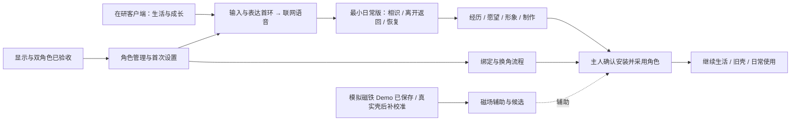

# 当前开发主线

更新：2026-11-18。

当前接续：**形态采用已离线完成 → 原服务启用与体验 → 角色内容 → 制作项目**。本轮 [A/B 模拟磁铁 Demo 基线](shell-field-calibration-20261117.md)已保存，A→圆团、B→原有角色，最后两窗共 319 条安静静置样本。主人确认实际外壳尚未制作，先用本轮数据推进候选与主人确认流程；真实外壳完成后再做重复拆装校准。

目标：同一个体在奇幻平行世界自主生活，现实多源输入折射为处境与机会，经历逐渐形成偏好和角色愿望。主人参与形象讨论、参数化外壳制作与打印，确认安装后采用整套角色特征。旧壳可唤起对应形态与表达，记忆、关系和能力延续。[完整产品评估](product-journey-20261116.md)统筹使用周期，[核心成长规则](product-experience-20261116.md)保持已确认决定。

**2026-11-17 分工确认**：自主生活先由客户端开发完成，包含世界推进、多源输入折射、自主选择、经历与兴趣积累、愿望形成。本仓负责设备感知、表情／声音／动作执行、角色资源、制作工作台和硬件接入；客户端保存同一个体的生活状态、记忆与关系。

本仓接续：**身体接口交接已完成 → 主人确认安装与设备表情采用已实机验收 → 客户端角色采用联合接入 → 角色内容与制作项目串联**。网络、语音与服务部署按客户端接入需要协同推进，沿用已完成的 4b1／4b2 基础。磁场先采用本轮模拟 Demo 基线，真实外壳制作后补拆装校准。

客户端的硬件接入管线以本仓能力与接口为依据，双方共用[接入基线与联合用例](client-hardware-integration-20261116.md#给客户端的接入基线)。客户端自主生活独立推进，接口和模拟用例同步对齐，设备联调按模块就绪安排。

[客户端交接包](../integrations/client-handoff/README.md)已提供接口字段、能力摘要和开发版兼容检查命令。本轮使用客户端 `0d8d4c5` 加现有已复核补丁，原 HTTP／SQLite → 生产适配层 → 内存 ControlLink 共 50 项检查通过，0 项跳过，独立 AI 复核通过；源码摘要、逐项结果和实际往返示例已[归档](../artifacts/client-handoff-20261117-r4/report.json)。接续安装确认时，持续个体、实物确认、目标表现与设备实际角色分别保存。

[主人确认安装](shell-installation-confirmation.md)现已接通：“我换好外壳了”保存实物确认，空闲时切换表情，分别核对首帧与保存。支持旧壳重用、连续确认和服务重开接续；配置更新后提示重新确认。213 项模块／HTTP 回归与新增页面 22 项浏览器检查通过，结果见[归档](../artifacts/shell-installation-20261117/report.json)。真实 USB 安装流程已验收；客户端人格、音色采用接续联合接入。

本轮[实机验收](shell-installation-live-20261117.md)已通过：[8782/#shells](http://127.0.0.1:8782/#shells)复用原 8780 的 USB 所有者与客户端。主人确认 A→圆团、B→原有角色的画面与保存正常；菜单往返、对话中及结束后切菜单、摸头与睡眠唤醒全部正常。设备首帧和保存回执已关联到安装编号，持续个体为 `shaping-001`，最新快照保存 B · 原有角色。结果与独立复核见[验收归档](../artifacts/shell-installation-live-20261117/acceptance/report.json)。

[客户端安装同步](client-installation-runtime.md)已接入原客户端 `4314` 与共享工作台 `8782`：设备保存后自动同步当前安装，卡片显示客户端接收结果。当前 B · 原有角色的安装编号、配置摘要与凭证一致，原个体、生活档案、六组交流结果和 USB 会话延续。63 项 Python、23 项 Node、19 项浏览器检查通过，原数据库备份副本通过重开及旧启动器回退检查，结果见[交付归档](../artifacts/client-installation-runtime-20261117-r3/delivery.json)。接续把形态配置接到原聊天与音色入口，再串联角色内容和制作项目；自主生活由客户端继续开发。A/B 当前空人格和未配置音色保留客户端现有设置。

[形态配置采用](client-role-adoption.md)已完成离线实现：聊天与语音按回合固定外壳配置，人格和说话风格进入原提示词，音色映射与实际合成结果分别记录。110 项测试通过，包括原 SQLite 恢复、A/B 中途切换、旧个体编号兼容、Windows 指定音色合成及补丁安装检查。可复现补丁及结果已[归档](../artifacts/client-role-adoption-20261118/report.json)。下一轮接入原启动器并展示采用结果，再安排体验；运行服务继续当前版本。

当前已细化[最小日常版交互与联网方案](daily-experience-v1-20261116.md)：首次相识、交流与取消、安静偏好、离开返回和恢复分别定义。首版面向主人与少量体验者，设置和打印可协助；日常桌宠联网即可使用，制作和调试再开电脑。后台采用项目维护常驻服务的设计，每位体验者独立实例与存档，具体主机接续选定。

2026-11-16 已静态核对客户端 `0d8d4c5` 的开发基线及关键源码。源码包含生活、成长、身体输入和输出桥模块，持续自主生活的整体效果仍在开发验证。主人确认持续身份与共同开发规则。[跨仓接入设计](client-hardware-integration-20261116.md)以双方实际能力为依据：先验证一个输入到表达的小回路，并共同改进生活接续，再逐步扩展语音、外壳和日常使用。

本轮体验已对齐：磁场提供变化与候选线索，首版由主人确认实际安装的外壳；可随时手动进入，复测可用后再按主人设置简化自动匹配。后台自动调度与安装确认均已离线实现，手动确认后暂停自动模式，主人可明确重新开启。

[4b1a 离线首环](client-expression-loop-4b1a.md)已完成，217 项测试通过。[4b1b USB 首环](client-expression-loop-4b1b.md)已于 2026-11-17 完成实机验收：平静／开心交替四次的画面、镜像、过渡与按钮正常，四条设备回执和原队列确认一致；菜单、对话、摸头和睡眠唤醒均通过。此前 43 项 Python／HTTP 和 14 项浏览器检查通过。验收页保留重播入口，本轮使用固定回复；这些成果供后续联合接入复用，当前顺序按上方分工推进。

[4b2a 语音协议接缝](xiaozhi-voice-seam-4b2a.md)已完成首轮离线实现，36 项自动测试通过。小智封包、回合取消、原 HTTP 聊天与 SQLite 已联测，字幕与合成读取同一份原回答；回应丢失时按原编号恢复并收尾旧输出。

[4b2b 真实中文语音](xiaozhi-real-voice-4b2b.md)已跑通电脑闭环：合成录音 → Opus → 实际 WebSocket → 通用中文听写 → 原生活服务 → 中文发声 → 接收端音频。网络支持自动断句、发送节奏、打断与失败后重连；当前模型使用固定回复。该成果作为后续联合接入基础，绑定、恢复、设备网络和常驻部署与客户端接口共同安排。

## 当前版本

本体已验收版本为 **E3f-9d.3 App + 双角色包**（COM4），当前安装入口为 [8782](http://127.0.0.1:8782/#shells)，共享 [8780](http://127.0.0.1:8780/#shells) 的 USB 连接。安装、回读和启动检查通过。主人确认主页与菜单刷新流畅，圆团和原有角色的表情、镜像、过渡及日常交互均正常。两次 USB 连接下的开关启动正常；本轮安装验收后保存原有角色。早期偶发黑屏在 E3f-9d.3 开关测试中未复现。详见[E3f-9d.3 实机记录](display-clock-e3f9d3.md#实机结果)。

显示修复依据：原日志确认内部 DMA 发送缓冲分配失败；E3f-9d.2 直接发送 PSRAM 像素后出现 DMA 供给不足，E3f-9d.3 降为 20 MHz 后通过本轮日志与画面验证。下一轮继续沿用已验收的传输参数。

双角色包包含原有角色和圆团，内容 7,249,690 B，8 MiB 资源区余 1,138,918 B。日常直接切换已装角色；修改素材、镜像或映射后，再生成并安装新包。完整素材库保留在电脑。

角色页顶部显示设备实际角色，下面编辑区保存草稿。设备分别回报切换目标、首帧处理后的实际角色和保存结果。接口见 [E3f-9d 设计](device-role-activation-e3f9d.md)，查询修正见 [E3f-9d.1](device-role-query-fix-e3f9d1.md)，操作见[本轮验收](device-role-acceptance-e3f9d.md)。

## 已有交付与接续方向

| 顺序 | 本轮交付 | 完成标准 |
| --- | --- | --- |
| 1. 角色管理 · 已完成 | 完整角色配置、现有预览与首次设置进度 | 一处保存名字、人格、音色配置和表达关联，重开可继续 |
| 2. 识别与绑定流程 · 离线完成 | 添加外壳、确认完整角色、切换决策、日志与模拟设备联测 | 可保存、重开和修改关联，识别验证与设备同步分别显示 |
| 3. 换角模块 · 后台服务离线完成 | M2、适配器、后台自动调度与内存联测已有 | 后续接主人确认，自动匹配按实测可选启用 |
| 4a—4b. 当前接续 | 4b1 实机、4b2b 电脑音频已有；安装确认已验收，客户端自动同步已运行 | 形态配置与音色已离线联测；原服务启用后联合体验 |
| 4c—5. 愿望与制作 | 经历到愿望、形象方案、参数化模型及角色内容 | 可讨论、修改、打印，等待时继续生活 |
| 6—7. 安装与长期迭代 | 主人确认安装、旧壳重用与统一采用，扩大内容和使用观察 | 新角色完整生效，共同经历延续；持续使用与维护成本有实测依据 |

运行期显示、双角色和本轮开关启动检查已完成。[S1c 采集项目与 S2a 表达绑定预演](shell-workbench-s1c-s2a.md)保存任务、原日志、识别档案和预演结果，使用既有 [S1a 评估](shell-repeatability-s1a.md)与 [S1b 档案保存](shell-profile-archive-s1b.md)。原项目入口现为 [8780/#capture](http://127.0.0.1:8780/#capture)；[我的外壳](http://127.0.0.1:8780/#shells)提供日常关联流程，8779 保留原设备工作台。

2026-11-13 的 A/B [历史现场采样](shell-field-capture-20261113.md)已保存：首组完成两壳登记、7 次独立验证，其中 A 有两次未确认，B 与移除对照符合预期。周边磁性物品放远后另建项目，完成环境基线、A/B 登记及 A 装回与同装配补录；对话和转向期间出现波动，补录末尾确认 A。上述历史进度保留。本次使用新的模拟 Demo 项目，真实外壳制作后按新安装基准做拆装、移除与未知布局验证。

本轮完成[角色档案与管理入口](character-profiles-stage1.md)：[8780/#characters](http://127.0.0.1:8780/#characters)新增“我的角色”，完整角色与外壳、表达角色分别保存。支持创建、编辑、重开、v1 导入、草稿导出及两套角色表情预览；音色与人格目前保存为配置。24 项单元/HTTP 测试、38 项新页面检查及独立复核通过，旧外壳页面 26 项检查通过。

阶段 2 已接通[外壳关联与离线换角](shell-characters-stage2.md)：添加外壳、选择完整角色、确认与修改关联，角色或登记版本变化后重新确认；可演练延后、连续换壳、取下、未知和断线重连，也可重识别已有原日志。

[阶段 3a](shell-switch-adapter-stage3a.md)已完成自动换角适配与内存设备会话联测：复用主机协议和单请求调度，分别核对请求、首帧与保存，覆盖失败接续和重连。“我的外壳”同页增加“会话联测”，结果可重开。原自动模式使用已验证档案和确认关联；后续主人确认流程复用其调度与回执。

[阶段 3b1](shell-switch-runtime-stage3b1.md)已接通原 USB 接收器的磁场事件与真实 M2 识别器，“我的外壳”可运行原日志会话联测。已重放 3 个现有项目、10 个独立窗口、1,831 条原采样；现有来源为历史演练或待复核。正式采样进度保留，完整角色与外壳关联库仍待主人设置。

[阶段 3b2](shell-switch-service-stage3b2.md)已接通后台持续调度与“我的外壳”运行卡，提供开始、暂停、重试及识别→目标→首帧→保存状态。页面关闭后服务继续运行；重开服务默认暂停。配置更新后重新开始，暂停后已发送请求继续收尾。原自动链路通过内存设备验证；转动状态与采样按 3b3 接续，新主人确认状态另行接入。

完整产品里程碑保留在[产品体验与开发计划](development-plan-20261104.md)：客户端接续持续生活、经历与愿望，本仓接续角色采用与制作工具；统一语音、参数化制作和长期体验按模块就绪联合推进。磁场辅助先使用模拟 Demo 基线，真实外壳制作后补完整验证。当前执行顺序以本页顶部为准。

本轮完成 [S1d 正式采样操作单](shell-field-guide-s1d.md)：保存安装基准确认、逐项操作提示和下一任务，可导出后接续现场采集。97 项测试、26 项浏览器检查和独立复核通过。未知布局一旦采样便固定对照名称，切换布局时新建项目。

本轮完成[统一视觉与动效](workbench-visual-system-20261116.md)：9 个页面共用蓝紫主题、标题、面板与控件，导航、分层切换、展开和节点反馈采用统一非线性缓动。深浅主题和 320px 窄屏通过检查，后台轮询保留草稿、焦点与预览。160 项新浏览器检查、156 项浏览器回归、56 项单元/HTTP 测试及独立 AI 复核通过。后续界面沿用此视觉系统。

## 开发约定

每轮完成一个可观察的功能，保留简短设计、必要测试、独立 AI 复核和当轮恢复材料。主线写当前事实，历史报告保留各版结果；安装、设备回执和人工画面验收分别记录。稳定的大版本集中更新 GitHub。

继续沿用菜单 DMA、首帧重排、原 USB 接收节奏及官方交互。[行动指南](development-pipeline-20261102.md)记录工具链、格式兼容、显示与菜单检查；本轮查询修复已把新增头文件纳入格式检查。

回退材料保留 E3f-9d.3 → E3f-9d.1 → E3f-9d → E3f-7 / E1.45，以及已验收 E3f-5 / E1.45 的链路；本轮恢复入口见[E3f-9d.3 报告](display-clock-e3f9d3.md)，按配套版本依赖恢复资源与 App。
