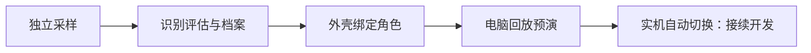
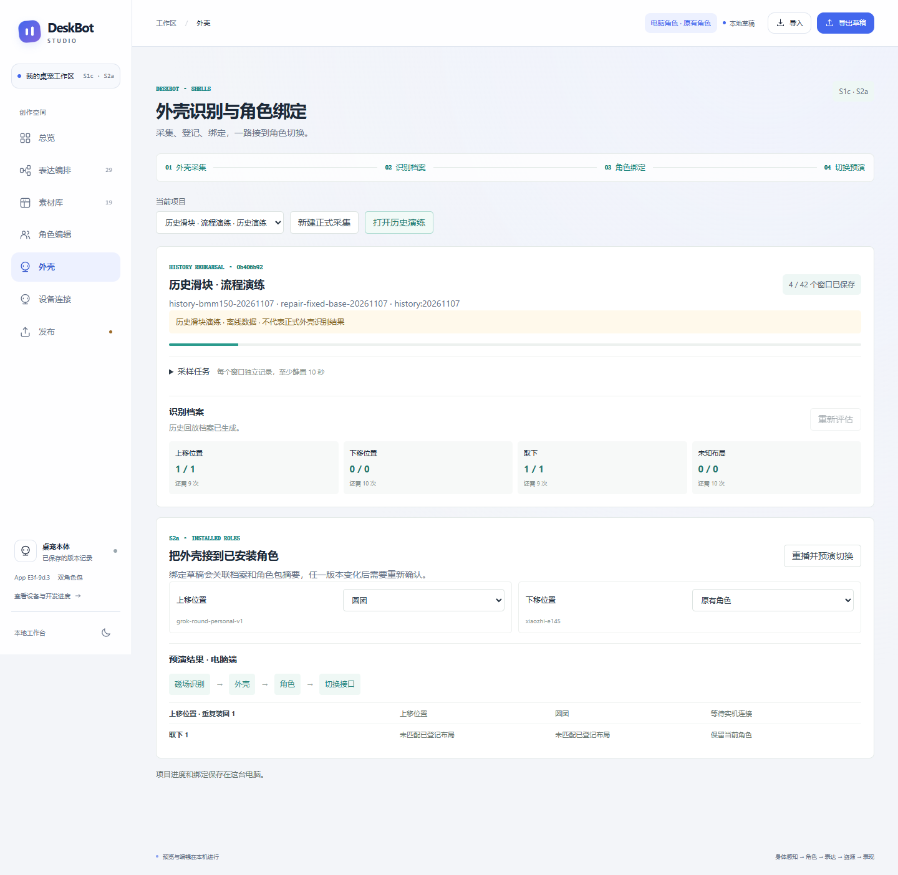

# 外壳工作台：采集项目与角色绑定

2026-11-13。S1c、S2a 电脑端完成；设备沿用已验收的 E3f-9d.3 和双角色包。

工作台：[外壳页面](http://127.0.0.1:8780/#shells)。可保存采集任务、导入原日志、生成识别档案、绑定角色并回放预演。当前打开的是明确标注的历史滑块演练项目。

验证：76 项 Python、15 项浏览器检查通过；另一 AI 独立复测 76 项通过。预览服务启动、页面加载与再次启动入口通过，原 8779 的 COM4 只读连接继续运行。

证据：[测试与源码摘要](validation.json)、[浏览器结果](browser-results.json)、[独立复核](peer-review.json)。设计见[模块说明](../../docs/shell-workbench-s1c-s2a.md)。

接续：确认实际外壳和固定安装方向 → 正式登记与重复拆装 → 确认角色绑定 → 接实时自动切换 → 人格与声音。拆装操作由主人配合，采集、导入与评估由开发者完成。
