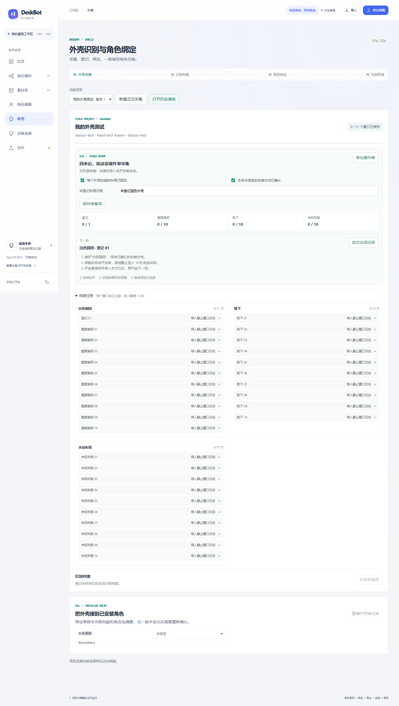

# S1d：正式采样操作单

2026-11-13，电脑端完成。[工作台入口](http://127.0.0.1:8780/#shells) → 新建正式采集。

操作单保存安装确认和未知布局对照，显示下一项任务、独立装配编号和拆装步骤，支持导出。采样量、识别结果和角色绑定分开显示。已有未知布局采样后，对照名称固定。

验证：21 项新增测试，加既有回归共 97 项通过；26 项浏览器检查通过，设备命令为 0。另一 AI 独立复测 97 项并完成最终复核。

证据：[验证与源码摘要](validation.json)、[测试](python-results.json)、[浏览器检查](browser-results.json)、[独立复核](peer-review.json)。[设计与接续](../../docs/shell-field-guide-s1d.md)。本轮源码快照保存在 `sources/`。

下一步：确认实际外壳和安装方向 → 正式采样 → 确认角色绑定 → 接实时切换 → 人格与声音。
