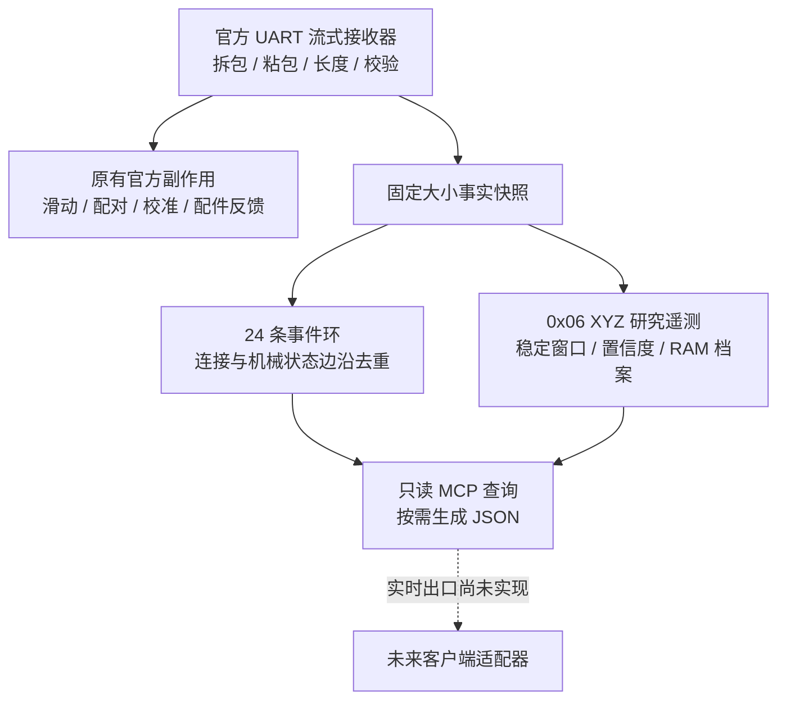
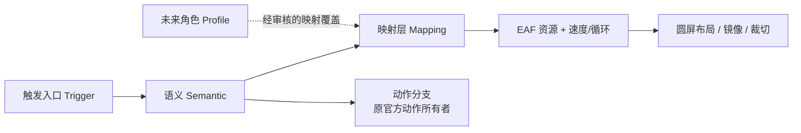

# 固件与客户端架构 / Architecture

2026-11-05：[E3c-8](deskbot-studio-e3c8-20261105.md)修正 USB 辅控制台路径和接收节奏。App 回读、保护区、NVS、启动、重启和工作台状态查询已通过；平静表情及人工交互待联网后验证。当前完整顺序见[开发计划](development-plan-20261104.md)。

## 当前状态

COM4 使用 **E3c-8 App、E1.40 bootloader、E1.18 资源与 `upper-assets-8m` 分区表**。仅写 App `0x10000..0x45E000`：App 擦除范围逐字节回读一致，其他区域设备端摘要一致，写后首次启动前 NVS 一致。资源位于 `0x1000000..0x1800000`，模型仍在 `0xBC8000`。

工作台由唯一串口进程收发，USB 任务解析会话并读取所有者快照；表达请求通过原 `Application::Schedule` 交给播放器。UI、音频、触摸和底座保留原有归属。hello 的 edition 字段沿用 E3b；具体 App 版本按已核对的 ELF 摘要识别。

E1.42 交互已验收；E3c-8 交互、三分钟映射和 E1.45 新害羞资源分别待测。底座修好后继续动作和外壳登记；客户端随后接角色确认、DeepSeek 与声音。下文的阶段记录保留当时结果。

## 工作台资源发布

角色草稿 → 当前角色快照 → 实际资源包 → 成员与容量报告。包生成器以 E1.18 为固定基线；默认映射精确复现原镜像，害羞候选精确复现 E1.45。角色接线改变后，旧报告显示为过期，下载入口随之更新；重新选择相同角色与接线可恢复匹配的报告。

资源镜像和固件分开构建。`firmware/releases/esp_vocat_n32r16/` 固定目标配置、分区 CSV 和 7 MiB 资源建议上限。隔离 App 构建核对同一分区表、模型、bootloader 与配置差异，不把资源放入通用 App 写入参数。验证记录分别标明离线生成、构建、设备写入和人工验收。

页面控件在初始化脚本之前生成，公开版和本机版均跑浏览器回归；新增布尔配置与旧构建比较时，只将明确列出的“缺省→关闭”单列，启用项仍按实际配置核对。执行步骤见 [E2b](deskbot-studio-e2b-20261104.md)。

## 表达目录与请求

`deskbot.expression_catalog/v1` 保存语义、资源、布局、帧率、循环和现有动作；SHA-256 标识目录内容。E2c 目录来自 E1.18 版本记录，角色草稿修改后单独生成资源包。

`deskbot.expression_control/v1` 分别表达表情请求、动作请求、回执与底座事实。请求带目标、启动周期、会话、递增序号、目录摘要、角色、请求编号和有效期。模拟器最多保留 1 条待提交请求、24 条最近事件与 64 条去重决定；重连同步结果，同一编号重发返回原决定。

“已受理”进入队列，“已提交执行”交给表现模块。E3c-5 已离线实现固件侧单个 `neutral` 请求；电脑入口仍按后续工作台增量接入。底座 `0x0010` 只提供动作完成事实，以独立事件展示；聆听动画由语音状态管理。

## 通信与任务归属（E3a 核对）

| 模块 | 现有入口与职责 | 增量接入方式 |
| --- | --- | --- |
| 云端语音 | 本体主动建立 WebSocket；音频与 MCP 共用现有云端通道；源码还保留 MQTT 路径 | 后续客户端适配按选定传输独立接入，保留官方认证与语音连接 |
| 应用主循环 | Application::Schedule 排队；MainEventLoop 处理状态、网络消息和已安排工作 | 新表达请求先做有界校验，再交给原所有者；主循环不等待长任务 |
| MCP | 收到 JSON-RPC 后由 DoToolCall 通过 Schedule 调用工具 | 本机工作台当前不是云端 MCP 主机；不把 USB 观察当成 MCP 调用 |
| 显示 | EmoteDisplay、ui_bridge 与 LVGL 适配器管理页面和动画 | 后续表达入口复用已有显示调度，先验证单个表情 |
| 音频 | AudioService 有输入、输出、编解码等独立任务和有界队列 | 保持音频所有权；语音产生的状态优先级单独定义 |
| 底座 | UART1 的官方组件解析帧；BaseControl 维护心跳、事实和原交互 | 动作继续交给底座；动作完成按无请求 ID 的事实处理 |
| USB 观察 | Application 状态变化日志、约十秒一次的 SystemInfo 内部 SRAM 摘要 | E3a 仅在电脑解析；逐行缓冲 2 KiB、24 条变化、30 秒数据有效期 |

来源：application.cc 的主循环、SetDeviceState 与 SendMcpMessage；protocols/websocket_protocol.cc 的 OpenAudioChannel；mcp_server.cc 的 DoToolCall；audio/audio_service.cc；display/emote_display.cc；boards/esp_vocat/base_control.cc。本轮未修改这些固件文件。

E3a 使用独立的 deskbot.body_observation/v1，只描述主机收到的日志和观察时段。它不填写缺失的设备 ID、固件版本、当前表情或底座状态；完整身体事实仍沿用 deskbot.body.v1。已保存的 E1.18 表达目录继续标为 saved_release_record、live=false。

### E3b 身份通道

当前控制台为 UART0 主输出、USB Serial/JTAG 辅输出。E3b 复用日志发送 `deskbot.device_link/v1` hello，独立任务优先级 1、栈 4 KiB、周期 10 秒，Kconfig 默认关闭。任务只读取身份、App 描述和容量；应用、UI、音频和底座各保留现有所有权。

电脑生成 `deskbot.body_observation/v2`：设备编号稳定，启动编号随重启变化；消息含版本、ELF 摘要、序号、运行时间与实际容量。按 2 KiB 行上限解析，身份 30 秒过期，重复与乱序不刷新时效，重连清理旧状态。设备目前只声明身份查询能力，目录仍使用保存的 E1.18 记录。

E3b 第二版已实测：首次启动与重启各收到 5 条身份消息，确认 32 MiB Flash / 16 MiB PSRAM；工作台断开后清理身份，重连后收到同一设备、本次启动的新序号。当前 libc 使用 nano 格式，64 位运行时间先转十进制文本；构建前的格式检查已纳入入口。

hello 是设备发现消息。后续双向接收单独绑定 USB 通道；`stdin` 仍属于主控制台，接收器选择须按实际驱动核对。云端 WebSocket 随语音会话开关；电脑持续表达连接使用独立生命周期。身体事实契约的 UTC 时间由客户端时钟补齐，hello 自带的是启动后毫秒数。

### E3c USB 会话层

[E3c-1](deskbot-studio-e3c-design-20261104.md)已加入默认关闭的 USB 诊断接收与会话层。28 项测试实际编译运行固件 C++，覆盖建立、保活、关闭、超时、重连、JSON 校验与分帧；原准备套件 83 项复测通过，合计 111 项。当前设备仍为 E3b 第二版。

两版隔离构建与审计通过：关闭版代码和数据与 E3b 相同；启用版 App 为 4,487,424 B，增加 4,000 B，分区剩余约 1.58 MiB。bootloader、分区表和模型产物一致，详见 E3c-1 的构建与审计报告。

USB 任务读取 basic VFS，优先级 1、栈 6 KiB。E3c-8 实测该配置每次读取只返回 1 B，因此每轮最多读取 512 次、512 B，再让出 CPU 10 ms；无数据立即结束本轮。会话使用固定内存：每帧 2 KiB、残帧超时 2 秒、会话有效期 30 秒、回复最短间隔 250 ms。电脑每次逻辑重连生成新 nonce；USB 总线连接状态辅助清理残帧。会话回复的 `controls_available=false` 沿用原协议，单个表情能力由独立请求入口提供。

已核对 IDF 5.5.5：主控制台只读 UART0，USB VFS 的打开实例共用状态；接收适配保留现有驱动与全局模式。E3c-2 由应用状态和页面切换所有者向固定小型快照发布切换阶段及稳定值，USB 任务读取镜像快照。实际屏幕睡眠状态目前为未知，控制仍关闭。

E3c-2 的 132 项测试通过，实际快照存储为 56 B，新增任务为 0。启用版 App 为 4,488,144 B，比关闭版增加 720 B，分区剩余 1,655,856 B。关闭版代码和数据与冻结 E3c-1 相同；两版的 bootloader、分区表、模型与 OTA 初始数据一致。详见[本轮报告](deskbot-studio-e3c2-20261105.md)。

回退读取当轮备份、App 擦除范围、计划与状态日志，保持原计划编号；候选及构建目录缺失时仍可恢复。每次恢复单独保存结果。本机 E1.42 原字节已离线核验；串口执行使用固定 IDF Python，设备交互按 E3b 记录验收。

### E3c-3 只读状态查询

会话内 `state` 查询返回 `deskbot.studio_state/v1`：应用、页面、各自的版本与阶段、设备运行时间和会话身份。查询使用原 USB 任务和回复缓冲；复制快照后格式化 JSON，有效查询续期 30 秒，默认关闭的新配置依赖 E3c-2 快照。

电脑端 `RuntimeQueryClient` 由已有串口所有者调用，最多保存一个待回复和一份当前状态。请求与状态均按本地发送时间设置 2 秒上限；重连换 nonce，清空旧状态，校验请求、序号和身份。设备运行时间只用于顺序校验，独立于电脑计时。178 项离线测试与构建审计通过；设备和工作台串口收发仍沿用 E3b。

查询启用版 App 为 4,489,152 B，比关闭版增加 1,008 B，分区剩余 1,654,848 B。关闭版代码和数据与 E3c-2 相同，两版保护产物一致。当前增量未访问设备。

### E3c-4 显示条件查询

`display` 操作复用已有 USB 会话，返回 `deskbot.studio_display/v1`。回复包含应用、页面、播放器初始化状态和当前预览条件；原 `state` 回复保持原协议。

播放器创建和释放时更新 8 B 镜像，与应用/页面快照共用临界区；组合快照最多 32 B。USB 任务复制后再序列化，沿用 1 KiB 回复缓冲。电脑端复用原查询客户端的身份、时效、重放和重连检查。

当前公开播放器接口没有实际睡眠状态，回复记为 `unknown`；E3c-4 显示查询的 `controls_available=false` 保持原协议。请求能力由下一节的独立控制入口提供。见[E3c-4 结果](deskbot-studio-e3c4-20261105.md)。

### E3c-5 单个表情请求

默认关闭的 `DESKBOT_STUDIO_EXPRESSION_REQUEST_ENABLE` 依赖显示查询。现有 USB 线程解析 `deskbot.expression_control/v1`，校验设备、启动、会话、目录、角色、序号和有效期，然后通过原 `Application::Schedule` 提交一个 `neutral` 回调。

受理和执行前均要求应用空闲、主页稳定、播放器已初始化。会话关闭、排队超时或所有者状态变化时取消请求。实际睡眠保留 `unknown`，仅调用原 `SetEmotion("neutral")`；该语义映射 `winking.eaf`，没有底座动作。`accepted` 表示排队，`dispatched` 表示调用播放器 API，圆屏播放另行确认。

固定上限为一个待处理请求、一个保留回调、一个终态回执和 64 条去重记录；控制状态最多 12,000 B，USB 输入工作区最多 2,200 B。请求锁在调用调度器和播放器前释放；沿用已有 USB 任务。254 项专项与回归通过，构建和容量结果见[E3c-5](deskbot-studio-e3c5-20261105.md)。本轮没有访问串口或刷写设备，工作台按钮按下一增量接入。

## 分层与所有权

### E3c-6 电脑端接入

`observe-studio-body-e3c.py` 是唯一串口所有者，同时处理原日志、显式状态查询与一次平静请求。`ControlLink` 管理会话、2 秒状态时效和设备回执；`ControlBridge` 通过有界 IPC 连接本机 HTTP 服务。原 `/api/body/state` 保持 v2 只读投影；新增 `/api/studio/state` 与 `/api/studio/command` 承载控制状态。

页面每 750 ms 读取电脑端快照；USB 显示查询每秒一次，发送最短间隔 400 ms。连接、启用和表达分别由用户操作。重启或断开使旧连接失效，表达请求发送一次，最多保存 24 条回执、64 条去重记录。固件回复序号与表达回执序号分别校验；本机超时与设备回执分别显示。

工作台、原生产 C++ 入口及调度适配器已离线联调；本轮固件源码与设备版本保持 E3b 部署状态。见[E3c-6 结果](deskbot-studio-e3c6-20261105.md)。

| 层 / Layer | 现有职责 / Ownership | 不承担 / Not owned here |
| --- | --- | --- |
| C61 底座 | 电机、回零、限位、磁场传感器、磁吸开关、UART | 人格、对话、表情库选择 |
| S3 本体 | 官方 UI/语音/摸头/双麦 DOA；UART 事实镜像；有界磁场识别 | DeepSeek 记忆与角色演化；自动注册未知外壳 |
| 电脑协议适配层 | 校验、快照优先、序号、过期、身份事实；离线角色绑定审核 | 无条件触发电机或把回放冒充实时设备 |
| 正式客户端（未来） | 外壳与角色确认、人格/音色/世界状态、Agent、ASR/TTS | 接管底层 UI 锁或电机限位算法 |
| 表达工作台 | 表达母库、角色草稿、节点预览、容量审阅和资源包生成；本机服务只监听回环地址 | 自动刷写、实时轨迹、任意动作执行 |



`0x06` XYZ 是研究扩展，需要匹配底座；不能称为官方默认协议。`base.action.completed` 没有请求 ID，不能捏造对应哪一次动作。高频心跳和磁场样本不进入事件环；官方副作用不被研究逻辑接管。事件列表不等于外壳身份列表。

## UI 与并发约束

历史实验曾在对话和菜单切换时出现 UI 冻结。当前路线是退回已验收边界、拆开研究模块：

1. UART/音频/计时器回调不直接操作 LVGL、弹窗、资源切换或页面导航。
2. 回调只做有界解析与快照更新；持锁区不等待 UI、不做网络、不分配大对象。
3. 只读查询复制快照后释放锁，再生成 JSON，不反向调用 UI 或动作。
4. 同一增量不同时改显示播放器、音频管线、电机和协议；扩展必须使用原有所有者和调度机制。
5. 固定内存和队列上限；避免 UART 高频采样变成日志或通知风暴。
6. 新资源只更换指定包成员，播放器源码和分区布局保持独立闸门。

每轮验收包括对话中及结束后切菜单；源码、构建、回读、启动和人工交互分别记录。

## 表达不是一个文件名



`happy` 等语义与 `Happy.eaf` 资源必须分开：多个语义可以共享文件；角色可以未来覆盖映射，但不应修改事实事件的含义。当前 `embarrassed` 使用 `Happy.eaf`，专门害羞候选仅在离线工作台，不是已刷入内容。现有资源存在局部眼睛精灵，不能只看 EAF 宽高就判断圆屏兼容性；必须结合 layout 镜像/裁切及播放器版本。

E1.44 从官方 Happy 复制末尾 `_C` 标记，适配当前播放器的排他终点，图像数据保持原样。该处理绑定当前播放器版本；标记内容原样保留，不解释为局部循环。完整脸与单眼镜像是两份独立派生物：容量都满足 7 MiB 软上限，单眼版兼容当前镜像路由，完整脸需要独立布局。母库保留两者，正式包只加入选定资源。

E1.45 已生成单眼镜像候选的完整 8 MiB 资源镜像，实际包 5,981,260 B。资源差异与恢复范围单独审计；恢复参考来自已验证迁移回读，现场部署使用当轮备份。资源部署与 App 的三分钟映射专项分别验收。

## 未来客户端边界

身体事实、角色解析、客户端记录契约位于 `protocol/`。先快照、再增量；身份/会话变化、过期、乱序和重放必须被处理。磁场 `known` 只是物理识别事实；角色登记/确认属于用户与客户端。离线 `resolved_offline` 不授权真实设备切换表情或动作。

实时传输、鉴权、资源上传、动作仲裁与服务替换还未完成。后续先做有界只读出口和契约回归，再做受控表达，最后替换小智后端；不在本阶段接入 DeepSeek。

## 存储、运行内存和更新边界

### N32R16 容量模型（E1.36）

COM4 已核实为 ESP32-S3 N32R16：物理 Flash 是 32 MiB，PSRAM 是 16 MiB。E1.40 当前 bootloader/App 镜像头声明 32 MiB，正式分区表仍按旧 16 MiB 布局。三者必须在每份报告中分开记录：物理容量决定芯片上限，镜像头声明 bootloader/App 配置，分区表决定固件布局，PSRAM 只属于运行内存。物理上半区不是现有资源区，也不能因为启动或 USB 全片回读成功就直接使用。

E1.36 离线审计将候选分成三类：`current-16m` 是精确回退；`capacity-only-32m` 只验证 32 MiB 配置而保持旧分区表和资源/模型地址逐字节不变；`upper-assets-8m` 是在 `0x1000000..0x1800000` 增加 8 MiB `assets`、保留旧资源和模型的几何布局候选。原位扩容并后移模型保留为比较路线。具体路线取决于寻址兼容性审计与实机映射结果。

容量审计页面见 [E1.36 N32R16 布局闸门](../artifacts/expression-storage-n32r16-e1-36-20261030/index.html)，报告和分区表生成均为离线操作；没有刷写、擦除、NVS 变更或 C61 访问。

### E1.37 构建结果与上半区寻址条件

[E1.37 容量对照构建](expression-capacity-build-e1-37-20261030.md) 已完成：16 MiB 控制 App 精确复现已验收 E1.26；32 MiB App 和 bootloader 各只改变容量字段及 32 字节摘要，全部可执行段与 App ELF 相同。App 为 4,477,280 B、分区余量 1,666,720 B。正式分区表、构建资源、模型和 OTA 初始数据逐字节相同，源码未改；构建通过不代表当前设备已升级。

32 MiB 选择会由 IDF 自动派生三个隐藏 bootloader 寻址配置；审计允许且仅允许这六项精确差异。E1.37 使用 QIO + auto-detect 编译配置，两个大地址缓存开关均关闭。IDF 5.5.5 将 `BOOTLOADER_CACHE_32BIT_ADDR_QUAD_FLASH` 标为实验选项，默认关闭且并非对所有 Flash 芯片稳定。**“Quad”在此仅指构建路径，不能描述物理 Flash**；E1.38 已从现场日志确认实际为 Octal OPI_STR。完整回读与镜像头 32 MiB 都不能证明 EAF 所依赖的上半区 mmap 能运行。

[E1.38 寻址与回退预检](expression-addressing-e1-38-20261030.md) 已离线完成。现场 JEDEC 为 `C2:8039`、MXIC、32 MiB Octal，正常启动使用 `mxic (opi)` / `opi_str`；准确商业料号仍待补证。镜像头 DIO、编译选择 QIO、运行 OPI 必须分开记录。自动识别不改变编译 guard，当前候选对 ≥16 MiB 或跨界 mmap 返回 `ESP_ERR_INVALID_ARG`。当前 EAF 挂载必须 mmap，不能仅依赖普通 read API 或 USB stub 的大地址读取能力。

`SPI_FLASH_SIZE_OVERRIDE=false` 时容量来自 bootloader 头：旧 16 MiB bootloader + 新 32 MiB App 仍预期限制为 16 MiB。容量启动需审阅成对 bootloader/App，或另做明确 size-override 构建；不再将 App-only 视作充分条件。现场 bootloader 的编译时间/校验/摘要与构建版不同，精确回退必须取现场完整擦除扇区。E1.38 已切出 E1.37 条件范围的回退并校验全片保护摘要，但它们是历史快照，写前必须刷新现场身份与摘要；新候选长度须重算范围。

[E1.39 显式 Octal 双构建](expression-octal-e1-39-20261030.md) 已离线通过：16/32 MiB App 为 4,477,200 / 4,476,944 B，bootloader 为 15,024 / 15,504 B。OPI、STR、80 MHz、MXIC 驱动固定；关闭 auto-detect、DTR、Quad cache32、实验选项及 size override。32 MiB 的 Octal cache32 由 IDF 派生，另在 sdkconfig 文本中保留一个兼容别名。两版间 6 项精确文本差异、完整生成配置及 ELF/镜像变化均已审阅；条件编译会改代码，不能套用 E1.37 的 header-only 结论。

正式产品源码、旧表、现场资源/model/OTA 均未在 E1.40 写入。参考资源包不等于现场 E1.18，不能执行通用 flash_args。E1.39 是离线候选阶段；之后 E1.40 已按独立授权成对写入 bootloader/App，并完成擦除范围回读、启动及用户指定本体回归。E1.42 又仅写入 COM4 App 分区完成只读边界探针部署，候选与回读一致；驱动容量、CPU 跨界 read/mmap、模型/内存和释放路径的真实 JSON 仍待主机调用。通过后再规划 8 MiB 资源迁移。详见 [E1.40 实机结果](expression-capacity-boot-e1-40-live-20261030.md) 和 [E1.42 探针报告](expression-capacity-read-mmap-e1-42-20261031.md)。

[E1.35a](expression-storage-preflight-e1-35a-20261029.md) 已完成观察器开/关 × 旧/8 MiB 布局四份隔离构建：每组 App 与非布局产物一致，正式源码和分区表未改。候选只扩大 `assets` 并后移同容量 `model`；这不是已迁移设备。当前 `Assets` 构造时就会挂载整区，`Apply` 再从 E1.18 的 index 加载内嵌模型；独立 model 仍被空模型回退路径使用。保留两份不同的模型内容，不能合并或删除其中一份以腾空间。

电脑母库保存完整素材与历史；设备保存有界活动包。8 MiB 候选先以 7 MiB 为发布软上限，预留 1 MiB；App 区保留 6,000 KiB。原 NVS 仅 16 KiB，后续外壳持久化需另做有界记录和磨损审计，可评估 256 KiB 专用区，但本轮不分配。旧 16 MiB 原位扩容方案约有 1.30 MiB 尾部；N32R16 上半区布局则有另外的未分配空间，两者不得混用预算。物理空间充足不等于已支持双包切换；当前没有原子资源更新或自动分区回滚实现。

音频缓冲、解码帧、通信队列和任务栈占 RAM/PSRAM；MMU 又有连续虚拟映射约束。整区 mmap 地址跨度从 95 到 129 页不是“把资源全读进 RAM”，也不是实测可用页数。后续每项能力同时报告 Flash 增量、内部堆/PSRAM 峰值、最大空闲块、队列上限和 UI/音频并发回归。需要新增运行时探针时，应单独审阅和回归，不能混入布局迁移。

旧原位扩容会覆盖 model 与原尾部，需完整备份、模型迁移和受控下载模式。上半区候选保留旧 model/资源，但必须备份新目标范围，并先验证大地址访问。两条路线都先写候选数据并回读，再提交表；表最后写不提供断电原子性。失败回退须恢复该布局实际影响的原始区间与旧表，不能只刷 App。正式迁移脚本须按布局版本与实时摘要拒绝不匹配，通用构建 flash map 不作为部署清单。

### E1.40 实机容量启动状态（2026-10-30）

E1.40 已在 COM4 仅部署显式 Octal 32 MiB bootloader/App；完整擦除范围回读与候选一致，OPI_STR 启动及指定本体回归通过，E1.18 资源和旧分区表保持。上文 E1.38/39 未部署的表述是对应历史阶段状态。刷写命令未触碰 NVS；刷后读回观察到 `audio.output_volume` 从 80 变为 100，原因和准确发生时间未确定。驱动容量直接查询、CPU 跨界 read/mmap 和上半区资源迁移仍待独立验证；USB stub 全片回读不证明 CPU 缓存寻址。详见 [E1.40 实机结果](expression-capacity-boot-e1-40-live-20261030.md)。

官方 MCP `self.get_system_info` 返回 `Board::GetSystemInfoJson()` 中的 `flash_size`；字段来自 `SystemInfo::GetFlashSize()`，内部调用 `esp_flash_get_size(nullptr, &flash_size)`。该工具通过 `AddUserOnlyTool` 注册，MCP 列表默认排除它，语音代理因此无权调用。E1.41 保留这项官方权限，并在 ESP-Vocat `DevTools` 增加 `self.get_flash_capacity`：只返回驱动容量和分区标签/地址/尺寸，不包含 MAC、UUID、应用哈希，也不执行写入。离线解析器核对 `flash_size` 及正式旧分区地址/尺寸，容量不符或分区漂移时失败关闭；E1.41 已在 COM4 仅部署 App 后确认设备启动日志注册该工具，但当前主机尚未取得配对的工具返回，不能把“已注册”写成“查询已通过”。查询只验证驱动报告值是否为 32 MiB，不代表 `spi_flash_mmap()` 已能跨过 16 MiB 边界，也不证明资源播放器能使用上半区。

### 工具链环境行动指南

本机的构建、刷写和离线审计必须先分流到正确的解释器；不要让 PowerShell 的 `python`、`py` 或 `$DeskBotPython` 未定义值决定固件工具链。固定入口如下：

| 用途 | 固定入口 | 必须核对 |
| --- | --- | --- |
| ESP-IDF 构建/`esptool`/串口诊断 | `D:\Espressif\python_env\idf5.5_py3.11_env\Scripts\python.exe` | Python 3.11、`import esptool, serial, yaml`；`-m esptool version` |
| ESP-IDF 源码 | `D:\Espressif\frameworks\esp-idf-v5.5.5` | `tools\idf.py` 存在，版本输出 5.5.5 |
| CMake | `D:\Espressif\tools\cmake\3.30.2\bin\cmake.exe` | 3.30.2 |
| Ninja | `D:\Espressif\tools\ninja\1.12.1\ninja.exe` | 1.12.1 |
| ESP32-S3 编译器 | `D:\Espressif\tools\xtensa-esp-elf\esp-14.2.0_20260121\xtensa-esp-elf\bin\xtensa-esp32s3-elf-gcc.exe` | 14.2.0 |
| ESP32-S3 符号审计 | `D:\Espressif\tools\xtensa-esp-elf\esp-14.2.0_20260121\xtensa-esp-elf\bin\xtensa-esp32s3-elf-nm.exe` | GNU nm 2.43.1；构建脚本需从受控 PATH 解析为绝对路径再启动 |
| 主机 C++ 测试 | `scripts/test-expression-e1-43b-cpp.py` | 复用已有 Zig 0.15.2；找不到时通过 `DESKBOT_ZIG` 指定路径，先验证再编译 |
| 仓库离线测试/JSON Schema | `D:\Program Files (x86)\Python\Python 3.13.0\python.exe` | Python 3.13；不用于 ESP-IDF 构建或刷写 |

每次构建前先在仓库根目录执行：

```powershell
Set-Location -LiteralPath "<DESKBOT_ROOT>"
& .\scripts\preflight-deskbot-toolchain.ps1 -Mode Build
```

先按工作类型运行独立预检：

```powershell
& .\scripts\preflight-deskbot-toolchain.ps1 -Mode Offline
& .\scripts\preflight-deskbot-toolchain.ps1 -Mode Build
& .\scripts\preflight-deskbot-toolchain.ps1 -Mode Flash -Port COM4
```

`Offline` 只检查 Python 3.13 和 `jsonschema`；`Build` 检查 ESP-IDF、Python 3.11、CMake、Ninja、编译器、`nm.exe` 及锁定组件 donor；`Flash` 检查 `esptool`、串口依赖和明确端口是否枚举。预检不会打开串口、复位或写设备。它输出 JSON，但子进程环境不会回写当前 PowerShell；实际构建必须由对应构建脚本在同一进程内设置 IDF 环境。当前构建 donor 是 `tmp\e139-octal-20261030\p`，以其中的 `dependencies.lock` 和 `managed_components` 为准；不存在的 `tmp\component-cache` 不是依赖。构建仍使用独立 `tmp/` 输出并关闭组件版本检查，不访问组件注册表或自动替换依赖。

测试按文件入口执行：下划线命名可用 `unittest discover`；带连字符的历史测试使用 `run-offline-checks.py` 或文件自身的 main。先确认实际测试数；`Ran 0 tests` 表示未找到测试。引用外层官方源码时使用已锚定的项目路径，工作树内的同名 `tmp/` 不是同一目录。

PowerShell 中 `& $DeskBotPython ...` 只有在变量已经是可执行文件路径时才有效；变量为空会产生“管道元素中的 & 后面的表达式生成无效的对象”。不要假设 `python`、`py` 或 PATH 指向 IDF Python；本机 `python` 当前为 Python 3.13，ESP-IDF 构建/`esptool` 要显式使用表内 Python 3.11 路径。先 `Set-Location -LiteralPath` 到实际 Git 工作树；含空格的路径必须加引号。PowerShell 多行命令只用反引号续行，反引号必须是行末最后一个字符；粘贴带 Markdown 转义的反斜杠或不存在的 `$DeskBotPython` 变量会在程序启动前失败。Windows PowerShell 5.1 对原生命令参数中的内嵌双引号处理与 PowerShell 7 不同；传给 `python -c` 的代码优先用单引号字符串，并在 PowerShell 单引号字符串中以 `''` 表示 Python 代码的单引号，避免 Python 收到被剥掉引号的表达式而抛 `Traceback`。

MCP 工具也要分三层验收：启动日志中的 `Add tool` 只证明固件注册；主机 `tools/list` 必须完整分页并确认工具名；最后才是同一 JSON-RPC id 的 `tools/call` 返回。`self.get_system_info` 是官方 user-only 工具；E1.41 的 `self.get_flash_capacity` 使用普通 `AddTool`，默认不是 user-only。若语音代理仍回答“无权限”，先确认它实际选择的是哪个工具、主机列表是否含新工具、是否取完 `nextCursor`，再检查客户端白名单或缓存；不能据此直接修改设备权限或把旧工具改成公开。没有实际 `tools/call` 返回时结果保持 pending。

如果当前 Codex 会话没有喵伴 MCP 主机入口，就不能把设备日志、语音转述或固件注册记录写成 `tools/list` / `tools/call` 证据；先使用可访问的官方 MCP 主机捕获配对结果，或者在设备端明确调用该普通只读工具并保存原始 JSON。不能通过临时扩权、改造 `self.get_system_info` 或猜测客户端白名单来绕过这一证据缺口。

E1.42 历史只读探针使用 E1.40 全片回读作为固定参考，由 `scripts/validate-expression-e1-42-probe.py` 校验。A7 的写入实验改用同轮写前快照，规则见下节。各阶段构建保存在各自独立目录，源码与报告按摘要对应。

E1.42 最初的阶段报告与 [部署机器记录](../artifacts/expression-capacity-read-mmap-e1-42-20261031/live-result.json) 保留历史状态：当时仅 App 写入、回读与用户本体验收通过，缺少启动日志、MCP 完整分页和探针原始 JSON。后续 E1.42.3 已通过独立串口诊断补齐容量与 CPU read/mmap 运行 JSON及恢复启动日志，见本页顶部最新结果；MCP 完整分页/调用仍未取得。不能把语音“无权限/查不到”或串口报告当作 MCP 主机权限证据。

### 固件工作轮次执行清单（强制）

每次从一个新的阶段编号开始时，按下面的顺序执行并在阶段报告中保存每一步的原始输出。任何一步失败都停止在该步，不用后续步骤的“看起来正常”替代它：

1. **定位工作树**：`Set-Location -LiteralPath` 到带 `.git` 的阶段工作树；用 `Test-Path` 核对源码、锁文件、候选脚本和输出目录。所有生成物进入该工作树的 `tmp/` 或 `artifacts/`，不写 `D:\` 根目录。
2. **分流预检**：先运行 `preflight-deskbot-toolchain.ps1 -Mode Offline`，再运行 `-Mode Build`；只有本轮确实要访问串口时才运行 `-Mode Flash -Port COM4`。预检输出保存为阶段 JSON。
3. **锁定依赖**：构建只使用仓库 `dependencies.lock`、已核对的 donor `dependencies.lock` 和 donor 的 `managed_components`。运行 Python 审计脚本前先看其 import/依赖声明并选对应环境：离线 JSON Schema 测试用 Python 3.13；IDF 构建报告、分区表和 YAML 审计使用 Python 3.11（含 `PyYAML`）。不执行无记录的 `pip install`、组件在线更新、自动选择 donor 或把另一个工作树的 `build/` 当作当前证据。
4. **隔离构建与离线检查**：使用阶段专用的 `tmp/e<N>-<date>/build-*`；核对源码 manifest、分区表、bootloader、App、assets、model 和 sdkconfig 的允许差异；运行专项测试、发布检查和 `git diff --check`。构建通过仍不是刷写授权。
5. **写前设备门禁**：先保存明确端口的芯片/Flash 身份、当前 App/受保护分区摘要和串口启动日志；确认目标是 COM4 本体。默认只写 `0x10000` App，禁止 `erase-all` 和无清单的通用 `flash_args`；涉及 bootloader/分区表/资源时必须另有范围清单和精确回退。
   构建产物比较与现场保护区比较使用不同锚点：本仓库构建参考 `expression_assets.bin` 不等于设备已验收 E1.18 包。现场资源必须按已验收完整分区回读及其固定 SHA-256 比较；不能把这类差异当设备损坏，也不能跳过检查。门禁失败先确认尚未写入、保存失败证据，再修正锚点。命令必须显式指定实际 Git 工作树 `tmp/github-publish-audit-20261023`，不能仅因为上层目录也叫 DeskBot 就省略 `workdir`。
6. **最小写入与回读**：使用固定 IDF Python 调用 `esptool`，保存写入日志；必须看到 `Hash of data verified`，再回读实际擦除范围并逐字节/摘要比较。未回读的部分不得写成“刷写成功”。
7. **启动与实机分层**：保存 boot log，分别记录启动、固件注册、主机可见、真实调用和人工交互。用户说“一切正常”只能作为人工回归结果，不能替代工具返回、CPU mmap 或资源迁移证据。
8. **MCP 权限故障定位**：先核对启动日志 `Add tool`；再让同一主机调用 `tools/list`，循环处理全部 `nextCursor`；最后用同一 JSON-RPC 会话调用目标工具并保存原始响应。只有这三层都通过才标记 `tool_verified=true`。若报“无权限”，依次检查实际工具名、是否误用 user-only 的 `self.get_system_info`、主机白名单/缓存、是否只取第一页和是否调用了错误设备；不先改 `AddUserOnlyTool`。

E1.42.2 离线主机捕获校验使用 Offline Python 3.13，不使用 IDF Python 3.11。输入、报告和探针导出都保存在 Git 工作树 `tmp/`；先通过 `scripts/preflight-deskbot-toolchain.ps1 -Mode Offline`，再运行 `scripts/validate-mcp-host-e1-42.py --help` 核对参数。该校验器只接受完整分页链及同会话配对响应，对 JSON-RPC `error` 和 MCP `isError=true` 分类；容量返回复用 `validate_expected_capacity`，探针 JSON 用 `--probe-output` 导出后再交给 E1.42 参考镜像校验器。生成离线报告不代表取得了实时主机证据，也不代表 mmap 通过。

#### 单页实验的快照与恢复

1. 运行时不可变参考取自同轮写前快照：保存低地址 64 KiB 和边界前 16 B，绑定设备身份、计划及运行目录。
2. 快照清单 SHA-256 独立写入 v4 恢复日志；校验器先核对清单，再校验数据。
3. bootloader/分区表的不可变前缀与含 NVS 的完整页分别核验；历史镜像只用于历史比较。
4. 新实验使用未占用的直接子目录 `tmp/e143a7-*`；标签仅含小写字母、数字和连字符。
5. 恢复沿用已保存的计划与原始字节，兼容 v3 日志；快照文件、当前候选或新构建缺失时仍能恢复。
6. 历史构建核对其归档源码，新候选核对当前完整清单。构建副本中已记录的本地依赖路径，只还原该路径后再核对原文件摘要；历史报告保持原样。

#### 上半区迁移与恢复

迁移后诊断以 E1.43c-3 的分区表和活动资源为基线。IDF 5.5 的 `spi_flash_mmap` 使用共享物理地址映射；播放器已经持有完整资源区时，再次映射可以不消耗新页。连续 8 MiB 测试同时核对完整内容、页数消耗和释放后的基准页数。

固定写入范围为新资源 8 MiB 和分区表 4 KiB。先保存同轮原始字节、身份和完整镜像摘要；新资源完整回读后最后提交表。恢复先还原并校验原表，再还原上半区。每次写入前持久记录意图，恢复沿用已保存的计划与原始字节；NVS 变化单列，静态保护区按摘要核对。

E1.43c-1 用文件模拟器验证写入、回读、日志失败及跨进程恢复。E1.43c-2 复用 COM4/esptool 传输能力，以模拟命令覆盖身份、分块读取、写入意图和启动日志检查；C1 仍会拒绝该原生适配器，避免模拟结果进入实机流程。模拟结果不是 ESP32 资源挂载、模型加载或交互证据。

当前 `CONFIG_USE_EMOTE_MESSAGE_STYLE=y`，资源由 `Assets::EmoteStrategy` 挂载。启动检查使用已验收日志中的标记；`LvglStrategy` 的分区大小与校验耗时日志不适用于此配置。资源回读、实际播放和模型功能各自验收。

#### 环境和依赖防错

每次新会话、切换工作树或出现依赖错误时，先从 Git 根目录确认位置并运行本仓库预检脚本；不要依赖之前会话遗留的环境变量。`Offline` 只验证离线 Python/JSON Schema 环境；`Build` 验证固定 ESP-IDF、IDF Python、构建工具、锁文件和本地组件 donor；`Flash` 只检查显式端口是否枚举，不会识别芯片、备份或刷写。

```powershell
git rev-parse --show-toplevel
Set-Location -LiteralPath '<上一步输出的仓库根目录>'
& '.\scripts\preflight-deskbot-toolchain.ps1' -Mode Offline
& '.\scripts\preflight-deskbot-toolchain.ps1' -Mode Build
```

本机已验证的版本边界：离线审计使用 Python 3.13.0 与 `jsonschema 4.23.0`；ESP-IDF 构建使用 Python 3.11.2、ESP-IDF 5.5.5、`esptool 4.12.0`、`pyserial 3.5`、`PyYAML 6.0.3`、CMake 3.30.2、Ninja 1.12.1 与 Xtensa GCC 14.2.0。以预检输出为当前能力证据；如果脚本报告路径或版本缺失，应停止该类工作并先修复预检，不要换到系统 Python、自动安装依赖或复用另一工作树的构建目录。阶段特定的 E1.42 工具注册审计无需 ESP-IDF，只需要已通过的离线 Python 预检。

PowerShell 运行外部程序时，不引用未在当前会话定义的变量，例如 `& $DeskBotPython`；使用预检脚本，或先以 `Test-Path -LiteralPath` 验证解释器的绝对路径。命令应从 Git 根目录调用仓库内脚本。遇到续行/引号报错时，先把命令改成单行；反引号必须是行尾最后字符，不能把 Markdown 的反斜杠续行符粘贴到 PowerShell。

脚本参数不统一。运行可能构建、写报告或访问设备的脚本前，先读用途并调用 `-h` / `--help`，确认它是 `build`、`audit`、`--check` 还是部署入口；不能因为名字里有 audit 就认定为只读，也不能把 `idf.py build` 当成已刷写。依赖离线文件、回读、日志或 donor 的脚本必须先逐项 `Test-Path` 核验输入，缺文件时停止，不得从相似阶段或其他工作树捡取文件补齐。

参数查询也必须使用脚本所属环境。有些脚本会在解析 `-h` 前导入构建辅助模块；本轮将 `build-expression-e1-42-flash-probe.py -h` 交给 Offline Python 3.13，因辅助模块导入 `yaml` 而在显示帮助前报 `ModuleNotFoundError`。该命令没有构建、打开串口或写设备。此类脚本先完成 Build 预检，再使用预检报告里的固定 IDF Python 3.11；Offline Python 只用于声明为离线的测试和审计，不用它探测 IDF 脚本，也不为绕过错误临时安装依赖。

固件中的 `AddTool` 注册、设备启动日志、MCP 主机完整分页列表、同一会话的 `tools/call` 原始响应是四种不同证据。只报告固件注册时，不能宣称主机已授权或工具调用成功；没有可访问的主机 MCP 入口时，记录为 `pending_host_access` 并继续能离线完成的审计。主机报告“无权限/查不到”属于主机侧故障线索，不能靠重复刷写同一 App 解决。只有固件源码或构建输入实际改变且专项审计通过时才重新构建/刷写。

常见错误的固定处理如下：

| 现象 | 处理 |
| --- | --- |
| `& $DeskBotPython` 生成无效对象 | 不使用未定义变量；改用表内绝对 Python 路径，或先用 `Get-Command`/`Test-Path` 明确赋值 |
| 将已验证解释器路径缩写成不存在的路径 | 复用预检输出的完整绝对路径，启动前 `Test-Path`；本机不存在 `D:\Espressif\python.exe`，不得从安装目录名推测可执行文件 |
| 前一命令失败却被后一成功命令掩盖 | 每个外部进程单独捕获退出状态；PowerShell 在调用后立即检查 `$LASTEXITCODE`，命令未找到还须检查启动异常/`$?`；不以整段最后一条命令的退出 0 宣称全部通过 |
| `python -m unittest tests.<name>` 或直接运行测试文件不能导入 `protocol` | 从已确认的 Git 根统一使用 `-m unittest discover -s tests -p <name>.py`；不假设 `tests` 是包，也不假设每个测试文件都会自行补充项目路径；不临时改导入来掩盖运行方式错误 |
| `read_flash` 报 `Corrupt data, expected ... but received ...` | 只有该明确的读包截断允许同一分块最多三次尝试；每次保留独立日志/部分文件，重试前重新核对设备身份。长度、摘要、身份、通用错误或写入失败不使用此重试。预检失败时不生成通过记录，保留目录并启动原 App；下一次预检使用新 run-label |
| `Win32_SerialPort` 为空但设备管理器仍有 COM4 | 用固定串口运行时枚举和 `Get-PnpDevice -Class Ports -PresentOnly` 交叉核对；查询接口为空不能判定设备离线。端口枚举仍不能替代打开 COM4 后的新鲜芯片/容量/安全身份检查 |
| 同一实验进程重启后日志从 1 重新编号 | 从 `logs`、`captures`、`payloads` 的直接文件恢复最高序号；只枚举一层，不递归构建或其他产物目录。每个证据文件独占创建，冲突就停止并保留旧证据 |
| 写/复位/串口操作开始后才发现证据路径冲突 | 设备命令前先独占预留命令日志和串口捕获文件；任何预留失败都必须在调用 esptool 或 USB reset 前退出，不能覆盖或另选旧文件 |
| PowerShell 用带空格或括号的绝对 Python 路径启动失败 | 调用运算符后把完整路径放在单引号内，例如 `& 'D:\Program Files (x86)\Python\Python 3.13.0\python.exe' ...`；命令启动异常与 `$LASTEXITCODE` 分开核验，并保留失败记录 |
| 原样 Flash 备份校验出现 `SHA digest in image updated` | `esptool verify_flash` 显式使用 `--flash_size keep`，拒绝含镜像变换提示的日志作为独立原样校验证据；变换可能仅发生在工具内存，不据此声称 Flash 或备份文件已写入。用原始分块和文件摘要核对，重新执行原样校验并保留两次日志 |
| PowerShell 续行失败 | 只用行尾反引号；反引号必须是最后字符，不粘贴 Markdown 的 `\\` |
| `python -c` 收到残缺引号 | Windows PowerShell 5.1 外层使用单引号，并将 Python 内层单引号写成 `''`；先单独执行短命令 |
| `ModuleNotFoundError`/组件版本漂移 | 停止构建，运行对应预检并检查锁文件和 donor；不现场安装依赖后继续 |
| 离线 Python 跑构建审计缺少 `yaml` | 运行 `preflight ... -Mode Build`，再用固定 IDF Python 3.11；本机 Python 3.13 只承载声明过的离线测试依赖 |
| 离线 Python 枚举串口报 `No module named serial` | 串口枚举和启动捕获均使用固定 IDF Python 3.11（已含 pyserial），即使该动作只是读设备列表。不要为系统 Python 临时安装 serial，也不要把解释器缺依赖说成用户没授权 |
| 构建脚本的 `-h` 在导入时就报 `No module named yaml` | 不把它当作脚本故障或安装包；先做 Build 预检，再用固定 IDF Python 3.11 查看参数 |
| Windows 子进程启动 `nm` 报 `WinError 2` | Build 预检检查固定 `xtensa-esp32s3-elf-nm.exe` 的绝对路径和版本；构建脚本先从其受控 PATH 解析绝对路径再启动，不把传给子进程的 PATH 等同于父进程的可执行文件查找环境 |
| App 开关审计误用于 bootloader 配置 | 分别读取两份有效 `sdkconfig.json`；App 只允许已声明的诊断开关差异，bootloader 不含该 App Kconfig 开关且必须与基线配置完全一致 |
| 构建期间修改固件输入 | 固定最新源码清单后重新暂存，再构建关闭/启用两版并复核哈希。E3c 构建器用 `--resume` 复用缓存，原日志保存为 attempt 文件；其他构建器按各自续跑入口执行 |
| `ESP_ROM_ELF_DIR` 缺失但构建继续 | 这是本轮 GDB 初始化警告；按最终退出状态和产物审计判断构建。ROM 调试符号另行配置，不为消除警告自动替换 IDF 或依赖 |
| 对没有参数解析的脚本传 `--help` | 先阅读 CLI 入口；`run-offline-checks.py` 会直接运行套件而不显示帮助。不要假设所有脚本都支持同一参数 |
| 同机多个项目同时构建 | 用命令行/工作目录/父进程定位当前构建；不批量停止所有 Python、CMake 或 Ninja 进程 |
| 迁移后旧准备脚本拒绝分区表，或共享映射被判为页数错误 | 使用带 `upper` 的准备及运行器；精确核对新表，区分共享映射的 0 页与新映射的 128 页消耗 |
| 历史报告的源码摘要与当前版本不同 | 按阶段保存原入口、源码清单与检查点；新布局另建入口，历史检查对照相应快照 |
| 关闭/启用构建中断后续跑 | 保留每轮镜像与日志；复核关闭版必须读取其归档目录，不能读取已切换为启用版的活动构建目录 |
| 主机 C++ 通过，ESP32 编译报整数日志格式错误 | `uint32_t` 等固定宽度类型使用 `<cinttypes>` 的 `PRIu32` 等宏；主机测试与 ESP32 交叉编译分别检查。修正后更新源码清单，用新 run-label 重建双配置 |
| 审计脚本拒绝 `--check` | 不假设所有脚本都有相同参数；先运行该脚本 `-h`，按其 CLI 选择 `--check`、专用审计器或只读报告核验，不要用错误参数触发重建 |
| 构建复核/部署准备报缺少 `yaml` | 这类离线脚本仍会加载 IDF 构建依赖，使用固定 IDF Python 3.11；“不访问设备”不代表使用 Offline Python。E1.43b 三个构建类脚本已在阶段文档列明 |
| COM 打不开或权限错误 | 先确认 `Get-CimInstance Win32_SerialPort` 的 VID/PID 和端口角色，关闭旧监听器；不能换端口或强制擦除来绕过 |
| USB 请求约三秒才有回执 | 分别测量写入与完整往返耗时；basic VFS 一次可能只返回 1 B。使用每轮读取预算，覆盖单字节、批量、持续和空输入；工作台串口写入上限为 5 秒，状态时效仍为 2 秒 |
| 修改串口进程后，工作台报告摘要过期 | 重新生成公开与本机工作台，再运行一致性检查；生成报告包含串口进程的源码摘要 |
| 工具“无权限/查不到” | 按 MCP 三层证据顺序定位；固件注册不等于主机授权，口述错误不等于真实 `tools/call` |
| 构建命令已输出完成但调用端失去会话 | 用原生终端会话 ID 检查命令退出状态和报告/产物；如果当前工具层提示旧会话不可恢复，先检查正在运行的进程、日志末尾和必需报告，再用固定脚本只续跑缺失阶段。不要同时启动第二个构建，不要把最后一行日志或生成的单个 BIN 当成完整审计通过 |
| 专项测试通过而旧全套件仍失败 | 读取完整失败名称与原因，将旧源码锚点/构建快照过期和当前阶段缺陷分开记录；运行相关专项并核验实际构建报告。保留失败项与旧报告，不通过放宽断言或改写历史产物制造全绿 |
| CPU 字节与同轮快照一致，却与旧 bootloader 摘要不同 | 运行时使用同轮写前参考，并在恢复日志中独立固定清单摘要；原实验失败记录保留 |
| esptool 写入后设备未正常启动 | 部署脚本用 `--after no_reset` 时，板子仍可能停在下载模式。先检查捕获方案，再用固定 IDF Python 的 `esptool.reset.HardReset`/`--usb-reset` 启动；监听脚本的 `--no-reset` 只适用于已经运行的应用，不能作为下载后的启动步骤 |
| 启动诊断等到超时却没有记录 | 查原始 `Application: STATE` 和任务退出原因。离线设备可能一直处于配网状态；不把未执行的探针判成失败，不把正常超时归因于权限。诊断可在稳定配网且音频队列为空时单独执行，仍须默认关闭、只读、有时限并与 MCP 主机验收分开 |

阶段报告必须同时标记 `offline_passed`、`build_passed`、`flash_verified`、`boot_observed`、`tool_verified` 和 `hardware_accepted`；未取得的证据写 `pending`，不使用“正常”覆盖缺口。
