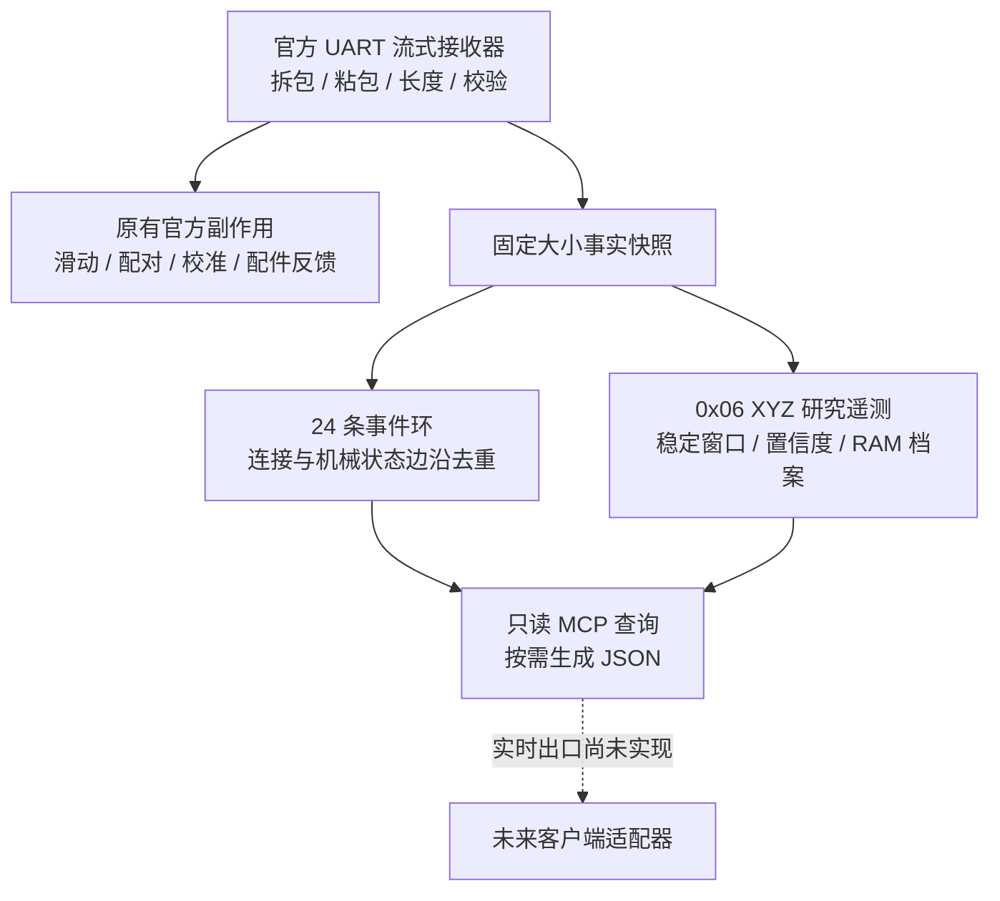
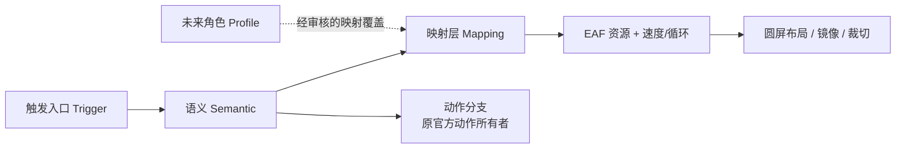

# 固件与客户端架构 / Architecture

## 分层与所有权

| 层 / Layer | 现有职责 / Ownership | 不承担 / Not owned here |
| --- | --- | --- |
| C61 底座 | 电机、回零、限位、磁场传感器、磁吸开关、UART | 人格、对话、表情库选择 |
| S3 本体 | 官方 UI/语音/摸头/双麦 DOA；UART 事实镜像；有界磁场识别 | DeepSeek 记忆与角色演化；自动注册未知外壳 |
| 电脑协议适配层 | 校验、快照优先、序号、过期、身份事实；离线角色绑定审核 | 无条件触发电机或把回放冒充实时设备 |
| 正式客户端（未来） | 外壳与角色确认、人格/音色/世界状态、Agent、ASR/TTS | 接管底层 UI 锁或电机限位算法 |
| 离线工作台 | 表达母库、资源派生、语义映射、圆屏预览、容量与发布审阅 | 自动刷写、实时轨迹、任意动作执行 |

`0x06` XYZ 是研究扩展，需要匹配底座；不能称为官方默认协议。`base.action.completed` 没有请求 ID，不能捏造对应哪一次动作。高频心跳和磁场样本不进入事件环；官方副作用不被研究逻辑接管。事件列表不等于外壳身份列表。

## UI 与并发约束

历史实验曾在对话和菜单切换时出现 UI 冻结。当前路线是退回已验收边界、拆开研究模块：

1. UART/音频/计时器回调不直接操作 LVGL、弹窗、资源切换或页面导航。
2. 回调只做有界解析与快照更新；持锁区不等待 UI、不做网络、不分配大对象。
3. 只读查询复制快照后释放锁，再生成 JSON，不反向调用 UI 或动作。
4. 同一增量不同时改显示播放器、音频管线、电机和协议；扩展必须使用原有所有者和调度机制。
5. 固定内存和队列上限；避免 UART 高频采样变成日志或通知风暴。
6. 新资源只更换指定包成员，播放器源码和分区布局保持独立闸门。

These are development constraints, not a claim that every historical freeze had one proven root cause. Offline tests, locks and startup logs cannot replace conversation/menu hardware regression.

## 表达不是一个文件名

`happy` 等语义与 `Happy.eaf` 资源必须分开：多个语义可以共享文件；角色可以未来覆盖映射，但不应修改事实事件的含义。当前 `embarrassed` 使用 `Happy.eaf`，专门害羞候选仅在离线工作台，不是已刷入内容。现有资源存在局部眼睛精灵，不能只看 EAF 宽高就判断圆屏兼容性；必须结合 layout 镜像/裁切及播放器版本。

## 未来客户端边界

身体事实、角色解析、客户端记录契约位于 `protocol/`。先快照、再增量；身份/会话变化、过期、乱序和重放必须被处理。磁场 `known` 只是物理识别事实；角色登记/确认属于用户与客户端。离线 `resolved_offline` 不授权真实设备切换表情或动作。

实时传输、鉴权、资源上传、动作仲裁与服务替换还未完成。后续先做有界只读出口和契约回归，再做受控表达，最后替换小智后端；不在本阶段接入 DeepSeek。
