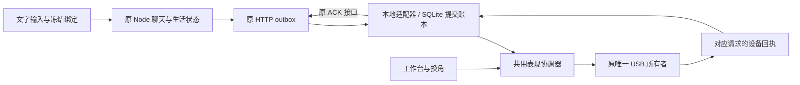

# 4b1a：文字回应到表情回执

2026-11-16。目标是把原客户端的文字回应接到既有表达通道。首轮离线联测；下一步 4b1b 接 USB 观察圆屏。

## 数据流与接口

| 模块 | 接口与职责 |
| --- | --- |
| `client_presentation_ledger.py` | SQLite 保存输入绑定、命令期限、准备发送、设备回执与 HTTP 确认；写入采用完整同步 |
| `presentation_coordinator.py` | 在原 `bridge.lock` 内核对实际角色、图摘要和代次，串行进入原 `command`；工作台表达和换角提升代次 |
| `client_presentation.py` | `chat(event_id, correlation_id, message)`、`tick()`、`state()`；沿原聊天、设备登记、outbox 与 ACK 接口运行；领取前按类型和来源筛选，语音由各自消费者领取 |
| 工作台服务 | 可选启用本地适配器；新增本机文字入口与状态入口，USB 仍由原桥持有 |
| 客户端恢复补丁 | 在模型调用前记录回合，在回复生成后保存可恢复结果；重开完成原回复、输出与回合归档 |

输入时冻结：个体、客户端阶段、表现修订、代次、设备、当前表达角色与图摘要。`event_id` 重复提交沿用原绑定和内容；发送前再核对。重连读取实际角色及新鲜会话，发送记录使用当次连接、启动和会话编号。角色切换即使又切回，也会结束旧代次待发项。

## 状态与边界

- 首轮语义为 `neutral / happy`。其他语义回写 `unsupported_expression`，保留原命令。
- 期限为原 `expires_at` 与 `queued_at + 30 秒` 的较早值，首次领取后持久保存。菜单、对话、睡眠占用时等待；到期回写 `expired`。
- 提交顺序为 `claimed → prepared → terminal → acknowledged`。先保存 `prepared`，再交给 USB；主机命令编号确定对应的 USB 请求编号，回执按设备、启动、会话和请求核对。
- `dispatched` 回写 `completed`，范围为 `player_dispatched`。回执已经保存而 HTTP 确认丢失时只补确认。提交结果不明时记录 `delivery_unknown`，后续新输入产生新命令。
- 待发期限控制开始提交的时间；提交后按既有 IPC、请求与终态预算收取原回执，共 21 秒。重开先核对已关联回执，未确认项回写 `failed/error.code=delivery_unknown`。
- 工作台表达、换角与客户端共用原锁和同一个命令入口。查询不改变代次，已提交项继续收取原回执。
- 聊天恢复记录分为 `started / prepared / completed`。`prepared` 保存原回复、完整输出计划与回合快照；重开只重做按事件编号去重的保存和入队。模型调用阶段中断的 `started` 显示 `turn_recovery_pending`，由新输入接续。
- 本地输入账本保留未收到 HTTP 回应的原请求；适配器重开后自动用原 `event_id` 重试，接续客户端准备好的回合。明确的回合待处理状态展示在本机状态接口。

## 源码与依赖

Python 使用标准库 HTTP / SQLite 以及既有协议模块。Node 使用已核对的 24+ 运行时、原 SQLite 持久层和完整客户端内容。

跨仓改动以 `integrations/client-4b1a/` 中的固定基线补丁与应用脚本交付，目标客户端为 `0d8d4c5`。隔离 checkout 应用相同补丁运行联测，源码摘要和测试结果一并归档。

## 验证

单元测试覆盖语义、绑定、代次、过期、并发和回执关联。集成测试使用真实 Node HTTP、独立 SQLite、固定模型回复和原 `ControlLink` 内存设备，覆盖重复输入、换角、断线、ACK 丢失与重开。故障注入分别放在回复准备、输出入队和发送之后，核对原编号、原回复及输出数量。

本轮 **217 项通过**：39 项适配与原 HTTP 联测、155 项原主机和工作台回归、23 项客户端测试。包含真实进程在输出入队后退出并重开、两线程争用同一命令锁、ACK 丢失、睡眠等待、21 秒回执预算、旧计划冻结与分页前筛选。两位 AI 分别复核恢复逻辑和设备调度，问题已修复并回归。

[结果与源码摘要](../artifacts/client-expression-loop-4b1a-20261116/report.json)及[复核记录](../artifacts/client-expression-loop-4b1a-20261116/review.md)保存在本阶段目录。4b1b 再观察圆屏并回归菜单、对话、触摸和睡眠；之后进入 4b2 常驻联网与统一语音。

## 后续沿用的做法

- 重试保留原时间、绑定、回复和输出计划；恢复时继续原事件。
- 队列先筛选消费者负责的内容，再分页，避免其他输出积压挡住新表达。
- 待发期限与发送后的回执预算分别计算，沿用协议实际时序。
- 每次推进待发项都重新核对绑定，包括刚写入账本就中断的情况；回执按原设备和会话保存。
