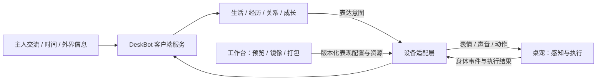

# 客户端与桌宠接入

更新：2026-11-17。主人已确认：**同一个体持续生活，换壳改变形态与表达，记忆和关系延续。**

完整使用周期与当前排期见[产品旅程](product-journey-20261116.md)。首版面向主人与少量体验者，日常目标为桌宠联网即可使用；USB 用于开发首环。设备网络、首次相识、离开返回和恢复纳入 4b，设置与打印可协助完成。

体验基线见[角色成长与实体化](product-experience-20261116.md)：现实输入折射进奇幻世界，经自主生活形成愿望，生成形象、参数化外壳并打印。首版由主人确认实际安装，磁场辅助提示与候选；旧壳恢复对应形态与表达风格，保留记忆、关系和能力。

自主生活先由客户端开发完成：世界推进、多源输入折射、自主选择、经历、兴趣与愿望归客户端。本仓提供身体输入、表情／声音／动作执行、角色资源及设备回执；接口交接已离线完成，安装确认的设备表情采用已通过实机验收，接续客户端角色采用联调。具体机制、接口和部署方式随双方验证调整；持续身份与生活状态由客户端统一保存。

## 给客户端的接入基线

2026-11-17 确认：客户端以本仓已验收的身体能力、现有接口和明确待接入项安排硬件相关管线；自主生活继续在客户端独立推进。两边先对齐输入、表现请求与执行结果，再各自实现、联合验收。新增能力共同扩展，双方文档同步更新。

| 能力 | 当前可依据的事实 | 客户端安排 |
| --- | --- | --- |
| 持续个体 | 已确认产品规则：同一个体，换壳和表现切换延续记忆关系 | 客户端保存生活、记忆和成长；设备角色关联到持续个体 |
| 表情 | 双角色与本体交互已验收；4b1 已跑通 `neutral / happy` 的客户端到圆屏链路 | 先复用这两项语义；新增语义核对客户端合同与实际角色图交集 |
| 语音 | 4b2b 已验证电脑 WebSocket、Opus 与真实 ASR/TTS，输入为合成录音、回答固定；设备统一语音待联调 | 认知与聊天使用客户端生活上下文；网络与语音模块复用现有接缝，接续真人和设备验收 |
| 身体输入与动作 | 本体触摸、菜单、对话和睡眠交互已验收；客户端事件上报、远程动作按项接入 | 按登记能力接收事件和请求动作；先用模拟事件联测，再核对设备实际回执 |
| 换壳与角色 | 主人确认 A/B 安装已实机验收；客户端安装自动同步已运行，安装卡显示接收结果 | 联合接入原聊天与音色采用；生活状态持续保存 |
| 磁场 | 已有采样、候选识别与离线调度，装回和环境复测继续接续 | 采用“候选提示＋主人确认”，同时保留手动安装入口 |
| 内容与容量 | 电脑保存完整素材，设备安装筛选后的角色包，逐包计算容量 | 先完成资源准备，再请求角色采用；镜像与过渡由资源配置承接 |

客户端侧建议接续：**持续个体与自主生活 → 接已有表达接口 → 统一真实对话与身体反馈 → 愿望／方案与安装采用 → 日常运行验收**。接口与模拟用例可在生活模块开发期间对齐；设备联调按各模块就绪情况安排。

交接使用现有 `/api/chat`、设备登记、outbox 与回执接口，具体字段见下方“接入路径与关键差异”和 [4a 接口定义](joint-capability-assessment-4a.md#接口与依赖)。客户端提交“表达什么”，适配层根据当前能力和资源执行；回执区分请求受理、播放器提交、角色首帧与保存。循环表情的提交命令完成范围为 `completion_scope: player_dispatched`，完整画面由实机验收。

联合验收先看三个用例：**同一输入得到一致的回答与表情；互动后客户端接续原生活；确认新壳后双方采用对应角色，记忆关系延续**。已实现与待实现分别沿上表和阶段报告更新。

[安装确认接口](shell-installation-confirmation.md)提供独立安装编号、持续个体、实物与完整配置快照，分别回报设备首帧和保存。设备表情安装已实机验收，见[归档](../artifacts/shell-installation-live-20261117/acceptance/report.json)。当前 `scope=device_expression`、`client_role_adoption=pending`；客户端据同一安装记录接续人格、音色和阶段采用结果。交接合同中的联合待接入项在两边验收后更新。

[客户端安装同步](client-installation-sync.md)新增本机接收与查询接口，将当前已保存安装写入客户端原 SQLite，返回持久凭证。查询为 `scope=installation_facts`，显示最近已同步形态与观察时间；人格、实际音色和成长阶段采用另按原入口接入。A→B→A、重复／旧请求、回应丢失、重开和原生活记录保留已在隔离原 HTTP 服务验证，后续[运行接入](client-installation-runtime.md)已将接收器与自动同步纳入原客户端和共享工作台，当前 B 的安装及凭证一致；原生活记录、队列和 USB 会话已核对。接入说明见[交接模块](../integrations/client-installation/README.md)。

具体交付见[客户端接入交接包](../integrations/client-handoff/README.md)：包含接口字段、机器可读能力摘要、实际 HTTP 示例和显式指定客户端开发目录的兼容检查。本轮 50 项离线检查通过，使用原 HTTP／SQLite、现有表现适配层和生产 ControlLink 内存设备；结果记录客户端实际提交、工作区差异与源码摘要。客户端可用更新中的源码复跑，逐项核对接口变化。

[4a 联合评估](joint-capability-assessment-4a.md)已完成源码核对和路线选择：先复用 HTTP 设备登记、聊天与输出队列，经统一协调入口接 USB；接着验证小智兼容语音，再结合客户端进度验证自主生活。当前 `/ws` 的音频协商与仅表达 HTTP 登记分别使用。

## 4a 核对快照（2026-11-16）

本节保留首次评估时的源码结论；当前接入范围见上方“给客户端的接入基线”。

客户端 [DeskBot](https://github.com/404-NOT-FOUND-ERROR/DeskBot/tree/0d8d4c5daf261446735b049c6f385981ffd96b21) 核对版本为 `0d8d4c5`（2026-11-14）。依据其[开发基线](https://github.com/404-NOT-FOUND-ERROR/DeskBot/blob/0d8d4c5daf261446735b049c6f385981ffd96b21/documentation/development-baseline.md)、[接口说明](https://github.com/404-NOT-FOUND-ERROR/DeskBot/blob/0d8d4c5daf261446735b049c6f385981ffd96b21/documentation/interfaces.md)及下列源文件。

| 能力 | 核对结果与验证范围 |
| --- | --- |
| 自主生活与成长 | 源码与文档包含任务、经历、关系、兴趣、愿望、试做和阶段采用模块；持续自主生活的整体效果仍在开发验证 |
| 多元输入 | 源码与文档包含时间、天气、公开资讯、主人互动和身体输入的来源、时效与作用范围管理；本轮完成静态核对 |
| 身体接口 | `body-perception.mjs` 包含触摸、方向与外壳事件，输出队列和桥已有实现；当前客户端与实体固件的联合效果待验证 |
| 语音 | ASR/TTS sidecar 接口已有，仓库默认实现为模拟音频；真实中文服务与当前桌宠语音仍待接入 |
| 认知质量 | 客户端基线记载 A3.4 复验进入 3/20、完整有效 2/20；R3-A 继续整改，正式新认知尚待验收 |
| 实体表达 | 本仓库 E3f-9d.3 双角色显示与日常交互已验收；客户端原生设备协议与当前 USB 协议待适配 |

本轮完成资料与关键源码核对、身份规则确认和开发顺序调整。客户端当前运行效果通过后续联合验证补齐；模块实现和阶段性测试分别作为选型依据。

4a 按设备实际能力选互动：显示与音频并发、已接通的传感输入、单轴转头、Flash/PSRAM 余量、离线行为和供电开销逐项对照。客户端活动先映射为设备能够稳定呈现的表达，联测问题同时进入客户端与固件的改进清单。

## 分工与数据流

候选分工：客户端服务集中保存生活与记忆，工作台管理制作草稿和发布配置，设备保存当前运行内容与必要缓存。首轮验证优先复用现有 Node/SQLite、认知模块和已验收设备接口，按结果决定后续调整。

## 身份与版本

| 对象 | 候选接入规则 |
| --- | --- |
| 持续个体 | 沿用客户端 `character_id` / 对应 `actor_id`；换壳、换表情包和重连均延续同一经历与关系 |
| 成长阶段 | 沿用客户端 `world.role_stages`；主人选择、实际试做与采用通过原接口处理 |
| 工作台角色配置 | 现有 `deskbot.role_profile.v2.role_id` 作为表现配置引用；人格字段接入时按客户端当前设定核对，长期人格由客户端持续管理 |
| 表达与外壳 | `expression_role_id` 选择表情图，`shell_id` 表示实物；安装外壳、采用虚拟形态与切换表达分别记录 |
| 同步状态 | 分别保存客户端阶段版本、工作台配置修订、表达图摘要与设备实际状态；`role_revision` 的映射在接入合同中固定 |

现有配置和绑定原样保留，新增个体与版本映射。一个个体可使用多份表现配置；切换时保留经历、关系、当前任务和成长阶段。

## 接入路径与关键差异

接入候选包括客户端 [身体协议](https://github.com/404-NOT-FOUND-ERROR/DeskBot/blob/0d8d4c5daf261446735b049c6f385981ffd96b21/research/protocol/body-perception-v1.md)、[输出队列](https://github.com/404-NOT-FOUND-ERROR/DeskBot/blob/0d8d4c5daf261446735b049c6f385981ffd96b21/apps/deskbot-service/src/output-router.mjs)和 [WebSocket 桥](https://github.com/404-NOT-FOUND-ERROR/DeskBot/blob/0d8d4c5daf261446735b049c6f385981ffd96b21/apps/deskbot-service/src/websocket-bridge.mjs)，电脑侧已有 `ControlBridge` 与唯一 USB 所有者。下列是已发现的差异和初步方案；4a 比较对客户端、固件及现有语音的改动成本后确定接口。

1. **表达会话。** 客户端 `/ws` 要求音频输入与输出格式；HTTP 的 `/api/devices/hello` 可只登记表达设备。首轮采用 HTTP 聊天与 outbox，经统一协调入口接现有 USB；真实语音单独核对小智协议、后端及音频会话。
2. **表情映射。** 客户端 `render.expression` 按已安装目录映射到设备语义与表达图；本体与工作台沿用原镜像、进入／持续／退出和应用调度。首版采用客户端与当前双角色包共有的 `neutral / happy`；其他语义先返回未映射。惊讶属于底层 USB 能力，接入时单独核对角色图；客户端新增难过、害羞等语义时共同修订合同。
3. **回执映射。** 保留 `command_id`、设备、启动与会话、来源事件、期限和版本。首版 `render.expression` 定义为“向当前表现的播放器提交语义”：收到 USB `dispatched` 后以 `completed` 结束该提交命令，结果带 `completion_scope: player_dispatched` 和原回执；受理阶段继续等待，拒绝、取消、超时和过期携具体原因结束。客户端消费者同时按此范围记录，完整画面与播放完成保持待观察。当前 USB 没有表情播放结束信号，循环表情持续到后续切换；角色启用的首帧和保存继续分别记录。若后续需要完整播放事实，再增加对应信号与合同。
4. **外壳与安装确认。** 核对版本的客户端使用 `magnetic_code / calibration_id`，本仓库提供 M2 连续磁场候选。分别保存候选观察和主人安装确认：后者绑定个体、外壳、方案、角色内容版本与当次安装，记录来源和修订，核对后进入统一采用入口。首次主人确认可独立于磁场观察完成；客户端需补明确的确认接缝，传感观察保留原语义。复测可用且主人启用自动匹配时，再由有效档案提供候选依据。
5. **输入归属。** 复用客户端 `body_devices` 本机登记与能力交集，首次只启用已核对的表达能力；身体输入和动作按实测逐项登记。触摸、方向与换壳分别映射到既有输入；设备重启、重连与输出确认进入运行记录，实际互动按客户端规则成为经历。同一对话保持一个处理入口。
6. **统一调度。** 客户端输出、工作台播放和既有换角模块共用一个表现协调入口，再交给唯一 USB 所有者。首版安装目标来自主人确认；后续可接受主人启用的有效自动匹配。协调入口保存当前目标、`presentation_generation` 和配置版本，切换后旧代次未提交意图结束为已替换。先完成角色实际确认，再按新版本发表情；已提交命令收尾后重新查询。菜单或对话占用时按原条件延后，超过期限返回原因。当前 `ShellInstallation` 接确认状态与保存结果，自动调度在手动安装期间暂停；两条路径已离线联测。

设备断线后刷新会话和目录，过期输出结束在原记录；恢复时核对安装尝试、准备进度、当前阶段与设备状态，再继续。同次磁场变化合并提示，转动、不稳定和暂不处理保留当前表现；主人可随时从“我换好外壳了”确认或更正。形象方案同意、实物安装确认与角色实际生效分别保存；当前一句结束后采用准备就绪的新目标。

## 开发与验收

| 步骤 | 交付 | 验收 |
| --- | --- | --- |
| 4a · 已完成评估 | 源码、状态归属和接缝已核对，确定 HTTP 表达首环及语音候选 | 见[联合评估](joint-capability-assessment-4a.md) |
| 4b1 · 首个实现 | 文字输入 → 同一生活状态 → 回应 → HTTP 队列 → USB 提交回执 | 先隔离存档与内存联测，再实机；重复、版本、时效与恢复有结果 |
| 4b2—4b3 | 客户端开发持续生活；双方接续统一语音、身体反馈和日常恢复 | 生活模块就绪后联合验收，逐步达成联网即可日常相处 |
| 4c—4d | 经历、偏好与愿望 → 主人讨论 → 形象方案和修订 | 愿望有依据，方案可确认、修改和暂缓 |
| 5 | 参数化外壳、角色内容准备、容量与打印文件 | 模型可打印、资源可核对，等待期间生活继续 |
| 6 | 磁场候选或手动入口 → 主人确认安装 → 统一采用 | 未识别和候选纠正可完成，服务与设备实际版本可核对 |
| 7 | 扩大生活内容与持续使用观察、简化部署维护；复测后的可选自动匹配 | 新奇感、打扰程度与运行成本有实测依据，基础恢复从 4b 开始 |

单元覆盖身份与版本、语义映射、能力交集、时效、回执范围、安装确认与共用调度。集成检查主人确认独立于磁场、候选纠正、同次变化合并、内容未就绪、旧壳重用、断线恢复和生活接续；循环表情的提交命令可正常收尾。实机按自己的节奏检查画面、菜单、对话、触摸和睡眠。另一 AI 复核设计与实现，稳定版本集中更新 GitHub。

客户端认知研究与身体接入共享目标和问题记录，分别保留测试结果，再通过端到端体验共同验收。先用隔离存档、受控输入和内存设备验证表达回路，随后在实机复现；持续生活另检查重复调用、打断接续、重启恢复和长期运行的效果及资源开销。详细当前进度见[主线](project-mainline.md)，产品排期见[开发计划](development-plan-20261104.md)。

首次接入规划独立 AI 复核通过：补齐提交命令的完成范围、共用表现调度和本机设备登记。13 份来源摘要已核对；本次补充“双方共同开发，按联合结果选型”，复核结果记入[核对记录](../artifacts/client-hardware-integration-20261116/report.json)。
