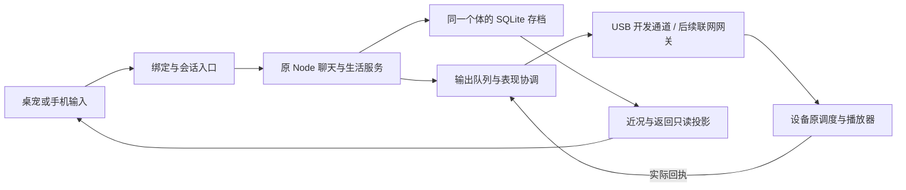
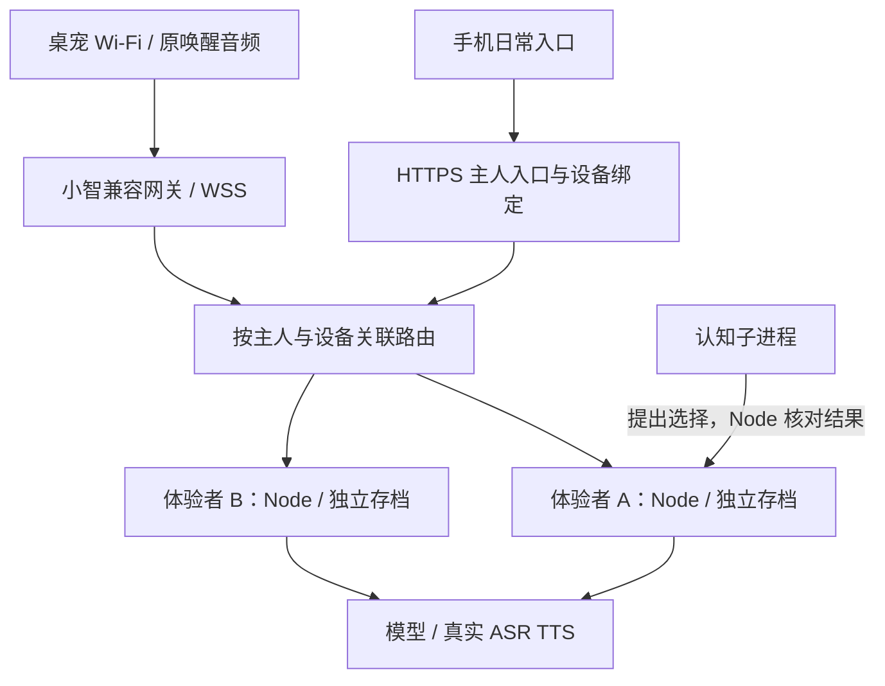

# 最小日常版：交互与联网方案

更新：2026-11-16。依据[完整旅程](product-journey-20261116.md)，把首版拆成可实现、可观察的日常任务。已确认：少量体验者、设置引导与打印协助；桌宠联网即可日常使用，制作和调试按需开电脑。下述交互为本轮设计，体验后调整。

## 首版交付

用户能认识同一个体，通过桌宠交流，看懂它正在做什么；安静离开，回来接上真实近况。断网、换网和服务重开后，继续原来的身份与进度。

先完成日常小回路，成长和实体化沿[核心流程](product-experience-20261116.md)接续。首轮共用已有平静／开心语义，表情、声音和动作按实际能力扩展。

## 第一次相识

| 步骤 | 用户操作 | 产品反馈与完成条件 |
| --- | --- | --- |
| 1. 准备 | 供电开机，用手机打开随设备提供的引导页 | 告知接下来是联网、连接伙伴、第一次见面；当前步骤可重开接续 |
| 2. 联网 | 按圆屏提示连接 `Xiaozhi-*` 热点，在设备网页选择家中 Wi-Fi | 沿用现有配网，手机切回家中网络后，引导页核对设备实际在线状态 |
| 3. 连接伙伴 | 交付前由项目登记；用户在手机页领取本台设备，或找回已有个体 | 核对设备、主人入口和独立存档；换网沿用绑定；领取成功显示伙伴和当前形态 |
| 4. 相识 | 点圆屏或用原唤醒方式说一句话，可讨论名字和称呼 | 它结合初始生活处境回应，留下第一次共同经历；基础世界与人格由角色自身设定承接 |
| 5. 开始相处 | 看它的当前活动，再自由交流或让它自己待着 | 手机显示“正在做什么”和一次实际互动；桌宠回到日常表现，引导完成 |

Wi-Fi 保存、网络连接、生活服务连接、伙伴绑定分别显示。首批可由项目协助领取和设置；手机引导只需解释当前一步。名字与称呼是相识内容，已有存档优先找回。

## 日常界面与动作

| 入口 | 平时显示什么 | 主要操作 |
| --- | --- | --- |
| 桌宠主页 | 表情与轻量状态；交流时字幕和声音一致 | 原点按／唤醒交流，原左滑菜单；摸头、睡眠与唤醒沿用已验收交互 |
| 手机“近况” | 当前活动、一条最近实际经历、连接状态 | 听它讲、继续聊、稍后看；有愿望时出现可接续入口 |
| 手机“交流” | 同一个体的对话，当前聆听／思考／说话状态 | 文字交流、停止当前回应；与本体互动共用当前会话 |
| 手机“设置” | 网络与服务、安静偏好、麦克风状态、找回与备份 | 换网、安静设置、输入来源选择、恢复原个体 |
| 制作工作台 | 愿望方案、内容预览与制作进度 | 按需打开；节点、镜像、资源包、采样和原日志在对应工具中操作 |

文案样例：“我刚试过一种新的做法，想给你看看。”实际内容来自它已经记录的选择与结果。活动还在进行时讲当前进度，只有完成记录才讲成果。

## 交流、安静和生活分别处理

| 状态维度 | 首版取值／来源 | 对行为的影响 |
| --- | --- | --- |
| 当前交流 | `idle / connecting / listening / thinking / speaking / cancelling`，由会话与设备事实组合 | 即时显示“正在听／想一想／正在说”；停止回应后清理旧轮次音频与表达 |
| 主人偏好 | `normal / quiet`，主人明确选择并保存 | 安静时保留轻量画面与近况，主动声音等待用户恢复；用户发起交流仍可回应 |
| 身体睡眠 | 设备实际睡眠状态 | 沿用原睡眠与唤醒方式，醒来先同步当前状态 |
| 麦克风 | 实际工作／静音状态，当前能力未提供时显示未提供 | 麦克风控制与安静偏好分别呈现，用户明确知道何时在听 |
| 网络与服务 | Wi-Fi、服务通道和最后观测时间分别记录 | 显示“连接网络／连接伙伴服务／已连接”；旧观测标为待更新 |
| 后台生活 | `running / paused / recovering / unknown`，由实际调度与存档读取 | 生活状态独立于屏幕；服务恢复后核对进度与来源 |

以上是跨端体验模型，设备内部状态继续沿用原实现。`thinking` 等体验状态由服务器回合进度补齐，逐项映射到当前能力。

用户发起交流优先于主动分享；菜单保留原交互优先级。取消和新输入提升会话代次，旧回合结果按原记录收尾，设备采用当前目标。世界里的活动按任务规则继续或调整，聊天结束后展示接续结果。

手机文字交流默认在手机显示答语，已绑定桌宠可同步表情；“让桌宠说”由主人显式选择，或由本体发起的语音会话确定。回合创建时冻结可信入口 `origin`、`output_targets`、`turn_id` 和 `turn_generation`，与表现代次分别保存。停止当前回应同时作用于该回合的文字流、语音和待发表达；已接受的主人输入和实际世界结果保留。过期取消只结束对应旧回合，当前新回合继续。同一个体的新输入按统一会话顺序处理。

主动分享采用“重要进展、清醒可打扰时、少量分享”的试用方向。安静、睡眠和用户正在交互时合并待分享项；未回应后保留一条近况。具体频率在 4b3 试用时配置并记录，首个接口实现先完成用户发起的回合。

## 离开与返回

- **离开**：主人可说晚安、设安静或直接去忙；无输入期间按既有状态生活。设备目前没有可靠的人体在场事实，返回由唤醒、点按、主动打开近况或明确话语触发。
- **返回**：先同步一份当前快照，挑选一条自上次看过以来的重要实际进展；用户选择听它讲、直接聊天或稍后。网络重连先更新画面，语音分享等待适合时机。
- **设备曾离线，服务仍运行**：汇总该期间已记录的生活；旧音频和过期表情按原期限收尾，当前表现从新快照生成。
- **后台曾停止或调度停顿**：显示恢复进度和实际记录。客户端已有时钟同步与恢复结算，实时观测、恢复后结算和未观测时段分别呈现；首版展示规则按联合测试核定。
- **找回原个体**：换网保持绑定；更换手机／电脑走主人找回入口。服务恢复核对存档与当前版本，制作项目从未完成处继续。

近况已读位置与“已播放”分别记录。打开页面即可查看文字；播报完成由音频实际完成回执确认。重连和重复打开沿用原近况编号，后续新经历可成为下一条。

## 接口、数据流与依赖

| 接口 | 状态与本轮定义 |
| --- | --- |
| `POST /api/chat`、`GET /api/outbox`、`POST /api/outbox/:id/ack` | 已有。4b1a 复用聊天、输出和提交回执；输入时冻结身份与表现绑定，沿用[4a 时效与恢复规则](joint-capability-assessment-4a.md#时效并发与恢复) |
| `GET /api/life/world`、`/api/life/continuity`、`/api/life/observation` | 已有。分别提供当前世界、接续事项和实际观测；组合读取核对同一版本，首页 GET 保持只读 |
| `GET /api/companion/home` | 拟新增。返回 `character_id`、`world_revision`、`as_of`、当前活动、连接／交流／安静状态、一条有来源的近况和可执行下一步；一致投影由服务一次组装 |
| `POST /api/companion/preferences` | 拟新增。用 `event_id + expected_revision` 保存安静与分享偏好；重复提交复用原结果 |
| `POST /api/companion/check-ins` | 拟新增。保存明确返回、近况已读或主动分享结果，分别携带事件编号、个体、原近况编号与结果；普通 GET 只查看 |
| `POST /api/companion/turns/:turn_id/cancel` | 拟新增。携带稳定 `event_id`、`session_id` 和 `turn_generation`；服务核对原回合输出目标，重复取消沿用原结果，旧代次不影响新回合；当前 `/api/voice/cancel` 仅为 sidecar 接缝 |
| 主人领取与找回接口 | 4b2 新增。短期领取码关联已登记设备、主人入口与独立存档；身份由网关会话解析，换网保留原关联 |

依赖：固定客户端基线 `0d8d4c5`、Node 24+、SQLite、完整世界内容与契约、原 USB 所有者。首环先开发共用表现协调入口与本机提交账本；4b2 再接网络、真实语音和主人绑定；4b3 交付近况、偏好、返回与引导。

## 首版联网部署

建议由项目维护一台有稳定网络入口的常驻服务机。**每位体验者一个 Node 实例和独立运行目录**，世界、认知预算、实验数据、配置、音频与缓存各有独立可写路径；共用入口网关和语音基础设施，手机和桌宠连接各自个体。具体主机按实测开销选定。

此图为目标拓扑。当前客户端主角 ID 固定；独立实例保存独立个体，入口以实例和主人绑定区分。原 API 放在服务内网，由网关处理主人会话、设备凭据与实例路由。首次只给已登记的少量体验者配置入口。

未领取设备进入配对状态；短期领取码一次消费，已绑定设备重试返回原关联，找回沿用原实例。改绑使用原主人确认的独立操作。网关根据已认证主人／设备的服务端关联路由，载荷中的个体或实例编号只用于一致性核对。

4b2 按实例显式注入全部可写路径；当前认知预算和实验库有相对源码的默认路径，采用独立运行目录或补路径配置后核对。日常网关只开放主人与设备所需接口，研究、实验时钟和作者控制保留项目管理入口。

小智兼容网关为 Wi-Fi 主候选，先复用现有设备音频能力。设备启动时 MQTT 配置优先于 WebSocket，切换路线需成套核对配置与协议选择。网关负责音频转写、取消与返回；原 Node 聊天入口保留唯一生活上下文。独立语音入口的切换按一次统一会话验收。

常驻运行包包括自启动、进程重启、上述逐实例持久目录、SQLite 一致备份和恢复演练；各库的 WAL 与对应数据库放在同一持久目录，备份使用一致快照。工作台关闭后后台继续运行，代码更新沿用原存档和绑定。

运营页复用健康、模型、语音、用量与存储接口；分别列出真实调用、测试调用、未知用量和估计费用。现有模型账本可复用，ASR/TTS 费用、统一额度和整体资源开销接续补齐，费用按实际所选服务重新核定。

## 开发与验收

| 顺序 | 实现 | 完成标准 |
| --- | --- | --- |
| 4b1a · 首个工程任务 | HTTP 输出适配、共用表现协调、本机提交账本与回合恢复 | 隔离存档＋固定回复＋内存设备贯通输入到回执；覆盖版本变化、时效、重复与退出重开 |
| 4b1b | 接原 USB 所有者 | 客户端回应对应圆屏表情，菜单、对话、触摸和睡眠回归通过 |
| 4b2 | 一台设备的常驻联网包、主人绑定、真实语音和断连恢复 | 关闭制作电脑后仍能交流；设备连向正确个体，服务重开后沿用原存档 |
| 4b3 | 手机近况与设置、第一次相识、安静与返回、自主生活接续 | 新体验者完成首次和日常任务，能解释它的近况，并从换网／暂停中继续 |

单元方案：状态维度独立、输入与近况去重、领取与绑定、修订、输出目标与取消代次、近况来源与已读、偏好保存。集成方案：聊天到实际提交、跨端取消与发声归属、领取码重试／过期、跨实例路由及全部可写目录隔离、管理接口访问范围、设备重连、服务重开、同编号重试、只读首页与恢复结算来源。

用户按自己的时间统一验收：首次相识；一次交流与打断；安静后再主动聊天；离开后看一条近况；关闭制作电脑仍可交流；断网／换网与服务恢复。实机继续检查两角色画面、镜像、过渡、菜单、对话、摸头和睡眠。

本轮交付为交互和部署设计、源码依据与相关已有测试复跑。新接口、网关和 4b1a 源码进入上述工程步骤；归档见 `artifacts/daily-experience-v1-20261116/`。
