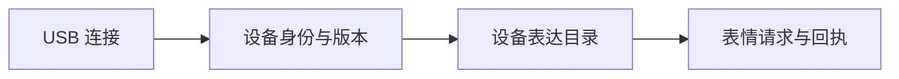

# DeskBot Studio E3b · 设备身份与版本

E3b 让本体通过现有 USB 控制台自报身份、固件版本、Flash 和 PSRAM 容量。第二版已安装，前两步的实机连接检查通过，交互验收待用户确认：



## 实现

本体启用 `DESKBOT_STUDIO_IDENTITY_ENABLE` 后，独立任务立即发送一条 hello，此后每 10 秒更新。任务优先级 1，栈 4 KiB；使用既有日志输出。配置默认关闭。

| 信息 | 含义 |
| --- | --- |
| 设备编号 | MAC 经独立域 SHA-256 派生的稳定编号 |
| 启动编号 | 每次任务启动生成的随机编号，用于区分重启 |
| 固件 | E3b 协议实现版本、App 版本与 ELF SHA-256 |
| 容量 | 运行时读取的 Flash、PSRAM 字节数 |
| 能力 | 本轮提供 `device_identity`；表达目录由后续接口确认 |

协议为 `deskbot.device_link/v1`，电脑快照为 `deskbot.body_observation/v2`。主机只接收数据；这是设备发现。客户端认证将在双向通道阶段设计。

主机按行读取，上限 2 KiB。身份在 30 秒内有有效更新时显示“身份已收到”；过期显示“等待更新”。重复、倒序和旧启动消息不延长有效期。断开、重连或启动变化时清理旧身份和状态。页面保留 E1.18 已保存目录与电脑请求模拟器。

## 启动与复现

在 Git 根目录执行：

```powershell
& .\scripts\start-deskbot-studio-e3b.ps1
```

打开[本机工作台](http://127.0.0.1:8766/#connection)，选择本体串口并连接。当前 E3b 第二版会在十秒内更新身份；屏幕、内存和对话状态继续按原日志观察。E1.42 保留为已验收恢复版本。

页面生成入口是 `scripts/build-deskbot-studio-e3b.py`，`--local` 生成本机完整预览，`--check` 检查生成结果。固件双构建使用已预检的 IDF Python 运行 `scripts/build-deskbot-studio-e3b-firmware.py`，`--check` 复核保存结果；中断先查原进程，再用 `--resume` 继续。

源码相对 E2b 只增加身份组件的两个文件，调整 `dev_tools.cc` 启动点和 Kconfig。显示、音频、底座与网络源码沿用原实现。构建结果和验证分别记录在[构建报告](../artifacts/deskbot-studio-e3b-20261104/firmware-build-report.json)与[检查汇总](../artifacts/deskbot-studio-e3b-20261104/verification.json)。

`scripts/audit-deskbot-studio-e3b.py --check` 复核源码范围和关闭版代码。独立的[固件审计](../artifacts/deskbot-studio-e3b-20261104/firmware-audit.json)记录与 E2b 的逐段差异；[现场观察摘要](../artifacts/deskbot-studio-e3b-20261104/live-observation.json)记录旧固件日志与等待身份状态。

## 本轮结果

| 检查 | 结果 |
| --- | --- |
| Python 专项与核心回归 | 修正版 140 项通过，含部署恢复 19 项和格式兼容 8 项 |
| 工作台 JavaScript 核心 | 43 项通过 |
| 浏览器场景 | E3b 30 项、E3a 回归 25 项通过；已查看桌面、窄屏、深色和现场页面 |
| 默认关闭 App | 4,481,776 B；与 E2b 的代码和其他数据一致，仅 ELF 标识及镜像校验变化 |
| 身份启用 App | 修正版 4,483,424 B；增加 1,648 B，分区余量 1,660,576 B |
| 保护产物 | bootloader、分区表、模型与 OTA 初始数据一致 |
| App 与保护范围 | `0x10000..0x457000` 逐字节回读一致，其余区域设备端摘要及写后首次启动前 NVS 核对通过 |
| 启动与身份 | 首次启动、重启各收到 5 条消息；确认 32 MiB Flash / 16 MiB PSRAM，间隔约 10 秒 |
| 重启与重连 | 重启保持设备编号、更新启动编号；断开清理身份，重连后收到同一启动的新序号 |
| 真实工作台 | 1440 / 390 px 页面通过，身份与已刷 App 一致，两个连接步骤完成，页面无脚本错误 |
| 交互回归 | 屏幕、对话中及结束后切菜单、摸头、睡眠唤醒待用户反馈 |

[App 候选清单](../artifacts/deskbot-studio-e3b-20261104/deployment-candidate.json)已保存。构建中第一次检查将高地址语音模型误判为表情资源，现已按完整地址与文件清单修正；原日志保留在本机构建目录。行动指南已补充这条经验。

首次安装在 `BuildHello` 的 `snprintf` 中崩溃：当前 nano newlib 不支持 64 位整数格式，后续字符串参数被错读。部署器自动恢复 E1.42，App 字节回读、其他区域摘要、NVS 与正常启动核对通过。修正版先将运行时间转成十进制字符串，并在构建前运行格式检查。见[首次恢复记录](../artifacts/deskbot-studio-e3b-20261104/first-install-recovery.json)。

## 设备验收与下一步

第二版已仅刷入 COM4 App。备份复用首次完整 32 MiB 回读，刷新本轮低地址 64 KiB，再以设备端摘要核对完整参考；写后逐字节回读 App，其余范围使用设备端摘要校验。启动、周期身份、重启、重连及真实工作台页面检查通过。现场备份、恢复镜像、原始日志和截图保存在本机运行目录；结果见[实机报告](../artifacts/deskbot-studio-e3b-20261104/live-deployment.json)。离线报告继续记录各自阶段的结果。

待完成：屏幕与菜单、点击对话、说话中及结束后切菜单、摸头、睡眠唤醒。底座相关回归在维修后进行。

2026-11-04：用户暂不方便测试，交互验收留待后续；期间继续 E3c 离线协议与调度验证。

部署入口为 `scripts/deploy-deskbot-studio-e3b.py`，按独立运行标签执行 `prepare → install → restart`；中断时先查同轮 `deployment-state.json`，再使用 `recover`。部署完成后用 `tools/verify-studio-identity-e3b.py` 检查工作台重连，最后以 `scripts/audit-deskbot-studio-e3b-live.py` 生成实机摘要。

E3c 接一个已安装表情：USB 接收器解析有界请求，交给应用调度和原显示所有者；加入请求编号、忙碌、去重、有效期与回执。E3d 再读取实际资源目录、扩展表情；底座修好后接入已有动作。完整顺序见[开发计划](development-plan-20261104.md)。

E3c 的入口核对和实施步骤已整理为[单个表情设计](deskbot-studio-e3c-design-20261104.md)。首个语义选 `neutral`，使用 E1.18 的 `winking.eaf`，没有绑定电机动作。
