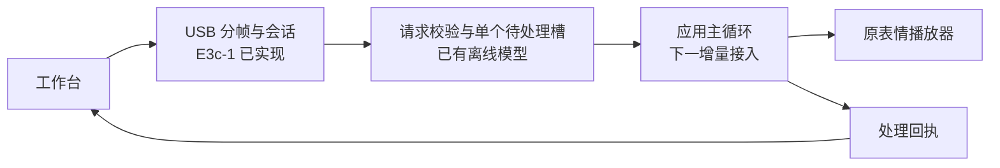

# E3c-1 · 从电脑连接到单个表情

目标：工作台点击“平静”，桌宠调用原播放器，并返回处理结果。先建立连接会话，再接入应用状态和表情。

2026-11-05：E3c-1 的 USB 诊断接收和会话层已完成，28 项专项测试及原准备套件 83 项测试通过，关闭版、启用版的隔离构建和审计通过。设备沿用 E3b 第二版，交互验收待用户方便时进行。



## E3c-1：USB 诊断会话

协议为 `deskbot.studio_session/v1`。请求包含 `schema`、`operation`、`request_id`、`target_id`、`boot_id`、`client_nonce`、`session_id` 七个字段。

| 操作 | 结果 |
| --- | --- |
| `open` | 核对设备和本次启动；同 nonce 恢复会话，新 nonce 生成新会话 |
| `ping` | 核对当前会话并续期 |
| `close` | 核对当前会话并关闭 |

回执包含设备号、启动号、请求号、会话号、序号、状态、原因、运行时间和租期。当前 `controls_available` 为 `false`；E3b hello 继续声明身份能力。

| 项目 | 实现 |
| --- | --- |
| 接收 | USB Serial/JTAG 基础 VFS；UART0 主控制台与 USB 辅输出沿用现有配置 |
| 任务 | 优先级 1，栈 6144 B；每 10 ms 最多读取 64 B |
| 分帧 | 固定 2 KiB 缓冲；处理分片、粘包、CRLF、超长行与断开清空 |
| JSON | 固定字段、ASCII 标识符最多 96 字节；解析标准转义，拒绝重复键、未知字段和嵌套 |
| 时间 | 租期 30 秒；残帧超时 2 秒；回复间隔至少 250 ms |
| 内存 | 会话核心使用固定内存；原生测试限制 Endpoint ≤ 3072 B、Request ≤ 704 B |
| 接入 | 默认关闭的 Kconfig 选项；由身份任务传入相同设备号和启动号后启动 |

USB 总线在线状态只能说明总线连接。电脑每次重新建立逻辑连接时生成新 nonce；旧会话由租期结束。检测到断开时清空残帧、会话和回复节流状态，重连可立即建立会话。

会话代码只处理诊断请求。应用、UI、音频、电机及持久化的接入分别在后续增量完成。

源码：[固件会话核心](../firmware/body/main/boards/esp_vocat/studio_usb_session.h)、[USB 适配](../firmware/body/main/boards/esp_vocat/studio_usb_diagnostic.cc)、[电脑编码与校验](../protocol/studio_usb_session.py)、[JSON Schema](../protocol/deskbot-studio-session-v1.schema.json)。

## 已完成的准备

| 部分 | 内容 |
| --- | --- |
| 表情接收模型 | 一个待处理槽、64 个结果、最近 24 条回执；请求完整到达后计时，提交前复核状态和有效期 |
| 原生分帧 | 固件与主机共用同一 C++ 头文件；实际编译运行并与 Python 结果对照 |
| 首个表情 | `neutral → winking.eaf`；该语义在当前映射中没有附带电机动作 |
| 回退 | 已验收 E1.42 App、完整现场备份、部署计划与执行记录已离线核对；恢复入口独立于候选与构建目录 |

[表情接收模型](../protocol/studio_expression_receiver.py)仍是电脑模拟器，回执标记来源 `simulator`。模型满 64 个结果后拒绝新编号；固件接入前需确定长期运行的窗口轮换方式。

当前 `SetEmotion` 返回 `void`。后续回执“已提交”表示已调用原显示入口，屏幕播放效果通过实机验收确认。

## 构建与核对

以冻结的 E3b 第二版为参照，仅改变六个固件文件：Kconfig、身份任务和四个 USB/会话组件。关闭版与启用版使用独立目录；比较 App、符号、有效配置和剩余空间，核对 bootloader、分区表、模型与 OTA 初始数据。

关闭版逐字节对照 E3b：可执行内容及其余数据相同，65 个变化字节均属于 ELF 摘要和镜像校验值。构建期间固定源码清单；源码变更后重新暂存再续建。

| 配置 | App 大小 | App 分区剩余 |
| --- | ---: | ---: |
| USB 会话关闭 | 4,483,424 B | 1,660,576 B |
| USB 会话启用 | 4,487,424 B | 1,656,576 B（约 1.58 MiB） |

启用版增加 4,000 B；两版的 bootloader、分区表、语音模型和 OTA 初始数据均与 E3b 相同。结果见[构建报告](../artifacts/deskbot-studio-e3c-20261104/firmware-build-report.json)与[审计报告](../artifacts/deskbot-studio-e3c-20261104/firmware-audit.json)。本轮完成离线验证，设备仍运行 E3b。

## 复现入口

从 Git 根目录运行，先用 `scripts/preflight-deskbot-toolchain.ps1` 确认 Offline 与 Build 环境。离线测试使用 Offline Python，固件构建使用 IDF Python。

```powershell
python scripts/validate-deskbot-studio-e3c-session.py --check
python scripts/validate-deskbot-studio-e3c-preparation.py --check
python scripts/check-deskbot-studio-recovery.py --check
```

前两项实际重新执行 28 + 83 项测试；第三项核对已保存的恢复材料。对应[会话报告](../artifacts/deskbot-studio-e3c-20261104/session-validation.json)、[当前准备报告](../artifacts/deskbot-studio-e3c-20261104/preparation-validation-e3c1.json)、[回退报告](../artifacts/deskbot-studio-e3c-20261104/recovery-readiness.json)。原 `preparation-validation.json` 保留为上一增量记录。

2026-11-05 全仓库复测 993 项：986 通过、2 跳过，5 项旧快照比对未通过，名称与 E2c 相同。原因与具体测试见[全套汇总](../artifacts/deskbot-studio-e3c-20261104/offline-suite-review.json)。

```powershell
& 'D:\Espressif\python_env\idf5.5_py3.11_env\Scripts\python.exe' scripts/build-deskbot-studio-e3c-firmware.py --check
& 'D:\Program Files (x86)\Python\Python 3.13.0\python.exe' scripts/audit-deskbot-studio-e3c.py --check
```

需要重新构建时使用构建脚本的 `--resume`；重新生成审计时省略审计脚本的 `--check`。串口回退入口为 `scripts/deploy-deskbot-studio-e3b.py recover --run e3b-live-20261104-install2`，本轮保留并核对材料。

## 接下来的增量

1. **只读状态查询**：[E3c-3](deskbot-studio-e3c3-20261105.md)已接入 USB 查询及电脑端状态管理，178 项测试、构建与独立审计通过。实际睡眠状态仍需确定来源。
2. **单个表情接入**：经 `Application::Schedule` 在应用主循环处理一个请求；结合主页、应用及睡眠状态决定能否提交 `neutral`。执行前复核会话、去重和有效期。
3. **工作台接线**：设备声明能力后开放实机按钮；显示请求、回执及其来源。
4. **实机验收**：会话建立、重复、过期、重连和重启；再做 20 轮对话/菜单往返、摸头、睡眠唤醒及 30 分钟连续交互。
5. **E3d 表达目录**：查询设备实际安装资源，再扩大表情范围；底座修复后接入已有动作。

之后按[完整计划](development-plan-20261104.md)推进外壳持久登记、角色确认和客户端 DeepSeek/语音接入。设备部署记录见 [E3b](deskbot-studio-e3b-20261104.md)。
