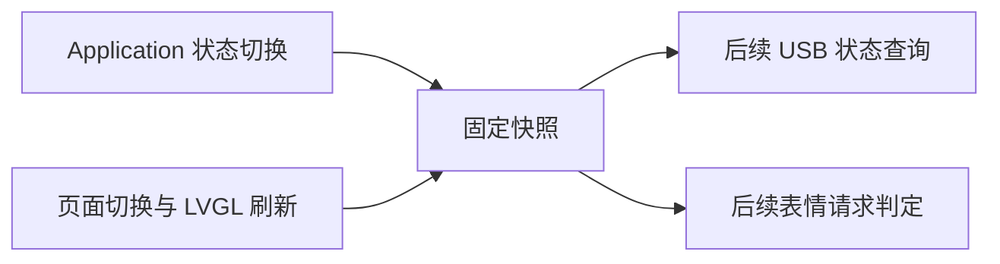

# E3c-2 · 应用与页面状态快照

目标：给后续电脑状态查询和表情请求提供一致的应用、页面事实。状态由原所有者在切换开始与结束时写入固定内存；本轮未添加 USB 状态查询，也未接表情执行。



## 快照内容

| 来源 | 当前值 |
| --- | --- |
| 应用 | 小智已有的设备状态枚举 |
| 页面 | 主页、其他已注册页面或未知 |
| 睡眠 | 未知；当前没有可确认的屏幕/播放器睡眠信号 |
| 控制能力 | 关闭 |

应用和页面各有独立的递增版本与 `unknown / transitioning / settled` 阶段。切换中不给出上一个值。重叠切换结束后标为未知，下一次独立的完整切换可以恢复；结束标记无法配对、版本溢出或超过四个并发写入时，该通道保持未知直至重启。页面快照在 LVGL 锁和主页动画刷新结束后标记完成。

`CanEnterSleepMode()` 表示是否满足进入睡眠的条件，不是睡眠已发生。`PAGE_SLEEP` 是定时页面，`sleepy` 是表情及动作语义。这三者都不用于推断实际睡眠。

快照核心使用固定大小结构；固件存储最多 80 B，单次读取结果最多 24 B，不新增任务、动态分配或外设调用。ESP32 访问由短临界区保护，快照读取不访问 Application 对象、LVGL 对象或页面原始指针。配置项默认关闭，并依赖 E3c USB 诊断开关。

## 离线验证

21 项专项测试实际编译运行生产 C++ 核心和 ESP32 适配层（主机锁替身），覆盖应用所有状态、页面、切换中、重叠与反序完成、非法结束、版本边界、固定内存以及 3 个并发应用写者、1 个页面写者和读取者。

专项与原有准备回归共 132 项通过，见[测试报告](../artifacts/deskbot-studio-e3c2-20261105/offline-validation.json)。

## 构建结果

关闭与启用两版独立构建、复核和审计通过，完整源码清单共 1,071 项，相对 E3c-1 的固件变化限定在六个文件。

| 配置 | App 大小 | App 分区剩余 |
| --- | ---: | ---: |
| 快照关闭，USB 会话启用 | 4,487,424 B | 1,656,576 B |
| 快照启用，USB 会话启用 | 4,488,144 B | 1,655,856 B（约 1.58 MiB） |

启用快照增加 720 B，实际存储为 56 B。关闭版代码和数据与冻结 E3c-1 相同，65 个变化字节均为 ELF 摘要和镜像校验。两版的 bootloader、分区表、语音模型及 OTA 初始数据与 E3c-1 一致。

结果见[构建报告](../artifacts/deskbot-studio-e3c2-20261105/firmware-build-report.json)与[独立审计](../artifacts/deskbot-studio-e3c2-20261105/firmware-audit.json)。临时构建位于 `tmp/e3c2-snapshot-20261105/`；重新构建使用构建脚本的 `--resume`。

## 复现入口

从 Git 根运行；测试和审计用 Offline Python，固件构建用 IDF Python。

```powershell
& 'D:\Program Files (x86)\Python\Python 3.13.0\python.exe' scripts/validate-deskbot-studio-e3c2.py --check
& 'D:\Espressif\python_env\idf5.5_py3.11_env\Scripts\python.exe' scripts/build-deskbot-studio-e3c2-firmware.py --check
& 'D:\Program Files (x86)\Python\Python 3.13.0\python.exe' scripts/audit-deskbot-studio-e3c2.py --check
```

本轮不打开串口、不刷设备。设备仍为 E3b 第二版，E3b 交互验收仍待用户方便时进行。

## 下一步

1. 给已建立会话的电脑增加只读状态查询，输出这些快照并验证有效期、重连和状态未知。
2. 确定实际睡眠状态与可显示条件，再通过 `Application::Schedule` 将有时限、去重的 `neutral` 表情请求交给原播放器。
3. 将请求、回执和实机按钮接入工作台，再安排设备回归。
