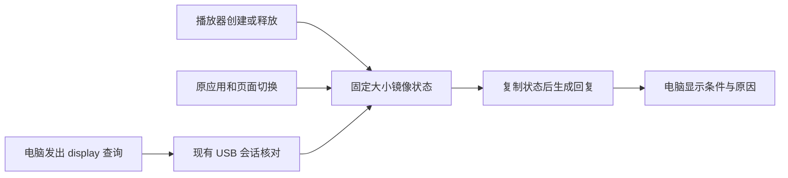

# E3c-4 · 显示条件查询

电脑可以通过现有 USB 会话查询播放器初始化状态，以及当前应用和页面。新增 34 项专项与前序回归共 212 项通过；双配置固件构建与独立审计通过。



## 查询结果

| 项目 | 表示什么 |
| --- | --- |
| 播放器 | 未知、初始化失败、已初始化或正在释放；记录状态版本 |
| 应用 | 空闲、聆听、说话等状态，包含切换阶段 |
| 页面 | 主页、其他页面、切换中或未知 |
| 睡眠 | 未知；当前播放器公开接口没有实际睡眠状态查询 |
| 预览条件 | 返回当前原因：播放器不可用、应用忙、页面切换、非主页或睡眠未知 |
| 表情控制 | 关闭；下一增量接入原应用调度与回执 |

“已初始化”来自播放器创建结果。主页状态来自原页面所有者；这两个事实分别记录。休眠资格函数、睡眠计时页面和 `sleepy` 语义各有用途，实际睡眠另行定义。

请求使用 `deskbot.studio_session/v1` 的 `display` 操作，回复为 `deskbot.studio_display/v1`。现有 `state` 查询和回复保持原协议。有效查询延长会话 30 秒，电脑按本地发送时间计龄，2 秒后清空过期状态。

## 实现范围

- 默认关闭的 `DESKBOT_STUDIO_DISPLAY_QUERY_ENABLE`，依赖已有状态查询。
- 播放器创建后和释放前后仅镜像标量；与应用/页面快照共用原临界区。
- 播放器状态占 8 B；组合快照最多 32 B；沿用原 USB 任务与 1 KiB 回复缓冲。
- 电脑端复用状态客户端的超时、重放、身份和重连检查。
- 原 `SetEmotion`、应用调度、UI 页面逻辑和第三方播放器保持原实现。

测试实际编译运行生产 C++ 会话、序列化及状态适配器。并发测试包含 20,000 次播放器状态更新、20,000 次应用切换和 50,000 次读取。离线报告见[机器结果](../artifacts/deskbot-studio-e3c4-20261105/offline-validation.json)。

## 构建结果

| 配置 | App | App 分区余量 |
| --- | --- | --- |
| 关闭显示查询 | 4,489,152 B | 1,654,848 B |
| 启用显示查询 | 4,490,192 B | 1,653,808 B |

启用后增加 1,040 B。关闭版代码和数据与 E3c-3 一致；两版的 bootloader、分区表、语音模型与 OTA 初始数据一致。播放器镜像占 8 B，原快照存储保持 56 B，任务数量保持原配置。

结果：[构建报告](../artifacts/deskbot-studio-e3c4-20261105/firmware-build-report.json) · [独立审计](../artifacts/deskbot-studio-e3c4-20261105/firmware-audit.json)。

## 当前设备与下一步

设备沿用 E3b 第二版，本轮完成离线开发。下一步确定表情请求在主页、忙碌和睡眠时的处理规则，再通过 `Application::Schedule` 接一个带有效期、去重和回执的 `neutral` 请求，随后连接工作台按钮并做交互回归。

当前复现入口：

```powershell
python scripts/validate-deskbot-studio-e3c4.py --check
python scripts/audit-deskbot-studio-e3c4.py --check
```

固件构建使用 IDF Python 运行 `scripts/build-deskbot-studio-e3c4-firmware.py`。旧阶段报告保留当时源码与结果，当前源码使用本阶段入口核对。
