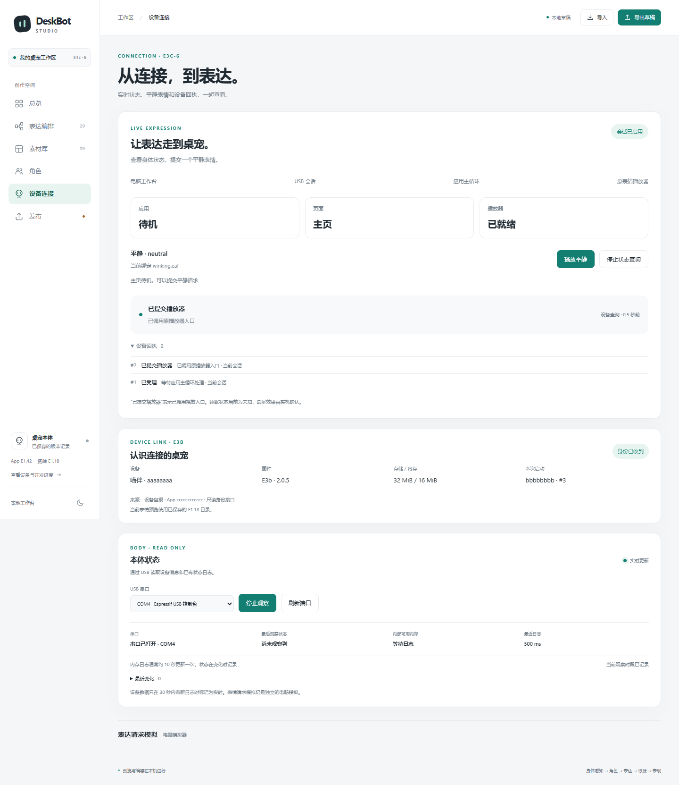

# E3c-6 · 工作台实时状态与平静表情

工作台新增应用、页面、播放器三张状态卡，一个“播放平静”按钮，以及设备回执列表。电脑端已与生产固件的 C++ 接口完成离线联调；设备仍运行 E3b 第二版，实机联调是下一步。



## 怎么使用

1. 打开工作台的“设备连接”，选择本体 USB，点击“开始观察”。
2. 收到设备身份后，点击“启用状态查询”。
3. 应用待机、页面在主页、播放器就绪时，点击“播放平静”。当前沿用 `neutral → winking.eaf`。
4. 查看“已受理 → 已提交播放器”。忙碌、切页、超时和断开会显示对应原因。

当前 E3b 固件只提供身份消息。它在启用查询后会显示接口未响应，待 E3c App 部署后接通实时状态与表情请求。打开页面和连接观察默认保持被动。


## 实现与结果

| 部分 | 做法 |
| --- | --- |
| USB 所有者 | 同一进程读取日志、查询状态与发送请求 |
| 连接绑定 | 每次启用生成新 nonce，核对设备、启动、会话和请求编号 |
| 查询节奏 | 状态每秒查询；两帧最短间隔 400 ms；状态有效期 2 秒 |
| 结果 | 保存最近 24 条设备回执；本机超时单独显示；表达请求由点击发起一次 |
| 交互 | 查询更新文字和属性，保留焦点及详情展开状态；支持窄屏、深色和减少动效 |
| 验证 | 45 项专项；其中 4 项实际运行生产 C++ 会话入口、控制器与调度适配器；浏览器 27 项检查 |

`accepted` 表示进入原应用队列；`dispatched` 表示调用原播放器入口。实际睡眠状态为未知，圆屏效果与对话、菜单、摸头、睡眠唤醒在设备联调时验收。

结果：[45 项专项](../artifacts/deskbot-studio-e3c6-20261105/offline-validation.json) · [1,182 项离线回归（1,180 通过、2 跳过）](../artifacts/deskbot-studio-e3c6-20261105/full-offline-validation.json) · [27 项浏览器检查](../artifacts/deskbot-studio-e3c6-20261105/browser-validation.json) · [公开工作台](../artifacts/deskbot-studio-e3c6-20261105/index.html)。

## 复现

从 Git 根运行 Offline 预检，再使用已核对的 Python：

```powershell
python scripts/build-deskbot-studio-e3c.py --check
python scripts/validate-deskbot-studio-e3c6.py --check
python scripts/serve-deskbot-studio-e3c.py --public --port 8766 --serial-python "<serial_python path from the Offline preflight>"
```

将占位路径替换成 Offline 预检报告里的完整 `serial_python` 路径。浏览器测试使用隔离服务端口 8770，运行 `node tests/deskbot-studio-e3c-browser.cjs`；可用 `DESKBOT_STUDIO_URL`、`DESKBOT_BROWSER_EXE` 和 `DESKBOT_PLAYWRIGHT_MODULE` 配置环境。

## 接下来的顺序

1. 部署 E3c App，保存当轮恢复材料，接通工作台的一次平静请求与设备回执。
2. 验收对话中及结束后切菜单、摸头、睡眠与唤醒，确认圆屏效果。
3. 查询设备实际表达目录，逐步开放已有表情；底座修好后接现有动作与外壳登记。
4. 外壳编号连接客户端角色档案，再接 DeepSeek 与语音服务。
