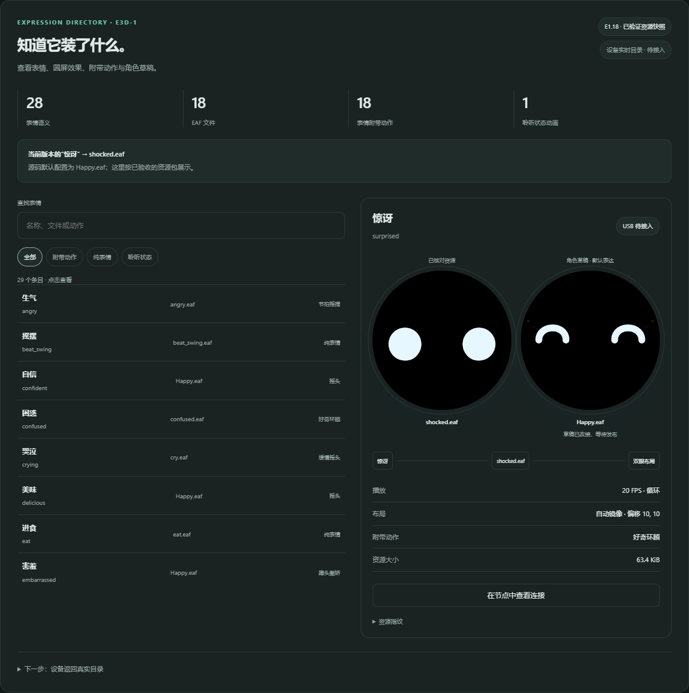
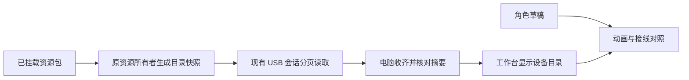

# E3d-1 · 表情目录与草稿对照

工作台现在可以逐项查看已核对的 E1.18 表情、圆屏动画、附带动作，并与当前角色草稿比较。

[打开工作台](../artifacts/deskbot-studio-e3d1-20261105/index.html) · [目录](../artifacts/deskbot-studio-e3d1-20261105/installed-directory.json) · [核对报告](../artifacts/deskbot-studio-e3d1-20261105/report.json)

## 这一轮完成了什么

| 项目 | 结果 |
| --- | --- |
| 表情 | 28 个普通语义，18 个独立 EAF 文件 |
| 动作 | 18 个表情附带动作，共用 5 种官方动作 |
| 聆听 | 1 个语音状态动画，15 FPS、循环、独立布局 |
| 共享资源 | 9 个语义共用 `Happy.eaf` |
| 已验收替换 | `surprised → shocked.eaf`；源码默认仍为 `Happy.eaf` |

清单以已验收资源包的 `index.json` 和实际文件摘要为依据，动作来自 E3c-8 对应的生产源码。页面标为“已验证资源快照”；设备实时目录在 E3d-2 接入。当前 USB 请求接口已实现 `neutral`，实机播放待联网验收。

## 怎么使用

1. 打开“设备连接”，向下查看表情目录。
2. 按名称、文件或动作搜索，选择“附带动作”“纯表情”或“聆听状态”。
3. 左侧圆屏显示已核对资源，右侧显示当前角色草稿。
4. 点击“在节点中查看连接”，替换资源后返回，即可比较改接效果。

每项显示帧率、循环、镜像、位置、资源大小和文件指纹。草稿通过现有发布流程生成资源包。



## 目录如何接入设备



本轮完成目录格式、接收器、离线分页样本和页面。下一轮实现设备快照和分页读取。

| 协议项 | 约定 |
| --- | --- |
| 清单 | `deskbot.installed_expression_manifest/v1`；表情、状态、动作和布局 |
| 分页 | `deskbot.studio_catalog_page/v1`；每页 2 项，最多 128 项，每帧 2 KiB |
| 查询 | 沿用原七字段 USB 会话封套，`catalog.0`、`catalog.2` 等 |
| 一致性 | 绑定设备、启动、会话、请求和页序；收齐后核对完整 SHA-256 |
| 重读 | 断线、缺页、重放或版本变化时清空，再从第一页读取 |

本包共 36 项、18 页，最大帧 1,106 B。资源清单有独立摘要；原表达控制目录编号继续用于现有请求。设备资源、接口能力与角色草稿分别保存。

设备实现沿用现有所有者：在资源加载后生成有界快照，USB 任务只复制并分页回复；重载先更新有效状态，再发布新版本。构建审计会记录内存、栈、耗时及 App 大小。

## 验证与复现

离线测试覆盖目录摘要、分页、身份、重放、断线、混合版本、共享资源和源码映射。浏览器测试覆盖动画、节点往返、草稿比较、筛选、搜索、窄屏、深色和减少动效。

本轮结果：37 项新增 Python 测试、25 项浏览器检查通过；完整离线套件运行 1,256 项，其中 1,254 项通过、2 项按条件跳过。见[专项结果](../artifacts/deskbot-studio-e3d1-20261105/offline-validation.json)、[完整回归](../artifacts/deskbot-studio-e3d1-20261105/full-offline-validation.json)与[浏览器结果](../artifacts/deskbot-studio-e3d1-20261105/browser-validation.json)。

```powershell
& .\scripts\preflight-deskbot-toolchain.ps1 -Mode Offline
python scripts/run-offline-checks.py
python scripts/build-deskbot-studio-e3d.py --check
```

生成器检查使用本机已保存的 E1.18 资源镜像；公开 HTML、目录与协议测试可随仓库使用。本机启动用 `scripts/start-deskbot-studio-e3d.ps1`；其他电脑可用 `serve-deskbot-studio-e3d.py --public --serial-python <Python 路径>`。浏览器检查入口是 `tests/deskbot-studio-e3d-browser.cjs`。

当前设备为 E3c-8。本轮完成离线开发；平静请求、圆屏和交互验收在联网后继续。

## 接下来

1. **E3d-2**：设备资源快照、同会话分页读取、工作台实时目录；先完成离线实现与构建。
2. **联网联调**：完成 E3c-8 平静请求和对话、菜单、摸头、睡眠唤醒回归，再部署目录增量。
3. **E3d-3**：先接纯表情，再逐项处理附带动作的语义。
4. **底座与客户端**：底座修复后接动作、外壳持久登记和主人确认；随后连接角色配置、DeepSeek 和声音。
