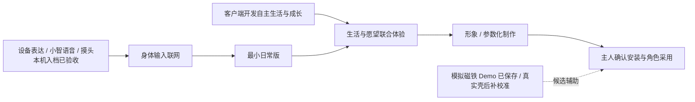

# 开发主线与行动指南

2026-11-27 当前任务：闹钟修复 App＋r8 已安装核对，表情工作台已采用新 App。下一轮合并验收语音闹钟、r8 表演与聆听条、底座重连，以及网页素材安装和上一版恢复；之后接电量反馈、热点重连和持续运行。客户端独立推进自主生活。[闹钟管理](alarm-management.md) · [表情制作](expression-pipeline.md)

更新于 2026-11-27。产品思路见[完整计划](development-plan-20261104.md)，职责和运行环境见[架构](architecture.md)。

**日常版已通过交互和电源验收。** 设备凭据更新、重启读取及恢复实测通过。共同记忆已实机通过。接续让桌宠讲出生活愿望，持续运行和实际登录自启随日常使用观察。[日常版操作](body-credential-renewal.md)

USB 表达、主人确认安装、安装同步、小智近况播报、语音分享与 Wi-Fi 摸头入档已验收。E3f-9d.7 已合并摸头、表情和地址保存，日常后台已部署。实际登录自启和热点重连随日常版验收。自主生活由客户端独立开发。[图形连接设置](body-network-workbench.md) · [日常后台](body-daily-service.md)

本轮接续规则：文本省略安装编号读取当前，语音显式 `null` 保留开始时无安装的状态；指定历史档案缺失返回明确结果。映射支持与实际音色分别记录。补丁同时联测原 prepared / output_enqueued 恢复。应用补丁时使用独立客户端仓库根目录，核对源码、恢复依赖和换行；Windows 长短路径由 `realpathSync.native` 统一。历史归档只作对照，测试使用副本。复跑见[形态采用](client-role-adoption.md)。

## 当前进度

| 部分 | 当前成果 | 下一步 |
| --- | --- | --- |
| 设备 | E3f-9d.7 闹钟修复 App＋r8；日常基线的交互、冷启动和充电切换已通过 | 新闹钟语音验收、r8 画面与持续运行 |
| 工作台与角色播放 | 8782 提供真实素材上传、镜像、生产预览、编译及安装恢复 | 网页安装与恢复上一版实机联测 |
| USB／Wi-Fi | 新版八次 USB、两次 Wi-Fi 播放回执通过，4311 日常后台与小智工具已恢复 | 用户按自己的时间观察圆屏 |
| 容量 | 32 MiB Flash、16 MiB PSRAM；r8 资源 3,993,973 B，8 MiB 分区余 4,394,635 B | 逐包计量并保留配套恢复材料 |
| 外壳 | 主人确认安装已实机验收，319 条 A/B 模拟磁铁 Demo 基线已保存 | 演示磁场候选与主人确认；真实壳制作后补拆装校准 |
| 客户端接入 | 小智近况、语音记事和更正后引用已验收。愿望读取已通过隔离联测 | 首份真实愿望听测与形象讨论 |

[E3f-9d.3](display-clock-e3f9d3.md)的显示修复、双角色及本轮开关启动检查已完成。当前顺序见[联合评估](joint-capability-assessment-4a.md)和开发计划；已验收 E3f-5 / E1.45 和 E3f-6 继续作为历史参考。

此前 [E3f-3 整链联测](role-expression-flow-e3f3.md)的 14 项测试接通生产 HTTP、安装、目录、请求、C++ 调度与回退。[E3f-2 角色总览](role-expression-overview-e3f2.md)已有 42 项离线和 36 项浏览器检查通过。[E3f-1 害羞触发](studio-shy-trigger-e3f1.md)保留为历史实现参考；后续 App 从当前布局版增量开发。普通验收：版本安装并核对后通知主人，主人方便时操作、统一反馈；测试版保持运行。定时映射用于独立诊断。

客户端接入沿用[4b1a 行动记录](client-expression-loop-4b1a.md#后续沿用的做法)：重试保留原回合，队列先筛选再分页，待发期限和回执等待分别计算。复测入口为 `scripts/verify-client-expression-4b1a.py`，显式提供客户端目录与已核对的 Node 路径。

[4b1b 启动与接续](client-expression-loop-4b1b.md#启动与接续)固定串口解释器、当前时钟与独立存档。启用控制时设备编号和启动编号取实际 hello；命令编号以字母开头。页面回应丢失后接续原输入，设备回执与圆屏观察分别归档。

文字联测使用已核对的 Node 24、固定客户端快照和 SQLite 在线备份副本。服务退出后用原启动器打开同一副本，比较历史、安装与队列。体验版独立使用 4315，原工作台继续连接 4314。

语音接入复测使用 Node 执行 `scripts/verify-xiaozhi-voice-seam-4b2a.mjs`，固定客户端提交与补丁摘要，自动创建隔离 SQLite 和临时 HTTP 端口。依赖已核对的 Node 内置模块，协议／语音替身与实机结果分别归档。

真实语音复测使用 `scripts/verify-real-voice-4b2b.mjs`；依赖安装与启动见[4b2b 模块说明](../integrations/client-4b2b/README.md)。它同时回归上轮协议和原客户端，生成录音、识别结果、回答音频与摘要；独立启动器使用本机地址和实验存档。

统一语音使用[现行联调入口](xiaozhi-conversation-pilot.md)，历史验证脚本按原归档摘要复跑。[真机试用](xiaozhi-device-voice-trial.md)先跑启动器 `-Check`，确认 Node 24、依赖、存档备份和 COM4 运行指纹。握手按固件实际报文：HTTP 带端口，WebSocket 的 Host 只有 IP；配置响应只发 WebSocket，原配网参数逐项读回。音频从设备进入说话状态后再发，检查首句、字幕与末尾；分别记录存档、发送和实机听到的结果。测试文本用自然问法，不加“刚才”等提示词。

小智近况联调用 `start-xiaozhi-life-bridge.ps1 -Check` 核对依赖，首次用 `-Prepare`。正式生活来源使用只读存档桥接，语音分享使用 4311 专用写入服务。先确认正式个体和服务实例，再核对工具发现、实际调用、回答与保存结果。具体活动播报与分享保存已实测。见[小智语音接入](xiaozhi-cloud-life-bridge.md)。

切回语音服务时，一次本机任务完成：记录原网络 → 连接圆屏所示配网热点 → 核对 IPv4 地址 → 写回原服务地址并读回 → 重启桌宠 → 连回原网络。设备报连接失败时先核对当前服务地址和相应服务是否运行；云桥接连接与设备语音连接分别检查。

摸头排查沿用[专项记录](touch-feedback-check-20261119.md)：先核对电极原始值、按键事件、手势和唤醒。原实现只给 GPIO7 绑定回应；GPIO6 单独观测。LED、感应值和用户听到的回应各自核对。读取按键电平会推进组件状态机，诊断采样使用原始值 API，事件回调只计数。

本轮接触变化约 2.2%／3.1%，原 5% 门槛没有产生按键事件；调整为 1% 后，静置与三连触回应通过。后续根据静置波动、接触幅度和误触发结果设置门槛，保留原有手势条件。

[摸头入档](body-touch-client.md)复用唯一 USB 所有者，按设备、启动和运行时间防重；新固件需同步登记接收端与观察器的摘要。修改观察 schema 后重启工作台父进程，再核对 hello；父进程也持有 schema 校验器。日志里每个三连触、待发回执和正式身体记录逐项对应。启动服务前核对实际仓库、存档和运行时路径，再交接旧实例。

同一待发队列由一个进程持锁，早事件等待重试时，后续事件按原顺序排队。状态分别显示 USB 观察、设备身份和客户端；服务重开后从原队列恢复回执。

[日常后台交接](body-daily-service.md)先备份原存档并核对两侧实例，再迁移配套配置。设备同一开机周期会记住表情序号，换接收存档须提升传输水位；仅迁移水位，保留原生活记录。启动成功以配置摘要、实例、PID 和两路监听共同确认。常驻进程异常退出时，子服务通过 IPC 断开释放端口与存档。进程测试显式清空子 Node 的 `execArgv`，退出判定同时检查 `exitCode` 与 `signalCode`；实时夹具先启用时钟再安装记忆模块。

Windows SQLite 测试显式关闭连接，`with connection` 仅管理事务。新的 realtime 客户端夹具先启用时钟再安装 refraction／memory；重开使用 `syncClockOnOpen:false`，保持原状态。

联网试用先核对实际私人 Wi-Fi 地址与监听条件，再生成绑定地址的证书和 App。证书工具使用 IDF Python 的 `cryptography`，客户端使用 Node 24。回环地址编译包只用于离线核对；实机分别确认 HTTPS 收到、存档完成和小智实际回应。

联网模块复跑使用两个固定解释器：`D:/Program Files (x86)/Python/Python 3.13.0/python.exe scripts/test-body-wifi.py --report artifacts/body-wifi-combined-20261121/python-tests.json` 跑离线 C++／事务测试；`D:/Espressif/python_env/idf5.5_py3.11_env/Scripts/python.exe` 生成证书、构建和使用串口。前者提供 `jsonschema`，后者提供 IDF 与 `cryptography`。新入口固定仓库的 `tests` 包，避免同名已安装包遮蔽。共享任务构建同时核对实际处理函数和任务入口；薄包装函数可能被编译器内联。

小幅参数对照使用已配置的构建目录做增量编译。改前保存上一候选的源码、App、ELF 和配置，改后另存产物并核对完整源码清单与配置；已验收的冻结工程继续保留。

图形连接设置复用唯一 USB 所有者。设置任务结束后重新启动观察，实际连接看新 hello；Wi-Fi 表情观察期间保持 USB 表情查询关闭。连接／断开请求从读体到执行共用维护锁，后台命令也检查维护状态。页面轮询保留地址草稿，重复编号接续原结果，旧修订重新读取后再保存。

## 显示与菜单开发检查

| 检查点 | 固定做法 |
| --- | --- |
| 故障定位 | 分别确认画面刷新、页面切换、触摸和音频；保留卡住时日志，按刷新发起、发送和完成通知定位 |
| 异步完成 | 成功、发送失败、部分发送和再次刷新均有明确结束路径；检查等待、通知、队列副本和资源释放 |
| 内存预算 | 同时检查内部静态数据、运行堆、最大连续 DMA 块、任务栈和单笔传输长度，观察联网与对话负载 |
| 稳定基线 | 新固件沿用 E3c-3b 的 4,092 B 分块与发送错误处理；默认关闭版核对基线，开启版单项增量 |
| 测试覆盖 | 主机注入首块、中途、末块失败，检查失败后再次刷新；实机覆盖静置、联网、对话中/后切菜单、摸头、睡眠唤醒 |
| 证据对应 | 测试记录绑定 App/ELF、配置、负载和时间窗口；编译、协议回执、屏幕效果分别记录 |
| 画面花屏 | 分别记录首次启动、正常开机与重启后表现；像素错位与刷新停止各自排查，同时核对内部静态增量和最大连续 DMA 块 |
| 开机黑屏与残留 | 记录黑屏时音频是否运行及 USB 供电状态；核对复位、初始化返回值、显示适配器就绪和首次全屏传输完成。区分完全断电、开关操作与软件重启 |
| 全屏分层刷新 | 原始串口日志核对 `priv TX buffer`、`ESP_ERR_NO_MEM` 和 `DMA TX underflow`；菜单与表情都异常时，优先查共用 LCD 发送路径 |
| PSRAM 发送 | E3f-9d.3 采用直接发送、20 MHz QSPI、4,092 B、队列 2 和原完成回调，日志与两角色画面已通过；后续同时复核这些参数及联网负载 |
| DMA 供给不足 | 启动日志检查 `DMA TX underflow`、事务回收和刷新错误；此类错误后恢复原 App，下一对照降低时钟。App 启动与身份通过后继续单独检查显示传输 |
| 测试入口 | 电脑端测试使用 Offline Python 和 `unittest discover -s tests -p 文件名`；构建、构建辅助模块检查及串口使用 IDF Python，沿用其中的 YAML 等依赖 |
| 原始证据 | 状态观察器只保留部分日志；故障时先由唯一串口所有者保存原始输出，再重启或对照版本 |
| UI 锁顺序 | 菜单与手势回调只向应用队列交接标量；外层 LVGL 锁也算在内，播放代码在应用线程获取 Emote 锁 |
| 片段切换 | 完成回调只排队，返回后再换动画源；用代次丢弃资源重载前的任务 |
| 暂停与末帧 | `gfx_anim_start` 会重置游标；恢复重开剩余段，新循环从零开始。末记录为终止标记，保证最后一张图像被播放 |
| 资源卸载 | 先停止并隐藏仍引用映射的眼对象，再释放角色表和资源；普通语义回退只停止占用并交还旧播放器 |
| 资源重载与交互 | 从同步状态快照初始化菜单、聆听占用；每秒同步确定状态，原子更新这两类位并保留睡眠。快照临界区先释放，再获取播放锁 |
| 分层动画性能 | 分别记录标称帧率、实际推进、合成耗时与运行堆；动作按实际运行时间推进，暂停时冻结计时，新请求重新对齐 |
| 局部刷新 | 覆盖前后姿态的范围并清除旧位置；背景变化、首次挂载和菜单返回时重画全屏，字幕仍由原 GFX 重画 |
| 纯色区域优化 | 覆盖范围外扩、纯色范围内缩；插值来源的纯色取交集。用直接采样、镜像及连续中断逐像素对照，再量测设备速度 |

依据：[E3c-3b 修复与验收](display-dma-repair-e3c3b-20261107.md)。后续表情、资源、USB、音频和任务调整均使用这张检查表。

[本轮全屏花屏排查](display-corruption-e3f9d2.md)保存了内部 DMA 分配失败的原始证据。静态数据增量、内部空闲总量和最大连续块分别判断；角色常驻数据位于 PSRAM，因果归属使用故障日志与单项对照。

## 本轮经验落实

| 这次发现 | 后续固定做法 | 核对依据 |
| --- | --- | --- |
| 模块通过被概括为整体完成 | 先跑一条完整用户任务，再报告交付范围；注明入口、模型、音频来源、实际设备和未接环节 | [整体评估](project-readiness-20261118.md) |
| 离线新补丁与旧启动器分离 | 一起核对客户端版本、补丁、恢复依赖、启动参数和存档；交付组合入口及迁移步骤 | 4b1a 摘要校验与形态采用 manifest |
| 健康接口正常但运行模式仍是实验配置 | 分别读取模型状态、世界推进模式、绑定与实际消费者；从真实输入追到实际输出 | 本轮 4314 只读响应与启动源码 |
| 本地触摸或转头被视为客户端已接通 | 保存传感事件进入原生活记录、物理动作和回执的同次证据 | 身体事实与动作联合用例 |
| HTTP 响应中断后同步任务停止 | 捕获完整传输错误，按原编号自动恢复；同时验证有界读取、完整长度和 JSON 对象 | [安装同步运行接入](client-installation-runtime.md) |
| 查询失败后界面仍显示已同步 | 清除本次核验标记，保留历史凭证与时间；重新查询后恢复状态 | 安装卡浏览器回归 |
| 服务运行期间世界状态继续变化 | 核对原记录保留、变更字段与来源；时钟及心跳单列，检查个体、关系、聊天和队列 | 现场 SQLite 一致快照 |
| 静音后服务收尾，设备仍停在收音 | 本轮静音、断流及处理失败关闭连接；实际 WebSocket 验证可重新发起 | 4b2b 失败收尾与重连测试 |
| 同一句含短停顿，识别只取第一段 | 通用听写持续收集至 WAV 结束，增加两段中文短停顿测试 | 4b2b 中文真实音频回归 |
| 合成音频联调通过，真人听写仍明显出错 | 用桌宠录到的同一组真人语音比听写，用同一回复比音色，再以正确文字单独检查回复 | [真机试用](xiaozhi-device-voice-trial.md) |
| 扫描超时后圆屏回到扫描提示 | 从 COM4 抓配网切换前后的原始日志。E3f-9d.3 可在扫描时点屏幕中央手动配网。核对手机热点全名和电脑 IP | [配网记录](xiaozhi-device-voice-trial.md) |
| 旧音频发送回调迟到，影响新回合节奏 | 发送回调返回后再次核对取消状态，再修改发送时钟 | 4b2b 迟到回调回归 |
| 本机缺少语音或音频工具 | 查询已安装能力，再用固定绝对路径和锁定依赖；语音引擎独立接口便于替换 | 4b2b 环境与依赖锁 |
| 真实时钟下重复转写产生冲突 | 同一转写固定事件、发生时间和内容，重试沿用首次请求 | [4b2a](xiaozhi-voice-seam-4b2a.md) 原 HTTP 联测 |
| 取消后提供者仍未返回 | 识别、合成和发送独立设截止，限制未收尾任务；发送失败先停止发声，再收尾 HTTP | 4b2a 取消及延迟确认测试 |
| 原 HTTP 回应丢失，提交结果未知 | 保存原请求并暂停新提交；原编号恢复后只收尾旧输出，常驻版接持久账本 | 4b2a 丢回应与超时测试 |
| 文件名或稀疏范围与预想不同 | 先用 `rg --files` 确认实际路径，再读取或运行；新增依赖按固定基线补齐 | 日常版源码核对 |
| Windows Python 缺少 IANA 时区数据 | 当前上海记录可用标准库明确指定 `+08:00`；跨时区运算先核对 `tzdata` | 日常版归档检查 |
| 多实例只分开世界库，认知实验路径仍相同 | 枚举并注入所有可写路径，包含预算、实验、配置、音频与缓存；按实例隔离运行目录 | 日常版独立复核与 `cognitive-runtime.mjs` |
| 设备同时有 MQTT 与 WebSocket 配置 | 先核对原协议选择优先级，再成套审阅地址、凭据与迁移；当前 MQTT 优先 | `application.cc` 与日常版部署设计 |
| 健康接口通过，正式认知仍未启用 | 分别核对进程、设备会话、真实语音、实际生活调度和用量；状态来自各自事实 | 4a 与日常版运行审计 |
| 安静、身体睡眠与服务暂停被混为一项 | 分别保存并展示偏好、设备状态和后台调度，按实际状态恢复 | [最小日常版设计](daily-experience-v1-20261116.md) |
| 跨仓稀疏检出只有源码，测试缺世界内容与契约 | 先核对固定 commit、Node 版本、`world-content`、`contracts`、测试夹具及 Python worker，再运行对应测试 | 4a 客户端测试环境检查 |
| GitHub 经代理的 HTTP/TLS 路径表现不同 | 固定 Clash 代理；失败记录工具与 TLS 后端，使用已核验 commit 的浅克隆或单文件来源，并校验 Git blob | 4a 来源核对 |
| 目录查询被拒绝后一直等待 | 关联查询命令编号，拒绝或超时后退避重查；已交接激活继续查询收尾 | [阶段 3b2](shell-switch-service-stage3b2.md) |
| 旧操作提示遮住最新运行原因 | 下一次成功轮询清除瞬时提示，常驻区域显示当前事实 | 阶段 3b2 浏览器回归 |
| 后台轮询影响正在编辑的表单 | 状态卡独立更新，检查草稿内容与键盘焦点；状态 GET 只读取 | 阶段 3b2 草稿、焦点与后台调度回归 |
| 合并历史测试时同目录模块导入失败 | Git 根目录执行，`PYTHONPATH` 同时包含根目录和 `tests`；先确认解释器与导入路径 | [测试说明](../tests/README.md) |
| 暂停或配置变化时请求仍在设备执行 | 分开处理“停止新切换”和“旧请求收尾”，核对版本与交接使用同一事务 | 阶段 3b2 启停与配置回归 |
| 数据经 IPC 延迟或被重复轮询 | 记录原接收时间和事件序号，发送前核对原样本时效；轮询只读已有事实 | [阶段 3b1](shell-switch-runtime-stage3b1.md) |
| 转动结束时缓冲里仍有转动期间样本 | 以停止时刻为下界，消费旧序号后只用停止后的新样本重新确认 | 阶段 3b1 转动、档案与窗口边界回归 |
| 内存向量与 JSON 重开类型不同 | 保存前规范化结果，并直接比较首次返回与重开状态 | 阶段 3b1 持久化与 HTTP 回归 |
| 主机命令、直接拒绝与后续查询使用不同编号 | 发送时保存命令到线上请求的关联；直接拒绝核对外层编号，后续执行事实核对内层编号；断开快照也核对连接代次 | [阶段 3a](shell-switch-adapter-stage3a.md) |
| 首帧已生效，但保存仍在进行 | 保留原请求到保存终态；超时先查询，配置改版也等旧请求收尾，再提交最新目标 | 阶段 3a 超时与改版回归 |
| 命令交接响应丢失，实际是否发送尚未确定 | 查询后区分已执行、仍在途与待重试；显式重试从已确认的事实接续 | 阶段 3a 无线上请求与迟到回复回归 |
| 对照名称改变会把旧样本显示成新布局 | 首份对应采样后固定物理对照标识；新对照新建项目，旧证据保留 | [S1d 采样操作单](shell-field-guide-s1d.md) |
| Windows PowerShell 传给 Python `-c` 的内层引号被去掉 | 预检用 Python 输出版本，再在 PowerShell 比较；按实际解释器路径核对模块 | S1c / S2a 启动脚本实测 |
| 快速请求完成后，`pending` 可能已清空 | 提交前记录旧回执序号；按本次命令确认后的唯一新请求关联 `accepted` 与 `dispatched`，每次只提交一次 | [联测脚本复核](../artifacts/studio-common-e3f7/live-verification-review.json) |
| 页面重建时，实时按钮短暂回到初始状态 | 挂载后用现有快照立即重绘；测试分别等待数据与界面就绪，保留失败现场 | [E3f-7](studio-common-e3f7-results.md) |
| 测试动画与待机相近，主人难以区分 | 用画面明显的独立语义验收；记录具体资源与发送时刻，原语义保留原接线 | [E3f-4a 进食验收](studio-eat-acceptance-e3f4a.md) |
| 查询占用发送通道，播放按钮闪烁或请求排队过期 | 点击后先等新鲜状态，再发送一次；结果过期时由主人明确重新点击，保持现有时间预算 | [E3f-4b](studio-play-readiness-e3f4b.md) |
| 设备重启后，旧目录无法用于新会话 | 每个新会话只读一次目录并显示进度；连接、查询进度和上次事实分别呈现 | [E3f-4b 现场记录](../artifacts/studio-play-e3f4b/live-result-20261109.json) |
| 目录刚读完时，显示状态查询还在进行 | 同一启动与会话内分别等待目录完整和新鲜显示快照，再核对能力与请求；保持原查询节奏 | [E3f-5 现场结果](../artifacts/studio-shy-e3f5/live-result.json) |
| 全角色核对复用单项解析器 | 直接使用分析模式，在命令构造前返回；HTTP 与浏览器均检查零命令 | E3f-2 单元、HTTP 与浏览器测试 |
| 角色全部断开时仍需要查看已装资源 | 独立核验目录与会话，逐项保留当前资源；接线状态另列 | E3f-2 全断开角色回归 |
| 页面初始化时数据返回会重绘连接区域 | 浏览器测试等待连接快照就绪，再操作页面；来源、角色和会话改变均覆盖旧结果失效 | E3f-2 36 项浏览器检查 |
| 菜单正常时，新增接收任务实际上已退出 | 验收先核对功能确实运行，再测菜单；持续接收、会话和查询分轮加入 | 启动日志、任务退出日志、真实收发与人工操作 |
| 联网切菜单时 SPI DMA 分配失败，驱动吞掉发送错误 | 记录刷新发起、传输错误与完成通知；覆盖失败、恢复后重发和菜单人工验收 | [E3c-3b 修复记录](display-dma-repair-e3c3b-20261107.md)与日志行 2020–2022 |
| 日志能输出，但输入路径错误 | 按有效配置选择通道，再核对注册实现和链接结果 | 冻结源码、sdkconfig、IDF 5.5.5 VFS 与链接映射；见[路径审计](../artifacts/ui-menu-regression-20261106/e3c3-usb-path-audit.json) |
| 单字节读取慢，历史提速版又出现卡死 | 先验证原节奏下的 UI，再单测读取预算；通信时延和 UI 状态分别记录 | [8 项接收测试](../artifacts/ui-menu-regression-20261106/e3c3a-offline.json)、逐步实测 |
| 后续版本已构建，前序实机还未通过 | 离线成果继续保存；设备每次只增加一个变量，前轮通过再部署下一轮 | 当前版本、候选配置、允许差异与验收结果 |
| 隔日安装时 NVS 可能已更新 | 现场重新读前缀并核对全片摘要，保存当下 NVS；恢复使用同轮原字节 | [71 项部署事务回归](../artifacts/ui-menu-regression-20261106/e3c3a-deployment-tests.json)、现场事务 |
| 资源安装工具绑定旧 App，而布局已更新 | 为当前验收版新增计划标记；从原快照覆盖已安装 App 完整擦除并集，核对原安装记录后再准备现场资源事务 | [E3f-4d](resource-installation-e3f4d.md) |
| 目录读取和播放之间发生重连 | 现场记录绑定连接、设备、启动、会话和目录；每次播放核对本次命令与同一请求的关联回执 | E3f-4d 现场记录关联测试 |
| 布局名相同，素材尺寸却不同 | 同时检查宽高、首帧实际坐标和刷新覆盖；普通单眼之间也测试 160↔200，原对话路径一并覆盖 | [E3f-4d 尺寸补查](../artifacts/studio-resources-e3f4d/size-transition-observation.json) |
| 故障注入后，整段覆盖记录掩盖了恢复结果 | 正常路径核对整段覆盖；故障路径分别记录首帧和恢复帧，核对后续恢复且原操作仅调用一次 | [E3f-4e](expression-reflow-e3f4e.md) |
| 最终下发回执已到，但未观察到受理回执 | 精确核对设备、会话、命令和请求；记录已提交播放器及 `accepted_observed`，屏幕效果另验收 | [E3f-4d 请求结果](../artifacts/studio-resources-e3f4d/live-result.json) |
| 主机超时但没有完整串口证据 | 记录 `write()` 返回字节数、请求/回复原始字节、时间戳和 request ID；证据齐全后再判断是发送、接收还是协议问题 | [本轮会话探针](../artifacts/ui-menu-regression-20261106/e3c3a-query-on-live-result.json)；原始回复未保存 |
| 主机拿到回复却报格式错误 | 先按 request ID 记录关联性，再独立运行 schema 校验；校验器接收的数据类型要与接口一致 | [open/state 原始记录](../artifacts/ui-menu-regression-20261106/e3c3a-state-reprobe-20261106.json) |
| 静置采集没有底座输出，动作窗口才收到帧 | COM4 与 COM8 分开保留原始日志；CSV 解码结果不替代原始行。COM8 采集器只解析 `[diag]` 格式，滑块事件需查 `session.log` | [本次双口采集](device-test-e3c3a-20261106.md#底座维修后采集) |
| 历史版本的 `--check` 绑定旧源码 | 核对保存的版本快照；不要用当前源码重写旧报告 | E3c-4 快照（本机留存：`tmp/e3c4-display-20261105/p`） |
| 旧候选的 USB 路径或显示驱动已落后于稳定版 | 从当前已验收的 E3c-3b 组装单项增量，沿用接收路径和显示修复，核对关闭版及开启版差异 | [基线适配设计](expression-e1-43b2-current-baseline-design-20261107.md) |
| 完整请求传输时间超过主机等待时长 | 分别记录写入、flush 和回执时刻，按完整传输与调度匹配主机预算；本轮 open / display / close 约 2.7 / 3.2 / 3.1 秒，固件保持原接收节奏 | [E3c-4b 时序](../artifacts/studio-stable-ladder-20261108/display-live-result.json) |
| 电脑等待时间短于实际串口收发 | 先记录整帧写入及回复耗时，再设置等待和轮询；状态过期单独检查 | [单次查询步骤](studio-display-e3c4a-20261107.md#下次实机怎么配合) |
| 采样没有状态标记或中途断线 | 保留原日志；摘要完成后才拆分；每段静止至少 10 秒并单独结束 | [磁场采集步骤](magnetic-shell-roadmap.md) |
| 主页待机仍因声源自动转头 | 固定方向采样停在菜单页，每窗定时约 15 秒并结束；检查 `Estimated direction`、`Set echo base angle` 与底座动作。带转向指令的窗归为观察，末尾稳定单独记录 | [A/B Demo 现场记录](shell-field-calibration-20261117.md) |
| 测试或审计脚本导入 IDF/YAML 依赖 | 含构建依赖的脚本统一使用预检给出的 IDF Python 3.11；普通离线测试使用 Python 3.13 | [工具链预检](reproducible-workflow.md) |
| 组合测试含 jsonschema 和 C++ 辅助器 | 整个主机套件使用 Offline Python 3.13；设备执行器单独使用 IDF Python 3.11，先核对依赖再运行 | [资源读取专项](resource-read-specialty-20261108.md) |
| IDF 的第三方 `tests` 包遮住本地测试 | 在 Git 根用 `unittest discover -s tests -p 'test_studio_resource*.py'`，测试之间按同目录模块导入 | [资源安装环境复测](../artifacts/resource-installation-e3d2b-20261108/validation-2.json) |
| 恢复构建时 `objdump` 报格式错误 | 先检查报错目标文件的 ELF 头；记录损坏文件，只清理本次构建中的无效 `.obj`，再增量重建 | 本轮发现 101 个无效中间文件；清单留在 `tmp/offline-status-20261108/` |
| Windows 把 HTTP 拒绝结果显示成连接中断 | 先发送并刷新回复，再按总时间和字节上限读取剩余请求；重复验证错误格式、来源与超大草稿 | E3e HTTP 集成测试 |
| 请求排队后，输入缓冲收到另一条命令 | 在调度提交点锁内复制已接受请求的语义，锁外调用播放器；测试同编号换语义及后续输入 | E3f-1 原生调度测试 |
| 表情已排队，此时又开始读取目录 | 在途播放完成后再读取目录，发送前复核目录状态；分别测试启用与关闭状态查询时的顺序 | E3f-1 主机竞争测试 |
| 固件编译器检查通用字段到小缓冲区的复制 | 明确允许值与长度，定长复制并补结束符；使用目标工具链复核 | E3f-1 语义复制与双配置构建 |
| 共享脚本更新后，旧派生页面与生成器不同 | 归档旧页面、保留历史报告，再更新受影响页面；同时核对来源与逐字节生成结果 | E3f-1 派生页面回归 |
| 托管驱动包含已验收补丁 | 固定原组件与补丁后的摘要，逐文件校验其余组件；保留原依赖锁，构建后复核冻结原树与构建副本 | [E3c-3b 构建入口](../scripts/build-expression-e1-43b-e3c3b.py) |
| 人工操作落在采集窗口之外 | 看到 `hold` 第 0 次采样后通知开始；按时间戳核对窗口内操作，恢复后验收另记 | [映射执行记录](expression-e1-43b2-execution-module-20261107.md) |
| 历史描述混进当前方案 | 页首统一写当前状态，历史记录保留日期；共享源码变更另记旧、新摘要和原因 | [当前基线](baseline-status.md)、[来源补充记录](../artifacts/ui-menu-regression-20261106/e3c3a-source-review.json) |
| 档案内容摘要正确，训练来源字段仍可能与原记录不同 | 读取原清单并重放，重建来源逐项比较；加载后从新采样确认身份 | [S1b 档案保存](shell-profile-archive-s1b.md) |
| 只读保护只检查命令首参数 | 在完整参数中拒绝写入、擦除命令和危险选项；用参数前置场景回归 | E1.43b-2 准备测试 |
| 审计只枚举目录里的普通文件 | 检查所有直接项并拒绝目录、链接和未知项；把日志摘要与数据分块摘要分开记录 | E1.43b-2 v4 审计 |
| 更新资源后原快照已变化 | 新 App 计划以资源安装后的快照为起点；整体回退先恢复 App，再恢复资源 | E3f-1 双事务集成测试 |
| 日常交互通过，指定动画还未观察 | 分别记录普通交互、请求回执和指定画面 | 2026-11-09 主人复测反馈 |
| 旧复核与新模块的范围不同 | 当前交付使用当前模块的复核记录；准备报告与实际计划编号交叉核对 | E3f-1 离线安装复核 |
| 新鲜备份后启动 App，NVS 又发生变化 | 准备与安装连续执行；中途结束用返回原版本入口，以后重新准备 | E3f-1 安装器的启动更新与重新备份测试 |
| 写前检查或传输初始化失败，占用了结果文件 | 各次操作分别编号，失败写结构化结果；测试从真实命令入口覆盖到传输边界 | E3f-1 安装器专项与 CLI 集成测试 |

设备候选沿用 E3c-3b 的显示与 USB 实现。原资源安装适配和[安装器事务](studio-shy-installer-e3f1.md)已离线通过；后续以验收后的逐素材布局版适配 E1.45 与害羞触发，保存当轮 App 和资源回退。底座与外壳识别单独排期。

## 接下来怎么做

表情请求走原 `Application::Schedule`，执行时复核应用、页面、会话和有效期。E3f-9d.3 沿用八项表情入口、角色启用与保存；`accepted` 表示排队，`dispatched` 表示已调用播放器 API。角色图是否覆盖该语义单独核对；双角色与客户端表达首环已验收，语音协议已离线联测，执行顺序见[主线](project-mainline.md)。

## 环境与测试入口

- 从实际 Git 根执行；先运行 `scripts/preflight-deskbot-toolchain.ps1`，按 Offline、Build 或 Flash 选择环境。
- `.ps1` 用 PowerShell，`.py` 用 Python；离线入口使用 Offline Python，固件与串口入口使用 IDF Python。
- Windows 文本读写明确 UTF-8，Python 控制台设置 `PYTHONIOENCODING=utf-8`。
- 浏览器测试先核对已有 Edge：`C:\Program Files (x86)\Microsoft\Edge\Application\msedge.exe`；Playwright 显式传入 `executablePath`。E3f-7 测试也可用 `DESKBOT_TEST_BROWSER` 指定路径。
- 确认页面收到本轮能力列表后，再检查按钮；只等待目录数量相同，会读到上一轮界面状态。
- `rg` 使用具体路径或 `-g`；带连字符的测试文件使用自身入口或项目测试器，核对测试数和退出码。
- 历史测试使用固定输入；本阶段核对当前源码。外部数值先检查原始整数，再转换枚举。
- 本机服务测试直连回环地址；GitHub 通过 Clash。长任务沿用原进程，完成后读取退出码和报告。
- 当前角色工作台入口为 `scripts/serve-deskbot-studio-e3f9d.py --port 8779 --serial-python <已核对的 IDF Python 路径>`，服务使用 Offline Python，串口由唯一 IDF Python 子进程持有。E3e / 8773、E3d-2 / 8772 保留作历史入口。
- 历史报告保留原始字节；共享源码更新用独立清单记录旧、新摘要和原因。当前使用 `scripts/build-e3e-source-review.py --check`；原 E3d-2 清单保留历史端点。
- 备份输入与采集输出使用独立路径，启动前核对目标文件。全片读取超时后保留现场记录；使用已有备份时，重新读取当前前缀并核对全片设备摘要，单独记录核验方法。
- E3c-3a 离线计划先由 `deploy-deskbot-studio-e3c3a.py check` 核对；现场 `prepare-live` 重新读取前缀、验证全片摘要并保存当下 NVS 与回退 App。写前再次核对，恢复读取当轮备份和事务日志。
- 先确认 USB 接收任务已启动，再测菜单；周期身份消息只证明输出链路。查询关闭与开启分开测试，单字节读取耗时另行记录。
- E3c-6 测试已接入离线总入口和 GitHub Actions；生成器检查用 `scripts/build-deskbot-studio-e3c.py --check`，生产接口联调用 `scripts/validate-deskbot-studio-e3c6.py`。

## 未来空间预留

| 预算 | 规划 | 限制 |
| --- | --- | --- |
| 活动包 | 当前 8 MiB 分区，建议 7 MiB 发布软上限、1 MiB 余量；母库留电脑 | 先完成现有包播放验收，再导入单个新表情 |
| App | 保持 6,000 KiB，每轮测实际镜像与余量 | 不挤模型或 NVS |
| 壳档案 | 后续单独评估约 256 KiB 记录区、版本/数量上限/磨损/迁移 | 当前未分配，不无限堆入原 16 KiB NVS |
| 第二资源槽 | 单独设计空间、提交标记、断电一致性和回退 | 空闲 Flash 不等于原子更新 |
| 内存/MMU | 内部堆、PSRAM、最大块、栈、队列和连续映射分别测量 | Flash、PSRAM 和 MMU 页不可互相替代 |

## 每轮固定操作

电脑工作台沿用“已核对目录 → 纯编辑核心 → 页面预览 → 发布审阅”的结构。新增页面同时检查方形圆屏画布、动态入口与固定入口、草稿恢复、窄屏和减少动效设置。Edge/Playwright 使用预检的绝对路径；截图前滚动加载可见素材，测试中明确限定页面区域，避免将弹窗中的重复卡片一起计数。

1. 从 `git rev-parse --show-toplevel` 定位实际工作树；新会话跑对应 Offline/Build/Flash 预检，固定路径见[架构行动指南](architecture.md#工具链环境行动指南)。用 `rg --files` 查现有阶段入口，不按编号猜脚本名；精确查输入，不反复扫描生成目录。
2. 明确证据等级：材料、源码审计、构建、回读、CPU、人工验收分别记。历史参考不代替新鲜备份，启动不代替对话时切菜单。
3. 锁定一个变量、允许差异、保护区和失败恢复。UART/计时器/音频回调只做有界事实更新，不调用 LVGL/弹窗/网络/资源切换；锁内不等待其他所有者。
4. 写前核对私有 USB 身份、芯片/容量、实际表和 App/boot/资源摘要；端口号与 VID/PID 单独都不足以识别设备。按实际擦除扇区备份，不用构建参考包代替现场资源。
5. 只有子进程退出、完整日志与验证文件齐全才报完成；中断后先查原进程，避免重复占端口或覆写目录。构建、esptool 成功和 UI 验收不混为一谈。
6. 实验前准备自动恢复；唯一 run-label 保留证据；回退分别验收精确回读、启动和人工交互，不覆盖历史报告。
7. 运行时参考使用同轮写前快照；清单摘要独立固定在恢复日志。不可变前缀与含 NVS 的整页分别核验。恢复兼容 v3，且不依赖当前候选、构建或快照文件；新实验目录使用 `tmp/e143a7-*`。

## 已遇到的错误与固定处理

| 现象 | 以后如何处理 |
| --- | --- |
| 完整画面被当成单眼镜像 | 按素材保存镜像、对齐与偏移；切回单眼时一起恢复，实时目录同步实际布局 |
| 动画启动后首帧尺寸尚未更新 | 沿用原播放器回调，跳过 EAF 元数据；首张图像就绪后同锁重排并完整刷新一次，测试两种绘制先后顺序 |
| 前一播放尚未完成布局，新播放已到达 | 将待重排状态转给新素材，覆盖连续两次普通表情、播放失败和资源卸载 |
| 主机替身接口与锁定依赖类型不同 | 替身参数和字段类型对照真实头文件；主机测试通过后完成实际固件编译 |
| 新增实现使历史源码摘要变化 | 历史报告使用冻结输入；当前行为映射另做一致性核对，新结果单独归档 |
| 测试源码更新后，生成报告仍引用旧摘要 | 先重新生成受影响工作台并核对产物，再运行完整回归；历史源码检查选择明确的关闭分支后继续比较原摘要 |
| 自动读目录期间暂时还没有显示快照 | 先等分页收齐并核对目录，再检查显示状态与播放；沿用原请求时效和发送预算 |
| 源码默认配置与已验收资源包不同 | 先读包内 index 和文件摘要；本包惊讶使用 shocked.eaf，默认源码仍为 Happy.eaf |
| 资源存在，但接口尚未开放 | 资源清单、请求能力和角色草稿分别展示；先查询能力，再提交请求 |
| 分页期间断线或目录变化 | 清空本轮目录，从第一页重新读取，收齐后核对完整摘要 |
| PowerShell 把 rg 通配符当成路径 | 用 `rg --files` 找文件，或用 `-g` 指定模式；执行目录来自实际 Git 根 |
| 本机通过而 Linux 测试失败 | 清单采用固定的路径组件排序；C++ 显式包含所用头文件；公开元数据与本机私有镜像分别测试 |
| Windows 与新克隆的源码摘要不同 | 已归档摘要的输入保留原始字节；发布前将 Git 暂存内容与源码记录逐项比较，换行也计入摘要 |
| 新克隆运行服务测试时缺少 tmp | 测试入口先创建自己的临时父目录，再创建隔离目录，独立运行与总入口采用同一规则 |
| 优化编译让基于 assert 的测试失效 | 原生测试显式使用 `-UNDEBUG`，核对断言启用后再运行 |
| 刷写时串口被工作台占用 | 先停止工作台观察，部署结束后重新枚举 COM4 的 USB 身份并恢复观察 |
| 新固件沿用旧部署入口 | 本轮候选、当前 App 长度与摘要、擦除并集一起固定；E3c 使用独立入口并保留 E3b 和 E1.42 两层恢复材料 |
| `unittest tests.<name>` 找不到模块 | 从 Git 根使用 `-m unittest discover -s tests -p <name>.py`，或运行总测试入口 |
| 全片备份读取较慢 | 保留同一个读取进程和分段日志。写后对 App 做逐字节回读，其余范围使用设备端摘要校验，并分别标明验证方法 |
| USB 重连超时，整片读取未完成 | 保留该轮分块与日志。已有同设备完整快照时，可新读当前前缀、核对整片设备摘要后生成新计划；安装前再次核对 App 与静态区，备份来源写入报告 |
| 串口环境缺少 jsonschema | 部署脚本用 IDF Python；含 HTTP/schema 的联调测试和实时验证器用 Offline Python，串口仍由唯一 IDF Python 子进程持有 |
| 升级 App 后旧实验按原版本哈希拒绝 | 使用当前基线专用入口；当前为 `prepare-expression-e1-43b-e3c3b-deployment.py`，恢复字节来自当轮设备快照 |
| USB 已连接但收不到新接口消息 | 先看设备实际 App 版本；E1.42 提供既有日志，E3b 才发送身份消息。页面分别显示串口、身份、目录和表达进度 |
| 默认输入通道与 USB 控制台不一致 | 当前 UART0 为主、USB Serial/JTAG 为辅；输出复用日志，双向接收明确绑定 USB 驱动，逐项核对驱动所有者 |
| 日志正常，但 USB 请求一直无回执 | 对照有效配置与 IDF 注册路径：辅助 USB 用 `/dev/secondary`，主 USB 用 `/dev/usbserjtag`；`stdin` 读取主控制台。先检查打开结果，再验证会话。历史版本对照使用其冻结源码；路径修正和读取预算分开测试 |
| USB 请求约三秒才有回复 | 沿用每 10 ms 读取 1 B，分别记录发送开始、写入返回、完整回复。电脑请求预算 8 秒、写入 7 秒、IPC 确认 10 秒；表情帧约 531 B，需约 5.3 秒。提速另做增量 |
| 回复一到就过期，或目录一直读不到 | 状态的 2 秒有效期从完整关联回复起算，计入 IPC 与校验耗时；显示查询按回复后间隔 1 秒安排，目录读取优先逐页完成 |
| 点击排队后才发送，回执迟到 | IPC 读线程记录点击入队时刻，排队 2 秒过期；首回执等 8 秒，首次受理后另等终态 3 秒。保留原请求关联迟到事实 |
| 接收节奏和电脑查询预算不匹配 | 先逐条发送，记录完整写入与回复耗时；电脑等待、轮询频率和状态过期分别调整，每次实测一项 |
| 磁铁记录缺少状态标记或采集未结束 | 保留原日志；分别标记初始、上移、下移、移除和装回。采集摘要完整且读取正常后，再拆分并比较 |
| 状态拆分完成但比较器找不到窗口日志 | 清单中的日志路径统一相对 `labeled-states/`；用一个端到端测试验证采集、拆分、比较连通 |
| 改了串口进程源码，工作台一致性检查失败 | 重新生成公开与本机工作台，再运行生成器检查；页面报告保存了串口进程的源码摘要 |
| USB VFS 多个打开实例共用状态 | 保持全局换行与输出模式；接收器单独管理读入，先核对现有日志与身份任务的并用方式 |
| USB 显示连接但主机串口已重新打开 | 每次逻辑重连生成新 nonce，绑定设备号与启动号；会话 30 秒到期。USB 总线状态作为辅助信息 |
| 构建中的源码与清单不一致 | 先更新 `SOURCE_MANIFEST.sha256` 再开始隔离构建；构建期间固定输入，后续修改使用 `--resume` 重新暂存并复核 |
| 跨任务读取设备状态或页面指针 | 使用 E3c-2 所有者快照；切换开始先标记进行中，原逻辑和页面刷新结束后发布稳定值。实际睡眠没有确认来源时显示未知 |
| 请求已受理后，应用或页面又变化 | 调度回调执行前复核会话、期限和所有者快照；最多保留一个回调，取消后也等旧回调被消费再接下一条 |
| 将执行回执当成屏幕播放结果 | 分别显示“已受理”和“已提交播放器”；实际睡眠保留未知，圆屏播放与交互另做实机验收 |
| 用设备运行时间计算电脑端数据年龄 | 电脑按本地请求发送时间计龄；设备运行时间只校验顺序。重连换 nonce，并清空旧状态 |
| Windows 默认 GBK 读取 Kconfig 等 UTF-8 文件失败 | Python 文本读写显式使用 `encoding="utf-8"`；专项测试确认实际测试数量与退出码 |
| 清理候选后还需要回退 App | 保留完整备份、App 擦除范围、计划及状态日志；恢复独立加载原字节，每次结果单独编号。离线核对用 Offline Python，串口执行用固定 IDF Python |
| 轮询让卡片反复入场、详情被收起 | 在同一次视图渲染加入身份卡，保留展开状态；入场动效用于页面切换，周期数据更新只刷新内容 |
| 会话到期后旧请求跟随新连接发送 | 连接、启动、会话分别校验；到期清空未发请求，重新启用生成新 nonce |
| 页面一直显示超时，随后设备才回执 | 本机结果与设备回执分开保存；匹配的迟到终态更新结果，表达请求发送一次 |
| 离线测试把接口联调当作屏幕验收 | 用生产 C++ 入口验证协议和调度；设备部署后再验证圆屏、对话、菜单和摸头 |
| JSON schema 引用意外访问网络 | 用本地 Registry 注册 schema 的正式 `$id`；回执引用精确到 receipt 定义 |
| Windows 通过，Linux GCC 报 C++ 夹具缩进错误 | 条件体使用花括号，后续语句另起一行；保留 `-Wall -Wextra -Werror`，核对 GitHub 检查 |
| 浏览器测试在页面刷新时读到空样式 | 在同一次页面求值中选择当前节点并核验样式，等待目标值出现 |
| 子进程快照不完整导致页面读数错误 | 在主机桥接层按版本化 schema 校验，消息序号与时效在解析层处理；退出或重连清理旧身份 |
| 把高地址的语音模型误判为表情资源 | 按分区名、地址和文件核对完整构建清单；当前模型在 `0xBC8000`，表情资源在 `0x1000000`。设备部署另生成 App 专用计划 |
| `$DeskBotPython` 为空、system32 下找不到相对路径 | 使用预检验证的绝对解释器，从 Git 根执行；PowerShell 尽量单行 |
| Python 路径含空格/括号导致 PowerShell 将路径拆开 | 用调用运算符配合完整单引号路径，例如 `& 'D:\Program Files (x86)\Python\Python 3.13.0\python.exe' ...`；测试必须实际出现 unittest 输出，命令启动错误单独记录 |
| 缩写出不存在的 Python 路径，失败被后续成功命令掩盖 | 复制预检的完整绝对路径并检查存在；每次启动单独记录异常/退出码，立即检查 `$LASTEXITCODE`，不以整段最后一条命令的退出 0 判全部通过 |
| 测试没有被发现，或导入项目模块失败 | 从 Git 根运行；下划线命名用 `-m unittest discover -s tests -p <name>.py`，带连字符的测试使用仓库离线入口或文件自身的 main。确认输出确实包含测试数，`Ran 0 tests` 不是通过 |
| 诊断构建仍生成旧布局的通用刷写参数 | 本轮只取 App 并使用 `upper` 运行器；后续正式发布先统一分区表和资源包配置 |
| `read_flash` 的读包被截断 | 只对明确的 `Corrupt data, expected ... but received ...` 同块最多三次尝试；每次保留新证据，重试前重新核对身份。写入、普通错误、摘要或身份差异不重试；失败预检不进入执行，用新 run-label 重新采集 |
| WMI 串口列表为空 | 用已预检的串口运行时及 PnP 枚举交叉核对，不能因此说设备没接；枚举不代替新鲜目标身份 |
| 全片原样校验提示镜像摘要被更新 | `verify_flash --flash_size keep`；拒绝图像转换日志作为原样验证证据，保留原始备份/分块及两次日志。区分工具内存变换与真实 Flash 写入 |
| 外层工作目录也有同名 docs，误读旧文档 | 先确认目标工作树的 Git 根与本阶段证据文件；每个 exec 明确 workdir，缺文档时不转读外层同名文件冒充当前结果 |
| Offline Python 缺 serial/yaml，连帮助也失败 | Python 3.13 + jsonschema 只跑声明为离线的脚本；构建/串口/IDF 辅助模块用固定 IDF Python 3.11；不临时安装依赖绕过 |
| donor、锁、nm 或 PATH 缺失 | Build 预检核对锁定 donor、CMake/Ninja/GCC/nm 绝对路径；构建器自己设置进程环境，预检子进程不回写环境 |
| 构建期间改了固件输入 | 该轮镜像不能验收；保留中间证据，用新 run-label 重跑两种配置，待构建器完成源码哈希复核。不把已生成的 BIN 当作最终产物 |
| 主机测试通过，设备在格式化消息时崩溃 | 以实际 `sdkconfig` 的 libc 为准。nano 格式中，64 位先用 `Decimal64` 转文本，再用 `%s` 输出；新增和修改的 C/C++ 文件及头文件全部进入构建前检查。联网表达构建已在 Ninja 前检查新增协议头文件与网络适配器；主机用例覆盖最大安全整数。实际跑通新查询后再交付测试 |
| 正常启动被判为失败 | 先核对实际启用的资源路径，再用已验收启动日志校对判定；Emote 路径没有 LVGL 的分区大小/校验耗时日志。启动、资源回读与屏幕交互分别验收 |
| 旧构建核对报 `formal source manifest changed` | 旧构建核对当时归档的源码；新候选核对当前完整源码清单。构建副本中的本地依赖路径按记录还原后，再核对原文件摘要 |
| `ESP_ROM_ELF_DIR` 缺失只产生 GDB 初始化警告 | 区分 CMake 警告与非零退出；本轮完整构建与产物审计通过，不据此安装/更换 IDF 或宣称运行时失败。需要 GDB ROM 符号时单独配置 |
| 把所有脚本的 `--help` 都当作无操作 | 先读参数解析入口；没有 argparse 的脚本可能忽略参数直接执行，例如 `run-offline-checks.py`。不要把参数探测误当成帮助输出 |
| 同机还有其他项目的 Python/Ninja | 按命令行、工作目录和父子进程识别本任务，只跟踪本轮会话；不按进程名称批量停止其他项目 |
| 断网诊断不触发 | 区分 Idle 和稳定配网；诊断不能只等联网 Idle。音频队列空是观测，不是防止未来对话的锁 |
| 工具无权限/无返回 | 分开本地授权、MCP 主机可见性、真实 tools/call、串口 CPU 结果；不重复刷同一 App 猜主机权限 |
| ROM 回读后屏幕不亮 | `--after no_reset` 留在下载模式；用已验证捕获脚本的 `--usb-reset` 启动 App；`--no-reset` 不能从 ROM 启动 |
| 日志慢/缓冲/退格、共享读取失败 | 查进程和完成验证文件，不凭耗时报完成；用 Python Path.read_text 或 Get-Content 读在写日志，不输出巨大的 esptool 进度行 |
| PowerShell 引号/反引号错 | 优先保存短脚本；不把反斜杠当续行，不用 shell 字符串拼装命令和路径 |
| 全 FF 被当作别名排除，空闲页被当作连续映射通过 | 已知非 FF、低地址保护、8 MiB 连续 mmap、实际 EAF 分轮验收 |
| CPU 字节正确，却与旧 bootloader 参考不同 | 使用同轮写前快照，并独立固定清单 SHA-256；历史参考保留作比较 |
| 把 64 KiB 测试页整块分配到内部堆 | E1.42.3 当时内部空闲约 61,759 B，不能容纳这类整页缓冲。后续 read 探针按小块流式 SHA-256，mmap 直接增量读映射；记录分配失败和释放，不为诊断挤占音频/LVGL 内存 |
| NVS 字节变化被误判为固件回退失败 | 分别核对写入范围、静态区和 NVS。A7 启动日志及官方解析器确认 `phy:cal_data` 更新；比较完整逻辑值并重组分块 blob，保留原始差异 |
| 历史测试把后续源码当作旧版本 | 测试使用带摘要的固定样本；当前代码走本阶段检查，旧部署入口继续核对原输入 |
| 节点按语义默认布局画错整幅素材 | 按素材文件、摘要和宽高选择登记布局；解析、总览与预览共用规则。旧快照显式传原布局，检查新旧节点像素 |
| 第二次点击被当作上次请求去重 | 每次点击生成新意图编号；本次等待沿用该编号，查询后重新解析，只发送一次 |
| 新测试夹具显示串口环境错误 | 注入的连接同时提供端口、身份、显示状态与目录；使用完整生产 HTTP 路由，以单独内存连接替换真实串口 |
| 测试中延迟导入解析器，源码清单多出一项 | 测试前加载实际依赖，同时固定动态加载的脚本；分别报告新增、移除和内容变化，保留每次验证结果 |
| 新部署引用了不对应的整片快照摘要 | 从已安装事务的原快照、候选和剩余字节重建，再独立核对整片、回退并集及写入载荷三种摘要 |
| 旧构建的依赖锁摘要不同 | 核对保存源码；构建副本只允许记录中的本地触摸组件路径变化，随后按锁逐文件核验依赖内容 |
| App 容量充足，界面仍出现刷新等待 | 同时比较内部静态数据、任务栈和最低空闲内存；用相邻版本实测定位变化，再审查显示刷新链路 |
| 资源迁移后旧 E1.43b 准备不适用 | 复核新表、8 MiB 活动资源和模型；共享已有映射时，按 0 页消耗检查，而非固定要求再减少 128 页 |
| 新 EAF 默认播放漏掉最后一帧 | 按当前 C 播放器核对排他终点与尾标记；E1.44 使用官方原样 `_C` 标记，检查全帧、单次、循环与末帧，换播放器后重新验证 |
| 把容量通过当作布局通过 | 分别审阅完整脸与镜像单眼；保持非对称原稿，按真实 `eye_anim` 路由检查构图，完整资源包重新计算容量 |
| 历史迁移包混用了原位扩容顺序 | 复用资源内容时单独核对布局。当前采用 E1.36 上半区方案：模型原位保留，上半区资源回读后最后提交表；E1.35b 的模型移动步骤只属于历史对照 |
| 模拟镜像切片赋值改变了整片长度 | 使用等长切片，写前核对 32 MiB 长度；真实资源集成测试检查整片回滚摘要 |
| 分区表模拟中断点落在有效数据之后 | 表在条目区内截断，检查中断结果同时区别于原表和候选表；资源写入另用中段中断 |
| 临时文件占盘、散落根目录 | 产物只进本工作树 tmp/artifacts；清理先枚举精确目录，保留源码、备份、回退、日志和本轮证据 |
| 新角色包误用旧打包入口 | 从当前 E1.45 实际镜像组包并逐成员比较；旧入口仍保留作历史复现 |
| 相同动画不同镜像互相覆盖 | 按内容和布局分配资源；不同镜像保留独立成员与数据偏移 |
| 表单失焦触发二次页面刷新 | 重绘期间合并后续重绘，提交未改变的值时保持现状；浏览器检查脚本错误和导入导出 |
| Node 找不到 Playwright | 使用预检确认的 Node 和模块绝对路径，或设置 DESKBOT_PLAYWRIGHT_MODULE；新角色浏览器测试已配置本机模块入口 |
| 包生成中断留下半个文件 | 每个文件完整写入临时路径后再提交；故障测试验证重试和下载摘要 |
| 每轮复制构建输出持续占盘 | 当前、候选及直接回退构建保留；旧构建核对后裁剪生成的对象和链接库，保留镜像、ELF、配置、栈记录、日志与冻结输入。删中间件后的首次重建重新编译；全局编译缓存可再生成 |
| 当前状态与历史摘要混在一起 | 主线、当前基线和整体进度写当前事实；历史阶段报告保留原结果。区分安装、请求回执、布局观察和完整交互验收 |
| PowerShell 导出改变档案的时间字符串 | 含摘要的 JSON 原样保存 HTTP 响应或读取原档案文件，再核对摘要；避免用日期自动转换后的对象重新生成档案 |
| USB 分片或重连带入上一条残帧 | 每行最多 2 KiB，超长行丢弃到换行；断开重置残帧；核对设备、启动和会话，提交时再检查有效期与所有者状态 |
| 同一实验重启后重置证据序号或复用输出路径 | 在 `logs`、`captures`、`payloads` 的直接文件中续最大序号；操作前独占预留输出。冲突时不得打开 COM4、复位或运行 esptool，也不得递归扫描嵌套构建目录 |
| 资源安装器仍固定旧 App 与启动 ELF | 先核对当前 App 和安装器的版本约束；新版本增加专用适配并覆盖原版本回归，当前已验收 App 继续使用 |
| 资源写入意图因满盘等原因保存失败 | 原资源完整时启动原 App；恢复中保留上一份持久日志，修复存储后重试；两条路径分别测试 |
| 配网时等待目录一直到超时 | 同时识别配网、会话关闭和 `catalog_unavailable`，记录待联网补测；自动资源诊断、恢复、目录和日常交互分别归档 |
| 新资源仍按旧资源校验器核对 | E1.18 原快照与 E1.45 目标状态分别检查；顺序演练绑定实际 App、资源和分区表摘要 |
| App 与资源分两次升级 | 分别保存计划，按配套版本的依赖确定恢复顺序。E3f-9d 先恢复资源，再恢复 App，并在 App 回退前核对其余区域；每轮使用当轮快照 |
| 主人确认日常正常，未观察指定动画 | 日常交互记通过，指定动画单独待确认；回执与实际画面分别记录 |
| 分别通过的模块尚未连成整体 | 用当轮 HTTP 下载字节演练安装，从安装内容重建目录，再走同一会话提交表情和回退 |
| 集成测试复用了旧目录或旧会话 | 安装、重启和断开后清空旧结果；原生接口统一生成序列与时间，先重读目录再操作 |
| 原生测试只核对了部分头文件 | 复用完整冻结输入校验；依赖锁仅规范化已记录的本机组件路径，测试产物绑定实际输入摘要 |
| 沿用旧功能版本时带回旧播放器 | 从当前冻结版本开启已有配置；关闭版比较代码和数据，保留当前显示、菜单与接收实现 |
| 连续播放夹具把查询当作表情请求 | 按真实查询与发送间隔推进测试时钟，先核对消息类型，再检查同会话回执和队列释放 |
| 构建与原生测试同时大量编译 | 固件构建固定 8 个并行任务；原生编译先预热工具链，再跑冻结候选测试，保留原始失败日志 |
| Canvas 预览和固件像素位置不同 | 以实际 GFX 函数作对照：奇数宽高按整数居中；宽图镜像遵循逐列覆盖顺序，覆盖透明像素与 4/8/24 位素材 |
| 构建被会话中断 | 先查进程和日志；进程结束后用该版 `--resume` 接续，保留旧日志，完成后用 `--check` 核对输入和产物 |
| 构建改写候选，部署测试却读取旧摘要 | 构建完成后冻结镜像，再运行依赖镜像的测试；封存尺寸、摘要和 ELF 后才生成安装计划 |
| 关闭配置仅因错误宏行号出现代码差异 | 新增条件分支时保持原逻辑行号，区分 ELF 摘要与实际代码数据差异；维持关闭配置的基线比较 |
| 原生测试替身掩盖 SDK 类型错误 | 替身沿用 SDK 的真实不透明句柄类型，适配层显式转换，并完成实际固件编译 |
| 角色切换后立即显示成功或保存 | 区分目标、实际首帧和保存结果；由应用队列执行播放与 NVS 写入，USB 和 GFX 回调只传有界状态或排队 |
| 重新读取列表后，表单仍显示旧版 | 干净表单载入最新修订；脏草稿保留并显示冲突。保存回复丢失时，按提交快照核对落盘结果 |
| 新 schema 的旧版引用无法解析 | 沿用绝对 `$id`，用本地协议注册表验证含迁移来源的真实档案 |
| Windows 上提前拒绝 POST 时丢失 HTTP 回复 | 复用既有限时、有界排空方法，先发回复再接收剩余数据；超长提交重复验证 |
| 断流后同一外壳沿用旧稳定计时 | 收到新观察前先检查时间间隔；过期重置稳定计时，未知提示也使用连续新鲜观察 |
| 关联变化后重复发送旧目标 | 重做决策时读取最新确认摘要；旧回执丢弃后核对下一条请求的版本 |
| 重连后旧状态回复解锁切换 | 查询快照与执行回执都关联连接代次，匹配当前代次后更新实际状态 |
| 把安装同步当成完整角色采用 | 分别记录实物安装、设备首帧／保存、客户端接收、聊天与音色采用；成长阶段沿原规则处理，空配置保留现有值 |
| 重试旧安装覆盖新目标 | 按安装编号返回历史凭证，来源修订控制新安装顺序；查询快照的序号与会话独立于去重摘要 |
| 跨语言摘要相同，内部资料却未完整校验 | 对照原 schema 验证迁移档案、关联来源、主人确认和完整执行目标，再核对摘要与回执 |
| JavaScript 与 Python 对表情符号长度、空白判断不同 | 文本按 Unicode 字符计数，空白规则与原服务一致；增加真实迁移资料的跨语言往返 |
| 手动安装目标与磁档案来源混用 | 执行目标保持主人确认来源，磁档案作为关联资料单独保存 |
| HTTP 联测把所有成功响应写成 200 | 先核对原接口约定：设备首次登记为 201，聊天受理为 202；安装同步沿用自己的 200 接收凭证 |

## 容量阶段历史记录（2026-11-02—03）

[A6](expression-upper-live-e1-43a6-20261103.md)保留“探针未通过、恢复通过”结果，完整 32 MiB 回读与写前一致；[用户恢复验收](expression-upper-restored-acceptance-20261103.md)已通过。

[A7](expression-upper-snapshot-e1-43a7-20261103.md)的单页 CPU、App/测试页恢复、静态区域核对及原 App 启动通过，32 MiB 已回读。本轮专项 154 项通过，见[测试报告](../artifacts/expression-upper-snapshot-e1-43a7-20261103/restoration-host-tests.json)。此前全套件 540 项的历史结果保持：535 通过、2 跳过、3 项 E1.26 检查未通过。

用户于 2026-11-03 确认屏幕、菜单、摸头、联网对话及对话中/结束后切菜单正常。[本轮验收记录](../artifacts/expression-upper-snapshot-e1-43a7-20261103/acceptance-20261103.json)已归档，A7 完成。

NVS 仅 `phy:cal_data` 更新，键名集合、其他逻辑值及 CRC 核对通过；整片摘要差异单列。原审计及其失败记录保留，修订审计与原事务控制器的恢复范围一致。

E1.43b 的探针、81 项专项和 16 项事务测试、双配置构建与独立复核均已完成。启用版 App 为 4,486,672 B，余量 1,657,328 B，保护产物一致。App 专用执行/恢复入口已准备好，范围为 `0x00010000–0x00458000`。用户选择稍后实测，本轮未访问串口或刷写。

[E1.43c-1](expression-upper-migration-executor-e1-43c1-20261103.md)的迁移控制、独立恢复入口和故障测试已离线完成，99 项专项/回归通过。两次写入中断后，在新进程删除候选再恢复，32 MiB 模拟镜像与原内容一致。E1.43c-2 已完成 COM4 传输适配层和 31 项测试，含真实留存 E1.18/E1.36 输入的模拟集成；未连接端口。

E1.43c-3 已按用户“直接迁移”指示完成 COM4 实机迁移。接下来先验收本体交互与原资源播放；再安排 B 的三分钟连续映射实测；随后只验证一个新表情。底座与客户端支线保持原顺序。

### E1.43c-3 实机迁移结果（2026-11-03）

- 只写入 `0x1000000..0x1800000` 的 8 MiB 资源区和 `0x8000..0x9000` 的分区表扇区；资源完整回读及 32 MiB 最终回读通过。
- 分区表、App、bootloader、NVS、旧资源、模型和其余受保护区域校验通过；NVS 前后摘要相同。
- 原 App 正常进入主程序，屏幕和触摸初始化标记存在；启动日志没有 panic 或资源/模型错误标记。日志未证明资源挂载及 EAF 播放。
- 状态：`migration_readback_and_boot_passed_interaction_pending`。用户尚未确认本次屏幕/菜单、摸头、对话、睡眠/唤醒和资源播放。
- 报告：[E1.43c-3](expression-upper-migration-live-e1-43c3-20261103.md)；本机执行摘要：[机器审计](../artifacts/expression-upper-migration-live-e1-43c3-20261103/report.json)。32 MiB 回退备份和逐块读回保留在本地运行目录，不放入 Git。

下一步按以下顺序：本体基本交互回归 → 查询活动资源地址/挂载并播放现有表情 → 必要时恢复旧表 → 完成 B 连续映射专项 → 单个新表情验证。交互或资源加载失败时，先保留日志并按 E1.43c 本轮恢复记录还原旧表和上半区原字节。
