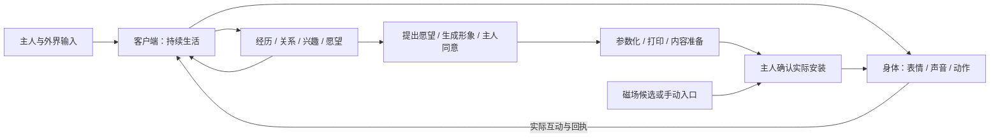

# 产品体验与开发计划

更新：2026-11-18。目标是让同一个体在奇幻平行世界生活，多源现实输入折射为处境与机会。它通过自主选择和经历积累偏好，提出角色愿望，与主人共同完成形象、打印和实体采用。**记忆、关系与能力延续；旧壳可唤起对应形态和表达风格。** [完整产品评估](product-journey-20261116.md)统筹使用周期，[核心成长流程](product-experience-20261116.md)保存已确认规则，实际进度见[主线](project-mainline.md)。

首版服务主人与少量体验者，设置有引导、打印可协助。日常目标为桌宠联网即可使用，制作与调试时再打开电脑。[最小日常版设计](daily-experience-v1-20261116.md)已细化首次相识、交流、安静、离开返回与恢复；4b1a 离线首环与 4b1b USB 实机验收已完成。

客户端与硬件固件共同开发。小智是日常语音基线，统一语音已接通真机，听写、声音和回答进入质量对照。近期优先语音体验、身体反馈与常驻日常版。客户端独立推进自主生活。首版用磁场辅助判断，由主人确认安装。[真机结果](xiaozhi-device-voice-trial.md)

## 理想用户流程

| 场景 | 主人怎么做 | 产品完成什么 |
| --- | --- | --- |
| 第一次使用 | 完成供电、联网和服务准备，创建或找回个体，开始第一次交流 | 保存引导进度，建立第一次共同经历，显示可理解的状态 |
| 日常陪伴 | 正常交流、摸头，也可以让它自己生活 | 生活服务结合需要、经历与输入作出选择，通过身体表达；结果回到同一段生活 |
| 离开与返回 | 安静离开，回来查看一条近况，选择聊或继续忙 | 按服务实际运行状态汇总经历，接续原任务；安静设置与未处理提示可恢复 |
| 成长与愿望 | 听它讲经历与向往，讨论形象，也可暂缓 | 保存愿望依据与方案，进入制作；它继续生活 |
| 制作外壳 | 确认形象与预览，导出模型并打印 | 生成适配硬件的参数化外壳，准备匹配的角色内容，核对容量 |
| 安装与变化 | 换好外壳，确认实际安装的是哪套；也可主动点“我换好外壳了” | 展示磁场候选，核对准备进度，在合适时机采用整套角色表现 |
| 重用旧壳 | 从候选或列表确认旧壳 | 恢复对应形态与表达风格，保留记忆、关系与能力，继续当前生活轨迹 |
| 内容更新 | 预览变化，确认安装 | 计算容量、安装核对、同步版本，保留上一版恢复入口 |
| 维护与找回 | 换网、重开服务、迁移或找回原个体 | 清楚显示当前状态，从有效记录继续生活与制作项目 |

## 已有基础

| 模块 | 当前状态 |
| --- | --- |
| 实体表情与交互 | E3f-9d.3 与双角色包已验收，镜像、过渡、菜单、对话、触摸和睡眠正常 |
| 工作台 | 资源制作、预览、打包、安装与恢复已有；9 个页面已统一主题与动效 |
| 外壳识别与表现绑定 | M2、绑定、原日志重放与后台调度已离线联测；主人确认安装、A/B 设备表情切换与保存已实机验收，319 条 A/B 模拟磁铁基线已保存，真实壳制作后补拆装校准 |
| 客户端生活与成长 | 源码与文档包含多元输入、任务、经历、关系、愿望、试做与阶段采用模块；持续自主生活的整体效果仍在开发验证 |
| 客户端设备与语音 | USB 表达首环已验收。试用语音接通真机，准确率与自然度待改善 |

现有“我的角色”保存的是 `deskbot.role_profile.v2` 配置。接入后把它关联到持续个体和表现版本，客户端继续保存人格、记忆、关系、当前任务与成长阶段。原有两套表达角色作为可切换的表现资源使用。

## 开发管线

继续复用 USB 表达、主人安装确认、安装同步和形态采用。当前顺序为语音质量对照 → 身体反馈与常驻日常版 → 生活愿望联合体验 → 制作与实体采用。结构测量和 CAD 小样可同步准备。[主线与分工](project-mainline.md)

客户端据[硬件接入基线](client-hardware-integration-20261116.md#给客户端的接入基线)安排身体交互、语音与角色采用模块；生活模块独立开发，接口和模拟用例同步对齐，已就绪模块逐项联合验收。

| 顺序 | 开发内容 | 完成后能看到什么 |
| --- | --- | --- |
| 4a · 评估完成 | 核对客户端与固件源码，确定单一生活状态、HTTP 表达首环及小智兼容语音候选 | 接口、职责、改动与验收顺序见联合评估 |
| P0 · 设计完成 | 完整旅程、日常交互与联网拓扑；项目常驻服务、体验者独立实例为首版方案 | 交互、接口、依赖与验收任务见最小日常版设计 |
| 4b1a · 离线完成 | 原文字聊天 → HTTP 输出队列 → 共用协调入口 → 模拟设备回执；持久保存绑定与恢复记录 | 217 项测试通过，包含真实 HTTP、进程退出恢复与原工作台回归 |
| 4b1b · 已验收 | 原客户端平静／开心交替四次经 COM4 提交成功，画面、镜像、过渡与连续操作正常 | 菜单、对话、摸头与睡眠唤醒通过，主人反馈与设备回执分别归档 |
| 4b2 · 语音体验 | 实机已接通。先做真人听写对照，再用同一段话比较音色，用正确文字改善回复。质量达标后复测打断、重连和切回小智 | 能听懂人话，声音自然，回答像有自己生活的角色，可继续追问 |
| 4b3 · 最小日常版 | 身体事件、受限动作、主人绑定、常驻运行、首次相识、安静、近况与找回；接入客户端已就绪生活能力 | 关闭制作电脑仍可交流和互动；离开返回与服务重开可接续，连续运行、延迟与费用有记录 |
| 4c · 经历到愿望 | 自主选择、结果、偏好、尝试、愿望与主人讨论共用实际记录 | 愿望有来由，主人可以引导、商量与暂缓 |
| 4d · 形象与方案 | 生成概念图，保存修订与主人同意，预览整套角色方向 | 可看、可讨论、可修改，打印等待期间继续生活 |
| 5 · 参数化与制作 | 按硬件基准生成模型，准备声音、表情、动作与内容包；提供打印协助与试装说明 | 可导出打印，等待和返工从原项目接续 |
| 6 · 安装与采用 | 手动确认与设备表现已实机验收，客户端安装自动同步已运行，聊天与音色采用已离线联测；接续原服务启用 | 客户端与设备共同采用对应形态，延续同一个体 |
| 7 · 长期迭代 | 扩大生活内容与使用观察、简化部署维护；按复测简化匹配 | 新奇感、打扰程度、持续使用和成本有实测依据 |

阶段 1、2 和 3b2 已有模块继续复用，历史报告保留原编号。既有 3b3 采样为磁场辅助与自动匹配提供数据，主人方便时从第二组 B 装回接续；手动安装确认可直接使用。每轮按延迟、资源开销、运行稳定性与体验调整两边实现。

**4b1a 离线首环已完成**：[设计与结果](client-expression-loop-4b1a.md)记录共用调度、提交账本、回合恢复与固定客户端补丁；4b1b 的平静／开心 USB 表达与主人实机验收已通过。下一项是组合运行入口与兼容验证，随后接真机联网语音。开放形象和参数化生成按后续里程碑开发验证。

## 体验与实现规则

- 候选分工是客户端服务集中保存生活与记忆，工作台保存制作草稿和发布配置，桌宠负责感知、表达和动作；具体接缝按首轮联测确定。
- 主人确认实物与表现关联；换壳、切表情包和重连延续同一个体。虚拟成长阶段与实际安装的外壳分别显示。
- 形象方案同意、实物安装确认与角色实际生效分别记录。首版磁场给线索，主人确认实际外壳；手动入口始终可用，自动匹配作为实测后的可选简化。
- 说话时记录新表现目标，在当前一句结束后切换；连续换壳采用最后确认的目标，字幕、声音与表情使用同一会话版本。
- 客户端、工作台播放和自动换壳共用一个表现协调入口；设备回执按实际阶段呈现。首版表情命令完成表示已提交播放器，完整画面另做观察验收。
- 日常显示“正在做什么、当前形态、连接与同步”；节点、原日志和识别参数进入高级工具。分别展示编辑草稿、待启用与设备实际状态。
- 内容就绪且交互允许时，以主人确认后约 2 秒看到变化为初步目标，实测核定。自动模式以明确匹配后计时。短暂取下、未知布局和暂不处理保留当前表现。
- 调试先检查设备身份、启动周期、会话、目录与状态时效；复用唯一 USB 所有者、原应用调度和已验收显示参数。
- 联合验证记录已实现、已验证与待探索三类结果。生活观察覆盖主动选择、互动后接续、重启恢复与持续运行开销，按结果安排下一轮。
- 日常目标是桌宠联网即可使用，制作与调试按需开电脑。首版采用项目维护常驻服务的设计，每位体验者独立 Node 与运行目录，世界、认知预算、实验、配置和缓存分别隔离，网关按主人与设备关联路由；具体主机按实际用量选定，设备本地能力与离线接续分别验证。

## 存储与恢复

电脑保留完整素材库，设备安装常用表现集合。当前两套表现内容 7,249,690 B，距现行 7 MiB 建议线余 90,342 B，距 8 MiB 分区余 1,138,918 B；新增内容优先筛选、复用和置换。镜像与三段过渡随素材和表达图发布。

长期生活、记忆和关系存入客户端 SQLite；设备只缓存已确认绑定、当前表现和必要运行状态。更新暂存、恢复副本与内存按阶段分别核算。

模拟基线见[本轮记录](shell-field-calibration-20261117.md)，历史采样保留在[现场记录](shell-field-capture-20261113.md)。实机恢复后按自己的节奏验收表情、菜单、对话、触摸、睡眠与恢复。每轮保留简短设计、必要测试、独立 AI 复核；稳定的大版本集中更新 GitHub。工具链与显示经验沿用[行动指南](development-pipeline-20261102.md)。
