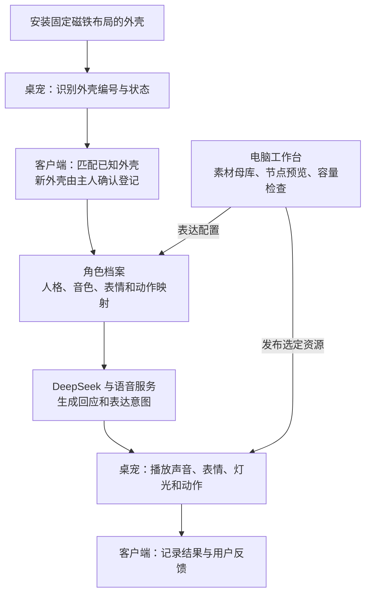

# DeskBot 后续计划

更新：2026-11-05。阶段二工作台与请求模拟完成；阶段三 E3b 第二版已安装，身份链路检查通过，交互验收待用户确认。E3c-6 已完成实时状态、平静按钮和回执的工作台联调，45 项专项及 27 项浏览器检查通过；完整离线套件运行 1,182 项，其中 1,180 项通过、2 项按条件跳过。设备仍运行 E3b 第二版，接下来部署 E3c App 并验收交互。规划依据当前固件架构、N32R16 资源布局及完整产品目标。

## 思路

[E3c-6](deskbot-studio-e3c6-20261105.md)已将原应用调度的单个平静表情接入工作台，支持查看状态、提交请求与读取回执。`accepted` 表示已进入队列，`dispatched` 表示已调用播放器 API；圆屏效果在实机联调时确认。实际睡眠状态仍为未知。

先让身体稳定表达，再让电脑读懂身体，最后接上角色与对话。

桌宠负责感知和执行；客户端负责角色、爱好、记忆与声音；工作台负责制作、预览、绑定和发布表情与动作。三个部分通过有版本的协议协作。

## 现在的位置

| 部分 | 已完成 | 接下来 |
| --- | --- | --- |
| 身体基础 | E1.42 交互已验收；E3b 第二版 App 回读、保护区与启动检查通过；原资源位于 8 MiB 活动区 | E3b 交互回归；三分钟连续映射专项 |
| 表情资源 | E1.18 惊讶表情已验收；E1.45 单眼镜像害羞候选完成离线包与 11 项测试 | 把害羞表情部署到设备并验收 |
| 电脑工作台与 USB | 编辑、打包、模拟、身份观察；E3c-6 实时状态、平静按钮与回执已离线联调 | 部署 E3c App，验收圆屏效果和完整交互 |
| 外壳识别 | A/B、移除和恢复、稳定窗口、置信度及内存档案已有验证 | 底座修复后继续拆装测试和持久登记 |
| 客户端通信 | 身体事实、角色档案、绑定确认已有离线协议 | 设备实时连接及表达请求 |

当前设备使用 E3b 第二版 App、E1.40 bootloader、E1.18 资源和 `upper-assets-8m` 分区表。E1.42 为已验收恢复版本。E1.45 是待部署候选，包大小 5,981,260 B，部署后资源区预计剩余约 2.30 MiB。

## 分阶段开发

| 阶段 | 工作内容 | 交付物与完成标准 |
| --- | --- | --- |
| 1. 完成一个新表情 | 三分钟映射与交互测试；保存现场备份；部署害羞候选；验证触发和播放 | 圆屏效果符合预览，摸头、对话、菜单和睡眠唤醒通过；形成已验收资源版本 |
| 2. 整理资源与发布（已完成） | E2a 统一编辑工作台；E2b 可复现角色资源包及 N32R16 构建核对；E2c 版本化表达目录、请求/回执和电脑模拟器 | 替换前后、影响范围和容量可查看；默认资源精确复现；电脑验证连接、重复请求、忙碌、超时、重连和动作事实 |
| 3. 打通电脑与身体（进行中） | E3a USB 只读观察；E3b 设备身份与版本；随后接入单个表情请求、设备目录和已有动作 | 状态有来源与更新时间；目录由设备确认；重复请求只执行一次；断开重连可恢复；原交互正常 |
| 4. 完善外壳识别与登记 | 底座修好后采集固定布局；独立评估；保存磁场档案；登记、修改和导出 | A/B 重复拆装能恢复识别；新布局进入待确认；重启保留档案；移动与干扰时状态清楚 |
| 5. 完成角色最小闭环 | 客户端接收外壳事实；主人确认外壳与角色关系；加载角色表达映射 | 换壳后角色名称与表情配置一起更新；新壳可命名登记；每次切换有可追溯结果 |
| 6. 接入 DeepSeek 和声音 | 依次接入语音识别、Agent、语音合成；统一流式播放、打断和重连 | 能自然对话、调用身体能力；切换角色后人格和音色对应；讲话时菜单与摸头正常 |
| 7. 丰富角色与维护 | AI 生成素材经工作台适配、预览和发布；丰富动作组合；客户端接入爱好演化 | 形成两套完整角色演示；角色会提出换装愿望，换壳确认后完成对应变化；完成长时间运行验收 |

阶段三使用 USB Serial/JTAG。E3b 负责身份，E3c-1—4 提供会话和状态，E3c-5 将平静请求交给原应用，E3c-6 接通工作台卡片、按钮和回执。接下来按“App 部署 → 单次平静请求 → 对话、菜单、摸头、睡眠回归 → 设备真实目录”的顺序推进。阶段一的映射专项和新表情部署按设备可用时间安排。底座维修期间，本体与电脑通信继续推进。

## 表情、动作和容量

- **素材母库在电脑**：保存官方、新制作和 AI 生成的原稿、名字、来源、授权、预览及版本。
- **设备安装选定包**：当前运行资源沿用已验证的 EAF 管线。每个素材记录圆屏布局、镜像方式、帧数、速度、循环方式和解码成本。
- **语义独立于文件**：例如“害羞”可以连接不同角色的动画；共享同一文件的语义在节点图中可见。发布记录具体改变了哪些连接。
- **动作分两步**：先开放现有动作及其组合、间隔和表达绑定；后续依据底座能力评估新的运动样式。动作节点分别展示请求、回执和可确认的完成状态。
- **资源预算**：活动资源区 8 MiB，发布包建议控制在 7 MiB 内。完整角色库保留在电脑，按需要生成设备包。
- **后续空间**：外壳档案按数量与写入频率评估约 256 KiB 专用区；在线资源更新另行设计第二资源槽和提交流程。当前布局作为这两项设计的输入。

## 角色如何变化

客户端分别保存“它想成为谁”和“现在已确认穿着什么”。

1. Agent 的爱好变化，形成一个目标角色，并向主人提出换装愿望。
2. 主人安装外壳，设备报告稳定的外壳识别结果。
3. 已登记外壳匹配对应角色；新外壳由主人确认名称和角色，再保存绑定。
4. 客户端激活角色档案，更新人格、音色及表达映射，桌宠显示当前角色。
5. 晃动、取下或识别暂未稳定时，建议保留当前角色，并显示等待稳定识别的状态。

角色档案使用稳定的角色 ID、外壳 ID 和资源版本。客户端先查询设备表达目录，再选择已安装资源；需要新资源时走工作台发布流程。

## 通信与调度

复用现有身体事实与角色绑定协议。先传完整状态，再传带序号的变化；重连后重新同步。第一步用电脑测试器验证只读数据，再加入带请求编号、有效期和执行回执的表达命令。实时通道在实现时按现有网络任务、资源开销和客户端环境选型。

显示、音频和电机分别由现有模块执行。UART、音频和计时器回调更新固定大小状态；统一调度处理表达请求。对话、摸头、睡眠与客户端请求的优先级形成明确规则。协议只有事实级动作完成通知时，按事实展示完成。

## 每轮开发和验收

1. **定范围**：明确本轮一个功能、涉及模块、预期变化和完成标准。
2. **离线验证**：从实际 Git 根运行环境预检；锁定依赖；专项测试、浏览器预览与容量检查。
3. **生成发布件**：阶段独立构建；核对 App、分区表、资源和模型；保存版本、差异及恢复材料。恢复入口独立于候选与构建目录，并覆盖中断后的再次执行。
4. **设备验证**：确认端口和设备身份；保存当轮备份；按清单写入、完整回读并记录启动。
5. **交互验收**：新功能加固定回归：对话中及结束后切菜单、摸头、睡眠唤醒；底座接入后加入转头和换壳。

建议统一验收基准：UI 相关改动连续进行 20 轮对话/菜单往返；涉及持久化做 3 次重启；外壳每种布局做至少 10 次拆装并保留独立评估样本；接口覆盖断开重连和重复请求；组合版本完成 30 分钟持续交互，最终版本增加长时间运行。每份记录同时写实际测试次数、结果和观察到的问题。

每阶段保留一份简短说明、一份机器报告和一个可复现入口。临时数据进入仓库 `tmp/`，公开结果进入 `artifacts/`；验收后整理中间产物，保留源码、现场备份和当前恢复材料。

## 最近的行动

阶段三 [E3b](deskbot-studio-e3b-20261104.md)第二版已安装，身份链路检查通过。后续顺序：

1. **完成 E3b 交互验收**：确认对话、菜单、摸头和睡眠唤醒。App 回读、每十秒身份更新、重启、重连与页面检查已通过。
2. **E3c 工作台联调**：[单个平静表情与回执](deskbot-studio-e3c5-20261105.md)已完成离线测试、双配置构建和独立审计。下一增量复用工作台现有串口连接，展示应用、页面与播放器状态，增加“平静”按钮和“已受理 → 已提交播放器”回执，同时显示忙碌、过期和断开原因。离线联调通过后部署 App，再做交互回归。
3. **E3d 表达目录与动作**：设备返回真实资源版本；表情扩大到已安装目录；底座修好后接入五个已有动作。
4. **阶段四、五**：外壳持久登记，主人确认外壳与角色绑定，加载角色表达配置。
5. **阶段六**：客户端接入 DeepSeek、语音识别与合成，最后完善角色演化和新素材制作。

阶段一的三分钟连续映射和新表情实机验收在设备方便时安排。

技术细节继续使用[架构文档](architecture.md)和[行动指南](development-pipeline-20261102.md)，本页作为通俗版完整计划。
