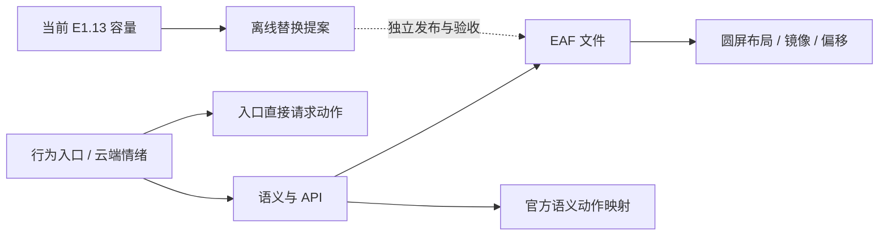

# E1.14 绑定决策 / Binding Decisions

记录日期：2026-10-24。结果为 `offline_validated`：整理现有证据与资源决策，不改变已验收的 O2f2 App 或 E1.13 assets。

[决策工作台](../artifacts/expression-binding-decision-e1-14-20261024/index.html) · [机器可读结果](../artifacts/expression-binding-decision-e1-14-20261024/decision.json) · [设备基线](baseline-status.md)

## 本轮结果

工作台支持按资源或 56 条路由检查节点关系，区分固定映射、条件分支、服务端动态入口及未映射调用。动作从语义或行为入口独立分支，不存在 `EAF → 电机` 关系。可以切换入口、逐个审阅共享语义，并缩放节点。



| 资源类别 | 数量 | 本轮决定 |
| --- | ---: | --- |
| 核心保护 | 5 | 保留 `winking/listen/insert/eat/beat_swing`，变化需独立回归 |
| 共享保护 | 3 | 保留 `Happy/confused/neutral`，单语义变化应提独立映射方案 |
| 独立保护 | 10 | 可研究替换；没有运行时证据时不删除 |
| 离线候选 | 1 | `shy_legacy.eaf` 仅保留元数据，未进入设备 profile |

这里统计 19 个资源行。E1.9 的 `28 core / 84 protected / 1 candidate` 统计多种行，不是资源数量。56 条路由 = 20 个行为入口 + 29 个语义审阅入口 + 7 个未映射名称入口。

## 会影响替换决策的关系

- `Happy.eaf` 被 10 个语义共享，存在摇头、环顾和蹭头三种语义动作请求。直接换文件会影响全部引用者；只改某个语义的映射不会释放仍被其他语义引用的文件。
- `confused.eaf` 被 `thinking/confused` 共享；`neutral.eaf` 被 `winking/idle` 共享。语义 `neutral` 实际指向非循环的 `winking.eaf`，不能按文件名猜测用途。
- 摸头入口先发送“我在摸你猫头”的上下文，再由服务端返回情绪，不是固定的 `embarrassed` 链。
- 配对检测通过 `SetEmotion(happy)` 请求 `shark_head`，入口另有 `look_around` 请求。两者分列，不虚构先后与完成关系。
- 动作工具的五个动作是选项，不是同时触发。DOA 角度请求独立于 EAF 绑定。
- 9 处未映射调用涉及 `circle_xmark/cloud_arrow_down/cloud_slash/download/gear/link/microchip_ai`。先核对错误、更新和联网场景，不能据此移除入口或其他动画。

所有连接都是静态证据；没有逐路由实测，不推断播放频率或电机完成情况。底座触发等维修后补验。

## 容量与来源

| 当前 E1.13 基准 | 字节 |
| --- | ---: |
| assets 分区 | 6,144,000 |
| 已验收完整包 | 5,538,349 |
| 剩余 | 605,651 |

包仍为 29 个成员，只对 `insert.eaf/eat.eaf` 无损重编码。工作台单文件参考大小、摘要来自 E1.9 上游源码；这两个成员标记“已重编码”，不把原始字节数当作当前部署成员尺寸。完整包容量继承已发布的 [E1.13 记录](baseline-status.md)，本轮没有打包或读取设备。

输入固定为 E1.9 `matrix.json` 和 E1.4a `bindings.json`，生成器校验 SHA-256，并记录容量/验收文档摘要。所有资源的 `removal_authorized/replacement_authorized` 均为 `false`；候选没有图像，不进入官方输出路由。

## 下一步 E1.15：单语义离线提案

先对比 `surprised → shocked.eaf`：复用已有官方资源，动作两侧都是 `look_around`，先把语义变化与引入新素材分开验证。

| 检查 | 通过效果 |
| --- | --- |
| 语义差异 | 只改变 `surprised` 的拟议映射，其余语义与官方回退不变 |
| 共享影响 | `Happy.eaf` 保留，不声称释放其字节 |
| 动作 | `look_around` 保持不变，不新增动作挂钩 |
| 圆屏 | 使用当前 `eye_anim` 镜像/偏移预览，不能只比 EAF 宽高 |
| 预算 | 从 E1.13 基准计算，索引与容器差异计入，不复用旧候选容量 |
| 发布资格 | 离线视觉、播放器、包成员差异与回退通过后，单独安排写入和回归 |

`embarrassed` 独立样稿继续研究，先解决许可、画布和播放策略。底座未修复不改 C61；外壳可靠性、客户端只读出口、角色确认、最终 DeepSeek/TTS 接入继续按[总路线](roadmap.md)分阶段推进。

## 复核

```powershell
python scripts/build-expression-binding-decision-e1-14.py --check
python scripts/check-publication.py
python scripts/check-workbenches.py
python scripts/run-offline-checks.py
git diff --check
```

生成器无外部依赖，可用公开输入重建相同产物。便携测试覆盖共享保护、动作分支、动态摸头、布局通道、候选隔离、当前容量与重建一致性。

本轮本地结果：

| 检查 | 结果 |
| --- | --- |
| 公开副本检查 | 通过；来源清单、相对链接、JSON、候选隔离和敏感信息模式检查 |
| 便携主机测试 | 149 项：147 passed、2 skipped、0 failed；跳过项仍是未提供的历史 F1 导出和完整 EAF 元数据报告 |
| E1.14 专项 | 13 项，包括公开输入重建一致性和实际页面控制脚本的 DOM 模拟执行 |
| 四个工作台 | 内联 JS 语法、JSON、相对链接与回环 HTTP 字节一致性通过；HTTP 检查不启动浏览器 |
| 固件边界 | `SOURCE_MANIFEST.sha256` 检查通过，未更改固件输入 |
| 空白检查 | `git diff --check` 通过 |

测试依赖仅临时安装在 clone 的 `tmp/e1-14-check-deps`，完成后已移除，没有安装到全局 Python。

浏览器安全策略拒绝本地 `file:` URL，本轮没有绕过限制，不声称浏览器渲染、缩放交互或移动端视觉验收通过。脚本语法、数据和无浏览器交互执行另行检查，不能代替浏览器。没有访问串口、刷写、修改固件源码、分区、NVS 或设备 UI。

## English summary

E1.14 reviews 56 static routes, 18 official EAF resources and one metadata-only candidate. Five resources retain core protection, three are shared, and ten remain individually protected. Missing runtime evidence never authorizes removal. Motion requests, tool options and source-branch actions stay separate from EAF playback. The accepted E1.13 package occupies 5,538,349 of 6,144,000 bytes, leaving 605,651 bytes. No firmware or device changed. Next is the offline single-semantic `surprised → shocked.eaf` proposal, preserving `Happy.eaf` and official motion mapping.
