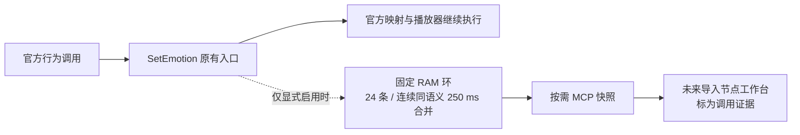

# E1.26 表情调用观察器：实现与构建审计

日期：2026-10-27。状态：离线实现、双配置完整构建通过；启用版随后仅部署到 COM4 App 分区，完整回读和保护分区校验通过，用户已确认本体回归正常。当前 App 为 E1.26 observer-enabled build，资源分区继续保持已验收的 E1.18，`surprised → shocked.eaf` 未改变。部署证据见 [E1.26 实机记录](expression-e1-26-live-deployment-20261027.md)。

## 本轮交付

[公开审计报告](../artifacts/expression-e1-26-runtime-observation-20261026/report.json) 汇总源码、协议、主机 C++、最小 ESP-IDF 工程与完整本体构建证据。完整日志、依赖逐文件校验和二进制保存在本机忽略的 `tmp/`，不包含设备采集数据。报告明确 `deployment_eligible=false`、`flash_authorized=false`。

观察器只回答“某个表情语义是否进入 `EmoteDisplay::SetEmotion`”。它不能证明该语义来自哪个具体事件、资源已加载、LCD 已显示或电机动作已完成，也不能据此判断资源可以删除。



本轮没有增加电脑工作台 UI，也没有接通上图最后的导入步骤。

## 接入范围与并发约束

| 项目 | 实现与审计结果 |
| --- | --- |
| 开关 | `CONFIG_DESKBOT_EXPRESSION_OBSERVER_ENABLE` 默认关闭；关闭时不编入观察器源码、调用钩子或新增 MCP 工具 |
| 保留内容 | 29 个固定语义、启动内序号、首次/末次启动毫秒时间与重复次数；未知、超长和非 ASCII 名称折叠为 `other`，不保留原始文本 |
| 容量 | 24 条固定环；连续同语义在 250 ms 内合并，超出容量覆盖最旧记录；计数与序号有边界 |
| 生产路径 | 单次零等待锁尝试，竞争时放弃本条并计数；不分配堆内存、不输出日志、不调用 UI、播放器或控制接口 |
| 快照 | 锁内只复制固定结构，JSON 格式化在释放锁后完成；忙时返回可重试状态，不等待 |
| 内存 | 静态 DRAM 对象；编译断言限制对象不超过 768 B、快照不超过 640 B；记录只在 RAM 中，重启丢失 |
| 查询 | `self.expression.observation` 返回最近调用及丢弃计数 |
| 清除 | `self.expression.observation.clear` 只清 RAM 记录与丢弃计数，保留本次启动内序号；它不控制硬件 |
| 官方源码 | 仅增加显式开关包围的构建、入口与工具代码；精确移除这些块后，与固定基线 `747b0d918538eedaf936fda0bb6c9340fc7658cc` 一致 |

源码范围固定为两个新增观察器文件、`main/CMakeLists.txt`、`main/Kconfig.projbuild`、`dev_tools.cc`、`emote_display.cc` 及来源清单。C61、官方 UI/播放器实现、音频、DOA、触摸、电机、表情映射和 NVS 均不改。

## 双配置完整构建

使用 ESP-IDF 5.5.5、ESP32-S3 目标、固定依赖锁和独立工程副本；69 个 Registry 依赖的实际文件内容通过校验。两配置均启用可复现构建元数据，避免构建日期造成 bootloader 差异。完整报告还核对 1,060 个来源清单条目、有效配置、编译源码成员与 ELF 符号。

| 配置 | App 大小 | App 分区 | 剩余容量 | 观察器 ELF 符号 |
| --- | ---: | ---: | ---: | ---: |
| 默认关闭 | 4,472,416 B | 6,144,000 B | 1,671,584 B | 0 |
| 显式启用 | 4,477,280 B | 6,144,000 B | 1,666,720 B | 13 |

启用后 App 增加 4,864 B。这里分区为 **6000 KiB**，不是 6 MiB。两配置的分区表、bootloader、`expression_assets.bin` 和 `srmodels.bin` 逐字节一致。

| 本次 App | SHA-256 |
| --- | --- |
| 默认关闭 | `7291c201819b3ad762e5647daa9d27a5d5b52b25f04b005b010bb008bd4fa51f` |
| 显式启用 | `f95a762df79e13a3678f0e739bfc91b9913cdbb85e0e015522d31f0a36a029c2` |

这些是新构建产物摘要，不是已验收 App 的摘要。关闭配置排除了观察器，不等于新镜像与历史 App 字节相同或已通过硬件回归。`firmware/body/README.md` 保留 O2f2 输入快照的历史说明，本轮后续构建状态以本文件为准。

构建生成的资源包是公开源码输入的参考产物，**不得覆盖设备已验收的 E1.18 assets**。后续若部署观察器，仅审查本体 App 分区 `0x10000`，不使用完整工程输出的全分区刷写命令。

## 离线验证与复查入口

```powershell
python scripts/test-expression-e1-26-cpp.py
python scripts/run-offline-checks.py
python scripts/check-publication.py
python scripts/check-workbenches.py
git diff --check
```

本轮默认套件共 211 项：209 项通过，2 项明确跳过，原因分别是没有真实 F1 导出和没有本机官方资源能力报告。观察器主机 C++ 测试覆盖启用/关闭、环覆盖、合并、时间回绕、未知文本折叠、锁竞争、快照/清除、计数和序号边界；主机 FreeRTOS 替身不能替代 ESP32 双核并发验证。

最小 IDF 和完整 IDF 构建均独立检查关闭/启用模式。完整构建证据齐备时，运行：

```powershell
python scripts/audit-expression-e1-26-observation.py
```

该正式审计会重新校验本机报告和构建产物；缺失、过期、配置不符或摘要不符均失败。干净 clone 的默认主机套件会明确跳过依赖本机构建证据的 5 项测试，但仍运行源码/协议、C++ 编译与关键拒绝用例；不会将 skip 当作完整构建通过。CI 获取完整 Git 历史，以便核对固定源码基线。默认主机检查不自动启动 ESP-IDF 构建。

完整构建入口 `scripts/build-expression-e1-26-body.py` 目前需要本机 ESP-IDF 与匹配的依赖缓存，不是无需环境配置的通用打包器；它仅构建，不访问串口。工作目录与输出均限制在仓库 `tmp/` 下。

## 下一步：真实调用快照与表达审阅

1. 通过只读工具 `self.expression.observation` 查询当前启动期间的调用记录，将返回的真实 JSON 快照保存到 E1.27 工作台可导入的文件。
2. 导入 E1.27，按实际场景检查语义、顺序、重复和覆盖计数。节点高亮仅代表方法调用入口；与官方调用路由、资源播放器与圆屏实测效果一起判断表情映射。
3. 只有形成明确的单语义变更提案后，才进行 E1.20 覆盖/共享引用审计、E1.21 播放器及资源容量检查、前后动画视觉审阅和单独的实机回归；不得按观察频次直接删资源。

| 实机场景（待执行） | 预期通过效果 |
| --- | --- |
| 点击对话，对话中/结束后切菜单各重复 5 次 | 菜单与主页响应正常，语音不中断，UI 不冻结 |
| 摸头、睡眠与唤醒 | 官方灯光、表情和交互正常；快照中只记录实际进入方法的语义，不要求固定动画 |
| 查询快照、重复查询、清除 | 响应有界；清除不触发表情/动作，后续序号不回退；查询产生的正常对话表情仍可能被观察 |
| 记录超过容量，断电重启 | 最近记录最多 24 条；重启后旧记录丢失；不存在 NVS 写入 |
| 底座修复后 DOA 与动作 | 按原验收方式回归；观察记录不作为动作完成凭据 |

实现与构建审计阶段没有访问硬件、串口或设备日志。随后启用版仅写入 COM4 `0x10000`，完成 App 回读、分区表和 E1.18 assets 校验，用户确认本体回归正常，详见 [E1.26 实机记录](expression-e1-26-live-deployment-20261027.md)。真实调用快照、专门的运行时锁竞争/环覆盖验证及维修后底座回归仍独立进行；用户本体验收不替代这些证据。
