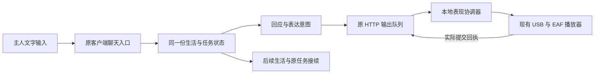

# 4a：客户端、语音与桌宠联合评估

2026-11-16。依据[已确认体验](product-experience-20261116.md)，本轮确定职责、接入路线和第一条可验证链路。源码基线为客户端 `0d8d4c5`，本日经 Clash 核对仍为 GitHub HEAD；设备依据 E3f-9d.3 已验收源码与现场记录。

## 结论与分工

采用**客户端集中管理生活，桌宠负责感知与表达**的方向。首先复用现有 HTTP 输出接口和 USB 播放能力；语音随后接到同一份生活状态。DeepSeek 是模型服务，小智包含设备通信和语音系统，两者可以协作。

| 部分 | 职责与本轮核对结果 |
| --- | --- |
| Node / SQLite | 保存同一个体的世界、任务、经历、关系、愿望和输出记录；已有事件去重、任务结算和重开读取 |
| Python 认知 | 根据 Node 提供的上下文提出选择与回顾，Node 核验并保存实际后果；当前默认启动路径尚未启用正式连续 Python 认知 |
| DeepSeek | 提供聊天和认知所需的模型调用；两条调用路径已有，额度、上下文与运行启用分别核对 |
| 小智设备固件 | 复用收音、唤醒、打断、音频播放及本体交互；已验收现场使用 MQTT 云端语音，源码另有 WebSocket 通道 |
| 工作台与本地适配器 | 管理表现资源、镜像、版本和设备命令；客户端与工作台共用表现协调入口和唯一 USB 所有者 |

当前客户端的真实 ASR/TTS 还需接入：已提交的 sidecar 将音频转为测试标记，TTS 生成测试音。文字建议的生活折射目前采用有限规则。持续自主生活与自然成长按客户端研究结果继续验证。

## 三条语音路线

| 路线 | 可复用内容 | 需要完成什么 | 排期判断 |
| --- | --- | --- | --- |
| 扩展当前小智云服务 | 现有联网、识别和发声体验 | 核实当前账号是否允许将每轮对话交给 Node，传入生活上下文、返回答语和事件，并支持主动表达 | 有完整接缝时优先比较；当前仓库没有云服务端代码或配置证据 |
| 自管小智兼容服务 | 设备已有小智协议、唤醒与音频链 | 兼容 MQTT/UDP 或切换到已实现的 WebSocket；接真实 ASR/TTS，把转写交给 Node，再送回语音、字幕和情绪 | 语音主候选；4b2 先做协议与服务验证，再核对改动范围 |
| 设备直接接客户端桥 | Node 已有 outbox、音频帧与设备会话 | 设备实现 `deskbot.bridge.v0.1`，补真实语音及 Opus 转换、取消、重连和音频协商 | 对设备改动较大，作为前两条验证后的比较方案 |

模型、人格提示或 MCP 工具单独接通后，还需核对每轮交流是否使用同一个体的实际状态、保存主人输入并接续生活。现有 `gateway/deskbot_gateway.py` 只转发模型文本；完整生活上下文走客户端原聊天入口。

4b2 用“实际支持的接缝、首段答语延迟、打断速度、声音、重连、资源开销、部署与费用”比较路线。现有 MQTT 云语音和客户端独立语音分别记录状态；统一语音验收通过后，日常交流采用一个处理入口。

## 第一条小回路：4b1

4b1a 已完成离线实现与联测，当前结果见[4b1a 实现记录](client-expression-loop-4b1a.md)；以下保留本轮确定的接口与范围。

第一轮在隔离存档中输入“今天做好了一顿饭，很开心”等主人消息。回应读取当时生活、记忆与正在做的事；文字显示在客户端，圆屏显示对应表情。先用固定模型回复核对传输，再在真实模型验证中比较不同生活状态下的理解与选择。消息、建议、实际行动和结果分别记录。

### 接口与依赖

以下均复用现有接口；本地适配器与表现协调器已在 4b1a 实现，4b1b 已于 2026-11-17 通过两种表情交替四次的真实 USB 下发、原队列确认和主人实机验收。

| 接口 | 4b1 用法 |
| --- | --- |
| `POST /api/chat` | 传稳定的 `event_id`、`correlation_id`、`character_id`、明确 `device_id`、冻结绑定对应的 `role_revision` 和 `message`；沿原聊天与世界入口处理 |
| `POST /api/devices/hello` | 根据本机绑定和设备实际目录登记 `display.expression`；这个 HTTP 登记支持仅表达设备 |
| `GET /api/outbox?target=vocat&device_id=…` | 只领取当前绑定设备的 `render.expression`；其他类型和目标交给各自消费者 |
| `ControlBridge.control()/command()` | 核对新鲜状态、角色与目录，经现有 USB 所有者提交；工作台请求进入同一协调入口 |
| `POST /api/outbox/:id/ack` | 保存 `completed/failed`，附来源事件、版本、USB 请求和原回执；`body-perception:*` 保留原专用回执路径 |

原客户端 `/ws` hello 要求双向音频协商。首轮使用上述仅表达 HTTP 路径。依赖为 Node 24+、客户端完整运行内容与契约、现有工作台服务；电脑侧适配不增加设备资源包。

### 表情与完成范围

| 客户端语义 | 首轮设备语义 |
| --- | --- |
| `neutral` | `neutral` |
| `happy` | `happy` |
| `concerned / tired / alert / surprised` | 回写 `failed`，`error.code=unsupported_expression`，保留源语义；后续审阅素材或共同扩展语义 |

当前双角色包包含平静、开心、难过、害羞、困惑和困倦。底层 USB 还提供惊讶等能力，当前角色图的覆盖单独核对；客户端当前表达合同没有难过、害羞项。首轮采用平静和开心，镜像与过渡沿用已安装表达图；新增映射先预览确认。

收到 USB `dispatched` 时，提交命令结束为 `completed`，附 `completion_scope: player_dispatched`。这表示已交给播放器；画面完整性由实机观察，循环播放结束不从该回执推断。

### 时效、并发与恢复

- **时效**：首轮期限取原 `expires_at` 与 `queued_at + 30 秒` 的较早值。原输出可能没有期限；适配器保存计算结果，重启与重复领取沿用。时间异常先报告并重新核对。
- **版本**：在接收聊天输入、创建回合时按 `event_id` 冻结个体、客户端阶段版本、表现修订与代次、已装角色和图摘要的绑定；输出沿用该快照。领取输出与发送前核对设备、启动、会话及映射；工作台切角色后结束旧代次的待发输出。缺失绑定的命令先返回待核对，重连建立新会话后重新核对。
- **并发**：一个 USB 所有者串行提交。菜单、对话、睡眠占用时按现有就绪规则等待，超过期限结束该条；统一协调入口管理客户端、工作台和后续换壳目标。
- **提交记录**：本机账本记录命令领取、准备发送、USB 回执和客户端确认。回执已保存但 HTTP 确认丢失时只补确认；发送结果不明时保留 `delivery_unknown` 并核对已有回执，结束仍无法确认的旧命令，下一次新输入产生新命令。
- **聊天接续**：现有“输入保存、输出入队、聊天结果保存”分步提交。4b1 增加明确的回合恢复记录与故障注入：缓存可恢复结果，重开优先完成原回合，状态不明时显示待处理；重复输入复用原编号和输出，原任务继续按实际状态运行。

过期、旧代次、缺失绑定、未映射与无法确认的提交均向客户端回写 `failed`，在 `error.code` 区分原因；`delivery_unknown` 保留实际结果未知的范围。已确认 `dispatched` 的提交只补原成功回执。

## 实现与验收顺序

下表保留 4a 的技术拆分。后续完整排期以[产品旅程](product-journey-20261116.md)为准：4b2 增加设备联网接入，4b3 交付包含相识、离开返回与恢复的最小日常版。USB 首环核对共享状态和表达，日常目标为桌宠联网即可使用。

| 步骤 | 交付与完成标准 |
| --- | --- |
| 4b1a · 已完成 | HTTP 输出适配与统一协调入口；固定回复、隔离 SQLite、内存设备验证整条链，覆盖重复领取、版本、时效与恢复 |
| 4b1b · 已验收 | 平静／开心四次 USB 下发及原队列确认完成；主人确认画面与菜单、对话、触摸、睡眠正常 |
| 4b2 · 进行中 | [4b2a 协议接缝](xiaozhi-voice-seam-4b2a.md)与 [4b2b 电脑真实音频](xiaozhi-real-voice-4b2b.md)已有；接主人绑定、持久恢复、设备网络与常驻部署 |
| 4b3 | 按客户端认知进度验证受控现实输入、自主选择、实际后果和互动后接续；记录真实用量与延迟，再扩大持续运行 |
| 4c—7 | 经历到愿望 → 形象方案 → 参数化制作 → 主人确认安装与角色采用 → 长期体验，沿[产品计划](development-plan-20261104.md)推进 |

单元方案覆盖语义映射、身份/版本、时效、幂等与提交状态；集成方案覆盖原 HTTP 聊天/队列、断线、回执丢失、输出入队后的进程退出、模型调用期间工作台换角和重新打开。身体感知、安装确认和语音各自通过对应接口接续。

本轮复跑 8 份原客户端测试，共 58 项通过，覆盖输入、有限折射、聊天、输出队列、HTTP、WebSocket、认知接续和设备配置。源码核对、测试、独立 AI 复核及来源摘要归档于[评估记录](../artifacts/joint-capability-4a-20261116/report.public.json)。新适配器、真实语音和端到端持续生活在上述步骤验收。
