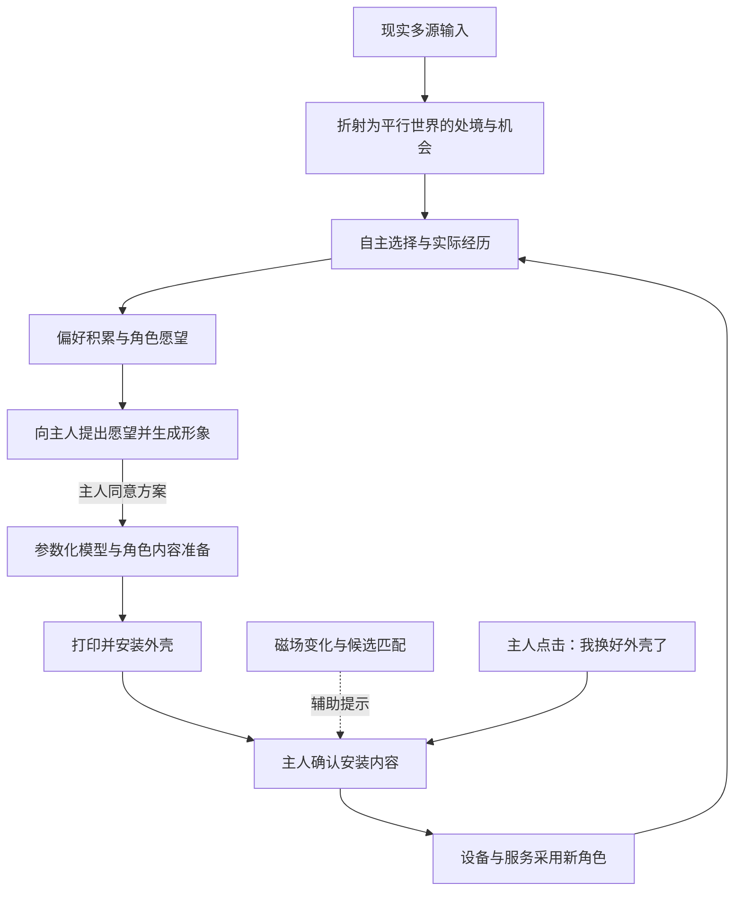

# 角色成长与实体化体验

更新：2026-11-16。本页记录已确认的核心成长与实体化流程。首次相识、日常相处、离开返回与长期维护见[完整产品体验评估](product-journey-20261116.md)；已有实现和验收状态见[主线](project-mainline.md)。

## 产品目标

同一个体在与现实平行的奇幻世界中生活。主人交流、天气、事件等多源输入折射为世界里的处境与机会；它通过自己的选择和经历积累偏好，提出想成为的角色。主人参与讨论、生成形象与打印外壳，安装确认后，让变化进入实体表现和后续生活。

持续的新奇感来自可追踪的生活、有差异的选择和逐渐形成的愿望。主人能够引导、邀请、商量和提供机会；它可以尝试、犹豫、坚持、改主意或休息。实际选择带来后果，再影响下一次生活。

## 核心成长与实体化流程

| 步骤 | 主人看到和参与什么 | 系统完成什么 |
| --- | --- | --- |
| 1. 相处与输入 | 交流、分享现实事件，查看它的近况 | 核对来源与时间，将输入转为它可感知的世界变化或机会 |
| 2. 自主生活 | 从简短近况、表情与活动中理解它在做什么 | 根据处境、需要、记忆与兴趣作选择，执行后保存实际结果；互动后接续或调整 |
| 3. 形成愿望 | 听它解释想成为谁、为何向往，也可提问、建议或暂缓 | 关联实际经历、偏好和尝试，保存愿望与主人回应；发展节奏通过持续观察校准 |
| 4. 讨论形象 | 看概念图，讨论轮廓、色彩和特征，选择继续、修改或稍后 | 生成并保存对应方案版本，形态与职业可组合；本轮同意进入制作 |
| 5. 制作准备 | 预览外壳、屏幕效果与声音，导出可打印文件 | 根据硬件基准生成参数化模型，检查装配与容量，准备对应角色内容 |
| 6. 打印等待 | 按自己的时间打印，重开后可继续项目 | 保留愿望、模型与准备进度，它继续生活；修改方案产生新版本并再次确认 |
| 7. 安装确认 | 换好外壳，确认“装的是哪一套”，也可更正或稍后 | 磁场提供提示或候选；主人确认实际外壳与方案，记录当次安装 |
| 8. 正式采用 | 看见一致的形态、说话风格、声音、表情与动作变化 | 核对内容与版本，在合适交互时机切换，分别确认服务、设备实际状态与保存结果 |
| 9. 继续成长 | 与变化后的它相处，也能重用旧壳 | 延续同一份记忆、关系与能力；新角色影响生活与表现，后续方向仍由经历和选择形成 |

例子：主人分享做饭经历，可以带来平行世界里的料理邀请或食材问题。它经过自主尝试，可能更喜欢料理，也可能更关心食材生长的池塘。同一来源保留不同发展路径；输入、经历、偏好与愿望各自记录。

## 三个确认时点

| 时点 | 确认的内容 | 后续状态 |
| --- | --- | --- |
| 形象方案同意 | 主人愿意制作这份方案 | 愿望进入制作，完整新角色等待安装；已确认版本可继续查看 |
| 实物安装确认 | 主人声明已装哪套外壳和方案 | 保存实际安装记录；资源未就绪时显示准备进度 |
| 角色实际生效 | 服务与设备分别确认采用对应版本 | 更新实际角色并记录这次共同经历；首帧、配置保存与完整画面分别核对 |

安装与生效在界面分别显示，例如“外壳已确认，内容准备中”。准备失败保留已确认进度，恢复后从未完成处继续。同一操作重试沿用原记录。主人确认安装时绑定当前方案与安装尝试，重连或内容变化后重新核对。

## 磁场辅助与主人确认

磁铁布局可提供候选线索。实际读数同时受安装方向、就位、转头和周边磁体影响，登记档案来自实际装配与采样。当前 A/B 的环境变化和装回结果见[现场记录](shell-field-capture-20261113.md)。

- **首版默认流程**：稳定变化后显示一次“你换上了哪套外壳？”；有候选时给出名称与缩略图，主人可确认、更正、选择旧壳或回答“没有换壳”。
- **主动入口**：主人随时点“我换好外壳了”，进入相同选择与确认流程。无明显变化、布局相近或读数未知时也可完成安装。
- **安静等待**：转动、短暂取下和不稳定读数先等待；同次变化合并提示。暂不处理时继续当前生活与表现，任务卡保留接续入口。
- **标注与评估**：主人确认的实物可关联当次样本，环境和装配记录分别保存；独立装回、转动及环境变化验证用于评估自动匹配。
- **后续简化**：对已确认、复测可用的档案，主人可启用自动匹配。明确匹配复用同一启用流程，歧义、未知或环境变化时恢复主人确认；具体判定参数经实测确定。

首版确认卡至少提供“这就是这套”“选择其他外壳”“没有换壳／稍后”。首次入口优先使用现有客户端；语音与圆屏入口后续按可用能力接入同一规则。

## 新角色与旧外壳

| 对象 | 采用新角色后 | 重用旧壳时 |
| --- | --- | --- |
| 个体身份、记忆与关系 | 延续，新增这次成长与共同制作经历 | 延续 |
| 学到的能力、兴趣与愿望 | 按实际经历继续发展 | 保留积累；当前兴趣决定是否重新投入对应活动 |
| 实际外壳与表现配置 | 在安装确认和准备完成后采用新版本 | 进入旧壳对应形态、音色与表达风格 |
| 平行世界的生活 | 新角色带来对应活动方式与关注 | 穿着可提供线索，成长轨迹与当前任务继续记录 |

厨师是职业方向，青蛙是形态方向，组合可以形成新的角色可能。角色表现包含语言、声音、表情、动作及世界活动，采用时保持一致；硬件能力与内容通过对应模块逐项实现。

## 日常界面方向

以下为界面方向，完整旅程中的交互与首版范围见[产品评估](product-journey-20261116.md)。已确认首版面向主人与少量体验者，设置和打印可协助，日常桌宠联网即可使用。

- **桌宠**：即时触摸与唤醒反馈、交流、轻量近况、角色变化后的表现；听取、思考、未听清和未连接容易分辨。
- **客户端**：以“正在做什么、最近的经历、当前愿望”为主；有制作任务时显示进度，安装时提供确认卡。多端共享同一个体和会话归属。
- **工作台**：形象、参数化、表情节点、镜像、声音预览、容量与内容发布。日常操作保留简洁入口，高级制作和诊断按需展开。

主动分享频率、安静时段和静音后的视觉反馈可设置。等待打印、暂缓愿望和未处理的安装提示采用温和接续，继续已有生活。

## 待验证的实现与开发顺序

小智提供当前设备语音与通信基础，DeepSeek 是客户端的模型选择。先评估现有小智服务的扩展能力、对话与生活状态接入、真实 ASR/TTS、打断与恢复，再比较复用服务、兼容网关或独立通道的成本与体验。统一角色状态与执行归属，模型和部署方式依据实测选择。

| 顺序 | 可观察的交付 |
| --- | --- |
| 4a. 联合能力评估 | 明确小智、客户端和设备能复用什么，确定同一生活状态进入交流与表达的最小方案 |
| 4b. 最小日常版 | 共享身份与文字表达首环 → 联网和统一语音 → 首次相识、自主生活、离开返回与恢复；桌宠联网即可日常使用，制作／调试按需开电脑 |
| 4c. 经历到愿望 | 从一组实际选择与结果看到偏好、尝试和愿望，主人可以讨论与暂缓 |
| 4d. 形象与方案 | 一份愿望生成可讨论、可保存修订的形象和表现预览 |
| 5. 参数化与制作 | 按硬件装配基准输出可打印模型，准备有容量核对的角色内容 |
| 6. 安装与角色采用 | 主人确认外壳，服务与设备采用一致角色；磁场候选作为辅助 |
| 7. 长期迭代 | 扩大内容与使用观察，简化部署和维护；按实测简化自动识别。首次使用、联网与恢复从 4b 开始验收 |

既有 3b3 采样从第二组 B 装回继续，为磁场辅助与自动匹配提供依据；主人确认路径可先完成。已验收 E3f-9d.3 与现有恢复材料保留。客户端持续生活与新认知仍在开发验证，参数化生成、开放形象和整套角色采用属于接续交付。

## 验收与归档

后续单元方案覆盖来源和去重、愿望与方案版本、主人确认、磁场候选、资源准备、角色生效与恢复。集成方案覆盖完整小回路、打印等待接续、无磁提示的手动安装、候选纠正、旧壳重用、断线及重复确认；实机核对形态表现、语音、菜单、触摸和睡眠。

产品观察检查：输入能否带来不同选择；主人能否理解愿望来由；角色是否表现出持续偏好与调整；旧壳和新壳是否承载共同经历；安装是否容易完成。新奇感与持续生活效果通过后续实际使用评价。

本轮交付为体验规则、流程与排期细化，源码与设备保持现状。文档、链接与独立 AI 复核结果归档于 `artifacts/product-experience-20261116/`。
