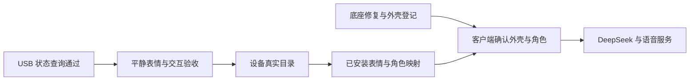

# 当前开发主线

更新：2026-11-05。

桌宠识别外壳、提供身体事实并执行表达；客户端管理角色、声音、记忆和演化；工作台制作、预览、绑定和发布表情与动作。

| 部分 | 当前成果 | 下一步 |
| --- | --- | --- |
| 身体基础 | E1.42 交互已验收；E3c-8 App 回读、重启和状态查询通过 | 当前表情与交互回归 |
| 工作台 | 节点、圆屏预览、角色草稿、打包、模拟、实时状态和回执 | 真实安装目录与表情选择 |
| USB | 辅控制台接收、会话、查询与单个平静请求已实现 | 联网待机下验证平静回执与重连 |
| 资源 | 8 MiB 活动区，E1.18 在用；E1.45 候选已备好 | 三分钟映射及新害羞表情实测 |
| 外壳 | A/B、移除与恢复、稳定窗口和置信度已有验证 | 底座修复后持久登记 |

下一步先完成平静请求、重复请求和断开重连；人工验收包括对话中及结束后切菜单、摸头和睡眠唤醒。再以设备真实资源目录扩展表情，底座修好后接现有动作。

见[E3c-8](deskbot-studio-e3c8-20261105.md)、[完整计划](development-plan-20261104.md)与[行动指南](development-pipeline-20261102.md)。
