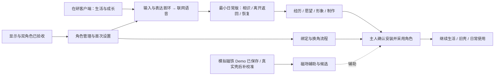

# 当前开发主线

2026-11-27：[闹钟管理](alarm-management.md)修复版已安装。旧版每天 08:00 的隐式提醒已关闭并在重启后核对，语音查询／取消和主页番茄钟暂停／继续已接通。11 项测试、构建、回读、启动和独立复核通过，实际语音与日常交互待主人验收。表情工作台已采用新 App 与原 r8 资源，后续换素材会保留闹钟修复；本对话过期产物已清理约 2.46 GB。

2026-11-26：[表情制作工作台](expression-pipeline.md)接通真实上传、360 圆屏适配、镜像、现有语义绑定、生产播放器预览、8 MiB 容量检查、配套安装包与上一版恢复。17 项自动测试及真实浏览器流程通过，安装异常路径已独立复核。本轮未刷设备，当前仍为 r8 插入衔接版，接续网页安装实机联测。

2026-11-24 表情接续：[连续性 r8](expression-continuity-r8.md)已沿最新 E3f-9d.7 日常版成对安装。App、资源、NVS、范围外 Flash 和启动核对通过，工作台角色摘要匹配，疲惫播放收到回执，小智和两路 HTTPS 已恢复。当前已安装 r8，实屏画面与日常交互等待主人验收；已验收 r7 和本轮现场扇区回退保留。

以下保留 2026-11-22 及此前的阶段成果。[整体交付评估](project-readiness-20261118.md)记录两仓源码、现场入口与验收核对；当前安装与待办以顶部 11 月 27 日记录为准。

**日常稳定版已通过交互和电源验收。** 菜单、对话、三连触、睡眠唤醒、完全断电开机和充电切换正常，两条联网摸头已入档。当前沿用高清分层 r7 素材，等美术稿更新后再换包。联网凭据换新、重启读取与换回已实测。[分层表情记录](layered-face-integration.md) · [日常版实测与操作](body-credential-renewal.md)

当前处于系统集成阶段。**此前 E3f-9d.7 全脸 EAF 版的显示、USB 表达、主人确认安装、合并联网和新角色已实机验收。** 4311 统一小智工具、正式存档、摸头接收和联网表情，8782 提供工作台与唯一 USB 观察。原 4316 验收服务已完成交接。文字与中文语音共用存档已通过电脑联测，小智共同记忆已通过实机验收。[日常入口](http://127.0.0.1:4311/companion)

小智近况播报和主人语音分享均已实机验收：可讲出正式生活记录，也可把“帮我记一下”的分享存入同一个体的生活记忆。[USB 摸头接入](body-touch-client.md)与[本机后台恢复](body-touch-resident.md)已有验收。[Wi-Fi 摸头](body-touch-wifi.md)本轮通过：两组真实三连触各入档一次，服务重开后补存、原回应、菜单、对话和睡眠唤醒均正常，原 5 条 USB 记录保留。接续联网表情与最小日常版，再联合验证生活愿望、实体制作。自主生活由客户端开发。[语音与生活存档接入](xiaozhi-cloud-life-bridge.md)

[桌宠与共同记忆](http://127.0.0.1:4311/companion)已部署到正式客户端。小智绑定一次，后台重开后自动连回；共同记忆可查找、更正、删除，并逐条选择是否让桌宠引用。主人已确认能听到上次近况、用语音记事，并在电脑更正后听到新内容。后台核对同一条语音记录已更正，小智再次查询成功。当前外壳形态待单独确认。语音沿用小智云。[本轮验收](../artifacts/companion-memory-live-20261122/acceptance.public.json)

本轮 [A/B 模拟磁铁 Demo 基线](shell-field-calibration-20261117.md)已保存，A→圆团、B→原有角色，最后两窗共 319 条安静静置样本。真实外壳完成后补重复拆装校准。

目标：同一个体在奇幻平行世界自主生活，现实多源输入折射为处境与机会，经历逐渐形成偏好和角色愿望。主人参与形象讨论、参数化外壳制作与打印，确认安装后采用整套角色特征。旧壳可唤起对应形态与表达，记忆、关系和能力延续。[完整产品评估](product-journey-20261116.md)统筹使用周期，[核心成长规则](product-experience-20261116.md)保持已确认决定。

**2026-11-17 分工确认**：自主生活先由客户端开发完成，包含世界推进、多源输入折射、自主选择、经历与兴趣积累、愿望形成。本仓负责设备感知、表情／声音／动作执行、角色资源、制作工作台和硬件接入；客户端保存同一个体的生活状态、记忆与关系。

本仓已有 USB 表达交接、安装同步和小智生活接入。[联网摸头](body-touch-wifi.md)已实机验收。**E3f-9d.7 基线**合并摸头、表情和[地址保存](body-network-settings.md)，[图形设置与分项状态](body-network-workbench.md)已完成。该基线的 66 项自动测试、18 项浏览器检查、独立复核、App 回读、保护区和启动均通过，主人已确认日常操作正常。

[日常后台](body-daily-service.md)已接通异常恢复和登录自启配置。原后台交接时已核对 27,205 条生活记录内容一致。本轮通过 78 项固件／协议、25 项客户端测试及独立复核，实际换配套、后台重开和两次联网表情回执均通过。实际登录自启、独立热点断线恢复和隔夜运行随日常使用观察。

触摸基线 E3f-9d.4b-touch 已验收：门槛由 5% 调整为 1%，静置约 7 分 50 秒无按键触发，三连触、摸头唤醒与发声日志完整。该版现作为 Wi-Fi 摸头版的同轮回退，E3f-9d.3 保留为此前显示与双角色基线。

客户端的硬件接入管线以本仓能力与接口为依据，双方共用[接入基线与联合用例](client-hardware-integration-20261116.md#给客户端的接入基线)。客户端自主生活独立推进，接口和模拟用例同步对齐，设备联调按模块就绪安排。

[客户端交接包](../integrations/client-handoff/README.md)已提供接口字段、能力摘要和开发版兼容检查命令。本轮使用客户端 `0d8d4c5` 加现有已复核补丁，原 HTTP／SQLite → 生产适配层 → 内存 ControlLink 共 50 项检查通过，0 项跳过，独立 AI 复核通过；源码摘要、逐项结果和实际往返示例已[归档](../artifacts/client-handoff-20261117-r4/report.public.json)。接续安装确认时，持续个体、实物确认、目标表现与设备实际角色分别保存。

[主人确认安装](shell-installation-confirmation.md)现已接通：“我换好外壳了”保存实物确认，空闲时切换表情，分别核对首帧与保存。支持旧壳重用、连续确认和服务重开接续；配置更新后提示重新确认。213 项模块／HTTP 回归与新增页面 22 项浏览器检查通过，结果见[归档](../artifacts/shell-installation-20261117/report.json)。真实 USB 安装流程已验收；客户端人格、音色采用接续联合接入。

本轮[实机验收](shell-installation-live-20261117.md)已通过：[8782/#shells](http://127.0.0.1:8782/#shells)复用原 8780 的 USB 所有者与客户端。主人确认 A→圆团、B→原有角色的画面与保存正常；菜单往返、对话中及结束后切菜单、摸头与睡眠唤醒全部正常。设备首帧和保存回执已关联到安装编号，持续个体为 `shaping-001`，最新快照保存 B · 原有角色。结果与独立复核见[验收归档](../artifacts/shell-installation-live-20261117/acceptance/report.json)。

[客户端安装同步](client-installation-runtime.md)已接入原客户端 `4314` 与共享工作台 `8782`：设备保存后自动同步当前安装，卡片显示客户端接收结果。当前 B · 原有角色的安装编号、配置摘要与凭证一致，原个体、生活档案、六组交流结果和 USB 会话延续。63 项 Python、23 项 Node、19 项浏览器检查通过，原数据库备份副本通过重开及旧启动器回退检查，结果见[交付归档](../artifacts/client-installation-runtime-20261117-r3/delivery.json)。

[形态配置采用](client-role-adoption.md)通过 110 项离线测试。[统一文字入口](client-conversation-runtime.md)已接上原聊天、存档及安装配置，验证 DeepSeek 接续历史、浏览器发送和同存档恢复旧版。A/B 当前沿用原人格和音色；实际声音接入下一轮。

当前已细化[最小日常版交互与联网方案](daily-experience-v1-20261116.md)：首次相识、交流与取消、安静偏好、离开返回和恢复分别定义。首版面向主人与少量体验者，设置和打印可协助；日常桌宠联网即可使用，制作和调试再开电脑。后台采用项目维护常驻服务的设计，每位体验者独立实例与存档，具体主机接续选定。

2026-11-16 已静态核对客户端 `0d8d4c5` 的开发基线及关键源码。源码包含生活、成长、身体输入和输出桥模块，持续自主生活的整体效果仍在开发验证。主人确认持续身份与共同开发规则。[跨仓接入设计](client-hardware-integration-20261116.md)以双方实际能力为依据：先验证一个输入到表达的小回路，并共同改进生活接续，再逐步扩展语音、外壳和日常使用。

本轮体验已对齐：磁场提供变化与候选线索，首版由主人确认实际安装的外壳；可随时手动进入，复测可用后再按主人设置简化自动匹配。后台自动调度与安装确认均已离线实现，手动确认后暂停自动模式，主人可明确重新开启。

[4b1a 离线首环](client-expression-loop-4b1a.md)已完成，217 项测试通过。[4b1b USB 首环](client-expression-loop-4b1b.md)已于 2026-11-17 完成实机验收：平静／开心交替四次的画面、镜像、过渡与按钮正常，四条设备回执和原队列确认一致；菜单、对话、摸头和睡眠唤醒均通过。此前 43 项 Python／HTTP 和 14 项浏览器检查通过。验收页保留重播入口，本轮使用固定回复；这些成果供后续联合接入复用，当前顺序按上方分工推进。

[4b2a 语音协议接缝](xiaozhi-voice-seam-4b2a.md)已完成首轮离线实现，36 项自动测试通过。小智封包、回合取消、原 HTTP 聊天与 SQLite 已联测，字幕与合成读取同一份原回答；回应丢失时按原编号恢复并收尾旧输出。

Windows 语音试用验证了 DeepSeek 回答能以字幕和声音返回圆屏，真人听写、音色和回答自然度低于小智。[电脑联调](xiaozhi-conversation-pilot.md) · [真机记录](xiaozhi-device-voice-trial.md)

## 新表情角色 · 已验收

AirBoat 候选 `0d087e8` 的 29 种表情已适配 DeskBot 并替换圆团，完整新角色常驻，原有角色留在电脑。[本轮记录](airboat-role-migration.md)：50 项核心与迁移测试、39 项浏览器检查和独立复核通过；App 与资源成对回读、NVS、保护区及启动核对通过。主人确认画面、镜像、连续切换、菜单、对话、三连触和睡眠唤醒正常。USB 五条及 Wi-Fi 三条表情回执通过。接续设备凭证更新、电源与持续运行。

## 当前版本

本体当前为 **E3f-9d.7 日常版 App＋高清分层 r7 资源**（COM4）。App、其余 Flash、NVS 和启动已核对，日常配套与小智在线。8782 已匹配当前 App，USB 观察正常。回退使用本轮保存的 r7 App，之前的全脸 EAF 版也已归档。[本轮记录](body-credential-renewal.md)

纯电池开机和充电切换已验收。完全断电开机后后台收到新的启动记录，确认桌宠已重新联网。主线接续让桌宠讲出生活愿望。[愿望接入](companion-lived-wish-4c.md)[固件接续清单](firmware-next-steps-20261120.md)

[联网表达首环](body-expression-wifi.md)已完成客户端 HTTPS、原输出队列、设备 C++ 协议与应用队列调度，实际网络下发已通过。[合并版](body-wifi-combined.md)让摸头和表情共用一个网络任务；同一设备与 SQLite 已联测丢回包、重开和防重。实机验收一起观察表情、三连触与原日常交互。

显示修复依据：原日志确认内部 DMA 发送缓冲分配失败；E3f-9d.2 直接发送 PSRAM 像素后出现 DMA 供给不足，E3f-9d.3 降为 20 MHz 后通过本轮日志与画面验证。下一轮继续沿用已验收的传输参数。

当前完整分层角色包为 4,145,773 B，8 MiB 资源区余 4,242,835 B，包含 29 种表情和界面、语音公共资源。修改素材、镜像或映射后生成并安装新包；原有角色包保留电脑，需要时连接换回。

角色页顶部显示设备实际角色，下面编辑区保存草稿。设备分别回报切换目标、首帧处理后的实际角色和保存结果。接口见 [E3f-9d 设计](device-role-activation-e3f9d.md)，查询修正见 [E3f-9d.1](device-role-query-fix-e3f9d1.md)，操作见[本轮验收](device-role-acceptance-e3f9d.md)。

## 已有交付与接续方向

| 顺序 | 本轮交付 | 完成标准 |
| --- | --- | --- |
| 1. 角色档案界面 · 已完成 | 名字、人格与音色配置、预览和设置进度 | 配置与表达关联可保存、重开；运行采用按 4b 联合验收 |
| 2. 识别与绑定流程 · 离线完成 | 添加外壳、确认完整角色、切换决策、日志与模拟设备联测 | 可保存、重开和修改关联，识别验证与设备同步分别显示 |
| 3. 换角模块 · 后台服务离线完成 | M2、适配器、后台自动调度与内存联测已有 | 后续接主人确认，自动匹配按实测可选启用 |
| 4a—4b. 日常相处 | 日常交互、电源、连接恢复、近况和共同记忆已验收 | 随日常使用观察持续运行 |
| 4c—5. 愿望与制作 | 愿望语音已联测；方案卡已上线，可修改、稍后接续、确认及导出。雨蛙交接已生成四件壳并通过数字几何校验 | 首份真实愿望听测 → 正式愿望与设定图联验；制造侧先试配连接小样 |
| 6—7. 安装与长期迭代 | 主人确认安装、旧壳重用与统一采用，扩大内容和使用观察 | 新角色完整生效，共同经历延续；持续使用与维护成本有实测依据 |

运行期显示、双角色和本轮开关启动检查已完成。[S1c 采集项目与 S2a 表达绑定预演](shell-workbench-s1c-s2a.md)保存任务、原日志、识别档案和预演结果，使用既有 [S1a 评估](shell-repeatability-s1a.md)与 [S1b 档案保存](shell-profile-archive-s1b.md)。原项目入口现为 [8780/#capture](http://127.0.0.1:8780/#capture)；[我的外壳](http://127.0.0.1:8780/#shells)提供日常关联流程，8779 保留原设备工作台。

2026-11-13 的 A/B [历史现场采样](shell-field-capture-20261113.md)已保存：首组完成两壳登记、7 次独立验证，其中 A 有两次未确认，B 与移除对照符合预期。周边磁性物品放远后另建项目，完成环境基线、A/B 登记及 A 装回与同装配补录；对话和转向期间出现波动，补录末尾确认 A。上述历史进度保留。本次使用新的模拟 Demo 项目，真实外壳制作后按新安装基准做拆装、移除与未知布局验证。

本轮完成[角色档案与管理入口](character-profiles-stage1.md)：[8780/#characters](http://127.0.0.1:8780/#characters)新增“我的角色”，完整角色与外壳、表达角色分别保存。支持创建、编辑、重开、v1 导入、草稿导出及两套角色表情预览；音色与人格目前保存为配置。24 项单元/HTTP 测试、38 项新页面检查及独立复核通过，旧外壳页面 26 项检查通过。

阶段 2 已接通[外壳关联与离线换角](shell-characters-stage2.md)：添加外壳、选择完整角色、确认与修改关联，角色或登记版本变化后重新确认；可演练延后、连续换壳、取下、未知和断线重连，也可重识别已有原日志。

[阶段 3a](shell-switch-adapter-stage3a.md)已完成自动换角适配与内存设备会话联测：复用主机协议和单请求调度，分别核对请求、首帧与保存，覆盖失败接续和重连。“我的外壳”同页增加“会话联测”，结果可重开。原自动模式使用已验证档案和确认关联；后续主人确认流程复用其调度与回执。

[阶段 3b1](shell-switch-runtime-stage3b1.md)已接通原 USB 接收器的磁场事件与真实 M2 识别器，“我的外壳”可运行原日志会话联测。已重放 3 个现有项目、10 个独立窗口、1,831 条原采样；现有来源为历史演练或待复核。正式采样进度保留，完整角色与外壳关联库仍待主人设置。

[阶段 3b2](shell-switch-service-stage3b2.md)已接通后台持续调度与“我的外壳”运行卡，提供开始、暂停、重试及识别→目标→首帧→保存状态。页面关闭后服务继续运行；重开服务默认暂停。配置更新后重新开始，暂停后已发送请求继续收尾。原自动链路通过内存设备验证；转动状态与采样按 3b3 接续，新主人确认状态另行接入。

完整产品里程碑保留在[产品体验与开发计划](development-plan-20261104.md)。客户端持续生活独立推进，本仓先完成统一交流、真机联网与日常使用；结构测量和 CAD 小样可同步准备。磁场辅助使用模拟 Demo 基线，真实外壳制作后补验证。

本轮完成 [S1d 正式采样操作单](shell-field-guide-s1d.md)：保存安装基准确认、逐项操作提示和下一任务，可导出后接续现场采集。97 项测试、26 项浏览器检查和独立复核通过。未知布局一旦采样便固定对照名称，切换布局时新建项目。

本轮完成[统一视觉与动效](workbench-visual-system-20261116.md)：9 个页面共用蓝紫主题、标题、面板与控件，导航、分层切换、展开和节点反馈采用统一非线性缓动。深浅主题和 320px 窄屏通过检查，后台轮询保留草稿、焦点与预览。160 项新浏览器检查、156 项浏览器回归、56 项单元/HTTP 测试及独立 AI 复核通过。后续界面沿用此视觉系统。

## 开发约定

每轮完成一个可观察的功能，保留简短设计、必要测试、独立 AI 复核和当轮恢复材料。结果注明模块离线验证、隔离联测、现场启用或完整用户任务验收，并写实际入口、模型与设备范围。主线写当前事实，历史报告保留各版结果；安装、设备回执和人工画面验收分别记录。稳定的大版本集中更新 GitHub。

继续沿用菜单 DMA、首帧重排、原 USB 接收节奏及官方交互。[行动指南](development-pipeline-20261102.md)记录工具链、格式兼容、显示与菜单检查；本轮查询修复已把新增头文件纳入格式检查。

回退材料保留 E3f-9d.3 → E3f-9d.1 → E3f-9d → E3f-7 / E1.45，以及已验收 E3f-5 / E1.45 的链路；本轮恢复入口见[E3f-9d.3 报告](display-clock-e3f9d3.md)，按配套版本依赖恢复资源与 App。
