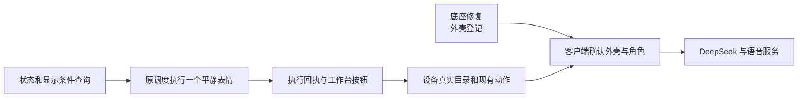

# 当前开发主线

更新：2026-11-05。

## 目标与分工

桌宠识别固定磁铁布局的外壳并提供身体事实；客户端确认外壳与角色的关系，管理人格、音色、记忆和演化；工作台负责表情与动作的制作、预览、绑定和发布。

## 当前进度

| 已完成 | 当前状态 |
| --- | --- |
| 官方身体与资源基线 | E1.42 交互已验收；E1.18 资源已迁至 8 MiB 活动区 |
| 阶段二工作台 | 节点、圆屏预览、角色草稿、打包与请求模拟完成 |
| E3b 设备连接 | 第二版已安装，身份、重启与重连检查通过；交互验收待测 |
| E3c-1—3 | 会话、应用/页面快照、USB 状态查询及电脑端管理完成 |
| E3c-4 | 显示条件查询，新增 34 项专项、共 212 项回归及双配置构建审计通过 |

## 最近的顺序

1. 在已完成的显示条件查询上，明确忙碌、主页和睡眠的处理规则。
2. 接入单个 `neutral` 表情请求；带请求编号、有效期、去重和回执。
3. 通过原串口所有者接入工作台，完成对话、菜单、摸头、睡眠唤醒回归。
4. 扩展设备表达目录和已有动作；底座修好后继续外壳档案。
5. 对接客户端角色确认，再接 DeepSeek 与语音服务。

E3b 人工交互、三分钟连续映射和 E1.45 新害羞表情按设备可用时间安排。完整安排见[开发计划](development-plan-20261104.md)，执行方法见[行动指南](development-pipeline-20261102.md)。
