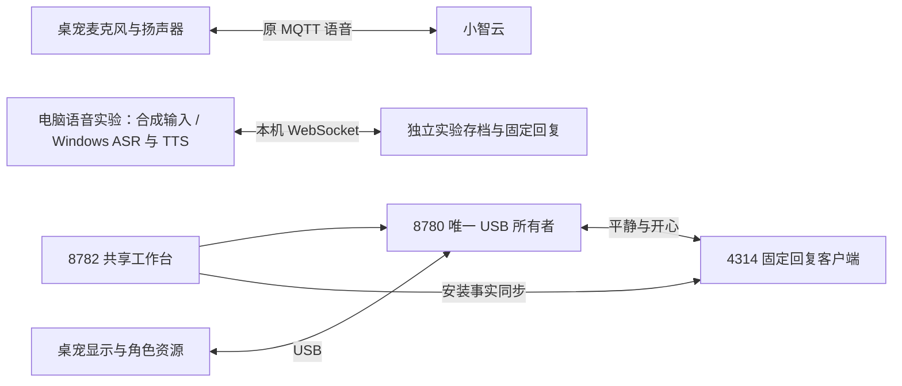

# 整体交付评估

日期：2026-11-18。核对两仓源码、启动入口、现场只读接口和既有验收报告。**当前处于系统集成阶段：身体表达有实机基础，统一交流、持续生活和实体成长仍需完整交付。**

## 目标与当前差距

首版面向主人与少量体验者：桌宠联网后即可相处；同一个体在平行世界生活，现实输入影响经历、偏好与愿望。新奇感来自它有依据的自主选择与长期变化，主人可以引导、讨论和暂缓。主人参与形象与外壳制作，安装后改变形态和表达，记忆、关系和能力延续。客户端负责生活与成长，本仓负责身体、表达、资源与制作接入。

| 用户任务 | 当前成果与证据 | 接续工作 |
| --- | --- | --- |
| 看见、触摸并与桌宠互动 | E3f-9d.3 与双角色资源包已实机验收；菜单、原小智对话、触摸、睡眠正常 | 新通信与音频负载下继续回归；补纯电池启动和持续运行观察 |
| 和同一个体自然交谈 | 桌宠语音仍走小智云；4314 使用固定回复；电脑中文语音实验通过 | 真人收音进入同一客户端，由真实模型回答，声音、字幕、表情与存档一致 |
| 让身体参与生活 | 本地交互、身体协议、传感回放和受限转头接口已有 | 实际触摸等事件进入客户端；客户端动作到物理执行及回执逐项联合验收 |
| 换壳后继续相处 | A/B 主人确认、双角色表情切换保存和安装同步已运行；人格与音色采用通过 110 项离线验证 | 把采用模块组合进实际启动器，配置有区别的示例，观察真实提示与音色生效 |
| 联网即可日常使用 | 已有日常旅程与部署设计；现场仍依赖电脑和 USB | 设备领取、常驻服务、联网恢复、安静、近况、找回原个体和实际费用 |
| 自主生活并形成愿望 | 客户端有世界、记忆、规则生活和认知实验模块 | 由客户端完成当前行为验收及持续生活验证，再联合验证可感知的经历与愿望 |
| 将愿望变成可安装新壳 | 工作台已有配置、素材、预览、打包和恢复；A/B 为模拟磁铁 | 硬件尺寸与公差、参数 CAD、可打印文件、试装、角色包和安装项目整链 |

之前把“固件搞定”“接入基本完成”用于概括整体，范围过大。准确说法是：显示与部分身体交互已验收，有限 USB 表达和安装同步已接通；其他能力按上表继续交付。

## 实际运行链路

本轮现场 GET 确认 4314 健康，模型为 `fake-llm-v0.1 / configured:false`；4314、8780、8782 在监听，8890 语音实验未运行。源码确认 4314 启动器使用 `scope:lab`、`timeMode:simulation`、`websocket:false`。请求时间取当前时钟，世界推进仍按模拟模式；健康响应只能说明该服务可访问。

开发仓的正式启动器已有 DeepSeek 配置、实时模式和生活调度，但未组合安装接收器与采用解析器。新采用模块在独立副本验证；旧 USB 启动器检查 4b1a 源码摘要，直接叠加新补丁会不兼容。下一轮应交付一个经核对的组合入口、依赖清单和迁移步骤。

电脑语音实验使用实际 WebSocket、Opus 与 Windows 中文识别／合成，输入为合成录音、模型为固定回复。它已验证协议和音频工具；桌宠真人收音、设备扬声器和统一记忆仍待联合测试。当前先收完整句子，再识别、回答与完整合成；流式识别和分句首段播放接续按延迟实测安排。

## 技术决策

统一的是**生活状态、会话和表达依据**。保留 ASR、模型、TTS 的独立接口，根据实际体验选服务。DeepSeek 是客户端当前模型候选，Windows 语音是实验适配；最终音色与部署方案需通过真人对照选定。常驻主机与语音服务一起选：Windows 系统语音依赖不能直接用于 Linux 主机。比较真人中文、噪声与回声、首段响应时间、打断和实际用量。

先核对现有小智云能否把完整交流送入同一客户端，并接收同一回答、取消和主动表达；本地尚无相应服务端权限与扩展能力证据。自管小智兼容网关作为已具原型的候选。路线小测应交付明确选型、迁移与原路径恢复方式。

固件已有 MQTT 与 WebSocket，当前配置优先 MQTT。接入需一起核对配置选择、鉴权、音频格式、`hello/listen/abort`、MCP、字幕表情和重连；现实验网关尚未覆盖真实设备完整消息。网络语音与 USB 表达共用表现调度，避免同一句重复执行；取消、睡眠与换壳沿用同一回合配置。固件改动量由这些联合用例确定。

本轮资源包为 7,249,690 B；8 MiB 分区余 1,138,918 B，距 7 MiB 建议线余 90,342 B。新增表现优先筛选、复用与替换。显示沿用已验收 PSRAM DMA、20 MHz、4,092 B 分块与队列 2，并在语音和网络并发下测量连续内存、延迟和刷新。

## 后续开发管线

| 顺序 | 交付 | 可观察的完成标准 |
| --- | --- | --- |
| 1 · 统一交流入口 | 锁定兼容客户端版本，组合原聊天、原存档、安装接收与形态采用；核对真实模型和语音路线 | 同一次文字交流使用真实模型与当前形态，保存回合及实际采用结果；重开沿用原个体。离线检查先用替身，真实模型另记录用量 |
| 2 · 桌宠联网交流 | 将真人收音接到上述服务，返回声音、字幕和表情 | 真机说话、追问前情、打断再说、断网重连、对话中换壳均接续同一个体；菜单、触摸、睡眠和显示回归通过 |
| 3 · 身体与日常版 | 接实际身体事件和受限动作；部署常驻服务与日常入口，完成主人／设备绑定、凭据和加密连接 | 关掉制作电脑后可交流；摸头事件与物理动作有实际记录；领取、安静、近况、服务重开和备份找回可完成；记录连续运行、延迟、资源与费用 |
| 4 · 生活与愿望联合体验 | 接入客户端已通过自身验收的生活与成长版本 | 离开返回可接续实际经历；多源输入带来有依据的不同选择和愿望，主人可以引导、讨论与暂缓 |
| 5 · 制作与实体采用 | 愿望方案、参数化模型、角色资源和安装项目串联 | 至少一件真实壳完成导出、打印、试装与确认；屏幕、麦克风、供电、转动空间和磁铁安装合适，表现及记忆接续 |

客户端自主生活独立推进，身体接口与其共同验收。结构测量、装配包络和 CAD 小样可同步准备；内容扩充、自动磁匹配与界面细节跟随实际需求安排。A/B 现有模拟基线继续用于 Demo，真实壳完成后重做拆装校准。

**下一项工程交付是第 1 步的组合运行入口与兼容验证**，随后接真机联网语音。当前 E3f-9d.3 继续作为身体交互基线。

## 如何判断完成

每次结果注明范围：模块离线验证、隔离联测、现场启用、完整用户任务验收。记录实际入口、模型、音频来源、设备与存档，以及对应版本。设备受理、交给播放器、保存和人工看见画面分别记录；测试数量用于说明覆盖范围。

首个统一交流验收：`真人发言 → 同一个体上下文与当前安装快照 → 真实回答 → 声音／字幕／表情 → 执行与取消结果 → 同一存档追问`。共同字段为 `character_id / device_id / installation_id / turn_id`。单一世界存档由客户端管理；语音与工作台按同一编号接续。

日常版再验证新体验者首次使用、纯电池与联网负载、换网、服务恢复、备份找回和多日低干预相处；核心体验版增加一件真实外壳的完整制作采用。工程联通、长期相处和成长价值各有自己的验收任务。

## 核对依据

- 现场只读响应、监听端口、两仓源码摘要与本轮修改前文档：[evidence.json](../artifacts/project-readiness-20261118/evidence.public.json)。
- 运行入口：[USB 客户端](../scripts/serve-client-expression-4b1b.mjs)、[语音实验](../scripts/serve-real-voice-lab-4b2b.mjs)、客户端开发仓 `apps/deskbot-service/src/index.mjs`。
- 接入范围：[交接契约](../integrations/client-handoff/contract.json)、[表达适配器](../protocol/client_presentation.py)、[身体事实协议](client-body-facts-v1-20261018.md)、[语音会话](../integrations/client-4b2a/voice-session.mjs)。
- 实机结果：[显示与双角色](display-clock-e3f9d3.md)、[USB 首环](../artifacts/client-expression-acceptance-20261117/report.json)、[安装确认](../artifacts/shell-installation-live-20261117/acceptance/report.json)。
- 离线采用：[110 项验证](../artifacts/client-role-adoption-20261118/report.public.json)；客户端生活以其 `documentation/development-baseline.md` 和 A3.6 记录为准，当前 R3-A 行为验收仍待完成。

本轮交付评估与主线校准，历史报告保留原版本结果。独立 AI 复核与文档检查归档于同一评估目录。
