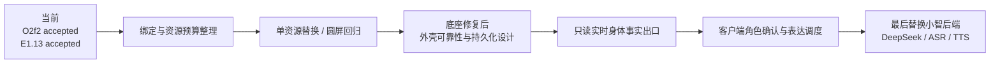

# 后续管线与阶段闸门 / Roadmap

更新：2026-10-23。目标是“外壳身份 → 用户确认角色绑定 → 客户端人格演化 → 身体表达”，不是在固件内实现人格 Agent。

| 阶段 | 交付物 | 通过条件 | 禁止越界 |
| --- | --- | --- | --- |
| 0. E1.13 收口 | 用户验收记录；必要时同范围资源回退 | 本体显示、圆屏裁切、菜单/对话并发、摸头、睡眠/唤醒已通过；底座触发另行验收 | 不扩大资源替换、不改播放器 |
| 1. 绑定清单 | 触发→语义→资源→布局/动作矩阵、保留/合并/待确认清单 | 动态回归覆盖必需行为；每项删除有静态与实测证据、回退 | 不因多个语义共用 Happy 就删除语义 |
| 2. 表达派生 | 原始 GIF/PNG/AI 母稿 + 兼容 EAF + 容量/像素对照 + 发布锁 | 当前播放器格式、内存、圆屏布局、包上限通过；每轮一资源 | 不直接导入不同编码播放器的整包 `.bin` |
| 3. 外壳可靠性 | 固定 A/B/C 布局训练/独立评估、移除/重装/运动/漂移结果 | 不确定不误绑定；重连与过期状态明确；数据分训练/评估 | 底座未修不伪造实测；随机位置是每壳固定布局 |
| 4. 登记与持久化 | 用户确认协议、版本化档案、校验、恢复/删除策略 | 断电与冲突测试；只保存必要事实；可导出回退 | 不让未知外壳直接改变人格 |
| 5. 实时只读出口 | 有界传输、会话/序号/快照/过期与契约测试 | 断线、乱序、重放、背压不影响 UI/音频 | 先不增加硬件控制与资源热更新 |
| 6. 角色表达接入 | 客户端角色 profile、受控表情/动作命令、仲裁和回执 | 与客户端共同验收；安全动作上限；不扰动 DOA/触摸所有者 | 不把离线 resolved 当设备已激活 |
| 7. 服务替换 | 客户端 DeepSeek、ASR/TTS、记忆与世界状态 | 流式音频、取消/打断、重连、鉴权、离线降级回归 | 不同时重写显示与电机/音频算法 |

## 资源策略

- 原稿保留完整质量；设备文件要小不等于压缩毁掉母稿。
- 先做无损去冗余与兼容压缩，再考虑帧率、时长、色彩/像素降级，并说明视觉代价。
- 当前 assets 分区保持 6,144,000 B，不靠扩大分区挤压 App、模型或 NVS。
- 必要表情及回退始终存在；资源名、映射、布局和动作具有独立版本。
- 只更换指定包成员并验证所有未改成员的摘要；禁止把新库整包当旧包直刷。

## 开发方法

每轮固定输入和边界 → 离线失败用例 → 独立构建/容量检查 → 独立用户授权 → 最小分区写入 → 全范围回读 → 启动日志 → 人工回归 → 更新状态。发布 Git 与刷写是两件事。本轮仅公开成果，不连接、不重启、不刷设备。

The production client is developed separately. Stages 5–7 require shared contract review and acceptance with that client; this repository does not claim an already connected DeepSeek/TTS pipeline.
