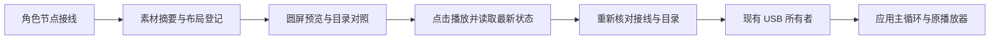

# E3f-6：角色节点与素材布局联动

更新：2026-11-10。

目标：角色接线、前后预览和设备播放使用同一套素材布局；进食显示完整画面，眼睛素材按原布局镜像。

## 设计

| 接口 | 处理 |
| --- | --- |
| 角色草稿 v1 | 继续保存“语义 → 素材”，兼容现有草稿 |
| 素材布局登记 | 复用 `expression-layout-requirements-v1.json`，核对文件名、SHA-256、宽高和模式 |
| 角色解析与总览 | 显式接入布局登记；逐项核对资源、播放参数、布局与附带动作 |
| 工作台预览 | 草稿按素材布局；设备按已核验目录；角色核对采用 E1.45 的 37 项留存目录；节点原连接继续显示 E1.18 历史布局 |
| 节点播放 | 复用现有连接所有者与点击后查询流程，发送前重新解析，每次点击一个请求编号 |

依赖：E3f-4b 工作台、角色解析器、布局登记、当前 E1.45 的 37 项目录。设备 E3f-5 / E1.45 已获主人验收；本轮服务切换和现场结果见[节点接入实机](role-node-live-e3f6.md)。

边界：布局按登记的素材内容选择；未登记素材沿用既有布局。原版本解析器保持历史结果，新版本显式传入布局登记和角色核对目录。旧快照作为历史事实显示，和当前草稿分别核对。角色、接线、目录、连接或页面变化时结束本次等待。播放能力仍以设备声明为准，附带动作单独显示。

## 验证

- 单元：完整画面、镜像单眼、不同眼高、素材或布局变化、旧快照及能力差异。
- 集成：生产 HTTP 接入内存连接，核对 37 项目录、角色总览、重复点击与变更取消；沿用原生目录和播放器回归。
- 浏览器：节点新旧预览、素材库、连续播放、等待后取消、角色总览，以及桌面和窄屏布局。
- 归档：测试结果和另一位 AI 的复核记录。

节点替换/撤销已核对；节点播放的画面与菜单已由主人验收，见[现场结果](role-node-live-e3f6.md#本轮结果)。下一步：常用表情接口 → 素材布局随包发布与独立动作 → 外壳和角色闭环。

## 结果与使用

- 145 项 Python / 原生测试、19 项播放流程测试通过。真实 E1.45 资源生成 37 项目录，核对全部角色接线，再验证六次混合请求与重复请求去重。
- 46 项浏览器检查通过，覆盖 1440 / 390 / 320 px、节点真实像素、替换与撤销、多次点击、状态等待和十种变更取消。
- 本机与公开版独立生成；E3f-5 / E1.45 的自动与日常交互验收通过，E3f-6 节点播放及主人画面/菜单验收也已通过。接续常用表情接口。

预览入口：[本机工作台](../artifacts/deskbot-studio-e3f6-20261110/index.html#editor)。静态打开可编辑预览；设备连接使用[本机服务](http://127.0.0.1:8776/#editor)。启动器为 `scripts/start-deskbot-studio-e3f6.ps1`，默认端口 8776；连接前先在原工作台停止 USB 观察，让同一设备由一个连接持有。节点已验收，现场状态见[接入记录](role-node-live-e3f6.md)。

验证材料：[最终测试](../artifacts/studio-role-layout-e3f6/offline-validation-2.json) · [浏览器](../artifacts/studio-role-layout-e3f6/browser-validation.json) · [独立复核](../artifacts/studio-role-layout-e3f6/peer-review.json)。
