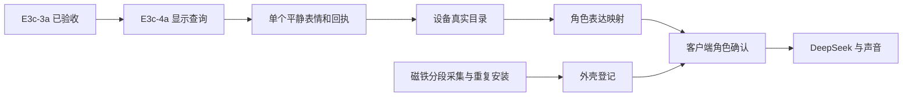

# E3c-4a：电脑读取显示状态

更新：2026-11-07。本轮完成离线准备，设备保持已验收的 E3c-3a 查询开启版。

## 做什么

让工作台读到播放器是否初始化、当前应用状态和页面。查询读取固定大小快照，显示、音频和底座仍由现有模块执行。实际睡眠状态记为未知。

旧 E3c-4 候选保留了旧 USB 输入路径。本轮从冻结源码组装：接收任务使用已验收 E3c-3a 的 `/dev/secondary`，再加入显示查询。循环保持每次读取一次、间隔 10 ms、6 KiB 栈、优先级 1。

| 项目 | 本轮范围 |
| --- | --- |
| 协议 | 已有会话增加 `display`，原 `state` 保持兼容 |
| 显示状态 | 播放器创建、释放时更新 8 B 镜像；查询时复制 |
| 源码 | 7 个文件，差异保存在本轮 `source.patch` |
| 构建 | 查询关闭、开启各一版，独立目录 |
| 比较 | 关闭版与 E3c-3a 的代码和数据相同；单列 ELF 摘要变化 |
| 容量 | 检查 App 余量、内部静态数据及保护产物 |

## 完成结果

查询关闭、开启两版构建与复核均通过。关闭版的代码和数据与 E3c-3a 相同，65 字节差异来自 ELF 标识、校验和与摘要。

| 项目 | 结果 |
| --- | --- |
| 开启版 App | 4,490,272 B，比当前版增加 1,040 B |
| App 分区余量 | 1,653,728 B，约 1.58 MiB |
| 内部静态数据 | 50,808 B，增加 8 B |
| 新增任务 | 0 |
| bootloader、分区表、模型、初始 OTA 数据 | 与参考产物逐字节一致 |
| 离线测试 | 113 项通过：显示与接收 51、部署 11、事务与恢复 36、磁铁采集 15 |

构建报告为 `firmware-build-report.json`；显示测试与部署测试分别为 `offline-validation.json`、`deployment-validation.json`，均在本轮公开结果目录。完整收尾结果见 [preparation-result.json](../artifacts/studio-display-e3c4a-20261107/preparation-result.json)。

安装计划已生成并离线核对：`tmp/e3c-live-20261107-e3c4a-offline/`。计划包含候选、原 App、完整参考快照及校验清单；App 扇区范围为 `0x10000..0x459000`，回退目标为已验收 E3c-3a 查询开启版。实机准备时刷新当下 NVS 和备份，恢复入口直接使用同轮保存的原内容。

## 离线入口

从实际 Git 根目录运行。Offline 预检给出 Python 3.13；Build 预检给出 ESP-IDF Python 3.11 和固定工具链。

```powershell
$DeskBotOffline = & .\scripts\preflight-deskbot-toolchain.ps1 -Mode Offline | ConvertFrom-Json
& $DeskBotOffline.offline_python.path -m unittest tests.test_e3c4a_display tests.test_e3c3a_usb_path tests.test_studio_display_query -v
& $DeskBotOffline.offline_python.path -m unittest tests.test_e3c4a_deployment tests.test_studio_app_deployment tests.test_studio_recovery -v
& $DeskBotOffline.offline_python.path -m unittest tests.test_capture_magnetic_states tests.test_split_magnetic_state_capture tests.test_compare_magnetic_state_capture -v
$DeskBotBuild = & .\scripts\preflight-deskbot-toolchain.ps1 -Mode Build | ConvertFrom-Json
& $DeskBotBuild.idf_python.path scripts/build-e3c4a-display.py --check
& $DeskBotOffline.offline_python.path scripts/deploy-e3c4a-display.py check --run e3c-live-20261107-e3c4a-offline
```

原生测试实际运行组合后的 USB 接收任务和状态存储，覆盖会话、显示查询关闭/开启、主页、菜单、说话中、未知/释放状态、分片与连续输入。详细构建结果保存到 `artifacts/studio-display-e3c4a-20261107/`。

## 下次实机怎么配合

代理先核对 COM4 身份、保存当下 NVS 与 App 回退材料，再执行本轮 App 安装和回读。你按以下顺序操作：

1. 静置 60 秒，然后点击唤醒、左滑菜单并返回 5 次。
2. 摸头 3 次，睡眠后再唤醒。
3. 代理依次单次查询 `open`、`state`、`display`，保存完整写入和回复耗时，核对主页和菜单状态；你重复一次菜单切换。
4. 连上原 Wi-Fi，说一句话，在它说话时和结束后各切几次菜单。

本轮通过后再加入单个平静表情请求，随后接真实目录和角色映射。

USB 的单字节读取测试显示一条请求可能超过 2 秒，电脑查询客户端当前等待 2 秒。实测每次发送一条，取得完整写入和回复耗时，再单独调整电脑端等待和轮询；回复等待与状态过期分别设置。

磁铁采集另做一轮：初始位置、上移、下移、移除、装回，各自保持静止至少 10 秒；代理逐段标记。现有未标记样本继续保留作原始记录。


