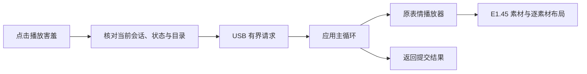

# E3f-5：在当前基线上接入害羞

更新：2026-11-10。

目标：电脑可连续播放进食、平静、害羞，圆屏按每个素材的尺寸与镜像方式显示。

## 实现

以已安装的 E3f-4e 冻结源码为起点，只开启已有的 `DESKBOT_STUDIO_SHY_REQUEST_ENABLE`。保留进食入口、逐素材布局、首帧重排、菜单显示完成处理和 USB 接收节奏。

| 接口 | 内容 |
| --- | --- |
| 电脑操作 | `operation: embarrassed` |
| USB 请求 | `play_expression`，`semantic_id: embarrassed` |
| 能力查询 | `expression_semantics` 增加 `embarrassed`，保留 `neutral`、`eat` |
| 原播放入口 | 应用主循环调度 `SetEmotion("embarrassed")` |
| 当前资源 | E1.45 的 `shy_candidate.eaf`，25 fps，循环；高 200 px 单眼素材，沿用双眼镜像 |
| 附带动作 | 沿用官方 `CAT_NUZZLE`（蹭蹭），工作台显示此提示 |

依赖：当前 E3f-4b 工作台、原请求适配器、E3f-4e 播放器和 E1.45 资源。使用冻结源码构建，工作区中的其他固件改动单独保留。

## 验证与交付

1. 开关双配置构建：关闭版与 E3f-4e 的代码和数据一致；开启版只增加害羞能力。
2. 单元测试：能力发布、重复请求、请求冲突、断连、超时，以及打开菜单或开始对话时的取消。
3. 集成测试：电脑请求进入真实 C++ 调度；核对 37 项资源目录及害羞绑定；回归进食、平静、害羞的首帧与镜像布局。
4. 构建核对：App 余量、内部静态数据、函数栈、依赖与保护分区产物；由另一位 AI 复核。

本轮交付固件、安装与恢复工具及验证记录。E3f-4e + E1.45 已通过主人验收；E3f-5 已安装并通过主人画面与日常交互验收。

## 本轮结果

- 211 项离线测试通过：三语义并存、连续回执、请求取消、目录、首帧及菜单显示回归。
- 30 项浏览器检查通过：当前 37 项目录、实际害羞绑定、连续播放、新鲜状态核对及三种屏幕宽度。
- 双配置构建通过：关闭版与 E3f-4e 逐字节相同；开启版只增加害羞能力。App 仍为 4,521,760 B，余量约 1.55 MiB，内部静态数据不增加，保护产物相同。
- 32 项安装与事务测试及独立复核通过。COM4 App 已安装，逐字节回读、NVS、其余 Flash、启动与周期身份通过；37 项目录一致，三项播放能力已发布。
- 进食→平静→害羞→进食四次请求均收到同会话设备下发回执。主人已确认本轮画面、菜单、对话、摸头和睡眠正常，见[验收记录](../artifacts/studio-shy-e3f5/manual-acceptance.json)；恢复目标为已验收的 E3f-4e / E1.45。

结果入口：[安装与恢复](studio-shy-installation-e3f5.md) · [现场结果](../artifacts/studio-shy-e3f5/live-result.json) · [下发回执](../artifacts/studio-shy-e3f5/live-dispatches.json) · [构建](../artifacts/studio-shy-e3f5/firmware-build-report.json) · [211 项测试](../artifacts/studio-shy-e3f5/offline-validation-4.json) · [32 项部署测试](../artifacts/studio-shy-e3f5/deployment-validation-1.json) · [部署复核](../artifacts/studio-shy-e3f5/deployment-peer-review.json)。历史报告保留原执行结果。

## 后续顺序

E3f-6 角色节点实际播放 → 更多常用表情与独立动作 → 外壳登记与角色切换。
