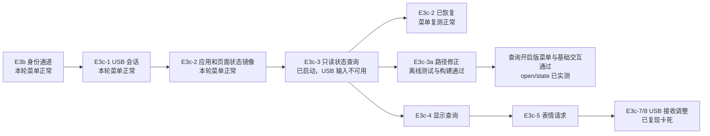

# 菜单卡死排查

更新：2026-11-07。

最新结果：E3c-3a 查询开启版联网滑菜单时画面停在主页；用户点击能听到木鱼声，说明触摸与页面逻辑已切换。切页后 41 ms 报 SPI TX DMA 缓冲分配失败，44 ms 报颜色发送失败；驱动却返回成功。无重启、panic 或 watchdog。详见观察记录（本机留存：`tmp/e143b-e3c3a-20261107-live1/observations/original-interaction-observation-v2.json`）和[人工验收](../artifacts/expression-continuous-mmap-e1-43b2-e3c3a-20261107/manual-verification.json)。

## 现场结果

| 版本 | 本轮操作 | 结果 |
| --- | --- | --- |
| E3c-8 | 开机后静置 | 用户反馈数秒后卡住 |
| E3c-7 | 静置、点击和语音唤醒，再左滑菜单 | 前三项正常，左滑后 UI 卡住 |
| E3b 第二版 | 静置一分钟、点击唤醒，再左滑菜单 | 用户确认没有卡住 |
| E3c-1 | 静置一分钟、点击唤醒、左滑菜单并返回 | 用户确认全程正常 |
| E3c-2 | 静置一分钟、点击唤醒、左滑菜单并返回 | 用户确认全程正常 |
| E3c-3 | 写入并正常启动 | USB 输入不可用，状态查询未进入；该版菜单未测 |
| E3c-3a 查询关闭版 | 静置、菜单往返、对话时切菜单、摸头、睡眠唤醒 | 用户确认正常；10 分钟日志未见重启或任务退出 |
| E3c-3a 查询开启版 | 静置 60 秒、菜单往返 5 次、摸头 3 次、睡眠唤醒 | 用户确认全部正常；设备离线，未测对话菜单；底座和 30 分钟回归未测 |
| E3c-3a 查询开启版，11 月 7 日联网补测 | 对话、点击、滑菜单 | 对话和点击正常；页面逻辑进入木鱼，画面未更新；日志记录 SPI DMA 分配失败 |

E3c-3 写入并启动后未能接收 USB 输入，随后恢复 E3c-2。查询关闭版和查询开启版的屏幕操作均通过；当前设备运行查询开启版。查询开启版 App 回读、NVS 和非 App 区域核验通过。后续只读探针已成功建立会话并读取 `state`；细节见[请求/回复记录](../artifacts/ui-menu-regression-20261106/e3c3a-state-reprobe-20261106.json)。底座首次被动记录见[COM8 记录](../artifacts/ui-menu-regression-20261106/e3c3a-base-passive-20261107.json)。维修后 COM8 无复位监听 20 秒未收到日志；这不能确认启动、复位或传感器状态，详见维修后监听记录（本机留存：`tmp/base-repair-validation-20261107/base-passive-observation.json`）。

E3c-7 现场日志中，任务看门狗两次报告 CPU 0 正在运行 `lvgl`。调用栈落在 `wait_for_flushing()` 显示刷新等待路径。这说明卡住时 UI 在等待刷新完成，具体引入原因继续通过版本对照定位。

## 对照顺序



每轮使用当时保存的镜像，只增加一个阶段。完成 App 回读和启动核验，再重复“静置一分钟 → 点击唤醒 → 左滑菜单”。相邻版本的实测结果确定后，审查对应源码差异并制作单项修复。

## USB 路径审计

E3c-3 的输入失败已定位到路径与配置不匹配：

| 检查项 | 本地证据 |
| --- | --- |
| 有效控制台配置 | UART0 主控制台，USB Serial/JTAG 辅助控制台 |
| 冻结接收源码 | 打开 `/dev/usbserjtag`，失败后退出任务 |
| IDF 5.5.5 注册代码 | 辅助模式注册 `/dev/secondary`，包含直接读取接口 |
| 保存的链接映射 | 辅助 VFS 初始化函数已链接，地址 `0x421d6f1c` |
| 当时启动日志 | 对应 E3c-3 ELF，报告 `USB input unavailable`；未记录 errno |

1,072 项保存源码核对通过，其中依赖锁仅替换了构建副本的本地触摸组件路径；关闭、启用两版的 18 项产物与历史报告一致。见[审计结果](../artifacts/ui-menu-regression-20261106/e3c3-usb-path-audit.json)。本轮只读取本地文件。

`stdin` 从主 UART 读取，直接打开 `/dev/secondary` 可读取 USB。下一候选从冻结 E3c-3 派生，只修正路径选择和启动诊断，保留原控制台配置、驱动归属、单次读取与 10 ms 让出节奏。

E3c-1/2 菜单通过时，USB 接收任务因路径不匹配已经退出。因此下一轮先让接收任务持续运行且不发请求，测试菜单；再建立会话、发送状态查询，重复同一操作。每阶段保存原有内部空闲内存与最低余量日志；当前版本没有 USB 任务栈余量输出，需要时再单独加入。路径修正对应输入问题，菜单卡死仍通过这些对照定位。

本地复核入口（Offline Python 3.13，无设备访问）：

```powershell
& 'D:\Program Files (x86)\Python\Python 3.13.0\python.exe' scripts/audit-e3c3-usb-path.py --idf-root 'D:\Espressif\frameworks\esp-idf-v5.5.5' --check
```

## E3c-3a 离线候选

基于冻结 E3c-3，仅修改 USB 接收文件中的路径选择和启动日志。69 个依赖组件按实际内容核对通过，原接收循环、6 KiB 任务栈和优先级 1 保持一致。

8 项专项测试通过：旧路径失败、辅助与主 USB 路径、打开错误、驱动所有者、空闲接收、连续输入让出 CPU，以及单字节请求。测试运行真实接收源码，底层使用电脑上的替代接口。单字节读取仍沿用旧节奏，一条会话请求超过 2 秒；接收提速作为后续独立增量。

| 配置 | App 大小 | 分区剩余 | 实机用途 |
| --- | ---: | ---: | --- |
| 状态查询关闭 | 4,488,224 B | 1,655,776 B | 先测试接收任务持续运行时的菜单 |
| 状态查询开启 | 4,489,232 B | 1,654,768 B | 再测试会话、查询与菜单 |

两版分别比对应旧版增加 80 B。有效 App 配置、bootloader 配置及保护产物均一致；查询开启版内部静态数据为 50,800 B，与对应旧版相同。本轮完成离线测试、双配置构建与报告复核；当时设备为 E3c-2。

材料：[单文件差异](../artifacts/ui-menu-regression-20261106/e3c3a-usb-path.patch)、[专项测试](../artifacts/ui-menu-regression-20261106/e3c3a-offline.json)、[构建审计](../artifacts/ui-menu-regression-20261106/e3c3a-build.json)、[部署事务回归](../artifacts/ui-menu-regression-20261106/e3c3a-deployment-tests.json)。

```powershell
& 'D:\Program Files (x86)\Python\Python 3.13.0\python.exe' -m unittest discover -s tests -p 'test_e3c3a_usb_path.py'
& 'D:\Espressif\python_env\idf5.5_py3.11_env\Scripts\python.exe' scripts/build-e3c3a-usb-path.py --check
```

### 安装准备与实机步骤

实测时直接使用[简版操作单](device-test-e3c3a-20261106.md)，其中包含用户动作、现场预检、被动日志和 E3c-2 恢复入口。

离线计划保存在仓库 `tmp/e3c-live-20261106-e3c3a-menu-off/`，编号为 `24c0bcc015c177d1fedc94e4f59b67b66ebe500edbae37bbf75c4cf7e612c160`。候选仅覆盖 COM4 App 扇区 `0x10000..0x458000`，回退目标为 E3c-2。当前完成离线准备，设备仍保留 E3c-2。

安装分三步：核对离线材料 → 现场预检 → 写入。现场预检读取当前前缀，核对完整 Flash 的设备端摘要，把当下 NVS 和原 App 存入独立目录；写前再次比较这份备份。恢复使用当轮备份和事务日志，候选文件及旧构建目录缺失时也可执行。

以下离线检查可随时运行：

```powershell
& 'D:\Program Files (x86)\Python\Python 3.13.0\python.exe' scripts/deploy-deskbot-studio-e3c3a.py check --run e3c-live-20261106-e3c3a-menu-off
```

以下两轮已执行完毕。第一轮通过；第二轮屏幕交互通过，但 USB 会话没有建立。表格保留本轮实际范围：

| 轮次 | 代理操作 | 用户配合 | 通过效果 |
| --- | --- | --- | --- |
| 1. 查询关闭 | 已写入路径修正版并完成回读、启动及 10 分钟日志核对 | 已完成静置、五次菜单往返、对话时和结束后切菜单、摸头、睡眠唤醒 | 用户确认全部正常 |
| 2. 查询开启 | 已写入；App 回读、NVS、非 App 区域和启动核验通过 | 静置、菜单、摸头、睡眠唤醒正常；离线未测对话 | 屏幕操作通过；后续 `open`、`state` 均完整匹配 |

查询关闭版仍是回退目标。离线菜单测试通过，联网补测已复现显示冻结。先完成[E3c-3b](display-dma-repair-e3c3b-20261107.md)显示修复，再继续联网回归和 `display` 查询。

部署入口新增 `check` 与 `prepare-live`：前者只读本地文件；后者从离线计划生成独立的现场事务。`prepare-live --run <新目录名> --from-run <离线目录名>` 与 `install --run <新目录名>` 连续执行，使用预检确认的 IDF Python。若改日再装，当天重新做现场预检。原始离线计划和现场计划分别保存。

## E3c-1 材料核对

- 1,068 个保存源码文件与原记录相符；依赖锁的唯一差异是构建副本的本地触摸组件路径。
- 69 个缓存依赖组件按文件内容核对通过；E3b 和 E3c-1 两种配置的 36 个保存产物与原报告一致。
- E3c-1 App 为 4,487,424 B，比 E3b 多 4,000 B；关闭会话功能后，可执行代码和其余数据与 E3b 相同。
- 本轮沿用原 App 部署事务，安装和恢复相关的 36 项离线测试通过。
- 历史 E3c-1 使用 `/dev/usbserjtag`，与当前辅控制台的 `/dev/secondary` 不同。它用于检查早期增量的菜单行为；双向 USB 能力在后续版本对照中验证。

公开[材料核对报告](../artifacts/ui-menu-regression-20261106/e3c1-retained-audit.json)保留镜像摘要与源码差异；现场材料位于 `tmp/studio-ui-freeze-20261105/`。历史构建记录保留原样，当前源码和旧镜像分别核对。

## 内部内存线索

从各版保存的 ELF 读取内部静态数据段：

| 版本 | `.dram0.data + .dram0.bss` |
| --- | ---: |
| E3b | 48,368 B |
| E3c-1 | 50,720 B |
| E3c-4 | 50,808 B |
| E3c-5 / E3c-7 / E3c-8 | 63,056 B |

E3c-5 比 E3c-4 增加 12,248 B。USB 任务另有 6 KiB 任务栈，动态分配与运行时最低空闲量也纳入对照。相邻版本实测将检验这些变化是否与菜单卡死同时出现。

## 后续顺序

当前先完成 E3c-3b、联网菜单回归与映射期间交互，再部署 E1.45；之后恢复显示查询和目录联调。以下 USB 与菜单记录保留其原测试范围。

1. `open` 和 `state` 已实机通过：每条请求完整写出，回复的 request ID、设备身份和 schema 均匹配；状态为主页待机。
2. 工作台请求 `display`，当前设备只提供 `state`。先复核 E3c-4 显示查询候选，再做单项实机测试。
3. 设备联网后测说话中和说完后切菜单，随后做 20 轮交互与 30 分钟运行。
4. COM8 已确认是 C61。底座修好后再次无复位监听 20 秒，没有收到日志；不据此推断传感器或复位状态。下一次用有界只读记录验证启动状态和磁铁移动事件。
5. 磁铁位置移动、磁场样本及本体收到的底座事件仍待实测；通过后继续外壳登记、动作绑定和客户端角色确认。

## E3c-3 准备结果

候选 App 为 4,489,152 B，分区余量 1,654,848 B。计划只覆盖 COM4 App 擦除范围 `0x10000..0x458000`，回退目标为当前 E3c-2；计划 ID 为 `3c46b073a32daa9d224740a23fdf9de6e8df2f6b0600f9ab5752f01d7e5a6e65`。见[准备记录](../artifacts/ui-menu-regression-20261106/e3c3-preparation.json)。

本次全片读取在 `0x1800000` 超过 180 秒超时。后续使用已保存的 E3c-2 完整备份，重新读取设备前缀并核对全片设备摘要，App 回退范围单独保存。准备结束后设备回到 E3c-2，收到 5 条身份消息；当时尚未进入写入阶段。之后的 E3c-3 写入、USB 输入结果及 E3c-2 恢复见[实机收据](../artifacts/ui-menu-regression-20261106/e3c3-live-result.json)。

## 执行笔记

- 旧构建核对保存的源码副本；当前源码核对当前清单。保留历史报告，不用新源码覆盖旧版本证据。
- 构建副本中的依赖锁先核对本地路径差异，再逐文件核对依赖内容。
- 历史依赖锁按原始字节复制，只替换本地组件路径并保留换行；文本重新保存会改变摘要。
- 构建和串口脚本使用固定 IDF Python 3.11；离线 schema 测试使用 Python 3.13。
- 离线计划保留当时配置；现场预检读取当前 NVS 并生成新事务，写前再次核对。恢复直接读取当轮原始备份和事务日志。
- 先核对接收任务确实启动，再测菜单；周期身份消息只证明输出链路。查询关闭与开启分两轮，单字节读取的原始耗时另行记录。
- 安装事务里的回退文件保存的是写入前的版本。E3c-2 安装事务中的回退文件属于 E3c-1；E3c-3 计划已单独核验当前 E3c-2 完整备份和 App 扇区范围。
- 备份输入与采集输出使用独立路径，启动前检查输出目标。超时采集目录保留失败记录，完整备份以文件长度、摘要和设备端核验结果识别。
- 上述首次准备阶段的读取失败与“未进入写入”是当时状态；后续实际写入 E3c-3 的结果另见实机收据。准备报告的 `flash_written=false` 仅描述准备阶段。
- 本轮第一次写前读取出现 USB 读包截断，随后芯片停止响应。未进入写入阶段；重新启动后已收到 E3b 正常启动及周期身份消息。
