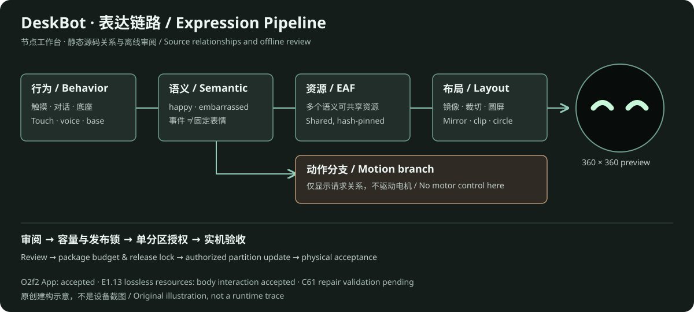

# 可视化导览 / Visualization Guide

[中文仓库介绍](../README.md) · [English overview](../README.en.md)

[E3c-8](deskbot-studio-e3c8-20261105.md)：USB 状态查询实机结果、恢复入口与接下来的表情验收。

**当前入口：[DeskBot Studio · E3c-6](../artifacts/deskbot-studio-e3c6-20261105/index.html)**。总览、节点编排、素材库、角色、设备连接和发布整合在同一个界面。通过[本机工作台](http://127.0.0.1:8766/#connection)查看实时状态、提交平静表情和读取设备回执；节点预览与资源包继续沿用现有编辑器。见[E3c-6 使用说明](deskbot-studio-e3c6-20261105.md)。

[E1.45 已选资源包预览](../artifacts/expression-e1-45-staging-20261104/index.html)：固定展示当前 Happy 与已选单眼镜像版、实际包容量和恢复范围。本机动态版位于 `tmp/expression-e1-45-staging-preview-20261104/index.html`。

[E1.44 害羞表情节点预览](../artifacts/expression-e1-44-adaptation-20261104/index.html)：当前 Happy、完整脸与单眼镜像分别展示，支持草稿接线、逐帧与循环。公开页含元数据及当前 Happy；候选动态媒体在本机 `tmp/expression-e1-44-adaptation-preview-20261104/index.html`。

## 打开工作台

以下页面自包含，不需要 npm、网络或设备，GitHub 文件页本身不运行 HTML：

```powershell
python -m http.server 8080 --bind 127.0.0.1
```

在浏览器打开 `http://127.0.0.1:8080/artifacts/expression-node-workbench-e1-4d-20261021/index.html`，或直接双击相应 `index.html`。本地服务器仅绑定回环地址，不作为客户端实时连接服务。

| 页面 | 用途 |
| --- | --- |
| [E1.40 成对容量启动实机结果](expression-capacity-boot-e1-40-live-20261030.md) · [机器结果](../artifacts/expression-capacity-boot-e1-40-20261030/live-result.json) | 仅 COM4 bootloader/App 写入、擦除范围回读、保护区/NVS 差异、OPI_STR 启动及用户本体验收；上半区 CPU mmap 与 8 MiB 资源迁移仍待验证 |
| [E1.39 显式 Octal 双构建](expression-octal-e1-39-20261030.md) · [审阅页](../artifacts/expression-octal-e1-39-20261030/index.html) | 对照 16/32 MiB OPI_STR 构建、完整 sdkconfig/生成配置、镜像段/ELF 变化、兼容别名、cache32 派生与新长度精确回退 | 离线构建/审计通过；32 MiB 镜像随后用于 E1.40 成对部署；参考资源不等于 E1.18 |
| [E1.38 寻址与精确回退](expression-addressing-e1-38-20261030.md) · [审阅页](../artifacts/expression-addressing-e1-38-20261030/index.html) | 区分物理 Octal / 镜像 DIO / 编译 QIO 自动识别；展示 App-only 容量限制、上半区 mmap guard、完整擦除扇区回退和可展开源码 | 离线完成；历史快照保留当时边界；之后 E1.40 已通过旧布局容量启动，CPU 上半区 mmap 仍未验 |
| [E1.37 N32R16 容量构建对照](expression-capacity-build-e1-37-20261030.md) · [审阅页](../artifacts/expression-capacity-build-e1-37b-20261030/index.html) | 两份实际构建、配置差异、可执行段/镜像头/摘要、保护产物及上半区缓存未开启的限制；离线通过，未刷写。后续物理 Octal 证据与容量作用见 E1.38；历史“Quad”措辞仅指编译路径 |
| [E1.35a 扩容预检与未来预算](expression-storage-preflight-e1-35a-20261029.md) · [审阅页](../artifacts/expression-storage-preflight-e1-35a-20261029/index.html) | 四份隔离构建、原 App 身份、双模型加载路径、资源软上限、档案存储预留及迁移/回退顺序；实机 mmap 和迁移待验，本轮未访问设备 |
| [E1.35b 原资源迁移与回退审计](expression-storage-migration-e1-35b-20261029.md) · [分区可视化与逐成员清单](../artifacts/expression-storage-migration-e1-35b-20261029/index.html) | 显示 6 MiB → 8 MiB 布局、旧 model/尾部实际覆盖边界、九段现场备份、资源成员摘要、只写三个目标的顺序；build-only 回退参考不等于设备镜像 |
| [E1.36 N32R16 容量布局闸门](../artifacts/expression-storage-n32r16-e1-36-20261030/index.html) · [报告](../artifacts/expression-storage-n32r16-e1-36-20261030/report.json) | 区分 32 MiB 物理 Flash、16 MiB 镜像/旧布局和 16 MiB PSRAM；对比旧基线、只改容量声明和上半区 8 MiB 资源候选；显示 ESP-IDF 分区表 round-trip、64 KiB mmap 页数和未分配范围。离线通过不等于启动或刷写授权 |
| [E1.35 存储策略与分区扩容](expression-storage-strategy-e1-35-20261029.md) · [布局对照页](../artifacts/expression-storage-strategy-e1-35-20261029/index.html) | 对比当前 6,000 KiB 与 8 MiB 候选资源区、模型后移、包余量、对称/非对称布局与小鱼资源归档；仅离线方案，未迁移或刷写 |
| [E1.31 多角色表情工作台](role-expression-workbench-e1-31-20261029.md) · [离线页面](../artifacts/role-expression-workbench-e1-31-20261029/index.html) | 按角色复制草稿、独立接线 29 个语义到 18 个官方 EAF、圆屏预览、共享审阅和 JSON 往返；E1.18 只读，导出不能刷写，不连接设备或客户端 |
| [E1.32 角色表达契约审计](role-expression-audit-e1-32-20261029.md) · [离线审计页](../artifacts/role-expression-audit-e1-32-20261029/index.html) | 对 E1.31 草稿检查身份命名空间、表达/动作分离、官方 E1.18 语义资源与布局、共享资源影响和拒绝用例；只读审计，不生成刷写包 |
| [E1.33 新动画导入与兼容性审计](expression-e1-33-import-20261029.md) · [公开离线页](../artifacts/expression-e1-33-import-20261029/index.html) | 对照当前已接线的 `Happy.eaf` 与尚未接线候选；审阅候选逐帧和官方 C 播放器的 full-screen/eye_anim 布局，以及计时器、素材来源、分区预算。素材媒体只在本机 `tmp/` 私有预览中显示；审计不生成刷写包 |
| [E1.34 候选预处理审阅](expression-e1-34-preprocess-20261029.md) · [公开元数据页](../artifacts/expression-e1-34-preprocess-20261029/index.html) · 私有动态图像页 `tmp/expression-e1-34-preprocess-20261029-preview/index.html` | 比较 13 项无损重编码、单眼裁切、full-screen/eye_anim 镜像、完整/局部帧范围、FPS 与分区预算。公开页省略候选图像；私有页仅供本机审阅。审计发现默认播放遗漏尾帧，不接线、不刷写 |
| [节点工作台](../artifacts/expression-node-workbench-e1-4d-20261021/index.html) | 选择行为，查看语义/调用/EAF/布局/动作的节点关系和圆屏预览；官方映射与候选覆盖分层 |
| [绑定矩阵](../artifacts/expression-binding-matrix-e1-9-20261022/index.html) | 统计复用、入口和待核对资源，作为清理/替换决策前的证据 |
| [压缩审阅](../artifacts/expression-e1-10-review-20261022/index.html) | 对照候选和资源压缩，检查画布、视觉和预算 |
| [E1.14 绑定决策](../artifacts/expression-binding-decision-e1-14-20261024/index.html) | 按资源或入口查看节点、独立动作分支、共享影响、保护分类与已验收容量 |
| [E1.15 单语义提案](../artifacts/expression-e1-15-surprised-shocked-20261024/index.html) | 对照 `surprised → shocked.eaf`、独立 `look_around` 动作、圆屏回退与容量投影 |
| [E1.16 真实包审计](../artifacts/expression-e1-16-repack-20261024/index.html) | 对照 E1.13 实际包、唯一索引变化、逐成员哈希、分区边界和精确回退 |
| [E1.17 官方 C 播放器审计](../artifacts/expression-e1-17-player-20261024/index.html) | 验证 `Happy.eaf` / `shocked.eaf` 的逐帧解码、计时器和圆屏布局兼容性 |
| [E1.18 资源部署回执](expression-e1-18-deployment-20261024.md) | 记录 assets-only 写入、完整回读、未改 App/分区表和启动检查；不替代用户实机验收 |
| [E1.19 表情节点预览工作台](../artifacts/expression-node-preview-e1-19-20261024/index.html) | 每个资源节点同时提供原始帧和圆屏合成预览；默认显示 `surprised` 的 E1.13 `Happy.eaf` 旧边与 E1.18 `shocked.eaf` 新边；可拖拽/点选接线，撤销并导出本地映射草稿 |
| [E1.20 映射审计报告](../artifacts/expression-e1-20-mapping-audit-20261025/report.json) | 消费 E1.19 草稿，核对官方 EAF 白名单、共享引用、动作/布局/FPS/循环、E1.18 基线、容量和精确回滚 |
| [E1.21 候选包与官方 C 播放器审计](../artifacts/expression-e1-21-package-player-20261026/index.html) | 将 E1.20 映射应用到 E1.18 实际包，比较 `Happy.eaf` / `shocked.eaf` 播放器结果，并验证 E1.18 精确回退；不写设备 |
| [E1.22 表情候选前后对照](../artifacts/expression-e1-22-candidate-preview-20261026/index.html) | 并排播放 E1.18 记录中的 `shocked.eaf` 与 E1.21 候选 `Happy.eaf`，可逐帧查看，并展示断开旧边、接入新边；动画为官方解码图集，不是设备实拍 |
| [E1.23 部署预检报告](expression-e1-23-deployment-preflight-20261026.md) | 精确比对 E1.13 候选与 E1.18 回退的完整 6 MiB assets 分区镜像、写入边界和 SHA-256；镜像保存在本机 `tmp/` |
| [E1.24 静态覆盖审计报告](expression-e1-24-coverage-audit-20261026.md) | 汇总语义、调用路由、官方 EAF 引用和视觉选择；区分静态覆盖与设备实际播放证据 |
| [E1.25 被动观测契约](expression-runtime-observation-e1-25-20261026.md) | 规定只观察 `SetEmotion` 调用的字段、24 条 RAM 环、合并窗口、清除和证据边界 |
| [E1.26 观察器实现与构建审计](expression-runtime-observer-e1-26-20261027.md) | 对照默认关闭/显式启用的完整本体构建、App 差异、资源/模型/分区不变量与后续部署闸门 |
| [E1.26 App 部署预检](expression-e1-26-deployment-preflight-20261027.md) · [实机记录](expression-e1-26-live-deployment-20261027.md) | 核对启用观察器 App、`0x10000` 写入边界、完整回读和受保护分区；COM4 App-only 已部署并通过用户本体回归 |
| [E1.27 表情调用快照工作台](expression-runtime-observation-e1-27-20261027.md) | 导入 E1.26 JSON 快照，统计调用并高亮 E1.19 语义节点；仅证明 `SetEmotion` 调用入口，不证明 LCD 播放或动作完成 |
| [E1.28 表情语义审查工作台](expression-semantic-review-e1-28-20261027.md) | 将 `happy`、`embarrassed`、`sleepy`、`neutral` 的入口、`SetEmotion`、EAF、动作请求和圆屏参考帧放在同一页；共享资源与动态入口单独标注 | 只读源码关系与参考合成；不证明 LCD/电机完成，不访问设备或授权刷写 |
| [E1.29 MCP 捕获链路工作台](expression-mcp-capture-e1-29-20261028.md) | 逐层查看成对 MCP 请求/响应、JSON-RPC、原始 text block、规范化快照与来源证明；合成样例可交给 E1.27 导入测试 | 离线合成样例，不是真实设备捕获；页面不联网，测试不连接设备 |

工作台主要 UI 为中文，仓库介绍可切换中英。没有承诺工作台本身已完成全界面国际化。



上图为原创架构示意，不是运行截图。公开工作台保留官方资源的圆屏预览；外部害羞研究候选的素材再分发许可尚未确认，因此只保留元数据和节点关系，画面位置显示明确占位，不包含候选图像或派生截图。原始本机研究文件不受影响。

## 阅读顺序

1. 在 Studio 总览查看整个链路，再进入节点页预览语义、动画与动作关系。
2. 当前连接、草稿连接和候选资源分别标记；共享动画可查看影响范围。
3. 角色页编辑映射，发布页核对资源版本、布局、容量与包编号。
4. 连接页显示设备身份；实时状态和表情按钮按 E3c 后续增量接入。

当前技术进展见[E3c-4 显示条件查询](deskbot-studio-e3c4-20261105.md)，完整顺序见[开发计划](development-plan-20261104.md)。各阶段页面保留当时结果；当前设备版本和验收状态统一见[基线](baseline-status.md)。
