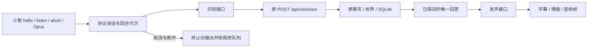

# 4b2a：小智语音协议与原客户端联测

2026-11-17。接续已验收的 [4b1b](client-expression-loop-4b1b.md)。本轮把语音协议接入原生活服务，下一轮接真实识别、发声与网络传输。

## 本轮交付

小智收音 → 转写 → 原客户端保存输入并生成回答 → 同一回答的字幕、情绪和 Opus 数据。取消、重新开始和重连会结束旧输出；主人已经说过的话和原生活记录继续保留。

本轮采用可替换传输的协议会话，自动测试使用内存收发端、固定转写和固定音频。原 Node HTTP、聊天、世界状态与 SQLite 使用实际实现。实际 WebSocket 服务、真实 ASR/TTS、设备接入和常驻部署接续实现。

## 接口与数据流

| 接口 | 约定 |
| --- | --- |
| `decodeAudio / encodeAudio` | 对照固件支持 v1 原 Opus、v2 16 字节头、v3 4 字节头；长度、类型、保留位和大小分别核对 |
| `session.receiveJson / receiveAudio` | 接收原 `hello / listen / abort`；收音限定 16 kHz、单声道、60 ms Opus；本轮用 `manual + stop` 确定一句话结束 |
| `recognize({packets, audio, signal, turn})` | 返回最终原文、清理后的文字及识别来源；空转写结束本轮，不生成聊天 |
| `client.ingestFinal({turn, transcript, signal})` | 只调用原 `/api/voice/asr`，冻结个体、设备、角色修订、会话及回合编号；原入口负责去重和生活上下文 |
| `synthesize({text, expression, signal, turn})` | 使用原回合已保存的答语；返回与下行 hello 一致的 24 kHz、单声道、60 ms Opus 包；测试替身单独标明 |
| `peer.sendJson / sendAudio` | 输出原 `stt / tts.start / llm / tts.sentence_start / Opus / tts.stop`；每次异步返回后重新核对回合代次 |
| `client.finish(result, turn, outcome)` | 仅收尾本回合、同设备的 `vocat` 命令。测试提交记录 `failed / protocol_fixture`，取消记 `turn_cancelled`；音频播放完成留待设备回执 |
| `client.recoverUnknown()` | 原 HTTP 回应丢失时保留首次请求，暂停新提交；按原编号取回结果并结束旧队列，恢复只收尾原回合 |
| `client.retryCleanup()` | 队列确认回应丢失时保留原结果和回执内容，暂停新提交；重试只补原确认 |

原客户端没有整轮取消接口；本轮取消作用于适配器后续输出和原队列收尾。模型请求已经进入原服务时，由原服务保存结果，适配器收到后结束旧命令。服务端取消及跨手机／设备统一代次在 4b2 后续接入。

## 会话与边界

- 设备和个体来自会话创建时的固定绑定；控制消息只核对当前服务端会话编号。新的连接替代旧连接，旧任务返回后只收尾原回合。
- 同一个体的连接共用一个原客户端适配器，HTTP 调用串行执行。新收音可结束旧输出；旧请求完成后再处理新的最终转写。
- `listen.start` 建立新回合，重复 `stop` 复用同一个完成任务。`abort` 和断开立即提高代次，旧字幕、情绪及音频停止发送。
- 首次收音固定回合编号和发生时间，首次最终转写固定内容；重试沿用原值。真实时钟下重复转写已接原 HTTP 验证。
- 识别、合成和发送各有截止时间；取消后独立结束等待。每个会话最多保留两项未收尾任务，失败时先停止发声再收尾 HTTP 队列。
- HTTP 结果未知时保存本进程内的原请求并暂停新提交，通过 `recoverUnknown` 接续。普通队列确认回应丢失时返回 `cleanup_failed`，适配器保留原结果，通过 `retryCleanup` 补确认；常驻版在 4b2c 接入持久提交账本与进程重开恢复。
- 每句最多 30 秒、每包最多 4 KiB、总计最多 256 KiB；控制文字和模型答语分别限制长度。协议错误保持明确错误码。
- 本轮只发送已有共同语义 `neutral / happy`；其他语义报告待映射，沿用已验收的资源、镜像和菜单调度。
- 小智现有协议没有逐段播放完成回执。协议测试记录内存端收到的数据，后续网络提交与圆屏、声音实测分别记录。

## 依赖与接续

使用已核对的 Node 24、固定客户端 `0d8d4c5 + 4b1a`、完整世界内容及契约。联测创建独立 SQLite，使用当前时钟和实验设备编号；原 4314 / 8780 服务继续提供已验收入口。

实际固件启动时 MQTT 优先于 WebSocket，原客户端 `/ws` 使用另一套桥协议。4b2b 接实际 WebSocket、真实 ASR/TTS 和 Opus 编解码，明确选择及费用；4b2c 完成主人绑定、设备配置切换与恢复；4b2d 做常驻部署和断连恢复，验证关电脑后可交流。随后 4b3 做相识、近况、安静与返回。

## 验证与归档

单元测试覆盖 hello、三种音频封包、错误长度、状态顺序、重复结束、空转写、取消时机、旧连接结果、输出上限和发送失败。集成测试启动原 Node HTTP 与 SQLite，核对唯一聊天、原世界计数、回答来源、队列收尾、重复转写及取消后新回合。

实现及测试保存在 `integrations/client-4b2a/`，结果归档到 `artifacts/xiaozhi-voice-seam-4b2a-20261117/`。代码完成后由另一位 AI 复核，再更新主线进度。

复测入口：使用已核对的 Node 执行 `scripts/verify-xiaozhi-voice-seam-4b2a.mjs`，自动生成测试报告和源文件摘要。

当前 36 项自动测试通过：29 项协议／会话单元测试，7 项原 HTTP／SQLite 集成测试。覆盖忽略取消的语音替身、发送失败先停止、HTTP 回应丢失、确认丢失、超时及按原编号恢复。包数、字节数与收音时间限制已核对；实际 Opus 解码、音频时长和声音在 4b2b 验证。
